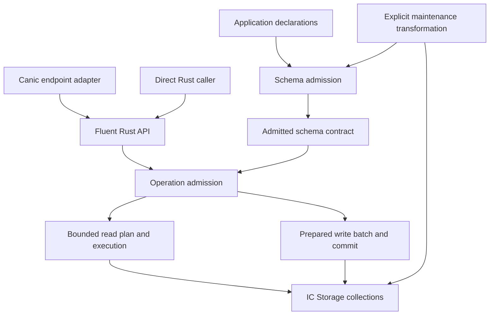

# IC DB system design

IC DB uses Storage 0.78.7 named stable-memory allocations and upstream stable collections. Storage owns its allocation directory codec. Version 0.78 rejects 0.77 backing. Existing data requires an export with the previous owner. IC DB owns its row, index and job codecs.

Status reviewed 2026-11-17: delivered engine scope includes the 0.19 maintained-count
hard cut and the 0.18 migration, sorting and comparison increments. Version
0.20 separates 16 KiB job frames from 4 KiB rows and improves console inspection
and local operation; it does not establish remote application support.
Canic owns remote application inspection and its endpoint qualification.
The changelog and Git tags record releases.
Application helpers can borrow a database directly or independently obtain a
`DatabaseSession` clone from their host. One attachment owns the storage lease.
A session query owns a handle and observes committed data at execution.
Explicit read-guard builders borrow their guard. A typed unique lookup uses a
generated named key with present components in declaration order and returns
an owned entity. The database owns this lookup. A store session takes one read
borrow and delegates to it, and a canister session selects the key’s declared
store. Session insert, replace and delete each submit one batch.
Changes that depend on each other share an explicit batch. A mounted canister session binds the batch to the store inferred from its entities. As in frozen IcyDB’s typed batch, generated inputs carry entity identity into preparation. The IC DB store type constrains every queued operation at compile time, and the existing store commit validates their combined final state. A batch takes
exclusive access only for the commit. A conflicting borrow
returns `BorrowConflict` before mutation. The last handle can return the database
to the host for maintenance. Frozen IcyDB `6d421e3` shared a store and request
root across sessions in `icydb-core/src/db/session/mod.rs`. IC DB keeps its
existing per-operation budgets. Like the predecessor’s `db/session/write/mod.rs`,
the session owns write ergonomics. Batch still owns validation and atomic mutation.
A host imposing cumulative accounting shares
one request allowance across helpers; it owns the request boundary and accessor. Database, fluent query,
maintenance and aggregate-job handles use IC Storage's target-default backing.
This follows the concrete backing used in frozen IcyDB `6d421e3`,
`db/schema/control_store/mod.rs`. Hosts still select named allocations at open.
Only installed fault probes substitute a backing to observe or interrupt supplier writes.

Native application tests can opt into `ic_db::testing::Fixture` with the
`test-support` feature. A named vector-backed allocation is retained across
database handles. Creation and reopen use ordinary schema admission and return
the engine’s errors. As in frozen IcyDB `6d421e3`’s
`db/diagnostics/memory_allocations/tests.rs`, rebuilding the runtime requires
fresh admission to the retained name. Installed probes own IC rollback and
upgrade qualification.

Persistent records, bounded fluent queries/resumable aggregates and identified
whole-database maintenance have product implementations and scoped native/Wasm
evidence. Broader capability coverage, operational limits and Canic integration
remain open; this is not a production-readiness or IcyDB-parity declaration.
Requested releases deliver public source to `dragginzgame/ic-db` and both product crates to crates.io;
live deployment and replacement of IcyDB are not. Written 2026-11-13.

Read sections 4–6 for contracts and supported mechanisms, and
[section 9](#9-delivery-and-deletion-gates) for current delivery status and gaps.
Section 7 distinguishes accepted scope from availability. Sections 10 and 12
retain dated measurements and research: their fixture-specific limits are not
claims about today's complete engine. Historical evidence is not silently
upgraded when an implementation gains another capability.

Maintainer decision (2026-11-13): freeze IcyDB's local checkout and GitHub
repository pending the IC DB experiment. Preserve existing committed/uncommitted
work, releases and data. Read-only research remains allowed; further edits,
commits, pushes, merges, releases or deployments require an explicit maintainer
decision to lift the freeze or authorize an exception. This records a work freeze,
not a GitHub archive/branch-protection change or an IcyDB retirement decision.
The separately authorized rename to private `dragginzgame/icydb-legacy` preserves
that freeze and the comparison revision; it does not authorize source changes.

IC DB explores a leaner rewrite of IcyDB for Rust applications on the Internet
Computer, retaining broad fluent query capability and familiar attribute-based
schema authoring. IcyDB supplies requirements, failure examples and useful
algorithms; its accumulated architecture is not a blueprint to reproduce.
Challenge inherited mechanisms and prove platform assumptions before building
infrastructure around them. This remains a separate experimental product.

Maintainer clarification (2026-11-17): some IcyDB features and abstractions were
mistakes or experiments that simply stayed. Their presence is not evidence of
best practice or an obligation to reproduce them. Assess each capability and
mechanism against current requirements and total responsibility, including work
moved to applications. Distinguish an observed legacy difference from accepted
unfinished IC DB scope; existing commitments still require an explicit decision
before changing them.

Section 10 records measured reductions for selected matched workloads. Those
results do not establish whole-product savings, universal safety or feature parity.

Accepted scope decision: IC DB exposes a fluent Rust API only. SQL is excluded,
not deferred; there is no separate public dynamic-query frontend. This decision
does not remove SQL from IcyDB or promise parity with its fluent operations.
The target is a broad, bounded, single-entity fluent query builder, including
grouping and distinct, with `#[entity]`-style schema authoring. SQL, joins and
window functions are explicit exclusions. This is a multipurpose database engine
specialized for the IC, with application-defined schemas and no built-in business
domain. Delivered fluent semantics and bounds are specified below; extensions
need equally explicit contracts. More code is
acceptable where it delivers useful coherent capability.

Schema changes use compiled, versioned maintenance transitions; general runtime
DDL and online schema activation are excluded. The implemented commit path has
no database-owned ordinary-write WAL (write-ahead log), relying on synchronous
bounded batches and IC message rollback. Product Wasm probes cover instruction
exhaustion, backing-write traps and growth refusal for selected workloads.
Maintenance persists its own bounded, transformation-specific progress.

Resumable aggregation is required within explicit bounds. Application result
mapping uses ordinary Rust iteration, not engine callbacks. The broad schema
type surface is retained unless a concrete reason supports a deliberate cut.
Hours-long maintenance is acceptable; copy space is an accepted cost in a system
that scales across canisters. Efficiency is judged against comparable IcyDB work.

## 1. Product contract

An application should define structured records, write them consistently, query
through useful indexes under explicit resource bounds, and reopen them after a
supported executable upgrade. It should be possible to understand which bytes
are authoritative and why a failed operation cannot leave contradictory records
and indexes.

The database owns row semantics, index/constraint consistency, query results and
its supported persistence transitions. The application owns authorization,
identity issuance, business transactions, tenant routing and cross-canister
coordination. The Canic adapter owns all product endpoint exports, guards,
transport and lifecycle composition. IC DB supplies no endpoint generation or
registration; its Rust library remains usable directly without mounting endpoints.
Standalone applications can expose their own endpoints through Platform's generic
guard/decode/encode hooks without Canic. The seven qualification hosts demonstrate
this with bounded Wire frames and no Wire Endpoint dependency. This does not add
endpoint generation to database macros. `make m0-endpoints` qualifies raw admission
refusals and reply-encoding traps, including persistence across an outgoing call
and rollback of the later callback's writes.

The target is a useful bounded embedded database, not PostgreSQL completeness,
a distributed database, a general workflow engine or a memory-backend framework.
The intended reduction comes from simpler mechanisms and explicit exclusions,
while preserving broad, application-neutral database capabilities. Exact API and
stored-format compatibility are not promised; no IcyDB retirement is authorized.

### Application-neutral qualification and secondary compatibility

The primary design inputs are accepted database capabilities, IC execution and
storage constraints, and applicable IcyDB lessons. No application's current usage
defines the product's schema, architecture, capability ceiling or milestone order.

Use small synthetic schemas and workloads to exercise independent obligations:

| Workload family | Required evidence |
| --- | --- |
| Typed records and atomic writes | Key ownership, nested/optional values, indexes, uniqueness, references, final-state batches and unchanged reopen |
| Filtered, ordered enumeration | Compound/range access, residual predicates, projection, ties, sparse pages, byte/work bounds and live updates |
| DISTINCT and aggregates | Selected tuple equality, grouping, group filtering/order, empty input, high cardinality and bounded exact resumption |
| Schema evolution | Encoding/index changes, admission, identified transformations, cross-chunk constraints, recovery and allocation reuse |
| Composition and scale | Multiple unrelated schemas, entity/index counts, query shapes, mapping closures and separately mounted host adapters |

Vary data distributions and operation combinations, including rejected and
adversarial cases; no one fixture establishes generality. Small probes choose
mechanisms at M0. The delivered engine qualifies supported combinations in M1–M3.
Independent expected results and declared bounds are required. IcyDB's tests and
history provide further failure cases to rederive, not an automatic obligation
to restore every historical mechanism.

The private [Toko repository](https://github.com/dragginzgame/toko) on GitHub is a
tier-2 compatibility target: its application needs should be accounted for, but
they do not guide the architecture. Inspect it read-only at recorded revisions
when assessing coverage. Translate any gap into a generic capability or an
explicit application integration consequence; do not embed its business model,
copy its schema into the engine, or cut capabilities it does not happen to use.
Toko compatibility does not override the accepted SQL/join/window exclusions.
It is not a prerequisite for specifying generic capabilities or starting M1.

For the current `toko-new` signup experiment, the maintainer accepted a fresh
start for `user_hub` and `user_shard`. Fresh stores use the named `DisplayName`
and the hub’s `Pending`/`Ready` status. Migration from the earlier text-name
and boolean-ready layouts is outside this integration’s scope. Opening an
existing store still requires an exact schema match.

The deleted local Toko checkout was obsolete. Earlier conclusions drawn from it
are superseded and must be rechecked remotely before making compatibility claims.
Do not restore or consult that checkout. This source decision does not change the
independently selected Toko Tooling engineering baseline. No Toko modification,
publication or deployment is authorized.

## 2. Complexity budget and exclusion rules

Every subsystem must name its consumer or accepted product capability, one
authoritative owner, introduced state, failure it prevents and executable
acceptance witness. Each persisted
field needs a writer, reader, invariant and retirement rule. A cache must name
its invalidation owner and remain disposable.

Start without these inherited mechanisms:

- A universal core with mandatory model/view/ops/workflow/adapter layers.
- Separate mutable schema authorities for generated declarations and runtime use.
- Additional query frontends alongside the fluent Rust API.
- SQL parsing/binding/lowering, SQL command caches and text-result conventions.
- General runtime catalog editing and online schema activation.
- Ordinary-write WAL, replay and checkpoint machinery unless M0 proves a gap.
- Joins and window-function execution.
- General backend-neutral storage traits without a second required backend.
- A universal resumable-job interpreter for unrelated database operations.
- Automatic repair/reconciliation of unknown or obsolete persisted formats.
- Generic access-plan conversions, positional side arrays or repeated expression
  normalization unless their semantic or measured execution benefit is shown.
- Plan caches, exact-count acceleration, compiled constraint machines and broad
  generated adapter families as prerequisites for the first useful database.
- Multiple release groups, custom receipt frameworks or native tool packages
  before the corresponding product has a delivery requirement.

Distinguish feature deferrals from accepted enduring constraints: ordinary atomic
writes fit one synchronous message, schema changes use explicit maintenance, one
required storage supplier owns backing mechanics, and access is fluent-only with
no SQL frontend. Additions must preserve this advantage or explicitly justify
surrendering it. An accepted broad fluent capability is sufficient product need;
absence from a particular application is not a reason to cut it. Reintroduction of a mechanism requires
a concrete need and comparison with the simplest correct
alternative. Specialized execution is allowed when Wasm/instruction evidence
justifies it. Fewer lines alone do not justify slower execution or weaker guarantees.

## 3. Ownership and dependency direction



Arrows are responsibility boundaries, not a mandate for a crate per box. The
product has the `ic-db` runtime/facade with internal modules and a small
`ic-db-macros` procedural-macro crate, re-exported through `ic-db` so applications
use one public entry point. Do not recreate
separate core/model/schema/diagnostic packages without an actual boundary need.
The runtime depends on IC Storage, Platform Types and the scalar/hash libraries
selected in its manifest; it owns database semantics and durable codecs. The
independent `qualification/` workspace contains the Wasm probes and fixture CLI;
no product dependency may point back into it. Endpoint generation belongs to the separately
owned Canic adapter; qualification exports are private experiment controls.
The required native CLI is a separate client boundary, not part of the Wasm
executor. Its executable currently lives with the qualification driver and reads
a local M1 fixture; add the product CLI package when the real adapter contract exists.

| Owner | Authoritative responsibility | Not its responsibility |
| --- | --- | --- |
| Admitted schema contract | Entity/field/index identities, types, layout and the selected format | Business ownership, competing generated/durable authorities |
| Row storage | Current records and their admitted encoding | Automatically accepting a changed Rust type |
| Index maintenance | Derived index entries consistent with committed records | Independent business facts or a separate schema authority |
| Read admission/execution | Bound semantics, access choice, resource limits and continuation | Caller authorization, background repair |
| Write admission/commit | Bounded mutation set and atomic row/index outcome | Cross-canister transactions or network calls |
| Maintenance | One selected source-to-target transformation and its recovery | Concurrent online DDL, generic background work scheduling |
| Canic adapter | Endpoints, guards, transport, lifecycle ordering and operational access | Query semantics or independent database state repair |

IC Storage owns allocation handles and collection/backing mechanics; IC DB owns
cross-record and cross-index invariants. The supplier boundary must be proved,
not inferred from the word "storage". Do not recreate Memory/Storage layers merely
to reproduce old package boundaries. Qualification borrows PocketIC's original
async client through Testkit with default features disabled; an explicitly
prepared command launcher owns the server process.
Instance deletion is explicit and best-effort, not a new IC DB lifecycle layer;
Build owns generic Wasm build mechanics. Choose their current published versions
when an experiment actually needs them, not speculative pins in this design.

Keep generic typed code at small boundaries: builders, codecs and result
conversion. Prefer shared concrete planning, traversal, grouping, distinct and
commit machinery, so each entity, closure type or fluent chain does not instantiate
another complete executor. Avoid encoding every fluent chain in nested executor
types. Ordinary application `.map()` closures should not specialize database
execution. Do not mandate boxing, a universal iterator or dynamic dispatch
everywhere. Reuse existing IcyDB performance lessons; specialization needs measured
Wasm/instruction value, not another speculative optimization framework.

## 4. Schema and identity: challenge the persisted catalog

Keep the current attribute-owned entity/record declarations with empty struct
bodies. After reviewing the annotated-struct experiment, the maintainer selected
the existing style for readability. Alternative forms are optional future work.
Blanket source compatibility is not required. Macros generate the compiled contract,
typed field references and necessary codecs/accessors. They do not generate a
second schema authority or host endpoints. Review individual attributes against
their retained responsibility; this is not blanket source compatibility with
IcyDB's existing options or generated artifacts.

Like frozen IcyDB `6d421e3` (`icydb-model-macros/src/node/schema_reference.rs`),
each entity exposes an uppercase associated constant for every authored field.
Application Rust uses `User::ID` and `User::NAME` across the existing fluent
methods. IC DB emits static logical names directly; the same admission path
validates fields supplied at runtime. The constants carry no ordinal or stored
identity. Field spellings that generate the same constant are rejected.

### Authoring and inspection contract

Keep field definitions inside the entity attribute. Latest maintainer direction:
do not require authors to allocate numeric field, entity, index or schema-key IDs.
Use resolved types and field paths, derive unambiguous names, and allow meaningful
explicit names where selection or stable identity needs them. Keep any compact
numeric physical handles internal. Record primary-key values are application data
and are unaffected by this authoring decision.

This supersedes the earlier acceptance of explicit entity/index IDs and is now
implemented for scalar entities. The default logical entity name is its Rust type
name; optional `name = "StableName"` preserves identity across source renames or
disambiguates types with the same short name. Rust module paths remain build-time
resolution metadata, so host and Wasm crate roots do not change stored identity.
Index names default to their ordered field names joined by a comma, for example
`"amount,id"`; optional `name = "by_amount"` overrides that identity. Names are
1–64 UTF-8 bytes. Longer derived names require an override. Two indexes on the
same fields require distinct names; uniqueness and membership remain part of each
index's complete contract. No numeric authoring ID syntax remains supported.

References name their target Rust type. Select a declared unfiltered reverse index
leading with the reference field when unambiguous; use `index = "name"` to select
among multiple candidates. Missing/ambiguous paths refuse during macro expansion;
missing target declarations refuse schema admission. This does not create indexes
or authorize unbounded reverse scans. For example, `references(entity = "User")`
uses Rust resolution, including imports and `Self`.

Full logical names define the contract. A const FNV-1a/32 of each name supplies
compact internal storage handles; admission rejects collisions among entities or
among one entity's indexes. Handles never substitute for full-name admission,
including reference targets. This avoids a durable assignment registry while
retaining the compact physical prefixes. The grammar is version 2; old numbered
contracts refuse intact. There is no automatic migration or data recreation.

Schema declarations use the design prelude as described in the [schema authoring rules](../../README.md#schema-authoring-rules). The implemented scalar spelling is:

```rust
use ic_db::design::prelude::*;

#[entity(
    store = RecordsStore,
    pk(field = "id"),
    index(fields = ["amount", "id"]),
    fields(
        field(name = "id", value(item(prim = "Nat64"))),
        field(name = "category", value(item(prim = "Text", max_bytes = 64))),
        field(name = "amount", value(item(prim = "Nat64"))),
        field(name = "note", value(opt, item(prim = "Text", max_bytes = 512))),
        field(name = "published", value(item(prim = "Bool")))
    )
)]
pub struct Entry {}
```

`Entry` is synthetic application code, not an engine-owned entity. Its fields,
types, limits and index are example choices using the implemented attribute syntax.
Field names are the field identities within their owning entity or nested record;
duplicate names refuse. Authors supply no numeric field IDs. Canonical contracts
include the exact names, never declaration positions, inferred numeric identities
or a hidden assignment registry. Renaming a field changes the contract and requires
an explicit supported transition; do not silently infer a rename from similar
types or names. Reordering declarations is compatible only if the selected codec
preserves the stored layout. Entity/index authoring follows the name/path policy
above; existing numeric contracts remain identifiable and refuse intact.
References resolve to the target identity and complete key contract.
Codec, comparator and supplier versions remain part of the canonical contract;
an entity ID alone never authorizes reading changed bytes.

The disposable comparison compiled both styles with matching inspection and typed
keys; it did not establish codec correctness, constraint enforcement or Wasm savings.
It is retired following the maintainer's readability decision. Retain one authoring
path, without a mandatory second DTO or compatibility frontend. Attribute removal
is permitted when justified: tell the maintainer which attribute is removed, why,
and which behavior changes or moves elsewhere. Keeping the familiar declaration
style does not require importing IcyDB's generated runtime or endpoint machinery.
Generated Rust values still require write admission, including managed-field checks.

Maintainer clarification: retain IcyDB's two-stage schema path expansion and
host-side `ctor` registration for the richer schema graph. The first stage emits
typed Rust references and canonical path metadata; Rust resolves those references
rather than the procedural macro guessing module/import resolution. Constructors
collect the compiled schema nodes in the host build; the second stage validates
and seals the complete graph before generating the database artifacts. Registration
order must not determine schema identity or stored layout. Keep duplicate/missing
node and invalid-link checks, and keep this collection machinery out of deployed
Wasm. This is build-time authoring infrastructure, not a durable runtime catalog.
Adapt the frozen
[path and constructor emission](https://github.com/dragginzgame/icydb/blob/6d421e3601a3d71e42af23ea5fe6b168cb6ef2ac/crates/icydb-model-macros/src/node/traits.rs)
and [graph collection/sealing](https://github.com/dragginzgame/icydb/blob/6d421e3601a3d71e42af23ea5fe6b168cb6ef2ac/crates/icydb-model/src/build/mod.rs),
without importing endpoint generation or runtime schema reconciliation.
Rust resolution paths and durable schema identity remain distinct: map resolved
nodes to their declared schema names/identities under the compiled-contract rules.
The scalar entity slice now implements both stages. `Entity::declaration_path()` carries the
compiler-resolved declaration path; typed reference spelling such as
`references(entity = "Entry")` uses the target’s macro-private logical name and its derived
handle, independently of the target descriptor, so self/cyclic relationships do
not create recursive constant evaluation. Numeric target IDs are no longer accepted. The optional native-only `ic-db/build` feature collects nodes
using `ctor`. The registration helper expands to a constructor in a compiled
host build. Its private function pointer binds the authored type before the
linker macro expands. This keeps ctor’s platform diagnostics on generated code
with the editor’s default Cargo configuration. Generated fields and codecs are shared.
The private generator selects a module
subtree, validates it through the existing `Schema::new`, seals registration and
emits typed schema assembly with an expected fingerprint. The target compiler
resolves the emitted types. The target checks their fingerprint when the schema opens.
For canister-local declarations, `ic_db::build_schema!()` selects `src/schema` in
the package-root build script. A shared schema crate calls `ic_db::build_schema!(model)` in its own build
script and `ic_db::include_schema!()` in its library. The generator discovers the declarations in that tree and follows each entity's
typed store link and each store's typed canister link. This restores the
ownership invariant from IcyDB `6d421e3` (archived generated entity,
`docs/design/archive/0.61-entity-macro-cleanup/generated.rs`, lines 826–827).
A store has one IC Storage stable key and one validated entity schema.
A canister exports a roster of these keys and schema constructors. The host
attaches a session for each entry. Typed canister queries and single-row writes
select the session using the entity’s declared store. Legacy IcyDB `6d421e3`
resolved store paths through `icydb-core/src/db/registry/registry.rs`; the
compiled roster supplies the position directly here. Positions exist only in the
running executable. Explicit batches and reference checks belong to one store. Module
moves and re-exports preserve membership. References stay within their store;
named value types can be shared. These links add no bytes to the row or schema
fingerprint. The host owns grants, installation and reopen policy. The producer checks target
membership at compile time and checks the descriptor fingerprint at admission.
See the [single-tree producer and consumer proof](../../qualification/experiments/schema-owner/README.md).
An admitted `Schema` can be cloned for host-owned reuse: it contains immutable
executable metadata only. Generated assembly validates the host/target fingerprint
once per thread, retains that immutable schema and returns clones. It never caches
database admission. The local M1 host also retains supplier runtime custody; each
call still opens a fresh database/collection lease and reads the current manifest.
Revisions are validated by operations that need them, as described below.

The M1 records schema library compiles the same declarations in its host build
script and target library. The Wasm canister imports its compiled schema. It exercises
a cross-module re-export and an optional self-reference with an unchanged golden
fingerprint. Native checks adapt IcyDB's order-independent assembly, duplicate
registration and late-registration cases; missing targets and unresolved Rust names
refuse. Wasm record/rollback/upgrade checks pass. The ctor dependency and collection
state are excluded on Wasm even if the build feature is selected. Workspace
`unsafe_code = deny` permits ctor's narrowly generated host internals; the runtime
and macro implementation crates retain `forbid(unsafe_code)`. No hand-written
unsafe code or extra product crate is added. Named record/payload-enum links now
participate through the same pipeline and bounded graph traversal described below.
This does not complete the broader type surface or prove composition growth costs.

| Generated or shared surface | Initial responsibility |
| --- | --- |
| Concrete entity and key types | Typed values; composite keys preserve declared component order; optional absence remains explicit |
| Typed field/index references | Construct admitted fluent operations; no specialization of the complete executor for each chain |
| One compiled descriptor | Stable identities, display names, types, bounds, keys, references, write ownership and semantic versions |
| Row/key codecs | Exact bounded encoding under that descriptor's contract; no lossy numeric coercion |
| Shared inspection | Project the compiled descriptor and separately report durable manifest admission/maintenance status |

Prefer one public macro emission contract through the `ic-db` facade; internal
host-build collection and target emission may remain separate stages. Do not require
separate user-facing schema-only/runtime import modes or generate insert/patch/replace helper
families before their distinct input contracts require them. This is a generated
surface choice, not removal of insert/update/delete or managed values. Defaults,
generated keys and timestamps must retain explicit ownership in write admission.
Canic endpoint definitions, guards and transport bindings stay outside these macros.

`db schema` must eventually show each entity's name and stable ID; field names,
types, optionality and bounds with units; ordered primary/index components,
uniqueness and supported predicates; reference targets; and declared default or
managed-field policies. The same response reports executable contract identity,
stored identity and admission/maintenance state. Display labels come from the
executable, not a separately editable durable catalog. On mismatch, label the
compiled description as unadmitted; do not claim it describes unknown stored
bytes or reconstruct a missing manifest. Inspection must remain bounded and use
the host's authorization policy. The current M1 console renders structured compiled
metadata from its local host; full deployed inspection remains implementation work.

M1 acceptance includes compile failures for duplicate field names/other identities, unknown index
fields, unsupported key types and contradictory declarations; round trips of
typed optional/nested values; identical descriptor meaning in typed access and
inspection; and refusal of field renames without an admitted transition. Other
source renames preserving explicit logical names reopen only when encoding/semantics
remain compatible.
The original native identity probe supports the sensitivity rules only. Product
macro/runtime integration has its own generated-schema, reopen and codec witnesses;
the probe is not a substitute for those checks.

### Compiled authority and durable admission

The deployment-defined starting contract creates an opportunity to avoid the
full persisted dynamic catalog, not merely to rewrite its reconciliation code.
The implemented path uses **a compiled canonical schema admitted against a minimal
durable format manifest**. Do not automatically
inherit IcyDB's accepted-snapshot architecture as a requirement of the new product.

The compiled schema owns the current executable's type and operation semantics.
The durable manifest identifies the database incarnation, admitted format/schema
identity and physical collection/layout identities needed to open its records.
The 0.19 hard cut uses live format `ICDBMF02`, frozen-maintenance `ICDBMT02`
and copy/retired `ICDBCP02`. These physical-format versions admit the 16-byte
entity revision/count record; schema declarations and their canonical fingerprint
are unchanged. Prior formats refuse intact, including in-progress maintenance.
The maintainer explicitly waived an old-format converter for this experimental
cut. There is no automatic reset, backfill or historical reader.
Its purpose is admission, not a second editable copy of the schema. Exact schema
identity must cover every behavior relevant to decoding and index consistency;
its definition cannot be just a source name or an unstable Rust hash.

Ordinary access opens only when executable and manifest are admitted together.
A missing/corrupt manifest is an error, never permission to reconstruct it from
generated types. A mismatched executable cannot reinterpret old bytes or silently
accept new declarations. Fresh initialization requires a proven fresh backing.
Typed accessors reference the admitted compiled contract; there is no recurring
proposal/reconciliation/candidate-publication pass on ordinary startup.

For M1, select SHA-256 with the domain prefix `ic-db:schema:v1\0` over the bounded
canonical contract bytes. Retain the full 32-byte fingerprint in the minimal
manifest, without a second competing schema hash. The compiled schema producer
computes it; reopening compares the admitted identity before row decoding.
This identifies a contract, not an authorized caller or a checksum of every row.
Follow the shared hashing policy's approved SHA-256 default; do not use a Rust
type name, `DefaultHasher`, inferred field number or truncated digest as authority.

The canonical contract includes field names and type/size rules, ordered primary
and secondary key components, constraints, semantic versions and supplier-format
identity. Sort entity/index identities and field names canonically while preserving
key component order. Explicitly encode lengths and tags; reject duplicates and
dangling references before hashing. The native witness now covers primary-key
changes and an independent SHA-256 vector. Its small grammar is not the complete
product contract. The grammar below settles what those encodings must identify;
the product's exact tags and byte vectors must be fixed before M1 persists them.

IC DB owns durable row encoding and decoding, independently of transport formats.
The default product excludes IC Wire. The optional `wire` feature describes
application payloads using the existing binary Serde layouts. The schema author
selects the declarations included in inspection. As in frozen IcyDB `6d421e3`’s
0.277 Wire trial, the host owns endpoint transport. IC DB supplies type metadata
without adding endpoint registration or changing the durable contract. Generate storage traversal in canonical
field-name order so names need not be repeated in each row; keep primary/index key
encoding separate because payload byte order does not establish index ordering.
A field rename still changes schema identity. Database admission enforces field
and whole-row bounds; codec changes require an explicit contract version and
supported transition. Public schema values also implement Serde for endpoints
and other application formats. This representation is independent of storage
admission. For example, a timestamp carries signed milliseconds to a serializer
while the row encoder writes eight little-endian bytes. ULID follows frozen
IcyDB `6d421e3`, `icydb-schema/src/atom/mod.rs`, for human-readable text and
uses a fixed binary array to match Toko’s existing endpoint adapter. Serde
decoding enforces intrinsic scalar invariants. Writes enforce field and row bounds.

The earlier fixed three-field Wire candidate probe checks literal bytes, absent/empty distinction,
integer extremes, UTF-8 byte bounds, schema-before-payload admission, truncation,
unknown framing, trailing bytes and four Wire work limits. It is native evidence
using Wire 0.22.1, not a production frame, generated codec, rich-type proof or Wasm
budget. Wire can accept noncanonical primitive encodings; never decode/re-encode
an external byte sequence to establish its original identity. These checks do
not detect every valid-value bit change or establish a row checksum policy.
That historical probe does not select Wire for product persistence. The current
small scalar codec belongs to IC DB; IC Storage owns backing collections.
Frozen IcyDB's
[persisted scalar codec](https://github.com/dragginzgame/icydb/blob/6d421e3601a3d71e42af23ea5fe6b168cb6ef2ac/crates/icydb-core/src/db/data/persisted_row/codec/scalar/mod.rs)
is the starting point for the current scalar implementation. Adapt its exact
little-endian payload writes, slice-to-array reads and strict boolean validation;
extend that approach to the already-supported 128-bit integers. Carry its
[exact-width regression cases](https://github.com/dragginzgame/icydb/blob/6d421e3601a3d71e42af23ea5fe6b168cb6ef2ac/crates/icydb-core/src/db/data/persisted_row/codec/scalar/tests.rs)
into generated-record tests here. The earlier
[storage-size investigation](https://github.com/dragginzgame/icydb/blob/6d421e3601a3d71e42af23ea5fe6b168cb6ef2ac/docs/design/0.257-typed-query-explain/0.257-storage-size.md)
explains why declared numeric widths belong to storage semantics rather than a
generic widened runtime representation.

Keep IC DB's sequential schema-selected rows: the compiled contract supplies
type, field order and scalar width. IcyDB's per-slot null/value envelope, slot
directory and generic value materialization are not required for this layout.
Query admission and row inspection resolve a field name to its position in the
same compiled field list. This retains the ownership rule from frozen IcyDB’s
`6d421e3` `db/schema/info/mod.rs::field_slot_index`. IC DB scans at most 16
field declarations and uses their positions directly.
Optional fields retain explicit presence; variable fields need u32 byte lengths
because this layout has no slot directory. Primary/index key ordering stays
separate from little-endian row payloads. No IcyDB or Wire dependency is added.
This removes the provisional varint/zigzag decoder, at the cost of larger small
integers: the three-Nat64 row `(42, 2, 7)` uses 24 payload bytes instead of 3.
Fixed-width decoding is a simplicity decision, not a measured cycle/Wasm saving.
Richer types must start from their relevant owned IcyDB codecs and qualify their
domain validation before admission; this increment does not implement them all.

### Compiled type graph and stored traversal

Use one finite compiled graph of named type definitions, not recursive expansion
of every nested definition. Include the reachable definitions once in canonical
name order; fields and enum variants also use exact UTF-8 name order. Fields are
scoped to their record, variants to their enum, and named types to their declared
schema namespace. Reject duplicate or unresolved symbols. References in this
graph are type links, distinct from enforced references to entity rows. Recursive
values remain supported through finite constructors such as optional/list fields
or an enum base case; reject required-value cycles with no finite constructor.
Value byte/node/depth and collection-count bounds remain independent of finite
schema-graph size. No runtime type registry or arbitrary-value interpreter follows
from this compiled metadata requirement.

| Contract component | Canonical content and storage consequence |
| --- | --- |
| Scalar or named scalar wrapper | Exact primitive kind/width, units/domain, codec/comparison/normalization versions and bounds; a wrapper's added rules are included rather than erased |
| Optional, list, set, map | Referenced component types, cardinality/count/byte bounds and comparison rules; absence is separate from empty; lists retain order |
| Record or tuple | Named record fields in canonical name order; tuple components in declared position order; recursively resolved component contracts |
| Enum | Variant names and payload contracts; derive compact row ordinals from canonical variant order, never Rust declaration positions |
| Field write policy | Authorable/managed ownership, required/optional behavior, typed literal default or versioned producer, normalization/validation policy and fixed inputs |
| Key, index, reference | Ordered field-name paths and directions, unique/present-only membership rules, target entity identity and full key contract, restricted-deletion semantics |

Names identify nested types and enum variants as well as fields; authors need no
numeric IDs for these. Entity/index authoring follows the name/path policy above. A name change
requires an admitted transition; ordinary source declaration reordering does not
change names or canonical order. A compact stored ordinal is a position within
an already admitted contract, not a separately persisted identity assignment.
Adding/removing/renaming an enum variant changes the contract even if some row
ordinals happen to stay the same. The earlier probe's numeric enum identities
were a candidate mechanism, not a shipped API; the current name-based witness
replaces it. No existing product attribute or retained data is removed.

The product now implements named records and unit/payload enums:

```rust
#[record(fields(field(name = "label", value(item(prim = "Text", max_bytes = 64)))))]
pub struct Details {}

#[enum_(
    variant(name = "Ready"),
    variant(name = "Data", value(item(is = "Details"))),
    variant(name = "Next", value(item(indirect, is = "Self")))
)]
pub struct Lifecycle {}
// In an entity's fields(...):
// field(name = "state", value(item(is = "Lifecycle")))
// field(name = "previous", value(opt, item(is = "Details")))
```

`name` overrides preserve logical identity across Rust source renames; Rust resolves
imported/qualified paths. The compiled link stores the exact logical name and a
function returning static metadata, which breaks recursive constant evaluation.
Function/static addresses are never durable identity. A bounded traversal visits
static nodes, coalesces equal definitions by name and refuses conflicting ones;
registration order cannot affect canonical bytes. Transitive definitions are
checked on typed access as well as reopen. Constructor collection remains host-only,
and no second mutable registration mechanism is added for named types.

Current bounds are 32 logical definitions (64 visited static declarations), 16
fields per record, 64 variants per enum and 64 UTF-8 bytes per name. Nested records
may be empty. The graph must have a finite value for every type: optional edges,
unit variants, empty lists and finite payload alternatives provide base cases. A least-fixed-point
check rejects required-value cycles with no finite constructor. `indirect` boxes a
named Rust value but does not change its stored representation or contract.

Typed encoding, decoding and borrowed stored-row inspection share a 32-level depth
limit, 256 structured-value visits across the whole row, and the existing 4 KiB byte
limit. Each entered record/enum/list/set/map counts once, including empty records, empty
lists and unit variants; absent optional values do not count. Scalars retain their existing byte
and field limits. Write exhaustion returns Limit during preparation; malformed or
over-budget stored values return Corrupt. Nested writes reuse one output buffer;
there is no buffer or generic owned value tree for each nested value. Records
encode canonical fields; enum bytes are a canonical ordinal followed by just the
selected payload, including explicit presence when that payload is optional.

The provisional unit-only `Enum` trait/`EnumSchema` give way to one generated
`Value` codec boundary and finite metadata for both shapes. This trait is a small
typed codec interface, not IcyDB's materialized universal value representation.
Named metadata uses `ICDBTY02`, including traversal limits and payload shapes.
Earlier unit-only manifests refuse intact; scalar-only identities remain unchanged.
No fallback decoder or migration is implied. `db schema` renders each reachable
record/enum/set/map definition once, using names for recursive links.

The local CLI supports `db schema ENTITY` (or `schema ENTITY` interactively),
selected by exact declared name. It displays fields, indexes, reference targets
and only reachable named definitions, once each even through recursion.
This retains IcyDB's describe-by-name outcome using the existing admitted metadata
and host-owned inspection projection. No catalog, database executor or generated
endpoint is added; production endpoints remain Canic's responsibility.

All-unit enums now support secondary indexes, including optional/boxed fields,
compound keys and sparse uniqueness. The component is the existing canonical
one-byte ordinal; optional presence keeps absence distinct from the first variant.
Query operands carry the complete enum definition and refuse another type,
changed alternatives or invalid ordinals. Declaration reorderings stay compatible.
Adding an index changes the admitted schema as usual; existing row codecs and
contracts without that index are unchanged. Indexed inspection still consumes
the shared structured-value budget. Any payload variant excludes the whole enum
from indexes, even when the selected value is a unit variant.

This carries forward the whole-definition capability and exact-identity lessons
from frozen IcyDB's `icydb-core/src/db/index/key/build/accepted_enum_tests.rs`
at `6d421e3`. It does not copy persisted catalog/type/variant IDs: the compiled
contract already fixes those meanings here. Native literal-byte, uniqueness-swap,
wrong-operand and corrupt-row/key witnesses accompany the Wasm index
rollback/reopen/upgrade probe. No attributes, durable metadata or extra execution
path are introduced; payload-enum ordering remains a separate decision.

Unit enums also serve as set elements and map keys using `item(is = "Status")`
and `key(is = "Status")`. Generated unit enums implement Rust ordering in the
same canonical variant-name order as their index components. The existing
collection count framing and ordinal codec are reused; enum keys consume the
shared structured-value budget. Transitive contract identity includes key types.
Payload enums, records and collections still refuse as collection keys/elements,
even if application code supplies a Rust ordering implementation.

Frozen IcyDB's `value/map.rs` and `value/tests.rs` at `6d421e3` establish canonical
map normalization and duplicate-key refusal. We retain that invariant at the
stored-byte boundary before a `BTreeMap`/`BTreeSet` can hide duplicates; caller-side
Rust collections still have their ordinary insertion semantics. This extends
the existing ordered decoder and named-type admission, without copying the
universal runtime-value comparator. No extra durable metadata, dependency or
collection executor is introduced. Existing admitted contracts keep their bytes;
new enum-keyed declarations have their own complete schema identity.

This adapts frozen IcyDB’s authoring and its duplicate-definition, malformed
payload, recursive graph/depth and exact-admission lessons (`6d421e3`,
`icydb-model/tests/composite_hooks.rs` and
`icydb-core/src/db/schema/enum_catalog/codec/tests.rs`). It does not copy catalog
publication, persisted variant assignments, per-slot framing or Wire conversion.
Independent bytes/hashes and native/Wasm boundary, rollback and reopen witnesses
qualify this implementation. Broader nested indexes, nested references, payload-enum/record/collection
keys and set elements, tuples and other retained types remain later increments.

Named value wrappers use the existing field codecs. `#[list(item(...), max_items = N)]`
defines a reusable ordered list, and `#[newtype(item(prim = "..."))]` defines a
distinct primitive-backed Rust tuple struct. Fields refer to either by
`value(item(is = "Type"))`. The compiled graph fingerprints the logical name
and complete inner definition, including bounds. Switching an existing field to
a wrapper requires an admitted transition even when its row bytes agree.
Wrappers add no row header or traversal charge of their own. The wrapped list
still consumes the ordinary collection, depth and node budgets.

Shared named values live in `ic_db::types` within the product crate. The library
owns reusable declarations; the compiled schema and codec own rule evaluation.
Adding a library value does not register it in every store. Rust resolves the
field path and the store includes reachable definitions. Application-specific
policies belong to the application’s schema crate. This follows frozen IcyDB’s
`icydb-model/src/base/types` at `6d421e3`, starting with one flat public module.
Legacy `num::DecimalRange` used a two-field record with
a cross-field ordering check. That contract requires record validation beyond
the scalar rules below.

#### Validation on named scalar newtypes

**Current local implementation.** `NonAnonymousPrincipal` wraps `Principal`.
Fields select it with `item(is = "NonAnonymousPrincipal")`. Application newtypes
over Principal can declare `validate(non_anonymous)`. The private inner value,
fallible construction, retained row checks and Wire decoding enforce the same
rule. The rule participates in the named-type fingerprint. There is one primitive
Principal codec and ordering.

**Checked text.** A named Text newtype can declare a conjunction of bounded rules. Every rule must pass. The schema author
chooses the rules and their literal parameters; IC DB owns their documented
meaning and evaluation. Application-specific decisions about the caller, time,
other rows or external state belong in ordinary application code or the existing
relational constraint machinery. Frozen IcyDB already drew this distinction.
Its model macros instantiated parameterized callbacks and collected diagnostics
through a visitor. Its durable schema used a closed set of typed operations and
explicitly excluded application callbacks. IC DB can reuse that division of
responsibility with its existing compiled schema and manifest.
[Legacy callback generation](https://github.com/dragginzgame/icydb-legacy/blob/6d421e3601a3d71e42af23ea5fe6b168cb6ef2ac/crates/icydb-model-macros/src/imp/validate.rs#L369)
and [legacy schema authority](https://github.com/dragginzgame/icydb-legacy/blob/6d421e3601a3d71e42af23ea5fe6b168cb6ef2ac/crates/icydb-schema/README.md).

A collection name can require at least one non-whitespace character and at most 50 Unicode scalar values.

```rust
#[newtype(
    item(prim = "Text", max_bytes = 200),
    validate(non_blank, max_chars = 50)
)]
pub struct CollectionName {}
```

This example chooses a 200-byte storage envelope so any sequence of 50 Unicode
scalars can fit. Confirm the intended byte envelope before porting an existing
field. Toko's check was `!s.trim().is_empty()`: `"  Game  "` retains its
spaces. Legacy's text length validator counted `chars()`. Thus 50 copies of
`é` occupy 100 UTF-8 bytes and pass the proposed limits. Combining marks count individually. Version one pins the Unicode White_Space code points in the evaluator.
[Toko declaration](https://github.com/dragginzgame/toko/blob/2f45ba1938f20e53ce0b8ddfffec4cccf6eb4df7/backend/src/design/src/app/collection/mod.rs#L40),
[Toko predicate](https://github.com/dragginzgame/toko/blob/2f45ba1938f20e53ce0b8ddfffec4cccf6eb4df7/backend/src/design/src/validator.rs)
and [legacy length units](https://github.com/dragginzgame/icydb-legacy/blob/6d421e3601a3d71e42af23ea5fe6b168cb6ef2ac/crates/icydb-model/src/base/validator/len/mod.rs#L29).

The compiled text descriptor records the byte bound, the non-blank flag and the optional character bound in fixed order. Reject duplicate or type-incompatible rules
at declaration time. Fingerprint their semantic versions and parameters in
canonical order. Reordering a conjunction keeps its identity; changing an
operand or a rule's meaning requires an admitted transition. Validate the full
target before publishing a migration. Preserve existing fingerprints for plain
wrappers. Each new supported rule extends the common evaluator over borrowed
scalar values. Generated code should supply only type conversion and static
descriptors. This avoids a separate executor per named type or rule combination.

Qualification should exercise the same value through construction, insert and
replace preparation, Serde/Wire decode, materialized reads, skipped projection
fields, map/set keys and applicable index paths. Invalid input fails before
publication; malformed retained values return `Corrupt` when inspected.
Metadata-only counts keep their existing integrity contract. For the text witness,
test multibyte boundaries, unchanged whitespace, reordering rules, tightening a
limit on populated data and a failed migration that preserves the source. Compare
Wasm growth for several types sharing the same rules before expanding the set.
Custom Rust callback registration and automatic normalization remain outside
this proposal.

Scalar newtypes use the primitive comparator and secondary-key encoding.
Borrowing a wrapper produces the inner scalar operand for fluent predicates and
index prefixes. Rust fields and record projections retain the nominal type.
Set elements and map keys use the same primitive order, retaining the wrapper
in the compiled schema. Sum and average accept newtypes over their supported
integer and Decimal inputs. A result record can select a primitive width or
Decimal scale, or preserve the exact input newtype when its primitive supports
the result. Named results use projection admission to check both logical name
and definition. A named Decimal average uses the source scale. The retained
job binds the declared result field type, including the wrapper name. Grouped and retained operations use the same rule.
Frozen IcyDB delegated newtype numeric conversion to the wrapped item
(`icydb-model-macros/src/imp/numeric_value.rs` at `6d421e3`). IC DB reads the
compiled primitive descriptor so exact accumulation needs no generated
conversion through Decimal. A required Timestamp newtype can carry either
managed-time role. Insert inputs construct the named type from the batch time;
replacement and maintenance use the existing fixed-width timestamp codec.
Primary and reference keys retain their existing admission rules. This adopts frozen IcyDB's named
list and distinct Rust wrapper ergonomics without its generated arithmetic or
normalization/validation visitors. Canic owns support for the added kind in
its remote inspection protocol.

Ordered lists are now implemented for entity/record fields and enum payloads:
`value(many, max_items = 3, item(prim = "Nat16"))` produces `Vec<u16>`;
`opt` wraps the list in `Option`, and `item(is = "Type")` selects named elements.
The list preserves order and duplicates; absence differs from an empty list.
Every list declares a maximum from 0 through 256, and all lists in one row share
a 256-item total. A list of empty records can be tiny in bytes yet expensive to
traverse, so item, structured-value, depth and byte limits are independent.
Counts are checked before element allocation or traversal in both typed decoding
and shared borrowed inspection. Encoding writes a u32 little-endian count followed
by the ordered element payloads into the existing single row buffer.

`many` is retained from frozen IcyDB's `icydb-model/tests/composite_hooks.rs`;
the checked reader and recursive list-bound lessons come from
`icydb-core/src/db/codec/reader/mod.rs` and
`icydb-core/src/db/schema/enum_catalog/codec/tests.rs` at `6d421e3`.
IC DB uses its own sequential codec and shared budget, without importing a
materialized universal list value, Wire encoding or durable catalog. Recursive
`Vec<Self>` edges need no Box and have an empty constructor. Direct inline lists
of lists and optional elements are not yet authored; named records can contain
further lists. List keys/indexes/references remain unimplemented.
No existing attribute is removed. The fixture's ListRow and ListNode expose these
shapes in `db schema`; native/Wasm probes cover exact bytes, shared bounds,
malformed stored elements, rollback and unchanged upgrade.

Named scalar sets now use `#[set(item(prim = "Int16"), max_items = 3)]` on an
empty struct and `value(item(is = "Scores"))` at its use sites. The generated
type is a tuple wrapper over `BTreeSet<T>`, retaining IcyDB's named set shape
(`icydb-model-macros/src/node/set.rs` at frozen `6d421e3`). Its stored count is a
u32 followed by elements in strictly increasing logical order: exact integer
order, false before true, exact text/blob byte order, and principal length then
significant bytes. This is not lexicographic order of little-endian row payloads.
The decoder checks each adjacent pair before inserting into the result; duplicate
or descending stored entries refuse as Corrupt. Application construction retains
normal `BTreeSet` behavior, including explicit insert's duplicate result. No
database normalizer or implicit transformation runs on keys.

All existing scalar families, primitive-backed newtypes and unit enums are supported; other named/container
elements await an explicit logical comparator. Sets are usable in entity/record fields, enum
payloads and lists through existing named links. Optional sets distinguish absence
from empty. Empty sets are finite constructors and consume one structured value;
their elements share the 256-item row total with lists, in addition to declared
0..256 counts, depth 32 and 4 KiB bytes. Typed reads and borrowed inspection share
one strict ordered traversal; inspection retains only the preceding scalar or
borrowed slice. There is no new value tree, persistent catalog, index or crate.
This carries forward IcyDB's immutable-key lesson from
`icydb-model/tests/ui/collection_normalizers/immutable_keys.rs`; normalization
policies and set-member queries/indexes remain separate work. Independent golden
bytes/hashes and native/Wasm checks qualify ordering, mixed collection bounds,
refused corrupt writes, no-op revisions, late traps and upgrade/reopen.

Named maps now use `#[map(key(prim = "Int16"), value(opt, item(prim = "Text",
max_bytes = 4)), max_items = 3)]` on an empty struct. This generates a tuple
wrapper over `BTreeMap<i16, Option<String>>`; fields use the usual named path.
Retain IcyDB's `key(...)`/`value(...)` spelling, scalar-key and immutable-key rules
from `icydb-model-macros/src/node/map/mod.rs` and
`icydb-model/tests/ui/collection_normalizers/immutable_keys.rs` at `6d421e3`.
Key order is the same exact scalar/unit-enum order as sets. Values use ordinary scalar,
optional, bounded-list and named-type semantics, without an ordering requirement.
Keys cannot be optional or containers. Named keys admit unit enums and primitive-backed newtypes. Boxing
a unit enum preserves its logical order and stored contract.
Nested entity references, normalizers and map member indexes remain unimplemented.

Map bytes are a u32 entry count followed by ordered key/value pairs. One shared
set/map traversal rejects non-increasing keys before a Rust collection can erase
duplicate evidence; values do not participate in key identity. Missing keys,
present keys with absent values, and empty values remain distinct. Application
construction retains ordinary explicit `BTreeMap` insertion/replacement semantics.
Count admission precedes traversal/allocation. Each entry consumes one of the
row's 256 collection items; nested collections consume additional items. Empty
maps are finite constructors and count as one structured value. Recursive map
values need no Box; the existing explicit Box option also remains usable, unlike
IcyDB's old blanket indirect-map-value refusal. The compiled graph and shared
32-depth/256-node/4 KiB traversal limits establish the current boundary instead.

Borrowed inspection traverses values without materializing them and retains only
the preceding scalar key or borrowed slice. MapTree's Wasm witness checks the
exact depth/node boundaries with independently framed bytes. Native/Wasm probes
also qualify scalar key order, optional values, list/map shared counts, malformed
entries, incompatible reopen, unchanged refused writes, no-op revisions, late
traps and upgrade preservation. No new durable state, dependency, crate or
universal value representation is added.

Policy functions are identified by a declared semantic name/version and canonical
typed fixed inputs. Changed behavior requires a version change; hashing source
declarations cannot detect an unversioned function edit. Defaults/generators run
during write preparation only, never decode or reopen. Literal defaults are
type-checked and encoded under the field's selected storage contract. The graph
is executable metadata and hash input; the manifest still stores its fingerprint,
not a second editable catalog.

Stored records traverse canonical fields and write no per-row field names. Enums
write the admitted ordinal and that variant's payload; reject unknown ordinals or
payload mismatch. Sets/maps use strictly ordered canonical elements/keys under
the declared logical comparator, not lexicographic row-payload bytes. Validate
each decoded entry before insertion into a Rust map/set can silently overwrite
or deduplicate it. Input normalization precedes
uniqueness checks; normalization collisions refuse rather than select a winner.
This does not add member indexes, flattening or implicit nested-reference checking.

The native recursive-row witness covers canonical record/enum traversal, map/set
construction-order independence, list ordering, absent versus empty, and malformed
collection/variant refusal. Its fixed maximum is eight tree nodes, three levels,
three entries per collection and eight UTF-8 bytes per string. All-maximal values
must fit its separate 512-byte Wire payload envelope, 512 traversal visits and
64-KiB allocation allowance; that allowance is conservative accounting, not a
measured heap allocation. It is a handwritten fixture, not generated product code,
full type coverage, a selected product limit or a Wasm cost proof. Product macros
must prove the same traversal from authored declarations before first persistence.

A schema-changing executable must explicitly carry the supported source decoding
contract and the transformation to its target, or use a separately approved
export/import path. Old decoders are scoped to that maintenance operation, not
normal runtime fallbacks. They may retire only after their source data and
recovery obligations have been explicitly retired. Arbitrary historical readers
and generic runtime schema editing are not prerequisites.

Product admission and maintenance witnesses check incompatible-layout refusal
and recovery using explicit compiled source decoders. Each added transition must
preserve that obligation. Inspection exposes the compiled contract; it does
not require an editable runtime catalog. If this arrangement fails, identify the
missing invariant and reconsider its mechanism explicitly, without silently
restoring runtime DDL or implementing two permanent schema-authority modes.

Include logical entity/index identities and field names in the canonical contract;
the intended authoring surface no longer requires numeric entity/index IDs.
Field renames are contract changes; never infer identity from similar names. Permit
unambiguous ergonomic index names with explicit overrides rather than requiring
users to invent every name. The implemented canonical encoding and host allocation
contract below replace the historical tag/lineage pipeline.

Retain decimals, large integers, principals/accounts, enums, optional fields,
nested records, lists/maps/sets, composite keys, defaults and managed timestamps.
Current consumer types are experiment inputs, not the product ceiling. A cut needs
a concrete technical or product reason and an explicit decision. Attribute/API
spelling may change while useful semantics remain. Specify ranges, comparison,
text order, null/optional distinctions, default/timestamp behavior and codec limits
once for reads and writes. Retained types must not acquire lossy conversions.
Storing a collection does not imply arbitrary indexing/querying of its contents;
those operations and custom codecs still need explicit contracts.

The compact type-operation matrix distinguishes storage, equality, ordering, indexing,
grouping/distinct and aggregate inputs. Retention does not imply every operation
for every type. Cross-operation witnesses cover decimal equality versus uniqueness/
grouping, composite-key encoding versus comparison, set/map construction order,
enum rename/reorder identity and timestamp preservation during maintenance.
Supported operations must agree; this does not require a universal value engine.

The implemented scalar optional-unique contract requires explicit present-only index
membership. Multiple absent values are allowed and have no entry in that unique
index; present values use the same equality as comparisons and other indexes.
For composite unique keys every optional component needs that guard. An ambiguous
unguarded declaration refuses rather than silently choosing a null policy. The
compiled `present_only` option expresses the complete guard without SQL text;
ordinary non-unique indexes and
grouping/DISTINCT still retain absence under their own declared semantics.
The product now qualifies optional scalar composite membership and macro
diagnostics, including release/acquire, references and rollback. Nested membership
and arbitrary partial-index predicates remain separate work.
Application-specific naming, normalization and length policies are not built into
the engine; its declared type/comparison semantics remain shared and exact.

The following write policies retain useful IcyDB guarantees without requiring
its public structural mutation lane or SQL `DEFAULT` syntax:

| Input or operation | Selected contract; implementation status below |
| --- | --- |
| Explicit optional `None` | Store absence; never reinterpret it as omission or request a default |
| Insert omission | Resolve a declared default, otherwise optional absence; refuse a missing required value |
| Partial update omission | Preserve the current value; no implicit default reapplication |
| Whole-row update/replacement | Supply all authorable fields and preserve the selected primary key; missing-row behavior must be explicit, not an implicit generated-key insert |
| Database-generated identity | Allocate during bounded preparation, validate the final key before mutation, publish any persistent allocator change with the batch; return the assigned key/row; no gap-free or secret-ID promise |
| Managed timestamps | Capture one time per batch; insert sets declared creation/update roles; a semantic change preserves creation and sets update time; no-ops preserve both even with an earlier clock; reject regression on real changes and corrupt stored ordering on every path |
| Reopen and maintenance | Do not rerun defaults, key generation or timestamp assignment on decode; transformations preserve values unless their recorded identity explicitly authorizes a change |

Database-owned inputs must be structurally unauthorable or explicitly refused;
they cannot silently override managed policy. Default/generator outputs still
pass ordinary type, size, uniqueness and reference admission before mutation.
Version semantic changes to these policies in the compiled contract.

The 0.6 typed insert slice implements omission with `Entity::insert()` and
`Batch::insert_input`, returning the materialized entity before commit. One small
input per entity contains optional supplied fields; an optional stored field has
an outer omission marker, so explicit `None` remains distinct. Store and canister sessions also accept a single generated input via
`session.insert_input(Entity::insert()...)`. They return the materialized row
after the one-row batch commits. Managed time still comes from the host through
a timed batch. Frozen IcyDB `6d421e3`, `crates/icydb/src/db/session/write/mod.rs`,
also kept authored input distinct from the returned row. IC DB already has the
typed row during preparation and can return it directly. This construction
feeds existing encoding, constraints and commit logic. Fully specified inserts
and replacements remain available; there is no partial-update builder yet.
Literal defaults support signed/unsigned 8–128-bit integers, Bool, bounded Text
and Blob, including optional present defaults. Missing required inputs refuse.
Blob defaults use Rust byte strings (`default = b"\x00\xff"`); empty byte strings
are valid within a zero-byte field bound. Ordinary strings and byte arrays are
not coerced. The macro checks the literal's bytes and bound; compiled metadata
uses the existing owned Blob codec and default fingerprint trailer. A changed
default changes schema identity; no default runs on decoding or replacement.
Frozen IcyDB `6d421e3`, `docs/guides/schema-authoring.md#literal-diagnostics`,
documents a prior ambiguity between text and hex Blob defaults. IC DB retains
exact-byte admission without adopting that hex grammar or a literal parser shared
with SQL. This is a typed construction extension, not a sanitizer or policy engine.
Primary-key defaults, nested-record defaults and richer producers remain separate
increments, not retired capabilities.

Static literal metadata uses the owned scalar codec in a versioned schema-hash
trailer. Default-free contracts retain their fingerprints; changing a default
requires an admitted transition. No row layout, manifest field, journal or
dependency is added. Inspection shows defaults beside bounds in the Info column.
Native and real Wasm witnesses cover exact integer boundaries, explicit values,
default uniqueness conflicts, refused/trapped writes, no-op replacements and
unchanged reopen/upgrade. A separately assembled byte/hash oracle covers the
fixture contract.

The subsequent 0.6 managed-time slice declares nonoptional scalar Timestamp
fields with `managed = "created_at"` or `"updated_at"`, at most one of each.
Either role may stand alone. A batch captures its operation time synchronously on first use.
Generated insert inputs omit managed setters. Direct fully authored insertion of
these entities refuses; the typed input returns its prepared assigned times.
Replacement takes a complete entity with its current stored timestamps: changed
or stale timestamp values refuse, creation is preserved, and a real change sets
update time. Single-row session replacement returns the prepared after-image on successful commit.
Equal timestamps are not an optimistic-concurrency token: distinct changes may
share an operation time.
An absent deletion succeeds without changing the revision or cardinality. A surviving
reference still refuses the entire batch. A bounded list of keys may name a target
entity. The engine maintains a reverse entry per distinct target, field and owner.
Lists retain their original order and duplicates in the row. The sum of their
declared reference capacities is bounded to 32 per entity; maintenance validates
both directions before publication. Deletes assign no operation time.
Sessions and multirow callers use the same batch clock. Mounted canister
sessions delegate to the owning store session. This follows frozen IcyDB
`6d421e3`'s session write boundary in `db/session/write/mod.rs`.

This retains IcyDB's frozen-time, no-op and corrupt-order regressions from
`persisted_row/patch/tests.rs`, including rejection of inverted stored time even
when authorable fields do not change. The canonical row codec makes byte equality
the current semantic no-op test. A shared bounded preparation function locates only
the two fixed-width time fields, checks ownership/progression and rewrites update
bytes; ordinary index extraction and commit then enforce final-state constraints.
No generic slot/provenance overlay, mutation interpreter or per-entity executor
is introduced. A no-op validates stored order without rebuilding its index keys.

Managed policy has its own versioned fingerprint trailer; entities without it
retain their existing identities. Row codecs and manifest fields are unchanged.
The added state is transient batch time and static field policy, plus the timestamp
values explicitly authored into an application's rows. Reopen/decode preserve them;
changed policy requires an explicit supported transition. Clock trust remains with
the host, and no cross-canister or strictly increasing timestamp promise is made.

This carries forward frozen IcyDB `6d421e3`'s omission, explicit-value and
insert-only default guarantees, including its narrow-integer regression lessons
from `db/data/persisted_row/patch`. It does not copy that structural mutation
engine, slot/provenance model or SQL default lane: typed construction resolves
omission before the single existing write path. No authoring attribute is removed.

The operation matrix below records retained product scope, not delivered
coverage. `Conditional` means an explicit component/comparator and encoded-size
contract is required; it does not mean dropping the capability for lack of a caller.
Retention does not imply every family or operation is implemented. Count is
available over rows; implemented field counts exclude absent values. The sections
for each type and operation specify delivered support and bounds.

| Type family | Equality | Ordering / index keys | Grouping / DISTINCT | Aggregate inputs beyond count |
| --- | --- | --- | --- | --- |
| Signed/unsigned integers, including 128-bit and U256 | Exact within admitted numeric rules | Exact order; no conversion through float | Same equality as predicates/uniqueness | Sum, average, min/max; explicit accumulator/result range and overflow |
| Decimal | Numeric equality; `1.0 = 1.00` | Comparator and canonical key agree across equivalent scales | Same scale-insensitive equality | Sum, average, min/max; precision/rounding policy must be explicit |
| Finite Float32/Float64 | Declared normalization, including signed zero | Versioned total order over the admitted finite domain | Same normalized equality | Sum, average, min/max; deterministic accumulation/rounding contract |
| Bool, text, bytes | Exact base equality; text transforms are explicit | Declared comparator and bounded key bytes | Same equality and bounded retained key bytes | Min/max where ordered; no implicit numeric conversion |
| ULID, principal, subaccount, account | Canonical identity equality | Explicit identity comparator/key contract | Same identity equality | Min/max where ordered |
| Date, timestamp, duration | Exact typed units | Chronological/numeric unit order | Same typed equality | Min/max; duration arithmetic needs explicit range/result units |
| Enums | Variant name plus payload equality within the admitted type | Canonical name order, then admitted payload comparison | Same variant/payload equality | Min/max when payload ordering is admitted |
| Optional values | Distinguish absence from zero/empty | Explicit absent ordering; contained type rules | One absent group/distinct value; contained type rules | Explicit absent/empty-input semantics for contained aggregate |
| Nested records, tuples, composite keys | Component equality under stable field identities | Conditional lexicographic components and key-size bounds | Conditional canonical whole-value equality | Min/max when whole-value order is admitted |
| Lists | Order-sensitive element equality | Whole-value/element index operations require separate admission | Conditional on bounded canonical element semantics | Whole-value count; arithmetic requires an explicit selected scalar operation |
| Sets/maps | Construction order must not change equality | Whole-value or member access/indexing remains an explicit decision | Conditional canonical set/key/value equality | Whole-value count; no implicit flattening/reduction |

Do not infer arbitrary member queries from storage or grouping support. IcyDB's
inspected contract already refuses map predicates/indexes and restricts nested
paths; retaining these values does not promise previously unavailable traversal.
Any additional restriction of a retained operation still needs a concrete reason.
Accepted 2026-11-14: decimal averages use a documented decimal precision and rounding
mode with explicit overflow errors, rather than a new rational result type or
refusal of every repeating fraction. Accepted 2026-11-15: the result record selects
Decimal scale 0–28, with one final rounding to nearest, ties to even. Overflow
refuses without reducing the selected precision. Continuation must not round
each chunk in a way that changes the completed answer.
As in frozen IcyDB `6d421e3`, the optional entity flag `timestamps` expands
to the two ordinary managed fields before validation. Switching between the
flag and the equivalent explicit declarations preserves schema identity.
Defaults and managed timestamps are authoring/write behavior. The implemented
copy path preserves managed roles and values; changing them is unsupported.
Defaults do not run during copying. Exact comparator identities, supported numeric
results and null/empty outcomes are specified below. The conditional cells still need operation-specific contracts and witnesses.
Removing SQL must not silently remove finite floats,
dates/durations, field-to-field comparison or supported text/collection predicates.

Derived lookup/layout tables remain disposable and need a measured purpose.
Do not serialize caches or hash multiple equivalent schema representations.

The identity sensitivity requirements are settled below. The canonical contract includes
explicit codec, comparator and supplier-format versions where declarations alone
cannot detect a change; it does not require several competing hashes.

| Change | Required admission behavior |
| --- | --- |
| Rust source rename preserving declared logical schema identity; documentation/presentation only | Same contract if encoding and stored semantics are unchanged |
| Logical entity/index identity rename | New contract with an explicit supported transition; no automatic matching |
| Field, nested-type or enum-variant rename | New contract with an explicit supported transition; update references; no automatic name matching |
| Row encoding | Identify accepted source decoder and admitted transition |
| Index key encoding or text order | New contract; reconstruct affected indexes |
| Null order or uniqueness semantics | New contract; validate target ordering/constraints |
| Supplier collection format | Explicit supplier compatibility identity and supported transition |

The native M0 witness exercises these inputs in one bounded canonical byte
contract. Fields are ordered by their exact names, which are included in identity;
enum variant names are included too; entity/index display names and declaration
order are excluded. Those witnesses use the earlier numbered entity/index contract;
the M1 native/Wasm witnesses separately qualify the new named contract. Index column order
and versioned stored semantics are included. This does not detect
an unversioned codec/comparator code change. The selected SHA-256 fingerprint has
a fixed domain and independent golden vector. The type-graph grammar above is
implemented in the product with separate codec/generated-traversal witnesses;
that evidence is not supplied by the small M0 identity probe.
Declaration reordering is compatible only when the actual codec preserves layout.

Direct compatibility names an exact accepted source contract, its proven rule
and the transition installing the target identity atomically. It is not permissive
startup reconciliation. Unchanged identity needs no transition.

### Schema maintenance and the DDL boundary

Use deployment-defined schema and explicit maintenance-window evolution.
Hours-long maintenance is acceptable. Source-plus-target capacity is an accepted
tradeoff; expected scale-out is across canisters, not a demand for in-place
migration to minimize temporary space. Per-message work and cleanup remain bounded,
and insufficient capacity must refuse safely rather than damage retained source.
SQL `CREATE`/`ALTER`/`DROP`, independent runtime catalog editing and online
constraint/index activation are excluded. Internal maintenance still creates
target collections, transforms rows, rebuilds indexes, validates constraints,
publishes the target and cleans retired collections for supported reuse. These operations belong
to one admitted transition, not a general public DDL interface.

A supported executable upgrade must reopen its data. A schema change is separately
classified as unchanged, directly compatible under a proven rule, or requiring
an explicit transformation. For example, adding an optional field is not declared
safe until its row-decoding and index consequences are proved.

The preferred transformation is bounded copy/validation followed by cutover:

1. Install code carrying the target contract, source decoder and versioned Rust
   transformation. This maintenance-specific Rust function computes target records
   synchronously within chunk bounds, without external effects or reentrant
   database mutation; its version and fixed inputs are stable. It is separate from
   ordinary result mapping and does not introduce general query callback hooks.
2. Establish the durable maintenance gate before copying; ordinary reads and
   writes close and source data stays frozen.
3. Copy the whole database into a fresh target allocation and build its indexes in bounded
   chunks. Commit each chunk's rows, indexes, allocator changes and progress in
   one message; a trap must revert the whole chunk, including progress.
4. Complete validation over all affected dependencies before publication.
5. Atomically switch the manifest/root to the target and reopen admitted access.
6. Clean recorded retired source collections in resumable bounded steps once
   recovery obligations permit it. Reuse requires explicit ownership and format
   admission; cleanup does not return their backing to a global free pool.

For example, adding an index changes the declaration, deploys an admitted
transition, builds and validates the index during maintenance, then publishes
the target. The initial product deliberately copies unchanged entities too;
selective copying or compatible collection reuse needs measured justification
and a separate ownership/publication contract. Retain source until
cutover is committed and recovery obligations are settled. Prove peak space and
bounded cleanup; reject this candidate if it exceeds the declared capacity envelope.
In-place rewriting is not an automatic fallback.

Specify the allocation, traversal and recovery guarantees IC DB needs. Qualify these against each selected supplier release before using its measurements to guide optimization.

#### Stable storage supplier

IC DB uses Storage 0.78.0 named stable-memory allocations and upstream stable collections. Storage owns its allocation directory codec. Version 0.78 rejects 0.77 backing. Existing data requires an export with the previous owner. IC DB owns its row, index and job codecs.

IC Storage's existing allocation reset is an investigated candidate for alternating reusable
collection slots: a later target may use a fully retired slot after source
preservation obligations end. Reset must be authorized by the durable role and
committed atomically with the slot's new format/progress identity. Never choose a
slot by emptiness alone or reset the live source. Fixed-slot reuse keeps allocation
mechanics in the supplier, but introduces database ownership/role checks and
retains each slot's high-water capacity. The capacity probe below tests the reset
and copy mechanism only; complete alternating cutovers, cancellation, index-slot
ownership and obsolete-executable refusal would be required before selecting it.
Do not advance this into the product architecture merely to accommodate the
current supplier; retain the probe as evidence pending the planned overhaul.

The durable maintenance record retains source and target contract identities,
source/target collection identities, immutable transformation identity/version
and fixed inputs, progress and current phase. This is operation-specific recovery
state, not an ordinary-write WAL or arbitrary transaction replay service.
Resume requires explicit support for that exact transformation, even when source
and target schemas match. Changed transformation code requires a deliberate
restart from preserved source or a separately proven recovery transition; hashing
the whole executable is unnecessary. Retrying cannot select a new source silently;
cancellation before cutover cannot expose target data. After
cutover, cleanup resumes against the retired source, not the live target. Derive
phases from actual irreversible boundaries, not accounting-only transitions.

All supported executables interpret one durable maintenance gate:

| Durable state | Admission and recovery |
| --- | --- |
| Source live, no transformation | Source-compatible executable may serve |
| Source frozen, target building/validating | Ordinary access closed, including under source executable A |
| Cancelled before cutover | Bounded target cleanup; reopen source only under a source-compatible executable after the gate safely clears |
| Target published | Target-compatible executable may serve; source-only executable refuses |
| Retired source awaiting cleanup | Cleanup touches only recorded retired allocations |

A maintenance-only source decoder in B does not authorize B's typed API to serve
the source after cancellation. Source retention after cutover does not promise
rollback after target writes. Before publication, validate the full affected
dependency set of rows, indexes and selected constraints, including unique-value
collisions introduced in different chunks.

Failed validation never publishes the target. Supported code may resume or cancel
the recorded transformation while preserving source. Canic exposes authorized
maintenance controls; it does not own progress or implement another recovery path.

**First M3 product increment (0.16).** `SchemaTransition` identifies the source
and target fingerprints, a nonempty semantic name of at most 64 UTF-8 bytes,
nonzero u32 transformation version and at most 256 fixed input bytes. The
constructor admits two different compiled contracts; this does not provide a
decoder for an otherwise unsupported historical codec. Name and inputs retain
their exact bytes. Transformation behavior/version discipline remains explicit.

`Database::begin_maintenance` consumes the live database and replaces its sole
manifest with a bounded `ICDBMT02` record after preparation. The source-frozen
record is at most 421 bytes: magic, source/target fingerprints, original incarnation,
phase zero, transformation version, name and inputs. Variable fields reuse the
owned codec's fixed-u32 framing and strict bounded decoding. These formats were
introduced as version 01 in 0.16; 0.19 versions both frozen and live metadata.
The longer frozen record is refused even by 0.15's ordinary
manifest reader; adding a separate marker that old code would ignore is insufficient.
Current ordinary open validates the gate and returns `Maintenance`. No normal
read/write API is exposed on the maintenance handle, which retains the supplier's
exclusive non-cloneable lease. Opening a second live handle cannot bypass it.

`Maintenance::resume` shares gate decoding and requires every identity component
to match the supported executable declaration. Wrong identities, malformed bytes
and unknown future phases refuse without repair. Dropping the handle keeps the
source frozen. This increment admits only the phase before target allocation or
copying, so `cancel` can restore the original live manifest in one synchronous
replacement. Source-compatible code can then reopen; target-only code still
refuses. Both freeze and cancellation roll back if the enclosing IC message traps.
Rows, indexes, revisions and incarnation are preserved; physical allocation is
not promised to shrink. Resuming and refusing do not mutate backing.

`Maintenance::source_page::<E>` accepts the exact compiled source schema and an
admitted source entity decoder. It reuses primary query traversal with 1–32
candidates and 1 byte–128 KiB encoded output per call, including whole-row validation,
primary-key consistency and retrying an unreturned byte-limited row. An individually
oversized row refuses; only absent continuation establishes completion. It does
not expose ordinary fluent queries or target writes through the frozen handle.
The existing bounded cursor framing binds a maintenance-specific domain, the
complete transition, incarnation, entity and its atomic source revision. Thus
cancel/edit/refreeze cannot silently continue an old scan, even if edits restore
old values; a no-op leaves the sequence unchanged. Reading adds no durable state.
These caller-controlled positions establish neither complete migration coverage
nor durable copy progress. Target writes and their progress must eventually commit
together under a separate proven ownership/publication protocol.

The bounded traversal retains the indivisible-row refusal lesson from frozen
IcyDB's `schema/migration_execution/tests.rs`; it reuses IC DB's scanner rather
than copying IcyDB's migration executor or journal. Native and Wasm witnesses
cover byte retries, source decoder admission, cursor invalidation and paging
across executable upgrades while ordinary access remains closed.

**Whole-database copy (0.17).** `Maintenance::begin_copy` accepts fresh host-provided
governed memory and a fresh nonzero target incarnation. Each source entity keeps
its name and primary-key declaration in the target, producing exactly one
target row per source row with unchanged keys. This extends 0.16's one-entity
mechanism without a planner or a second executor. Whole-database copying is the
selected initial product contract; selective reuse is deferred, not prebuilt.

The caller selects the next typed operation using `next_entity()`, in canonical
schema-name order. `copy_next::<Source, Target>` applies the explicitly versioned
Rust transformation; `copy_unchanged::<E>` uses the same path and requires the
entity's complete declaration to be admitted by both schemas. A changed declaration
cannot use the unchanged shortcut. Empty source entities must also be visited. Progress
records one entity ordinal plus its bounded cursor, not a persisted program or
dependency graph. Every source entity is copied and every target index rebuilt.
After resume, `SchemaCopy::status()` reads the admitted checkpoint already in
memory. The host sees one validation stage across both passes, can distinguish
readiness for publication from cancellation, and decides when to publish.
Frozen IcyDB `6d421e3` likewise reads phase from its migration record
(`db/schema/migration_record/mod.rs`). Here the host needs no second progress record.
`CopyStep.complete` means all entities are copied; a completed entity alone does
not authorize validation or publication. Wrong entity order/pairing refuses intact.

Private copy inserts defer reference existence checks until complete validation.
Ordinary inserts/replacements/deletes still enforce final-batch references. Shared
reference extraction and target decoding keep absence, zero keys and key-type
semantics identical. Final validation checks references within each complete
collection, allowing cycles and referencing rows copied before their targets.
Missing targets prevent publication and leave cancellation available. A compiled
target may add empty entities. Target initialization creates their ordinary
zero-count, zero-revision metadata. They have no source copy step. Target
validation checks that metadata, rejects rows without source peers and verifies
index owners. A copied row with a present reference into an added, empty entity
fails target validation. After publication, a newly inserted row may reference
a migrated owner and protects it from deletion under the ordinary batch rules.
Removing entities, deleting source rows, changing keys and split/merge transforms
remain explicitly unsupported; these need deliberate future contracts.

**Managed timestamp preservation (0.17).** Source and target must retain the same
managed roles. The explicit transformation may rename their fields but must preserve
each role's value. Adding/removing roles and changing timestamps refuse; deliberate
time-policy transformations remain later work. The private copy-insert mutation
carries expected source times into shared batch preparation, which checks them
before persistent mutation. Ordinary inserts and replacements retain their existing
time policies. No host clock runs during copying. Final validation also compares
managed values across the two allocations. Codecs enforce creation/update ordering;
rebuilt timestamp indexes use the normal index codec. No persisted format, phase,
authoring attribute or public import bypass is added.

Frozen IcyDB's `migration_planner/tests.rs` at `6d421e3` exercises managed/generated/
indexed entities through field renames and checked casts. We retain that coverage
obligation using an explicit typed transform and shared commit preparation, without
its runtime planner or accepted-source lineage catalog. Native and Wasm witnesses
preserve distinct creation/update times through renaming, index reconstruction,
interruption and cutover, then check ordinary update policy on the published target.

`SchemaCopy` retains both exclusive leases. Its bounded `ICDBCP02` envelopes carry
the existing exact transition/source identity frame, target incarnation and role.
The source role is immutable during copying; the target records copying plus a
bounded entity position/cursor, copied, validation progress, ready, cancelling or cancelled;
cutover records the retired source role. These operation records are at
most 1005 bytes and reuse existing strict identity/cursor codecs. Position zero uses the original copying tag.
Positions 1–127 use tag 9 and the existing one-byte ordinal. Resume also checks the ordinal against the
exact compiled schema. Original one-entity checkpoints remain supported. Ordinary open
validates the envelope and refuses all these roles. Pre-copy `Maintenance::resume`
cannot reopen them and therefore cannot bypass target cleanup. Resume compares
both identities/roles and the supported executable before exposing operations.

`copy_next` reads only its durable continuation, prepares a bounded source page,
invokes the versioned synchronous Rust function with fixed inputs, checks unchanged
keys, and builds ordinary target inserts. The ordinary commit path validates rows,
builds indexes and detects uniqueness conflicts even with earlier chunks. The
next checkpoint is encoded before mutation and installed after the batch within
the same message, with no recoverable refusal after mutation begins. A refused
chunk leaves progress and target entries unchanged; an IC trap rolls back both.
Exhausting an entity advances to the next; exhausting the whole source records
copied, without authorizing publication.

`cancel_step` removes at most 32 target entries per call. Once cleanup starts,
copying refuses. Only after all entries except the ownership manifest are removed
does the same message mark the target cancelled and restore the source live
manifest. Interrupted cleanup resumes against the identified target; unknown
phases and changed executable identities refuse intact. The target retains a
closed tombstone and physical allocation. No resetting or allocation reuse is
implemented. Fresh allocation admission uses the supplier's existing
empty-memory proof, not heuristics about empty logical collections.

`validate_next` requires completed copying, then scans all physical source entries
followed by all target entries, at most 32 per call. A successful chunk checkpoints
its bounded physical key; failed chunks leave progress unchanged. Both collections
remain frozen across calls/upgrades, and copying refuses once validation starts.
The shared validation function checks each admitted revision, complete row framing
and primary-key agreement, corresponding row existence in the other collection,
every expected index's owner, and every stored index's membership in its owner's
decoded row. It rejects unknown namespaces/entities, missing rows/indexes, orphan
or stale indexes and conflicting unique ownership. The two passes establish exact
key coverage; neither source-only nor target-only traversal suffices. Existing
row/index codecs and ownership checks remain authoritative. Each validated row
has at most eight index and sixteen reference checks under the admitted schema.
At each pass's start, all declared revisions (at most 128) are checked, including
those of empty entities. A positive count at revision zero is corrupt even when
both counts agree. A positive revision with zero rows is valid after deletion.
No transform is rerun
or arbitrary callback executed during validation.

Only after both passes reach exhaustion does the target record ready.
`publish` consumes the handle, prepares both manifests, then marks source retired
and replaces the target gate with its ordinary live manifest in the same message.
It returns the target database. The host owns allocation selection for future
opens and must select the target after publication; this API does not add an
allocation-routing catalog. Any durable host routing change must share the same
synchronous message if it is to be atomic with publication. Source bytes stay
preserved but every ordinary open, maintenance resume and cancellation path
refuses retired source admission. Target writes do not revive a rollback path.
The successive-copy PocketIC fixture stores the host’s active allocation in a
separate stable cell. A trap after updating the cell reverts both manifest changes
and the selection. After upgrade, the same host read observes frozen B after the
trap, live B after cancellation, or transformed C after successful publication.
Retired-source cleanup follows the separate explicit host retention decision below.

**Retired-source cleanup (0.17).** `RetiredSource::resume` requires the exact
transition, source incarnation, target incarnation and retired source role before
exposing deletion. Live, copying, cancelled or mismatched allocations refuse intact.
The handle owns only source's exclusive lease; it cannot open or mutate target.
`cleanup_step` removes at most 32 entries using the same bounded key-selection
helper as cancellation, without decoding historical values. Every removal shares
the current IC message's rollback boundary. Removed entries are progress, so
interruptions need neither a stored cursor nor another phase. The unchanged retired
manifest remains after completion, keeping source closed and identifying ownership.
Repeated completion performs no mutation. Cleanup cannot reset or reuse the
allocation and makes no physical-shrink promise.

This retains IcyDB's requirement to resolve cleanup ownership before mutation
(`migration_execution::cleanup_migration_staging_page` at `6d421e3`). Its physical
generation/domain discovery is unnecessary for this narrower contract: the whole
identified source allocation is retired. Partial/shared-allocation retirement is
not implied. Native and Wasm probes cover identity refusal, bounded progress,
trap rollback, upgrades, idempotence and preservation of target data. A recorded
0.16 executable additionally checks admission with partially cleaned source.

This retains IcyDB's private-candidate and atomic row/index/progress obligations
from `schema/migration_execution`, replacing its page journal with the proven
synchronous IC rollback boundary. It introduces two bound operation manifests,
not a second row/index representation, migration planner or ordinary-write WAL.
Native witnesses independently inspect rebuilt row/index bytes and cover
cross-chunk collisions, mismatched custody and cleanup progress. Wasm probes trap
after target initialization, copying, validation checkpoints, publication and
cleanup, compare complete backing bytes, and resume across upgrades. Copied data
is served only after validation and publication. Whole-database native/Wasm
witnesses cover unchanged and empty entities, interrupted entity progress,
complete-target reference refusal/cancellation, index reconstruction and atomic
publication. Native cases additionally cover cycles and missing empty-entity revisions.
This retains IcyDB's bounded final-validation obligation (`final_validate_migration_page`
at `6d421e3`) without its planned-program traversal or maintenance budget framework.

This retains frozen IcyDB `6d421e3`'s exact migration-identity and closed-phase
invariants from `schema/migration_record` and its tests, plus its refusal of
unsupported migration recovery in `startup/tests/migration_failures.rs`. It does
not copy the runtime schema planner, accepted-head reconciliation or commit-marker
journal. Freeze/copy use bounded operation-specific manifests and exclusive
maintenance handles, without a new crate or generic job executor.

Native probes compare every source row/index/revision entry and independently
frame the gate. Wasm probes freeze, reopen, reject a different executable's
transition version, and roll back freeze/cancel traps against raw stable backing.
A recorded 0.15 executable additionally refuses reads and writes while frozen,
then resumes ordinary service after cancellation. `make m3-maintenance` selects
these checks; the predecessor input is documented in qualification.

**Successive migration witness (0.17).** The same Wasm host now runs A → B,
ordinary B replacements/inserts, then B → C using a third fresh allocation. C adds
a field and index. The 0.23.21 fixture also adds an empty entity in C. B → C resumes across
upgrades; changed transformation versions and stale A → B operations refuse intact.
Cancelling the second migration restores B with its intervening writes, never A.
After publication, the new index returns transformed old and newly inserted rows,
and ordinary restricted deletion remains active. A's independently bound cleanup
can run while B is frozen; B cleanup after C publication preserves C. Traps compare
complete backing at initialization, copying, publication and cleanup boundaries.
Physical backing is recorded separately from logical cleanup.

This retains the exact-identity/fresh-progress obligation in frozen IcyDB's
`terminal_handoff_record_rejects_active_reset_wrong_database_and_carried_progress`
(`schema/migration_record/tests.rs`, `6d421e3`). IC DB needs no terminal-handoff
record or commit-marker journal: the existing manifests bind each pair and fresh
target checkpoints. The witness adds no product state or execution mechanism.
The separate capacity witness below qualifies a larger selected shape. Allocation
reuse and broader production resource envelopes remain outstanding M3 obligations;
these witnesses do not establish capacity for arbitrary repeated upgrades.

**Migration capacity witness (0.17).** A qualification-only `maintenance-faults`
variant copies 128 source rows into the existing eight-index envelope schema.
Rows are 4096 bytes and physical index keys 512 bytes. Copy calls admit at most
32 rows/128 KiB of source bytes; oversized row-count and undersized output budgets
must refuse normally without mutation. The existing backing-fault wrapper rejects
real supplier `grow` requests during copying. Whole-backing comparison covers
rows, indexes, allocator metadata and checkpoints; the same chunk must complete
after upgrade with growth allowed. Both runtime allocation and database errors
remain observable normal refusals where returned, rather than forced host traps.

The existing independent write-envelope byte oracle checks every copied row and
index. Validation and cleanup must finish within explicit call bounds, with IC
instruction counts recorded for each phase. This preserves frozen IcyDB's
indivisible-row/index-work obligation from
`migration_page_limits_qualify_every_indivisible_rewrite_resource` (`6d421e3`),
without its journal-specific resource accounting or a new product budget tracker.
Qualification owns the additional executable and fault controls. Larger tree
shapes, reference-heavy workloads, heap peaks and supplier changes still require
separate evidence; no allocator optimization or reuse guarantee is inferred.
The selected Storage 0.74.1 run completed at maxima of 118,030,506 copy,
61,016,055 validation and 3,366,626 cleanup instructions per chunk. These include
host admission and supplier work under the qualification fault wrapper, excluding
transport. Qualification records the exact workload and bounds; these are measured
samples, not universal budgets or comparable IcyDB performance claims.

**Local migration demonstration (0.18).** `db migration-demo` exercises a fixed
compiled `Item` transformation in a separate disposable allocation pair. It widens
an integer field, adds an indexed label, copies two rows per call and performs a
real local executable upgrade before continuing. Existing product manifests own
resume, validation, publication and retired-source cleanup; the CLI retains no
migration checkpoint or second state machine. Final output reads the rebuilt
index. The ordinary console database remains usable, including after the upgrade.

This carries forward IcyDB's explicit-progress and validation-before-publication
lesson from `db/schema/application` (`6d421e3`), not its proposal/status catalog,
schema planner or generated migration controls. The fixed fixture protocol lives
only under `retained-console`, without fault injection or product endpoints.
Canic still owns production authorization and endpoint composition. `make m3-cli`
checks the installed command and independent wrong-phase/upgrade behavior; this
is an executable example of the selected contract, not another migration engine.

## 5. Reads and query semantics

In application collections, `Id<E>` delegates hashing and ordering to the primary key, as in IcyDB `5538760`, `types/identity/id.rs`. These operations require traits on the key alone.
Fluent predicates accept an owned or borrowed `Id<E>` wherever they accept
its raw key. This follows frozen IcyDB’s `value/input` conversion at `6d421e3`.
Direct lookups check the entity brand at compile time. A field predicate
checks the underlying scalar type during admission, including on references.

A scalar literal predicate may select one child of a named record. The static
`field_path!` spelling joins generated field names. Admission resolves the pair
before planning and binds the child position and exact literal to the query.
This follows frozen IcyDB `6d421e3`'s separation of schema-aware predicate
validation from traversal in `db/query/predicate/validate.rs`. The executor reads
the child from the validated parent span using the row codec. Absence at either
level gives the ordinary absent scalar. The planner uses that same rule when
a filter fixes the parent to absence. A present parent still permits absent optional children. Presence filters use that scalar's
presence directly and skip encoding a comparison key.
For same-row relational comparisons, either operand of `filter_fields` may be
a direct scalar record member. Both paths are resolved at admission and bound
to continuation identity. The shared scalar comparator treats two absent
operands as equal and requires presence on both sides for ordered comparisons.
This extends frozen IcyDB `6d421e3`'s resolved field-slot comparison
(`db/predicate/resolved.rs`) to the existing bounded record-member reader.
Text and Blob members also accept literal `StartsWith` through the same typed
comparison and encoded prefix bounds as top-level fields. An empty prefix matches
every present value, including an empty member. An absent parent or member fails
the prefix predicate. An indexed member can answer the bounded count from keys.
With `filter_fields`, the prefix can come from another field or direct member
of the same row. Both operands must be present and must both be Text or both
be Blob under the existing field type checks. A varying prefix requires a row
comparison and consumes the scan's candidate budget.
Direct Text and Blob members also support `EndsWith` against literals and fields.
Like the suffix predicate in frozen IcyDB `6d421e3` (`db/predicate/semantics/mod.rs`),
this compares the end of the value. Normal index order supplies no suffix seek.
The member suffix predicate reads candidate rows within the existing work budget.
Two mandatory literal prefixes on the same field must agree over their shared
leading bytes. Suffixes follow the same rule over their trailing bytes. This
extends the compatible repeated-prefix case in frozen IcyDB `6d421e3`
(`db/query/plan/planner/range/tests.rs`) to unindexed scans and suffixes.
Unindexed member predicates use the ordinary residual row work budget. Ordering resolves the same path and reads the
validated scalar for the bounded complete sorter. A missing parent and missing
member share one absent sort key. Ordinary direction and primary tie-breaker
rules apply. A physical member index admits one indexable scalar in a
required or optional record, with nonunique membership. If either the parent or the member is optional, the index uses one optional key tag. A missing parent and a missing member produce the same absent component, followed by the owner ID. Assigning, changing or clearing the parent maintains the entry in the row batch. Typed writes copy scalar operands or borrow Text and Blob at the generated
field access. Subaccount retains its by-value operand identity. Text and Blob
reuse the flat index codec's zero escaping, terminator and complete-key cap.
Frozen IcyDB `6d421e3` uses the same byte ordering in
`db/index/key/ordered/segments.rs`. Member admission shares the flat index scalar check. A primitive-backed
newtype uses the inner key encoding. A unit enum carries its compiled definition
when admitting operands and uses canonical variant ordinals in keys. This retains
the enum identity check exercised in frozen IcyDB's
`db/index/key/build/accepted_enum_tests.rs` using IC DB's existing schema graph. Literal equality and range bounds use the existing ordered key encoding. Range
admission matches both parent and member. Each bound applies to every owner
tied on its scalar value. A default-order row query still preserves primary-key
order. A count fully covered by the range can count index entries directly.
A typed write reads the member directly. Owner verification, replacement and
deletion derive the same component from the validated parent span. Frozen IcyDB `6d421e3` uses the same field-path key
builder for maintenance and integrity verification
(`db/index/plan/mod.rs` and `db/index/plan/integrity.rs`). Preserve that
agreement between typed writes, stored-row decoding and owner verification.
The [matched index control](../../qualification/README.md#direct-record-member-growth-and-read-cost-0265-development)
and physical-key probe cover a required Nat16 member on insert, lookup,
replacement and deletion. The experiment supported reusing the existing key
codec and owner verification. A product index must bind both parent and member
in its schema contract. Changing the member under the same logical index name
requires an admitted transition and rebuilding the index. The fingerprint frames parent and member separately under a tag outside the
flat-field length domain. Existing flat indexes retain their grammar.

An ordinary indexed read validates the complete owner row and its membership
in the visited index before residual filtering. Frozen IcyDB’s integrity
verifier derives the expected physical key for one index from the owner;
mutation preparation separately checks old membership across affected indexes.
Its regression cases distinguish a missing owner from a decodable owner with
a divergent key. [Verifier](https://github.com/dragginzgame/icydb-legacy/blob/6d421e3/crates/icydb-core/src/db/integrity/derived/mod.rs#L441)
· [Regression cases](https://github.com/dragginzgame/icydb-legacy/blob/6d421e3/crates/icydb-core/src/db/session/tests/derived_integrity.rs#L274).

IC DB compares the visited entry’s namespace, encoded components and owner suffix
directly. Writes and reads share component framing checks. Reads still derive
the component bytes of other indexes on the row and enforce the 512-byte
complete-key limit, including the suffix on non-unique indexes. Only writes
and maintenance operations that need physical keys assemble the full keys.
An ordinary query checks membership for the visited entry; verifying the
existence of every expected entry belongs to complete collection validation.
The [three/eight-index listing measurement](../../qualification/README.md#ordered-document-prefix-listing-0234-worktree)
records both the cost of additional indexes and the effect of this change.

Bounded Blob fields support exact equality/range comparisons, indexes, ordering,
DISTINCT, grouping, and synchronous/retained min/max. Operands are borrowed
`IndexValue::Blob(&[u8])` (or slices through `Into`), never coerced from Text.
Unsigned raw bytes compare lexicographically; a shorter proper prefix sorts first.
Absence, empty bytes and a zero byte are distinct. `StartsWith` also accepts an
exact Blob operand; an empty prefix matches every present value. A selected index
can seek the prefix on its first unfixed component. `EndsWith` accepts exact Blob
suffixes as a residual predicate; empty suffixes match present values only.
The fixture CLI exposes this through `--payload-suffix HEX` on `db query
BinaryObject` and `db aggregate BinaryObject`, combined with prefix/range bounds.
It uses the same engine predicate and retained-job identity; the private fixture
request shape changes with its paired CLI, without a durable-format change.
Blob substring matching, sums/averages and primary keys are not admitted.
Native composition checks cover optional Blob DISTINCT and retained grouped
min/max whose late winners change prefix membership. Group filtering, aggregate
ordering and limits apply only to completed winners, with reopen between work
chunks and result pages; see the [qualification receipt](../../qualification/README.md#blob-prefix-composition-022).
This retains the post-aggregate selection invariant represented in frozen IcyDB
`6d421e3`'s `executor/aggregate/runtime/tests.rs`, without copying its general
compiled-expression evaluator. Existing comparison and finalization paths suffice.
Shared key encoding escapes zeroes and terminates each component, retaining the
512-byte complete index-key bound, comparison/state bounds and output refusal
rules. Stored Blob encoding is unchanged. An authored Blob index changes schema
identity and requires the same explicit transition as any other added index.

`Database::cardinality::<E>()` reads the maintained whole-entity count without
enumeration. It admits the entity and requires well-formed metadata; it does not
validate stored rows/indexes or detect an arbitrary well-formed counter corruption.
`cardinality_by_name()` exposes the same metadata for inspection of an exact
name in the admitted schema. The CLI uses it for every listed entity; unknown
names refuse. Typed calls retain full type-contract admission. This adds no
dynamic query frontend, per-entity dispatch registry or persisted representation.
Fluent `count()` admits the request before reading maintained cardinality for an
unfiltered entity, counting index entries when the selected index range proves the
full filter, or counting physical row keys when the primary-key interval proves
the full filter. A fixed key can satisfy an entire OR clause. Any remaining
row predicate requires reading the owner. As in frozen IcyDB's exact count
admission (`6d421e3`, `db/session/query/exact_count.rs`), a shortcut requires
proof for the full predicate. Primary intervals use the existing bounded
traversal and require no maintained range counters. The [primary-range count measurements](../../qualification/README.md#primary-key-range-count-costs-0235) separate database opening and execution. Index scans retain the work budget. Metadata and index-only counts
trust the corresponding stored state. Explicit `count_validated()` checks the
visited rows and their selected index entries. Prefix metadata counts remain unimplemented. A work limit is never
silently reinterpreted as a partial exact result.

Fluent Rust builders construct one admitted operation representation. There is
no SQL parser, SQL adapter or separate public dynamic query API. Runtime values
and conditional builder composition can still support application-selected
filters and ordering; applications map their allowed inputs into fluent calls.
Do not replace SQL with a general string-based expression language.

The intended fluent surface is broad within one entity: composable predicates,
field projection, indexed lookup/ranges, ordering, pagination, multi-field grouping,
distinct results, count, sum, min, max and average, with group filtering and ordering
by aggregate results. These are accepted baseline capabilities. M0 specifies exact
types, null/empty/overflow behavior and distinct field/tuple equality. Review
computed expressions and richer ordering on their fluent usefulness and bounded
implementation, not whether SQL originally motivated them. Joins and window
functions remain excluded; broader relational machinery is not implied.

Specify composition before builder spelling. M0 uses a few worked queries with
small inputs, exact outputs, limit/continuation placement and explicit refusals.
Resolve input versus group limits, the distinct projection/tuple, counting distinct
values, post-group filters, ordering stages and equivalent/rejected method orders.
A scan work budget yields incomplete execution; it never silently limits the
mathematical input and turns a whole-query aggregate into a prefix aggregate.

The original native composition witnesses use this input:
`(id, category, value)` is `(1,A,10), (2,B,20), (3,A,30), (4,B,20)`.

| Admitted operation | Exact result and limit placement |
| --- | --- |
| Project category, distinct, order category, output limit 1 | First page `[A]`, then `[B]`; duplicates across work/page boundaries stay suppressed |
| Count distinct projected category | `2`, not four entity rows or a sum of page-local distinct counts |
| Project `(category, value)`, distinct, count | `3`; equality covers the selected tuple, not category alone or hidden entity IDs |
| Group category, sum value, keep sums greater than 35, order sum descending then category ascending, output limit 1 | Complete groups are `(A,40), (B,40)`; first output page is `(A,40)` |
| Same grouped operation, input work budget 2 per advance | First advance is incomplete with no final output; it cannot apply the group filter/limit to prefix sums `(A,10), (B,20)` |
| Filter input value at least 20, then the same grouped operation | Only `(B,40)` survives; A sums to 30 after the row filter and fails the group filter |

Output limits apply after the selected projection/distinct or completed group
filter/order stages. An input-prefix limit, if supported later, must be an explicit
different operation. Admission must reject ambiguous stage combinations rather
than allowing method-call order to silently change this meaning. These examples
specify semantics independently of the delivered builder described in section 9.
The native witnesses vary work budgets 1–4, page completed results, and refuse
distinct-key/group capacity overflow without publishing a truncated answer.
Their four-entry finalization bound does not qualify production instruction or
byte limits. Builder method-order admission remains an implementation obligation:
row predicates and aggregate predicates must target explicit stages, while an
output limit must never become an input-prefix limit because of call order.

Optional aggregate inputs have a separate worked contract. For the six projected
values `[10, None, 30, 10, None, None]`, row count is `6`, present-field count is
`3`, and distinct present-field count is `2`. Projection DISTINCT produces
`[None, 10, 30]`: counting those result rows gives `3`, while counting their
present field values gives `2`. The fluent API must distinguish these operations
explicitly; SQL removal does not remove either capability.

Sum, average and extrema ignore absent operands. This input has sum `50`, minimum
`10`, maximum `30` and mathematical average `50/3`. Empty and all-absent inputs
yield zero field counts and no sum/average/extremum; a present zero yields
`Some(0)`, not absence. Carry total and present-value count across advances rather
than averaging chunk averages. The native example varies work budgets 1–6 and
uses an exact `u128` total for at most six `u64` operands, including totals above
`u64::MAX`. Its numerator/denominator pair is an oracle for average semantics,
not a selected public result type. Production numeric widening, decimal rounding,
overflow and grouped combinations still need type-specific qualification.

Absent group keys form one group; ignoring absent aggregate operands does not
discard that group or an all-absent group. A five-row witness produces
`(key=None, sum=40, rows=2, values=2)`, `(A, None, 2, 0)` and `(B, 0, 1, 1)`.
All three appear in completed output before filtering. An explicit completed
group predicate requiring a present sum greater than zero retains only the first.
The witness declares absent keys first; production ordering must remain explicit.

Remove SQL-only syntax, name/alias binding, literal parsing, statement lowering,
command caching and SQL-facing administration/formatting. Trace shared users
before excluding an underlying capability: comparison, expression evaluation,
projection and aggregation may still serve fluent queries. Origin in SQL work
alone is not evidence that a mechanism is SQL-only. Do not recreate a SQL AST or
compatibility layer behind the fluent builder.

Return bounded typed results that callers can iterate and transform with ordinary
Rust `.map()`. Use a common page container generic over its result type (`Page<T>`
conceptually), with normal iterator access. Entity reads return entities;
projections return projected records/tuples; ungrouped aggregation returns an
aggregate value; grouped pages contain keys and aggregates. Incomplete aggregation
returns an explicit progress outcome. Do not force these results into full entities.
The delivered result types are described in section 9; no engine callback subsystem is used.
Iteration must not hide cross-message fetching or discard page continuation.
Application mapping is outside query planning, bounds and persisted continuation;
mapping a page does not implement global filtering, sorting or aggregation.
Keep database predicates, ordering, grouping and distinct in the fluent operation.
Arbitrary predicate, sort-key, reducer or update callbacks are not part of this
initial contract. Callers construct updated values before submitting a batch;
the database validates them normally. No closures or captures are persisted.

Inline selection admits one column or two to four distinct columns from the queried
entity. The existing projection mask selects stored spans. Typed decoding assembles
tuples in caller order and the cursor binds that order. Frozen IcyDB `6d421e3`
also distinguishes projection order from physical order (`db/executor/covering/mod.rs`).
Here ordinary reads continue to validate the owner, including for an ID-only page.
The [installed projection comparison](../../qualification/README.md#typed-column-listing-on-pocketic-0273)
checked SQLite page boundaries for an indexed phase listing and a sparse variant.
Typed and named ID output each used 16 bytes per match and fetched the same owners.
Adding the typed ID and then the typed triple to the entity-plus-named build
added 1,836 and 2,675 uncompressed Wasm bytes respectively.

Schema inspection, query explanation and integrity checks may have Rust methods
where needed; SQL command forms are excluded. Ad hoc text
queries, SQL scripts and SQL catalog editing have no compatibility path. Adoption must
identify affected consumers/operators and accept their replacement workflows or
exclude them from initial adoption, accounting for application code added.

`make db` installs/updates the native `db` binary without launching it. The `db`
command provides interactive and scriptable schema inspection and bounded queries
(`db schema`, `db query --limit 2`). Schema output comes from the executable's
compiled contract plus durable admission/status, including fields and indexes;
it is not a second editable schema catalog. The CLI uses explicit commands and
options, not SQL or an arbitrary expression language. In the product, the Canic
adapter maps allowed requests into fluent operations under the same admission,
ordering, work/byte limits and continuation semantics as application callers.
No separate CLI planner or executor is permitted. Canic owns remote endpoints,
authentication and authorization; the database owns semantics. Surface partial
pages and refusal reasons explicitly and return nonzero status for failed scripts.
The current console reads only a labelled local synthetic fixture. Its `query`
command accepts Entry, Document or DecimalRow; omitting the entity retains the
explicit Entry default for existing demos, never a default inferred from schema
order. `aggregate` requires an entity and runs retained jobs. Each command's help
lists its supported fixture selectors; neither is a generic runtime query frontend.
Connecting to real deployments remains implementation work.

For the first query subset, support primary-key lookup, required index equality
or range lookup, composable bounded filters, projection, deterministic order,
page limits, grouping, distinct results and selected aggregates.
Choose a simple deterministic access rule before adding a cost model. An index
restriction is a derived optimization, not a second complete filter authority.
Residual truth semantics remain authoritative when an index covers only part of
a filter. Specify error precedence, null behavior and numeric comparison once.

Physical execution may specialize primary-key, index and bounded scan paths.
Share admission and continuation rules without forcing every hot loop through
one generic iterator framework. Reject unsupported or unbounded query shapes
explicitly; do not quietly fall back to an arbitrarily large scan.

Admit ordering only when the access path supplies the complete requested order
with its unique tie-breaker, or the entire candidate set fits an explicit sort
bound. Sorting a bounded prefix of a differently ordered index cannot establish
global order; refuse that shape when neither proof holds.

Accepted browsing contract:
keyset pagination over a total order with a unique tie-breaker, with documented
live-data behavior across calls; no snapshot-isolation claim. Bind continuations
to the database incarnation, schema/query/order and progress, and bound decoding.
If a cursor carries trusted progress or planner decisions, authenticate it or
revalidate all such claims. Treat application authorization independently on
every request. Inserts/deletes and updates to order or predicate fields are live:
a returned row moving beyond the cursor can repeat; an unseen row moving behind
it can be omitted; predicate membership can change. A tie-breaker gives no
at-most-once identity guarantee. This live behavior is accepted for browsing.
Exact enumeration, where required, needs a separate explicit contract; resumable
aggregation must not silently inherit browsing's duplicate/omission behavior.
For a page and its exact filtered total in one response, execute both terminals
under one synchronous session read guard. Apply the cursor only to the page.
The count has its own work budget and can refuse even when the page fits.
A later request acquires a fresh read boundary for both values.
Test these cases and schema changes before implementation.

Preferred bounded-scan response: return a possibly empty or partial page with a
continuation when work is exhausted. Only explicit completion ends enumeration.
Advance past the last fully processed candidate, including residual nonmatches,
not merely the last returned row. Count examined index candidates and fetched
rows separately. If a qualifying row cannot fit the remaining output bytes,
retain a position before it so the next page retries it; a row exceeding the
whole response allowance produces an explicit size refusal, not an endless
empty page or silent skip. These are the implemented progress/retry semantics.

The 0.22.2 [live-page witness](../../qualification/README.md#live-pages-across-writes-and-upgrades-0222)
combines both directions, changed ordering keys and predicate membership, inserts
and unchanged-schema upgrade. A plain tuple oracle fixes the expected repeats,
omissions and new matches independently of cursor/key decoding. One-candidate
pages and exact 16-byte projections prove sparse progress and retry after a
15-byte refusal; read/refusal calls preserve backing. It extends the native
update regression without adding snapshots, cursor state or a second executor.
A second installed case deletes the cursor row with its dependent, upgrades,
then reinserts the same primary/index key with a different payload and upgrades
again. The saved exclusive position continues to exclude that key, while a fresh
query sees the replacement. This preserves IcyDB's delete/reinsert visibility
lesson without its positioned journal-overlay retirement machinery.

Bound requests using visible limits: bytes, terms/depth, batch size, rows examined,
rows returned and work per continuation. A small query language should not need
an elaborate weighted accounting framework. A bound must stop work before the
protected resource is exceeded, not merely count afterward.

The synchronous `group_summary::<K, S, A>()` terminal returns one key, present
operand count, sum and average per group. S and A must name the same numeric
field. Their normal widening and rounding rules apply independently. Frozen
IcyDB `6d421e3`'s `grouped_fold/bundle/mod.rs` shares grouping across aggregate
slots. Here a single exact total and denominator suffice for all three results.
Summary ordering accepts either key direction or an explicit count, sum or
rounded average. Equal measures retain ascending canonical key order. Sorting
precedes output limits and paging. A summary filter names count, sum or rounded average. Chained comparisons
are ANDed before ordering. A nonempty `filter_summary_any` clause accepts a
group if any of its measure comparisons succeeds. Each comparison uses the selected measure's result type and
participates in the existing eight-term limit. Retained summary jobs bind
the predicate measures and operands, both output contracts and the summary operation.
They checkpoint the existing grouped average's exact total and present count.
Both synchronous results and completed retained pages use the same group
finalizer, including range checks on groups beyond the requested page.
The finalizer encodes a sum or average comparison key only when a group filter
or ordering uses that measure. Count ordering compares the completed counts
directly. Group-key order comes from the accumulated map.
Scalar sums and averages require only the output record. Single-measure grouped
sums and averages also encode a comparison key when a result predicate or
aggregate-value ordering needs one.

### Constrained resumable aggregation

Aggregation must support bounded advancement across calls, not only refusal when
input exceeds one call's budget. Limit each advance's input work and bytes; also
bound total group cardinality, intermediate-state bytes, output size and the
number of retained jobs.
Resumption is not a promise of unlimited cardinality or arbitrary reducers.
Specify distinct-key retention and its interaction with aggregation separately.
Per-message bounds cover every phase: accumulation, finalization, group filtering,
aggregate ordering, materialization, invalidation and cleanup. Either cap group
state so finalization provably fits one message or advance it in bounded steps.

The operation has an explicit incomplete/complete outcome. Never present partial
accumulators as completed results; group filtering and aggregate ordering operate
on complete results unless a separately proved execution path can finalize groups
earlier. Page-local deduplication is not whole-query distinct. Completed output
may itself need bounded pagination and cleanup.

The 0.20 [retained-envelope witness](../../qualification/README.md#retained-aggregate-envelope-020)
qualifies selected count/sum/average finalization at 32 groups and filtered,
ordered output pages across upgrades. Job state now has its own 16 KiB bound,
independent of 4 KiB rows. Its numeric grouped DISTINCT workload completes with
32 values in each of 32 groups; a wider two-field tuple reaches the frame bound
at 790 values. These are encoding-dependent observations, not fixed value-count
promises. Smaller input chunks cannot bypass state exhaustion; refusal preserves
the checkpoint and cancellation remains available. IcyDB's
frozen exact-limit/duplicate and independent-byte-budget regressions supply the
invariants, without importing its resource framework. Costs and remaining
qualification gaps belong to the linked receipt. Retain one bounded checkpoint
per job; no spill, new allocation or job interpreter is introduced.

For a projection whose access path orders by the distinct key, product
`.distinct()` suppresses adjacent equal keys across pages without a retained
seen-set, following the earlier M0 witness. Residual predicates may vary within a duplicate class. The cursor records whether
a qualifying row in the current class has already been emitted. Prefer that direct path when its proof holds; it does not
remove the need for bounded retained keys or full collection for other admitted
DISTINCT shapes. The product also admits a bounded complete collection for ordered
projections whose duplicates are not provably adjacent, including varying filters.
It preserves first-match traversal order, returns no cursor and refuses rather
than returning partial output. For scattered duplicates across calls, retained DISTINCT can accumulate up to
255 tuples within its 16 KiB job frame and page the completed keys. The separate
exact DISTINCT count retains at most 32 keys.
Live ordered enumeration
still does not establish a frozen input for an exact count or aggregate.

Accepted 2026-11-14: use explicit source-change invalidation with a conservative
per-entity revision and bounded server-retained jobs. Even mutations unrelated to
the selected fields invalidate the job. Exact completed results are promised;
completion during continuous writes is not. Callers decide when to retry; do not
restart invisibly. Hours-long schema maintenance does not authorize query write
freezes. Measure observed completion under varied write rates without introducing
snapshot/versioned storage or accumulating over live pages that repeat/omit rows.

Committed row mutations advance the entity revision atomically with data/index
changes; refused/trapped mutations leave no revision advance. Restoring old values
still counts as change, reopen preserves its meaning, and intermediate aggregate
state writes do not invalidate the input. Prove these properties without adding
a change log or historical rows.

The first fixed grouped-sum probe supports this mechanism's exactness and retry
safety, but all five synthetic contended attempts invalidated (section 12).
Do not select it as a general completion guarantee. A compound application
calculation reading multiple entities needs a coherent boundary for all of them;
one entity's revision cannot certify the other reads. This does not add database
joins or authorize an aggregate write freeze.

Bind server-retained state to database/schema/query/algorithm identity and the
source boundary; advance accumulators and position atomically, and prove retries
cannot double-count. Canic checks caller permissions. Jobs have quotas and explicit
expiry; expired jobs cannot resume and cleanup is bounded. Resume after an upgrade
only when the executable explicitly supports the job's schema/algorithm identity;
otherwise refuse resumption and require explicit supported cleanup. Capacity
exhaustion returns an explicit failure with bounded cleanup, without automatic
spill into more stable storage.
The M2 retained-aggregate slice below selects concrete quotas and cleanup limits.
Persist no user closures. This is a focused
aggregation mechanism, not a general resumable-job framework or ordinary-write WAL.
Use application-neutral correctness/high-cardinality cases across varied write rates.

The product-level `make m2-contention` witness exercises a 96-row retained sum
with 12-candidate advances and controlled intervening writes. Unrelated-entity,
same-value, trapped and refused writes must allow completion. A source change
must invalidate without exposing a prefix total, including when a later write
restores the old value and the executable upgrades before resumption. Repeated
attempts under source writes may all invalidate; the caller explicitly cancels
each handle and starts a new attempt after a quiet interval. Completed output
retains its captured revision after later writes. These deterministic schedules
qualify the implemented contract, not a production write-rate distribution or
completion SLA. The witness reuses existing qualification endpoints and adds no
product mechanism; the historical M0 candidate remains separate evidence.

The 0.19 shared-capacity witness fills all 16 job slots with grouped sums,
grouped counts, grouped DISTINCT counts and an optional-field count on a second entity.
Three upgrades preserve progress and custody. A source mutation invalidates only
its unfinished jobs; completed groups keep their captured result, and the other
entity's jobs finish. Full-store refusal and stale query/handle operations preserve
backing bytes. Cancellation permits all slots to be reused, while bounded expiry
cleanup removes at most three jobs per call. This qualifies logical slot reuse,
not supplier allocation reclamation or a production throughput/completion SLA.
It reuses existing endpoints and adds no scheduler or durable representation.

IcyDB's frozen grouped/scalar token contracts (`6d421e3`,
`db/cursor/token/{grouped,scalar}`) preserve bounded continuation and query/authority
binding. The applicable lesson here is that a continuation cannot acquire a new
meaning after reuse or against another query. This independently written witness
checks IC DB's existing retained-slot generations and query binding; it does not
copy the token MAC, SQL/frontend layers or claim equivalent retained-job support
in IcyDB. See the [receipt](../../qualification/README.md#shared-retained-job-capacity-019).

The product now provides `start_count`/`resume_count`,
`start_count_distinct::<Record>`/`resume_count_distinct::<Record>`,
`start_group_count_distinct::<KeyRecord, Record>`/`resume_group_count_distinct::<KeyRecord, Record>`,
`start_sum::<Record>`/`resume_sum::<Record>` and
`start_avg::<Record>`/`resume_avg::<Record>`, plus
`start_min::<Record>`/`resume_min::<Record>` and
`start_max::<Record>`/`resume_max::<Record>`, and
`start_group_count::<KeyRecord>`/`resume_group_count::<KeyRecord>`,
`start_group_sum::<KeyRecord, Record>`/`resume_group_sum::<KeyRecord, Record>` and
`start_group_avg::<KeyRecord, Record>`/`resume_group_avg::<KeyRecord, Record>`.
One `AggregateJobs` collection uses a
separate host-governed allocation, leaving the row manifest and codec unchanged.
Its versioned header admits the owned codec version and owns a fresh incarnation
and monotonic slot generation.
Only the current header (`ICDBAJ02`) and current codec version admit the job
allocation. An older header returns `InvalidJob` before any write, including
when the allocation has no remaining jobs. Retained v1 results and handles
require the old executable. A host moving off v1 must provision a fresh job
allocation with a fresh incarnation. Row storage is independent.
Internal envelope constructors reuse scalar encoding
with a byte budget owned by jobs; public row constructors retain 4 KiB.
At most 16 slots retain 16 KiB encoded bytes each; expiry is fixed at creation and
at most one hour after host-captured time. A job admits one million candidates;
each advance examines at most the fluent work limit (1–512) and reads at most
64 KiB of source row/key bytes. Candidate bounds reserve room before another
fetch; neither this byte count nor the encoded-state cap claims total allocator
or traversal memory. Finalization of one count/sum/average is fixed-size and
output-bound. Job records use the cursor codec's own encoded-frame bound.
Expiry cleanup checks at most 16 frames before deletion; its caller limit bounds
removals, not examined slots. Lifecycle inspection borrows cursor/accumulator
slices through the same bounded frame decoder as resume; only resume materializes
owned bytes. After identity/expiry admission, IC Storage's `remove_discard`
avoids retrieving the deleted payload again. Complete outer framing and metadata
checks remain required; cleanup does not interpret reducer-specific contents.
This retains the scalar-view ownership lesson from frozen IcyDB `6d421e3` without
a second decoder, metadata collection or durable-format change.
The 0.20 envelope witness exercises invalidation,
cancellation, interrupted cleanup and slot reuse with all 16 jobs near their
frame bound, including a maximum-size expiry cleanup. This establishes selected
logical progress/rollback and costs, not physical shrinking or general allocator reuse.

Re-admit the caller's fluent query on each advance. Bind the exact database/schema,
access path, predicates, source entity, numeric operation, operand/result type and
algorithm version; resource budgets can change. Persist only this binding, captured revision,
expiry, phase, sequence, progress position/counters and exact count/accumulator.
Do not serialize another query AST or expose a prepared-write handle. Sequence
zero begins advancement; an older sequence reads the current saved state and a
future sequence refuses. Mutation of cursor and accumulator is one record write
inside the enclosing message's rollback boundary. Decode/validate result output
before persisting completion. Arithmetic/output refusal preserves the checkpoint.
On the current job-store format, a successful retry or completed-page read at
the saved observation time skips the record write when the sequence also stays
the same. A later observation is persisted even for completed jobs to enforce
clock monotonicity.

Average reuses the retained exact total and present count; divide and round once
at completion to the result record's declared Decimal scale, nearest with ties
to even. Never average page means or round a partial total. Sum and average have
distinct operation tags even when their Decimal result shapes match; the original
sum binding stays unchanged. The one-million-candidate cap still bounds signed
128-bit totals plus 28 scale digits inside I256. An unsigned scale-up overflow
cannot yield an i128-fitting result after division by at most one million.
These arithmetic bounds extend the synchronous proof without adding another
accumulator, schema representation or durable format. Synchronous scalar, grouped
and retained numeric queries share one owner for result admission and selection
of the source fields to inspect.

Retained scalar minimum/maximum reuse synchronous exact projection admission,
comparison and strict winner replacement. They persist only the winning record
bytes; the existing outer count is a zero/one presence marker. Resume validates
that marker, optional presence and complete value framing before reconstructing
the ordered comparison key. No durable duplicate key or universal value tree is
added. Distinct operation identities prevent switching minimum/maximum or numeric
terminals; existing identities and payloads are unchanged. State must fit the
complete 16 KiB job envelope even for a provisional winner. The output budget
applies only at completion, allowing a smaller final minimum to replace a large
provisional one. Empty/all-absent input yields `None`; source changes, retry,
expiry and cancellation use the shared lifecycle. Scalar value finalization and
save are shared with sum/average. Synchronous and retained scalar value queries
admit the encoded output size before decoding the caller's result record.

`start_group_min::<KeyRecord, Record>`/`resume_group_min::<KeyRecord, Record>`
and matching maximum terminals extend the same winner contract to groups.
Persist canonical key-record order, a presence tag and the present winner bytes;
reconstruct both comparison keys on resume. The outer count records how many
groups have a winner. All-absent groups remain with `None`; required operands
cannot restore a winnerless nonempty group. Scalar/grouped winner validation
shares full presence/value framing checks. Restore borrows the winner bytes
from the checkpoint during validation and copies the validated record into
the reducer. Grouping and operand records may
overlap; operation, key, operand and complete selection bind the job. New grouped
extrema identities preserve all existing payloads and identities. Start/resume
and output pages share grouped numeric machinery. The 32-group/16 KiB complete
job bounds apply before output selection, including groups later excluded.
No extra allocation, durable comparison-key copy or output cache is introduced.

Retained grouped row counts use the same grouping table, projection admission,
comparison codec and completed-output selection as synchronous `group_count`.
Their payload stores key-record bytes and counts in canonical comparison order;
resume reconstructs and validates comparison keys, strict ordering and total count.
No duplicate durable comparison keys or separate grouping executor are added.
The retained `start_count_field`/`resume_count_field` and
`start_group_count_field::<KeyRecord>`/`resume_group_count_field::<KeyRecord>`
terminals reuse synchronous presence admission and the same count checkpoint.
They accept any stored top-level type and count present empty values; zero-count
groups remain present. A field-count identity binds the field name even when
required, independently of ordinary row counts. Existing identities and encoded
payloads stay unchanged; no durable field registry or extra state is added.
This retains the null-exclusion lesson in frozen IcyDB `6d421e3`'s
`value_reducer/tests::count_ignores_owned_and_borrowed_nulls` through IC DB's
existing validated field spans, without a universal value conversion.

All three scalar count terminals use the same job admission, revision check,
advance and save path. The selected input determines the reducer and job identity.
Retained scalar DISTINCT counts share synchronous tuple-projection admission and
the exact comparison-key set. Persist a sorted set of at most 32 keys inside the
16 KiB whole-job frame, with a separate algorithm identity. On resume,
validate full typed key components using the owned key codec, optional tags,
strict ordering, set cardinality and the outer count. No original projected rows
or duplicate key representations are retained. Empty input counts zero; all-absent
tuples count once. This intentionally differs from frozen IcyDB `6d421e3`'s
`grouped_distinct/aggregate/tests` distinct-field null exclusion: the product
terminal counts tuples, preserving its synchronous semantics. The equality/key
codec is shared; no universal value dispatcher or second DISTINCT executor is added.
Keys seen in earlier steps remain in the set. State/output refusal preserves the
checkpoint, and source revision changes invalidate unfinished work as for counts.

Retained grouped DISTINCT counts use the same grouping table and key-set codec.
Persist each group key record followed by its nonempty sorted distinct set; sum
set cardinalities in the outer progress count, bounded by examined input. Groups
have independent 32-key limits and a separate 32-group cap; the existing whole-job
16 KiB limit covers all sets together. Transient accumulation retains the shared
group-state allowance. Bind both projections (including overlapping fields) and
completed-group selection under a grouped-DISTINCT algorithm identity. Group keys
are reconstructed as before; scalar key-set bytes and prior job identities remain
unchanged. Empty input completes with no groups, and an all-absent tuple contributes
one. Finish all input before filtering/order/limit, using the same output conversion
as other grouped counts. The frozen IcyDB completed-group selection distinction
still applies; this adds no parallel DISTINCT routing or generalized job engine.
The job-frame codec owns bounded opaque accumulator bytes; each admitted operation
owns its payload validation. Existing scalar payload bytes and bindings stay valid.
New grouped payloads have an independent algorithm identity; executables without
that algorithm cannot resume them. This is not a promise that older executables
can interpret or clean up newly introduced payloads.

Retained grouped sums/averages extend the same payload with each group's exact
32-byte numeric total and present count. Reuse scalar numeric identity for operand,
operation and result type/scale under a separate grouped-numeric algorithm identity;
existing scalar and grouped-count identities/bytes stay unchanged. Reuse the same
numeric restore validation and grouped result conversion as existing terminals.
All-absent groups retain zero count/total and complete as `None`; empty input
completes as an empty vector. Average divides by each group's present count and
rounds only at completion. Finalize all groups before selection: an excluded
overflow still refuses without saving partial progress. Retain IcyDB `6d421e3`'s
null-exclusion and typed-overflow lessons from `value_reducer/tests`, with IC DB's
already selected I256/U256 totals and declared-scale rounding rather than its
universal `Value` coercion path. This adds no arithmetic engine or job collection.

The retained grouping envelope is 32 groups inside a separately bounded 16 KiB
whole job frame, including cursor and metadata. It is deliberately smaller than
the synchronous 128-KiB group-state envelope. Large key/group combinations refuse
instead of spilling; output filtering/limits cannot conceal that refusal. Per-step
scanning still uses the shared bounded in-memory grouping allowance. Encoding the
checkpoint, finalizing/filtering/sorting at most 32 groups and converting output
must all succeed before persistence. Output refusal preserves previous progress.
Group predicates, order and output row limit are mathematical result selections,
so they bind the job; work remains adjustable and the engine owns the output allowance. Return only
complete selected groups. Larger retained-state envelopes need separate evidence.

Retained grouped resume methods return `GroupPage { rows, next }` for row/field/
DISTINCT counts, sums, averages and extrema. This deliberately replaces the earlier vector result;
callers map `rows` while retaining `next`. Without a page request, the full selected
result must fit as before. `.group_page(size, after)` is a resume-only modifier:
page size 1–32 can vary, while `limit` continues to cap the
entire selected result. Finalize all groups, filter and order before slicing; a
hidden overflow still refuses. Empty input has empty rows and no continuation.
Byte exhaustion returns a partial page and a position before the unreturned group;
if the first group cannot fit, refuse `RowTooLarge` without changing progress.

`GroupCursor` is a fixed 28-byte logical cursor containing the job handle and an
ordinal in the at-most-32 completed selected groups. Validate framing, job identity,
completed phase and result bounds. Query admission still verifies the job's bound
semantics. A caller can edit a position to skip rows, but cannot change results or
advance input; host authorization remains separate. First-page requests can advance
input normally; a continuation cannot bypass unfinished accumulation. Completed
results stay fixed across later source writes, retries and supported upgrades.
Expiry/cancellation still apply. Recompute the bounded finalization on each page,
without a durable output cache or page position. Existing job formats and identities
remain unchanged, and first-page finalization/output refusal preserves progress.

Running jobs explicitly invalidate on a source revision change, including on a
replayed request. A completed result keeps its captured boundary despite later
writes, until expiry or cancellation. `cleanup_expired` examines at most 16 slots
and removes at most its requested 1–16 jobs, preparing all refusals before deletion.
There is no implicit cleanup on capacity refusal, and generation checks prevent
stale handles from affecting reused slots. Unsupported store formats refuse intact;
schema/algorithm/query mismatches refuse resumption. A known-format incompatible
job remains cancellable/expirable independently of database admission. Future format
changes need an explicit recovery/cleanup rule. Logical deletion does not imply
physical shrink; no storage-supplier size-class optimization is introduced.

The 0.18 `make m3-jobs` Wasm witness combines these rules with the maintenance
gate: running and completed jobs stay inaccessible while source admission is
closed, but supported job cancellation/expiry cleanup remains available even when
the executable cannot resume that maintenance version. After supported maintenance
cancellation restores unchanged source data, an unexpired job can resume its
original checkpoint. This does not transfer jobs to a published target or bypass
schema/algorithm identity; the [qualification receipt](../../qualification/README.md#retained-jobs-during-maintenance-018)
records the selected lifecycle.

Native and Wasm publication regressions additionally check an unchanged entity whose
rows and numeric revision match across cutover: source cursors and running or
completed jobs refuse against the target's schema/incarnation binding without
changing backing. Known-format jobs remain independently cleanable; fresh target
jobs work after reopen. The Wasm case traps publication, compares complete stable
backing and upgrades during copying, after publication and after cleanup. It
reuses the whole-database fixture with one private job/cursor endpoint; no product
mechanism or host routing state is added. This qualifies refusal and cleanup, not
job transfer. It retains frozen IcyDB `6d421e3`'s continuation-semantic binding
lesson (`db/cursor/signature.rs`) using the existing schema/incarnation checks.

The M0 fixed grouped-sum probe supplies the atomic revision/progress and retry
precedent. Frozen IcyDB `6d421e3`'s `grouped_fold/count/window` and
`grouped_fold/generic/page_finalize` distinguish completed-group filtering/paging
from accumulation; keep that distinction without copying their `Value`, projection
or route machinery. The product reuses its existing scanner and exact reducers.
`make m2-jobs` qualifies completed-group pagination and
scalar/grouped count, DISTINCT count, sum, average and extrema jobs.
The CLI's `query` selectors remain synchronous. `db aggregate Entry` demonstrates
retained counts, present-field/DISTINCT counts and min/max/sum/avg of amount,
optionally grouped by category. Document adds row/note/priority counts, DISTINCT
notes, note/priority extrema and priority/score sums, optionally grouped by
`entry_id`, with `--entry-id` filtering source rows. DecimalRow exposes row,
present-field and DISTINCT counts
and required/optional Decimal min/max, sums and averages, optionally grouped by `zone`,
using the synchronous console's scale-2 result records. Counts retain Nat64
thresholds and include one absent DISTINCT value while excluding absence from
field counts. These adapters reconstruct typed fluent queries on
each update call, displays explicit progress and follows completed-page cursors.
`--min`/`--category` filter source records; `--group-min`/`--group-max`/`--group-order` and the
total `--limit` select complete results. The response-only `--page-size` cannot
truncate input or change the bound total selection. Synchronous and retained
console paths share entity-specific filters and exact typed threshold admission.
Each bound is limited to 64 UTF-8 bytes. Numeric bounds parse directly into the
selected result type; engine admission enforces range and declared Decimal scale.
Grouped note extrema accept literal Text, including empty strings, with the
product's exact byte ordering. No normalization or absence sentinel is introduced;
range predicates exclude absent results. Text bounds bind retained jobs just as
numeric bounds do, and changing either bound refuses resumption intact.
Signed and fractional inputs never pass through floating point or rounding.
The optional lower/upper bounds compose inclusive engine predicates before
ordering, limiting or paging. Both operands are validated; an otherwise valid
inverted range selects no groups, without an adapter-side shortcut.
The fixture uses a 60-second expiry and a 32-call host bound, then explicitly
cancels on success or refusal. It computes no aggregate locally and never silently
restarts. The `retained-console` feature shares host job-store custody with the
rollback witness while excluding fault controls; normal record/performance builds
retain their independent feature selection. Production endpoints remain Canic-owned.

## 6. Writes, commit and recovery

A single-row session insert may select one generated unique key type as its conflict target.
Preparation derives that key from the input and validates any existing index owner.
Only that conflict may produce `AlreadyPresent`. Other key conflicts and invalid
references still refuse. A skipped insert publishes no rows, indexes, count or revision.
Input preparation can consume a generated ULID even on replay.


Prefer no database-owned WAL for ordinary writes. Prove the message rollback
boundary instead of introducing durable batch records, replay, checkpointing or
log retirement. This choice is conditional on the M0 Wasm/supplier evidence;
removing SQL is not its justification.

Insert, replace/update and delete lower into one concrete prepared batch of row
and derived-index changes. Read required current rows once, validate types and
constraints, calculate changes, then commit. Distinct user commands retain their
semantics; they do not each get a staging/validation engine.

A changed row retains each index entry whose complete key and owner stay identical.
Preparation still admits all new keys and checks the stored owner of every old
entry. A retained unique value stays occupied throughout final-state validation.
Field-only edits still advance the entity revision. This adopts frozen IcyDB’s
unchanged-membership rule while retaining IC DB’s existing-owner check.
[Legacy mutation planner](https://github.com/dragginzgame/icydb-legacy/blob/6d421e3/crates/icydb-core/src/db/index/plan/mod.rs#L270) ·
[Matched Document edits](../../qualification/README.md#document-replacement-costs).

Each entity's existing metadata record holds revision and row count together.
Preparation checks the final net insert/delete delta once per changed entity;
replacement leaves count unchanged and a no-op leaves both values unchanged.
Count overflow refuses with `Limit`; underflow or missing/malformed metadata
refuses with `Corrupt`, before mutation. Commit publishes both values with rows
and indexes, adding eight payload bytes per entity and no extra metadata key or
write per changed entity. Copy targets start at zero and private inserts rebuild
their counts; validation requires source/target agreement for the current
key-preserving transition. No online count builder or ordinary-write journal is added.

**Maintained-count design review (2026-11-16).** The reason for this metadata is
to make whole-entity cardinality available without work proportional to the row
population, under the IC's per-message execution bounds. The invariant is
`count(E) = number of live primary rows of E`: initialization establishes zero;
the only live mutation owner applies the final presence delta atomically; copy
inserts rebuild target counts through that owner. Cancelled targets and retired
sources may be physically cleaned without maintaining counts because they cannot
serve ordinary access. Storage is bounded by declared entities (currently at most
32), not by distinct field values. The mechanism has no fixture entity, field,
population threshold, supplier-node assumption or measured-query special case.
Measurements assess its cost; they do not establish its correctness or justify
extending it automatically to filtered counts.

Read-only review of frozen IcyDB `6d421e3` found the same core behavior in
[`EntityCardinality` and its write/reopen tests](https://github.com/dragginzgame/icydb-legacy/blob/6d421e3601a3d71e42af23ea5fe6b168cb6ef2ac/crates/icydb-core/src/db/data/store/tests.rs),
and a separate [metadata-only exact-count terminal](https://github.com/dragginzgame/icydb-legacy/blob/6d421e3601a3d71e42af23ea5fe6b168cb6ef2ac/crates/icydb-core/src/db/session/query/exact_count.rs)
that refuses unsupported shapes or unavailable evidence without scanning. Its
journaled store combines a validated durable generation with post-watermark
overlay deltas. Those mechanisms solve real visibility/recovery obligations.
The [0.230 closeout](https://github.com/dragginzgame/icydb-legacy/blob/6d421e3601a3d71e42af23ea5fe6b168cb6ef2ac/docs/design/archive/0.230-durable-exact-cardinality-generations/0.230-closeout-audit.md)
records a critical cache shortcut that bypassed durable identity/readiness proof,
and a schema-publication gap that exposed stale counts. Retain the one-authority,
no-partial-as-exact lesson; IC DB's single live state, closed maintenance and
same-message commit remove the need for those overlay/fold mechanisms.

This is not a universal database optimization: snapshot visibility can require
different counts for concurrent transactions, as documented for
[InnoDB](https://dev.mysql.com/doc/refman/8.4/en/aggregate-functions.html).
Adding snapshots, deferred writes, online rebuilding, bulk import or another live
mutation path must re-establish the count invariant and admission boundary.
Metadata counting is not an integrity scan or a guarantee about later messages;
arbitrary well-formed metadata corruption remains undetected by that read alone.
Future prefix counts need their own state-size, write-fan-out and invalidation
contract. The 0.19 mixed-history witness now checks accumulated inserts, replacements,
deletes, unique exchanges and reference changes against independent maps, followed
by upgrade and maintenance. It retains IcyDB's final-batch uniqueness lesson from
[`index/plan/unique`](https://github.com/dragginzgame/icydb-legacy/blob/6d421e3601a3d71e42af23ea5fe6b168cb6ef2ac/crates/icydb-core/src/db/index/plan/unique/mod.rs):
a value released in the complete intended batch must not block its new owner.
This is independently implemented qualification, not copied executor code. No
journal overlay, reverse-reference subsystem or optional-count cache is added.
The [mixed-history receipt](../../qualification/README.md#mixed-history-qualification-019)
owns its small envelope; broader workloads are still needed for general claims.

The initial API uses reads of current state followed by one explicit atomic batch
within the same synchronous message. It has no general transaction closure or
read-your-own-staged-writes context. Crossing a message boundary between reads
and submission does not preserve the read assumptions.

Retain reference existence checks and restricted deletion. Validate these against
the intended final batch state; dependent changes are explicit batch commands.
Automatic recursive cascades are excluded initially, and finite batch/fan-out
limits apply to explicit dependent writes.
Every enforced reference needs bounded target-existence and reverse-reference
checks, normally through a maintained ordinary index. A target delete must account
for references deleted/repointed in the same batch, then detect any surviving
reference without an unbounded scan. A mapping's reference to an existing user
does not require every user to have a mapping; declare that inverse requirement
separately if needed. Nested stored containers do not automatically gain enforced
member references; qualify the explicitly supported reference locations.

Implemented contract: ordinary recoverable refusals occur during preparation.
Decode within bounds, read current records, and validate the complete intended
mutation set before persistent mutation. Then synchronously apply every row,
index and necessary allocator change without external calls. After mutation
starts, complete or trap the enclosing message through the proven rollback
mechanism; never return a partial `BudgetExceeded`. Keep preparation internal to
this operation, with no public prepare-now/commit-later handle.

Preparation establishes structural bounds on encoded bytes, mutations, index
fan-out and peak memory. Remaining commit failures must roll back. The
[IC message execution contract](https://docs.internetcomputer.org/references/message-execution-properties/)
provides message rollback on traps, not on normal application error returns.
A database success is not an independently durable commit:

| Surrounding application behavior | Contract outcome |
| --- | --- |
| Batch succeeds; message completes normally | Effects persist |
| Batch succeeds; later code in the same message traps | Batch rolls back too |
| Batch A succeeds; B is refused; application normally returns an error | A can persist |
| Batch succeeds before an inter-canister call; later callback traps | Earlier execution's effects remain |

A commit-time trap also rolls back earlier application work in that message.
The Canic adapter must preserve this boundary, not translate an abort into normal
success or error return. Selectively undoing a batch while preserving earlier
message work is outside this contract. Audit history or change feeds, if selected,
need their own requirements; neither is supplied by the migration progress record.

The public cross-record example is one `batch(insert parent, insert dependent)`
(conceptual API), with authorization and stable IDs supplied by the application.
Separate successful database calls do not form one application transaction.

Atomicity alone does not define valid batches. The implemented batch semantics are:

| Interaction | Required result |
| --- | --- |
| Multiple commands for one entity/primary key | Refuse |
| Two mappings claim one principal | Refuse |
| Multiple absent values in an explicitly present-only unique index | Accept; retain separate reference checks and omit only that unique-index entry |
| Release/acquire or exchange unique values across distinct rows | Accept if complete final-state uniqueness holds |
| Create user and mapping | Accept if final-state constraints hold; a mandatory mapping per user is a separate declared constraint |
| Delete user leaving its mapping | Refuse under the selected mapping constraint |

Validate interactions against the complete intended result, not independently
against unchanged storage. An in-memory mutation set may suffice; it does not
justify a durable overlay. Product native/Wasm witnesses qualify these semantics
through the selected supplier; section 9 records their limits.

The original fixed M0 batch witness passed these cases (section 12). It stages
at most eight commands in memory, validates changed mappings against final users
and final principal ownership, then removes all touched old index entries before
installing the new rows/indexes. A reverse `(user, mapping)` index permits restricted
deletion to skip mappings deleted/repointed in the same batch. Each skipped old
reference consumes a distinct batch command, so at most the batch bound plus one
candidate is needed to find a surviving reference or exhaust the range. Newly
created references to a deleted user are refused during final-state validation.
This argument relies on maintained index integrity; corruption is not permission
to ignore a reference. The witness qualifies these fixed semantics, not generic
constraint generation, nested references or production resource envelopes.

Product failure probes establish selected uses of IC execution rollback through
IC Storage. If a new supported workload exposes a gap, name that failure before reconsidering a
database-owned commit mechanism and its replay/visibility/retirement owner. Do not
copy IcyDB's canonical/live/tombstone/provenance layers first or remove existing
IcyDB protections. Native tests alone cannot prove IC message rollback.

This establishes disciplined use of IC rollback, not independent
cross-collection transactions supplied by IC Storage.

Malformed stored bytes fail closed through bounded fallible decoding. Recovery
must distinguish incomplete current-contract work from corruption and unsupported
formats. Integrity inspection reports inconsistency; it does not silently repair
business data. Runtime metrics and errors expose actionable state without becoming
another persisted authority or a large mirrored diagnostic taxonomy.

## 7. Capability scope and exclusions

This table records product scope, not implementation completeness. Section 9
owns current delivery status and gaps. Accepted capabilities justify work without
a current application caller; review items require a concrete contract decision,
not automatic inclusion or removal. Nothing here authorizes changes to IcyDB.

| Responsibility | Accepted disposition | Admission or preservation witness |
| --- | --- | --- |
| Durable structured records and stable IDs | Initial | Write/reopen and exact application ID preservation |
| Primary-key and unique secondary indexes | Initial | Duplicate batch refusal and row/index agreement |
| Attribute-based schema and fluent access | Retain familiar authoring style | Compiled contract and typed helpers; no required Canic endpoints |
| Runtime-selected filters | Required through fluent composition | Runtime operands and supported predicate combinations share bounded admission |
| SQL SELECT/mutation syntax and separate dynamic frontend | Excluded by accepted fluent-only scope | Identify affected callers and accepted replacement workflows |
| SQL DDL and general runtime catalog editing | Excluded | Schema defined in code; supported changes use explicit maintenance |
| Joins and window functions | Excluded | Fluent admission exposes no such operations |
| Explicit schema transformation | Initial persistence journey | Interruption, resume, cutover and cleanup witness |
| Online constraint/index activation | Excluded from the selected maintenance contract | Indexes and constraints validated before maintenance cutover |
| Ordinary-write WAL/replay | Omitted from synchronous bounded writes | Product Wasm rollback covers selected row/index/allocator failures; qualify new envelopes |
| Durable migration progress | Required | Exact transformation resumes; chunk data and progress commit together |
| Relations and referential actions | Reference validation and restricted deletion; explicit dependent batches | Final-state constraints hold; no automatic recursive cascades |
| Broad types, composite keys and nested collections | Retain accepted authoring surface | Exact codecs, limits and supported query semantics; concrete reason required for cuts |
| Optional fields, defaults and managed timestamps | Retain with explicit semantics | Insert/update/old-row decode agree; no ambiguous omission |
| Expression/prefix/partial indexes | Review against broad fluent scope | Representative query plus ordering, bounds and maintenance proof |
| Projection and composable predicates | Required fluent capabilities | Typed results and consistent bounded filtering |
| Grouping and distinct results | Required fluent capabilities | Defined equality/null behavior, complete results and bounded high-cardinality execution |
| Multi-field grouping, count/sum/min/max/average, group filtering and aggregate ordering | Required baseline | Defined empty/null/overflow behavior and independent result oracle |
| Resumable aggregation | Required, explicitly constrained | Input consistency, bounded state/work, retry-safe advancement and cleanup |
| Computed expressions and richer ordering | Review for fluent usefulness | Retain useful bounded behavior; exclude SQL-only machinery |
| Exact-count acceleration and query caches | Defer optimization | Measured benefit with invalidation cost included |
| Pagination | Initial explicit live-data contract | Stable order, tamper/refusal and inter-page mutation cases |
| Resumable bulk mutations | Defer ordinary API | Work cannot fit a bounded batch; select explicit semantics |
| Cross-canister transactions/replication/sharding | Application/infrastructure owned | No distributed atomicity claim from local batch success |
| Memory allocation and raw collections | IC Storage owned | Checked ownership and actual supplier guarantees |
| Result mapping | Ordinary Rust iteration over bounded results | No engine callback hooks or hidden page fetching; preserve continuation |
| Endpoints, guards and lifecycle composition | Canic adapter owned | Direct library use and separately composed Canic endpoints |
| Wasm build and PocketIC infrastructure | Build mechanics, upstream client and prepared external launcher | No duplicate provisioning/cache/server manager |
| CLI/schema inspection and queries | `make db` installs; `db` runs | Thin no-SQL client, shared fluent semantics, bounded output, Canic-owned remote integration |
| Integrity/error/metrics reporting | Optional standalone or host-owned heap counters for synchronous fluent queries, commits and retained job calls | Successful synchronous results report work and encoded bytes. Query-message observations expire at message end. See [recorder scope](../../README.md#observe-database-operations). Optional [failure logs](../../README.md#read-operational-logs) use the same operation boundaries and one bounded standalone or host-owned destination. |
| Old formats, cancelled plans and compatibility aliases | Historical research only | Unsupported bytes rejected intact; no legacy read path |
| Historical implementation-shape tests | Do not port mechanically | Retain requirements and independent semantic oracles |

## 8. Qualification strategy

Keep experiments in an independent qualification workspace when authorized.
Use small native/Wasm probes, not a prototype universal database framework.
M0 established entry contracts and mechanism feasibility with small representative
examples. The questions below continue to guide qualification as the product grows;
they are not an uncompleted prerequisite to starting implementation or a second
engine to build. Full supported combinations belong to the delivered M1–M3 engine.
Prove one migration's data/progress boundary and one representative resumable
aggregate; do not build general migration or grouped-query engines in qualification.

1. **Commit boundary:** use the actual Wasm environment and selected supplier;
   inject failure before, between and after row/index/allocator mutations. Contrast
   normal error returns with traps and exercise section 6's composition and
   intra-batch cases, reference validation and restricted deletion. Independently
   inspect allocator metadata and index entries,
   not just reads through the writer's own lookup path. Establish whether the
   bounded contract can dispense with an ordinary-write journal.
2. **Schema authority:** qualify the compiled-schema/minimal-manifest candidate
   for unchanged reopen, changed declarations, unsupported
   formats and interrupted installation. Prove that generated metadata cannot mask
   missing/corrupt format metadata, and that source decoders remain available for
   the selected maintenance recovery. Specify the retained type-operation matrix
   and probe a few cross-operation boundaries; qualify the full matrix in M1–M3.
3. **Maintenance:** select a representative encoding change and index rebuild
   that expose retained storage and constraint obligations. Interrupt every
   progress/cutover/cleanup boundary; test cancellation and source executable A's
   refusal while frozen. Interrupt B, install B-prime with the same target schema
   but a different transformation identity, and require refusal without mixed
   results. Inject failures between chunk data and progress writes and prove
   both revert together. Test target uniqueness collisions across chunks, complete
   dependency validation, source preservation and allocation reuse on a second
   migration. Exercise prolonged maintenance, capacity refusal and restart recovery;
   hours of downtime are accepted, but unbounded individual messages are not.
   Separately test upgrade-hook traps and multi-message transformation recovery:
   [atomic executable upgrades](https://docs.internetcomputer.org/references/ic-interface-spec/management-canister/)
   do not supply atomicity for an entire multi-message database transformation.
4. **Query contract:** derive cases from the retained capability matrix, with
   fluent operand validation and an independent result oracle. Prove ordering admission,
   sparse-filter empty/partial-page progress, output-byte retry without skips,
   and insert/delete/order-field/filter-membership changes between pages.
   Include grouping/distinct cases with repeated keys across work/page boundaries,
   nulls, empty input and high cardinality; prove result completeness or refusal.
5. **Resumable aggregation:** use one small grouped aggregate across bounded
   advances with an independent oracle. Probe revision invalidation first, including
   row/revision rollback, value restoration, reopen and self-invalidation avoidance.
   Exercise representative writes to distinguish exactness from completion.
   Bound finalization/order/materialization as well as scanning. Define replay,
   cancellation/expiry and upgrade contracts; probe the selected state/progress
   mechanism now and qualify the full aggregate family during M2.
6. **Composition and size:** compare an empty host, a small typed-record workload,
   varied representative entity/index sets, and those workloads through the Canic
   adapter. Vary entity count, fluent-chain shapes, application mapping closures and
   endpoint count independently; attribute incremental Wasm costs to each.
   Confirm ordinary result mapping does not instantiate another executor. Reuse
   applicable IcyDB performance evidence and target remaining uncertainties.

New evidence may still disprove a selected mechanism. In particular, do not
assume IC Storage supplies cross-collection transactions or that a maintenance
copy fits the real storage budget. Evidence precedes the implementation choice.
Prove progress separately from safe rollback: selected insertion, growth and
reclamation primitives must fit the advertised message envelope. Repeatedly
trapping safely on the same oversized operation is not successful continuation.

## 9. Delivery and deletion gates

This is the current status summary, reviewed 2026-11-17. Passing a selected
workload establishes that contract and envelope, not every combination in the
retained capability scope. Later detail explains the implementation and evidence.

| Milestone | Delivered and checked | Remaining boundary |
| --- | --- | --- |
| M0 — Scope and feasibility | Entry review accepted; mechanism probes established the chosen write, schema, query and recovery contracts | Historical probes remain scoped evidence, not product qualification |
| M1 — Persistent records | Attribute schemas, owned codecs, broad stored types, indexes, final-state batches, references, defaults and managed timestamps; reopen/rollback and selected resource/growth comparisons | Full type-operation combinations, broader member indexes, nested references, composite primary keys and additional authoring policies |
| M2 — Fluent queries | Bounded predicates, projection, proven ordered paths, bounded complete sorting with per-field directions, live pages, canonical and first-occurrence DISTINCT, grouping, counts/extrema/sums/averages and retained exact aggregation | Larger sorting, richer operation combinations and representative contention/query-growth costs |
| M3 — Schema maintenance | Identified whole-database copy, validation, cutover, cancellation and retired cleanup; upgrade recovery, successive migrations and a selected capacity probe | Added entities start empty; source entities and keys must survive. Broader resource envelopes and long-term allocation policy. Supplier-specific slot reuse remains deferred |
| M4 — Product qualification | Selected scalar/fan-out comparisons, entity growth and controlled fluent-shape/map composition; independent three-entity model with Canic-mounted writes, snapshot reads, sparse listings and retained item counts across upgrades, plus migration; Canic-owned typed adapter | Broader matched workloads and operational acceptance; tier-2 application findings remain separate |
| M5 — Extensions | No blanket completion claim | Each extension needs its own contract and working journey; retained gaps above are not silently reclassified as optional features |

The [skewed application workload](../../qualification/README.md#skewed-application-workload-02310)
checks a 128-item listing and exact count on the same Canic mount. Moving an
item changes indexed membership and invalidates an in-progress count. A new
count finishes across upgrade. The fixture measures complete listings before
and after the first post-upgrade update, with budgets of 1, 8 and 32
candidates per page and a fixed two-row output limit. The qualification
application uses eight candidates by default and accepts an explicit budget
for sparse-page and larger-page comparisons.

The CLI demonstrates product schemas, bounded queries and aggregates against a
temporary local fixture. Version 0.18 adds `db migration-demo`
with a real local canister upgrade during copying. Canic owns the remote inspection client.

The 0.21 local console includes `BinaryObject` for synchronous queries,
maintained counts and retained aggregates. `--payload-min`/`--payload-max` accept `0x`-prefixed hex
pairs (0–1024 bytes); the CLI decodes these to byte operands before transport.
Projection, DISTINCT, ordering, payload grouping/counts and min/max reuse the
existing fluent endpoint. Hex output is presentation-only, with `0x` distinct
from absent `—`. The engine and stored fixture schema do not change for this
adapter addition. Retained counts, DISTINCT counts, min/max and payload groups
use existing job endpoints, progress and explicit cancellation. The
0.22 console also accepts payload bounds for retained aggregates, reconstructing
the same fluent predicates on start and resume. Existing job admission rejects
changed predicates without advancing progress; nonmatches consume scan work and
empty results still require completion. No engine or durable job format changes.
This retains the signature-mismatch refusal lesson from frozen IcyDB `6d421e3`,
`db/cursor/tests/mod.rs::prepare_grouped_cursor_rejects_signature_mismatch`;
the CLI uses IC DB's existing job binding, not a copied cursor framework.
The 0.22 console exposes optional Blob grouping and projected
DISTINCT counts: absence is one group/value, distinct from empty bytes, while
`count:optional` excludes absent values. This preserves frozen IcyDB `6d421e3`'s
`db/executor/aggregate/value_reducer/tests.rs::count_ignores_owned_and_borrowed_nulls`
lesson through existing IC DB operations, without copying its reducer machinery.
Native retained-Blob qualification now also merges duplicate byte keys across
sparse primary scans and indexed input, reopening both stores between advances
and completed pages. An independent Rust map checks exact counts and final group
selection; this complements, rather than extends, the recorded Wasm upgrade proof.
Optional-Blob retained checks also preserve absent versus empty keys and zero
present-field counts across chunks/reopens on primary and indexed paths.
Optional-Blob filter flags remain outside the console's selected surface.
The 0.22 fluent Blob prefix increment reuses the escaped component comparison
and secondary prefix range used by Text. Prefix matching begins at the component
boundary, so zero escaping preserves raw-byte prefix identity. Blob suffixes
also use the shared comparator, rejecting matches that begin inside a zero escape.
Blob substring matching is a bounded residual filter as described below.
Frozen IcyDB `6d421e3`, `db/predicate/runtime/mod.rs` and its
`borrowed_field_pairs_match_general_comparison_semantics` regression, retain strict
Text/Blob separation but do not implement Blob prefix comparison. IC DB extends
its existing mechanism, without copying IcyDB's coercion/value dispatch. Native
checks compare scans, index seeks, sparse/reverse pages and retained reopen with
raw byte-slice results. The local console exposes `--payload-prefix` on query and
retained aggregate commands, combining it with inclusive byte bounds through one
shared predicate builder. The private query/retained request tuples change with
their callers; durable row, index and job formats do not. Qualification evidence
and its exact Wasm identity are recorded in the qualification guide.
The fixture accepts `--payload-contains HEX` for bounded substring filtering on
synchronous and retained queries, including an empty needle (`0x`).
Version 0.22.1 also exposes `--payload-suffix` for both commands through that same
builder. Prefix, suffix and inclusive bounds compose; suffixes use the existing
residual predicate, and retained jobs bind them across resume. The private
transport is not an application protocol or backward-compatible service.
IcyDB `6d421e3`'s `sql_query_result_from_statement_keeps_blob_projection_typed_until_rendering`
regression supplies the binary-versus-display distinction; its SQL packaging and
dynamic result hierarchy are not copied.

The 0.20 console adds selected-entity/JSON schema inspection, separate
reference target/index columns, per-call measured charges, history and quoted
arguments. These remain fixture presentation and input handling, not a new query
engine, schema authority or transport contract. The foreground CLI owns editing;
the prepared Testkit launcher owns the server, including a console-specific
one-hour total command limit with Testkit 0.110.0 and cleanup on exit (the earlier
0.106.0 launcher used a 24-hour console idle timeout). No heartbeat or silent restart is added.
Exact commands, limits and regression evidence live in the
[installed-console guide](../../qualification/README.md#installed-console).
Frozen IcyDB `6d421e3` supplies the named-schema rendering lesson
(`shell/render/tests.rs`, `verbose_dossier_golden`) and Rustyline precedent
(`shell/interactive.rs`); its SQL statement loop and persistent dossier are not
copied. Host Text owns terminal escaping and table layout; Clap owns command
admission after Shlex splits words. No deployed representation changes here.

Canic's existing Blob adapter, reviewed at
[`e84702b`](https://github.com/dragginzgame/canic/tree/e84702b3bdcf4eb209476aadd053df21f18dd8eb),
established the integration pattern: explicit synchronous application handlers,
captured callers and reply-encoding traps. Database requests construct existing
fluent operations with explicit bounds, without a second planner, SQL or a general
dynamic frontend. A real CLI must consume an explicit adapter/application
contract; fixture tuple controls are not a public protocol to promote.

The initially isolated adapter probe moved into Canic's working checkout;
the recorded `make db-test` run passed with its selected dependency graph. The optional
adapter mounts three synchronous application-supplied handlers; the application
owns passive request/reply types, method identities, its schema, actual-caller
authorization and explicit storage initialization. Bounded batches, sparse live
pages, five upgrades and frozen-source cancellation exercise the existing engine.
Ordinary Wasm exposes no fixture fault/maintenance controls. IC DB's temporary
patch and runner are retired, leaving one implementation owner. These Canic
files remain untracked in the read-only review at Canic HEAD `e84702b` on
2026-11-16; that review did not rerun qualification or establish delivery.
At that historical review, application CLI support and a common inspection protocol
were outstanding. The committed contract and native client below supersede that
status. See the
[integration receipt](../../qualification/README.md#canic-typed-application-integration-019).

This preserves IcyDB's application-supplied, synchronous caller authorization
before request construction (`crates/icydb/src/guards/mod.rs`, frozen `6d421e3`).
It does not copy its generated SQL/schema surface, session executor or transport
into IC DB. Mounting follows Canic's existing Blob hooks; application policy
remains outside both engines. An operation-level authorization grant does not
replace any tenant/row checks required inside an application's typed handler.

### Application inspection

Canic owns the inspection protocol, verified client and installed endpoint tests. Applications decide which callers can inspect a catalogue, selected schema and maintained count. IC DB supplies the schema and admission facts and qualifies bounded fluent listing semantics. The local `db` console operates on the fixture.

### Current engine delivery and qualification

Maintainer sequencing decision: prioritize application integration and engine
maturity over further performance tuning. Keep the maintained-prefix counter
experiment parked and its costs/evidence available. Do not adopt its format,
metadata obligations or change planner defaults to improve selected benchmarks.

The 0.19 increment adds maintained whole-entity cardinality under the explicit
format hard cut described in section 4. It does not change schema authoring or
replace fluent counting, and provides no conversion of earlier stored formats.
The local CLI exposes this as `db count ENTITY` for its queryable fixture
entities. It accepts no filtering, limit or continuation options; filtered counts
remain fluent `db query ENTITY --select count`. This directly calls the existing
typed cardinality API, with no new engine, cache, metadata or endpoint-generation
policy. As in frozen IcyDB's `DataStore::exact_entity_count` (`6d421e3`,
`crates/icydb-core/src/db/data/store/mod.rs`), the result trusts maintained entity
metadata. IcyDB's journal-overlay deltas and planner-selected prefix-count paths
are not copied; the CLI does not imply row/index integrity validation or remote
application support. The existing prefix-count experiment stays parked.

Routine comparisons run the frozen IcyDB engine only for queries. A [one-off restricted-delete comparison](../../qualification/README.md#restricted-delete-phases-against-frozen-icydb) measured the same deletion schedule on both engines. Query-comparison writes seed data or change indexed membership for read checks. Earlier standalone startup and write measurements are historical receipts. Canic inspection uses its released protocol.

The native records witness exercises restricted deletion with 31 staged child removals and one surviving reference. After repointing the survivor, the same batch succeeds. Reopen and indexed enumeration recover all 257 children of the adjacent parent. A separate [installed self-reference workload](../../qualification/README.md#cross-chunk-reference-migration-018) measures full-batch refusal with the first or 32nd reverse-index entry still live, followed by bounded deletes across upgrade.

The next qualification emphasis is realistic combinations and operational bounds:
larger/reference-heavy datasets, aggregate contention, entity/query/endpoint
composition and matched IcyDB costs. Maintenance must retain its current narrow
contract until an extension is deliberately selected. Source-plus-target space
is accepted; logical cleanup does not imply physical shrink or reusable capacity.

The 0.21.0 slice adds Blob query support and checks retained optional-text extrema and
large text key/winner pairs through upgrades, exact completed pages and intact
checkpoint/output refusals. Blob winners use the same checkpoint and finalization
paths. The public operand enum gains a Blob variant; existing schema identities
and stored row/key/job representations are unchanged. Retained Decimal averages now also exercise the existing console
adapter through 13 datasets and upgrades, preserving final-only signed even-tie
rounding, presence counts and fitting averages of widened totals. The
[Decimal receipt](../../qualification/README.md#retained-decimal-averages-0210)
distinguishes this from earlier synchronous coverage.
Frozen IcyDB `6d421e3`'s `value_reducer/tests.rs` and grouped-state
tests supply the invariant that a selected text value survives later inputs and
ignores nulls; this witness independently checks durable ownership through heap
loss rather than copying its value reducer or expression engine. The
[qualification receipt](../../qualification/README.md#retained-variable-sized-values-0210)
owns workload bounds and evidence; this is not a matched performance comparison.

The 0.18 `make m3-references` probe now checks 256 rows in 128 reference pairs
across copy chunks and upgrades. Complete-target validation detects a late
dangling reference before publication; cancellation restores source service.
The valid case publishes with independently checked row/index bytes and retains
final-batch restricted deletion. After publication, 254 references to one target
exercise refusal beyond a deleted prefix and bounded explicit deletion across an
upgrade. This qualifies the existing mechanism for one small-row entity, not
nested references or arbitrary populations. Phase bounds and measured
instructions live in the [qualification receipt](../../qualification/README.md#cross-chunk-reference-migration-018).

The M2 slice delivers `Database::query::<E>()` with up to eight comparisons over
top-level ordered scalar/unit-enum fields, plus absence checks on every optional
stored type. `filter` adds an AND term; `filter_any`
adds a nonempty OR clause, ANDed with other terms/clauses. With
`filter_any_operands`, each alternative can use an exact literal or another
field on the row. Literal-only clauses lower to the same terms as `filter_any`,
including cursor and job identity. Both spellings use one traversal and emit a
matching row once even if several alternatives match. Frozen IcyDB
`6d421e3` composed `CompareFields` under `FilterExpr::or` in
`db/query/expr/filter/mod.rs`. Here the existing flat clause stores the two
operand kinds directly. All alternatives count
toward the same eight-term budget; empty or oversized clauses refuse with `Limit`.
Runtime field names
resolve against the admitted entity, and operand widths/types must match exactly.
Equality includes absence; inequality is its complement. Range predicates require
a present operand and do not match absent fields. No numeric coercion, callbacks,
arbitrary expression language or separate public dynamic frontend is added.

Primary traversal now intersects mandatory singleton `Eq`, `Lt`, `Le`, `Gt`
and `Ge` predicates on the primary key with its namespace bounds. It reuses the
admitted encoded operand: primary keys and comparison components have the same
ordered encoding. Equal endpoints tighten toward exclusion; contradictory
intervals finish empty only after all operands and cursor framing are admitted.
OR alternatives do not narrow this interval. Secondary paths retain their selected
equality prefix and apply these comparisons to the first field after it. The plan
carries the admitted fixed-component count already used by DISTINCT; range
execution does not reconstruct path selection. Bounds cover complete equal-value
classes, including all trailing components and primary-owner suffixes. With the
owned self-delimiting component codec, a byte-prefix successor skips that whole
class; primary exact-key bounds keep their existing inclusive/exclusive rules.
Optional less-than ranges add a present-tag lower bound so absent values remain
excluded. Mandatory comparisons on later components and OR alternatives remain
residual. A derived bound over the 512-byte complete-key cap also remains residual:
an optimization must not reject an otherwise admitted comparison operand.
The existing scanner receives the resulting bounds for rows, projections and all
aggregate terminals. No extra executor, query representation or durable state is
added. Query/cursor/job identities stay unchanged because the selected path and
matching sequence are unchanged. A cursor from an older full scan, or a valid
caller-selected position, intersects rather than widens the interval; ascending,
descending and inclusive byte retries use the same bound rules. Candidate counts
can fall and previously budget-exhausted queries can complete. Integrity checks
cover examined rows, not records outside the selected range.

This adapts the endpoint-tightening algorithm and equal-exclusive/contradictory
interval lessons from frozen IcyDB `6d421e3`, specifically
`query/plan/planner/range/bounds.rs` and the primary-range regressions in
`query/plan/planner/compare/prefix_tests.rs`. Secondary-class boundary lessons come
from `index/key/codec/mod.rs` (`RangeBoundSide` and component-range lowering) and
`index/range/tests.rs`. IC DB's concatenated ordered components use byte successors
instead of IcyDB's framed suffix/owner sentinels. Exact admitted component bytes replace
its general value/coercion comparison and construction-budget interfaces. The
bounded eight-term request supplies the preparation envelope. Native witnesses
compare inclusive/exclusive combinations with integer predicates, cover signed
extremes and variable-width Principal keys, clamp out-of-range cursors, retain byte
retries and reopen aggregate progress. Secondary witnesses add duplicate classes,
optional Text with NUL/Unicode bytes, terminal integer values, exact-cap/oversized
bounds and old-style logical positions outside the narrowed interval. Wasm
qualification covers both directions, fixed prefixes, duplicate classes, empty
ranges and upgrade continuation. These are correctness and candidate-work
observations, not comparative IC instruction or Wasm-size measurements.

`filter_fields(left, comparison, right)` admits top-level, key-comparable fields
of the same declared type for Eq, Ne, Lt, Le, Gt and Ge. Text or Blob fields
can have different size limits within their respective families. Optionality
may differ. For same-family Text or Blob fields, StartsWith, EndsWith and
Contains take their exact needle from the right-hand field. Both fields must
be present. An empty needle matches any present value. These checks are
residual because the needle varies by row. Two absent values compare equal; ordering requires both values.
When mandatory equalities or supplied index components fix both fields, the
planner can disprove Eq or Ne before traversal. A count can prove the comparison
from a selected key prefix only when that prefix supplies both values.
Other field comparisons use the row evaluator under the usual candidate budget.
For residual Eq and Ne, the evaluator compares admitted scalar values directly.
This follows the typed equality path in frozen IcyDB `6d421e3`,
`db/predicate/runtime/compare/value.rs`. IC DB admission requires compatible
types before execution. Literal and field comparisons share scalar equality
with list and set membership.
Both fields participate in DISTINCT class admission and continuation identity.
The fixture CLI accepts `--text FIELD OP VALUE` for a text literal (including
an empty string), `--bool FIELD true|false` for Boolean equality, and
`--compare LEFT OP RIGHT` for a field comparison. Fixing `published` lets an
ordered Document title listing seek a literal prefix on `(published, title)`.
The [two-page PocketIC comparison](../../qualification/README.md#ordered-document-prefix-listing-0234-worktree) checks candidate counts, tied titles and continuation cost.
Both `db query` and `db aggregate` pass these filters to the fluent builder,
including on each retained resume. Document queries project `title` and
optional `note` through typed `fetch_as` records. The output-byte limit
applies to the encoded projection.
The installed-Wasm retained-count witness scans two candidates per call.
Changing only the right field refuses with `InvalidJob`; that refusal and a
trapped advance each preserve stable memory byte for byte. After a same-code
upgrade, the original job finishes with five matches across six candidates.
The retained console count also checks `title Contains note` over six documents
with a two-candidate work limit. After a same-code Wasm upgrade, changing the
needle field refuses without altering stable memory. Replaying the previous
sequence returns the saved progress. The original job counts three rows,
including an empty needle and a repeated substring. Changing a source note
during a separate run invalidates it before it can return a count.
Ordered field comparisons prove presence for both operands. Comparing a
field with itself for equality succeeds even when the field is absent. After admission, an ordinary
count uses entity cardinality when every mandatory clause contains a comparison
that always holds and no index restriction was requested. Self-inequality and strict self-ordering
are false even for absent fields. A clause containing only those alternatives
proves an empty traversal. Inclusive self-ordering matches exactly the present
values. The same presence proof applies to admitted Text and Blob pattern
comparisons with an empty literal or with the field itself. Collection
membership still requires an equal element, even when the needle is empty.
For a required field the presence test holds on every row. A record member carries
that guarantee only when both its parent and the member are required. For
an optional field, an ordinary count can use an admitted present-only index
containing that field, provided the index also answers the other filters.
An ordinary index also supports this count when the optional field is its
first component after the fixed prefix. Its `01` presence tag supplies the
inclusive lower bound. Counts can read that range directly, and ordered pages
skip the absent entries in either direction. With additional residual filters,
the range still narrows traversal while the row evaluator checks each candidate.
Equality with a required field proves presence for its optional counterpart. Equality between
an optional field and a direct record member supplies the same proof only
when both the parent record and the member are required. For optional operands,
equality also proves presence when a mandatory literal or length filter on the
other operand rejects absence. An OR clause supplies this proof when every
alternative directly requires that operand to be present. The planner follows
one field equality for this check. Inequality to a field fixed to absence by a
mandatory literal equality also rejects an absent indexed operand. An explicit
index prefix fixes each supplied component for this proof. For example, on
the present-only index `(calibration, sample, id)`, the prefix `calibration = 7`
and the comparison `sample == calibration` together require a present sample.
Inequality with that same prefix can still match an absent sample. These comparisons
remain row filters and do not establish a constant index bound.
This keeps the two-field admission check from frozen IcyDB `6d421e3`
(`db/query/predicate/validate.rs`) and omits its cross-type coercion rules.

`Contains` on a stored list or set tests exact member equality for elements
supported by the scalar key codec, including scalar newtypes and unit enums.
The needle may also come from a top-level field or a direct scalar member of
a record on the same row. This uses
the same field type compatibility rules as scalar field comparisons, applied
to the element type. An absent needle is a nonmatch. The right-hand field
participates in cursor and job identity just as it does for scalar comparisons.
For example, a list of `StartedAt` timestamps accepts a `StartedAt` field as
its needle. An `ExpiresAt` field is refused even with the same underlying
encoding. A unit-enum literal must match the complete enum contract; changing
only Rust declaration order preserves that contract. The installed Wasm
fixture checks each enum variant against a stored set after a trapped
replacement and a same-code upgrade. A variant present only in a neighboring
map is a nonmatch. Replacing the set with an empty set removes all matches.
A native grouped-count test reopens after 512 of 520 candidates, rejects a
literal substituted for the field with the checkpoint intact, and counts three
matching rows across two groups. Each matching list contains the needle twice.
An absent or empty container has no matching member. Text and Blob members are
compared whole; scalar Text and Blob fields retain byte-substring semantics.
The row decoder validates the complete container first. The residual predicate
then reads the bounded item sequence from its field span and compares each
decoded scalar directly with the typed needle. For unit enums, admission checks
the enum contract once and the scan compares ordinals. The first match suffices. Maps and
structured elements refuse admission. This retains the list membership semantics
from frozen IcyDB `6d421e3`, `db/predicate/runtime/compare/value.rs`, using
the declared element type and the same equality semantics as scalar field comparisons.

`filter_length(field, comparison, n)` compares UTF-8 bytes for Text, raw bytes for
Blob, and item counts for lists, maps and sets, including named lists and scalar
wrappers. Absent values match only Ne. Eq(0) therefore selects present empty
values and Gt(0) selects present nonempty values. The planner uses the inclusive
range from zero to the declared maximum to recognize comparisons with a uniform
result for present values. With a maximum of three bytes, Eq(4) matches no
rows, Ne(4) matches every row including absence, and Le(3) matches precisely
the present values. Counts can use cardinality or a covering present-only index
for those cases. Mandatory length bounds on the same field intersect in the
declared integer length domain. For example, a three-byte maximum and a
mandatory length greater than two together fix the length at three. An OR clause is impossible only if every alternative is
disproved. A length inequality (`Ne`) alone still permits absence. This adapts
the bound intersection in frozen IcyDB `6d421e3`, `query/plan/planner/range/bounds.rs`,
to lengths without constructing storage keys.
A mandatory literal equality or an explicit index prefix fixes the byte
length of a Text or Blob. The planner can reject a contradictory clause before
traversal and an index covering the other filters can count entries directly.
A mandatory literal prefix, suffix or substring on the same field gives a lower bound on its byte length.
The same bound applies when a mandatory equality or explicit index prefix fixes the pattern field.
For list and set membership, a matching collection has at least one element regardless of whether the needle is a literal or comes from another field.
The length uses the original value, including UTF-8 and raw zero bytes.
For top-level residual length filters the u32 count comes from the validated field span.
For a direct Text or Blob member of a record, the scanner takes the byte length
of the borrowed member value. An absent parent and an absent member both match
only Ne. The continuation binds both the member position and the threshold.
The threshold is bound to cursor and job identity. `QueryOperand::Length(n)` uses the same term
inside an OR clause. The local `db query` and `db aggregate` commands pass
`--length FIELD OP N` to the same builder. Frozen IcyDB `6d421e3` tested Text and list emptiness in
`db/predicate/runtime/compare/value.rs`; the current row format supplies an
explicit length without materializing the container.

The fluent methods `filter_absent(field)` and `filter_present(field)` lower directly
to `Eq(Absent)` and `Ne(Absent)`, preserving cursor and job identity.
The local query and aggregate commands expose these as `--absent FIELD` and
`--present FIELD`. When supplied together both conditions must hold.
Both comparisons also accept optional blobs, lists, named records,
payload enums, sets and maps. Empty values and unit variants are present. Required
fields reject absent operands; unknown fields refuse rather than implying absence.
Other comparisons on non-orderable types remain unsupported. Admission marks these
fields in one transient presence mask instead of requesting scalar key slots;
the existing full-row decoder supplies validated byte spans. Execution reads the
optional tag and shares comparison absence semantics. It still validates the
entire present value before filtering, without materializing a generic value tree.
For top-level scalar presence tests, the executor uses the decoded scalar's
presence or an already required field span. Neither requires encoding the value
as a comparison key.
This retains IcyDB `6d421e3`'s structural null/presence distinction from
`db/predicate/runtime` and missing-path regression lessons, without its separate
scalar/value predicate dispatch, nested-path rules or SQL null nodes. Existing
cursor/job bindings, projection, DISTINCT admission and aggregate scanning remain
the owners of their respective rules. Native probes cover all these type families,
empty values, malformed tags/rows, paging and retained-job reopen; Wasm checks
optional-list filtering and projection across upgrades. No durable representation
or schema grammar changes are needed.

The bounded flat term list carries clause boundaries into the same scanner.
All operands are admitted before execution, even when another alternative would
match. One traversal supplies rows and aggregates without union scans or repeated
results from overlapping branches. DISTINCT retains its whole-class predicate
proof, now applied to every alternative. OR clauses do not introduce nested trees,
boolean normalization, multiple access paths or persisted query models.
Clause boundaries enter cursor/job identity only when a clause has multiple
alternatives, preserving existing conjunction-only bindings and singleton-clause
equivalence with `filter`. Changed structure or operands refuse continuation.

Both membership methods accept typed slices and convert each member at the fluent
boundary. Rust `Option<T>` operands map `None` to the existing absent operand
and `Some` to the underlying value, following IcyDB `6d421e3`’s
`crates/icydb-core/src/value/input/mod.rs`. Existing field admission checks apply.
Frozen IcyDB `6d421e3` accepted application strings and byte vectors in the same
input module. IC DB borrows their contents for the query lifetime, including
fixed-size byte arrays as Blob literals.
Typed membership follows frozen IcyDB `6d421e3`’s `in_list` in
`db/query/expr/filter/mod.rs`. The shared term budget is checked before conversion.

`filter_in(field, values)` lowers directly to that same OR clause of exact
equalities. It accepts a nonempty list under the shared eight-comparison budget;
duplicates consume budget but never duplicate rows. Optional absence matches an
explicit absent member, with no SQL null rules or implicit conversion. The same
ordered equality clause shares cursor/job identity; reordering members refuses
continuation. This retains IcyDB `6d421e3`'s equality and duplicate-result lessons
from `db/predicate/normalize/tests/owned_membership.rs`, without its sorting,
deduplication or canonical membership representation. Both fluent methods share
clause construction; no temporary member collection or new execution path is needed.
An OR branch on Text or Blob byte length can supply an interval endpoint
when its bound proves the present empty value. Every branch must identify an
exact value on the same component for this interval to apply.
For counts, when both ends of the selected membership interval encode the same
value, every index entry in the interval proves the clause, including tied
owners of a record-member value. On a secondary index with a fixed-width
component, including a leading component of a unique compound key, the same
proof holds when the clause includes each encoded value
from the lowest to the highest. The planner searches the supplied operands for
each successive encoded key, borrowing their bytes directly. The eight-term
limit allows at most seven successful steps. A gap retains
the ordinary residual check unless another proof covers the clause.

`filter_not_in(field, values)` adds consecutive ordinary `Ne` filters in supplied
order, under the same nonempty-list and eight-comparison bounds. An absent field
matches unless an explicit absent operand excludes it. Every member is admitted,
even if an earlier predicate rejects all rows; duplicates consume budget. The
equivalent inequality chain has identical cursor/job identity. This retains the
exact exclusion requirement represented by frozen IcyDB `6d421e3`'s `NotIn` in
`db/predicate/runtime/compare/value.rs`; its list-value/coercion evaluator is not
copied. IC DB rejects invalid operands during admission and needs no additional
comparison variant, negation executor or retained representation. Native oracles
cover optional values, duplicate exclusions, both page directions, bounds and
continuation through ordinary inequalities, including retained counts.

`filter_between(field, lower, upper)` is shorthand for `Ge` then `Le`, retaining
both endpoints, the same cursor/job identity and two ordinary comparison terms.
Operands must have the field's exact admitted type; absence refuses as a bound
and never matches as a field value. Reversed bounds match nothing but do not
bypass admission. This retains frozen IcyDB `6d421e3`'s inclusive `FieldRef::between`
semantics (`db/query/builder/field/mod.rs`), without its allocated expression tree. For two mandatory literal bounds on the same field, range scans and point probes
can establish an empty input from the admitted keys before reading candidates.
This also covers equal endpoints when either comparison is strict, following
the lower/upper rule in IcyDB’s `db/predicate/simplify/mod.rs` at that revision.
An alternative inside an OR clause cannot establish a mandatory bound.

`filter_not_between` lowers to one OR clause (`Lt lower`, then `Gt upper`),
retaining IcyDB's `FieldRef::not_between` semantics and two-term budget without
general negation. Absence never matches. Equal bounds exclude that value; reversed
bounds match every present value once, even when both alternatives match. Existing
single-path traversal bounds apply; there is no two-range seek or union plan.
Sparse scan/index pages and retained counts through reopen use the same explicit
comparison identity. This is native qualification, not new Wasm performance evidence.

The fluent `filter_between_fields("price", "floor", "ceiling")` compares three
fields on each row. Its two inclusive comparisons must both succeed.
`filter_not_between_fields` uses a strict comparison on each side in one OR
clause. If one bound is absent the other comparison can still match. Both
methods lower to the same comparisons as frozen IcyDB’s
[`FieldRef` range builders](https://github.com/dragginzgame/icydb-legacy/blob/6d421e3601a3d71e42af23ea5fe6b168cb6ef2ac/crates/icydb-core/src/db/query/builder/field/mod.rs#L199).
IC DB’s existing field-comparison admission, work limits and cursor binding
apply to these two terms.

`Comparison::StartsWith`, `EndsWith` and `Contains` admit present Text operands under the declared byte
limit, for row filters and completed text min/max group selection. Matching is
literal, case-sensitive UTF-8 with no normalization; an empty operand matches
every present text value, including empty text, but not absence. All three
comparisons also accept Blob operands and match raw bytes.
Shared admission and comparison reuse existing terminated text keys,
stripping presence and terminator framing only when matching, while preserving
escaped NUL bytes. This prevents optional empty text from matching suffix U+0001.
Encoded operands stay unchanged. No codec, schema or job-format change is needed;
existing comparison discriminants and continuation bindings remain unchanged.
`EndsWith` and `Contains` remain residual predicates under ordinary scan budgets.
This retains frozen IcyDB `6d421e3`'s strict text-prefix/suffix semantics from
`db/predicate/runtime/mod.rs`, without its case-fold/coercion machinery.
Independent Rust string oracles cover Unicode,
embedded NUL, presence framing, absence, DISTINCT and completed groups; retained jobs bind both
input and group text comparisons across reopen. Group operand admission and key
encoding share one path across counts, extrema and numeric results; the comparator
receives transient framing metadata, without another durable representation.
The Wasm witness checks sparse pages,
byte refusal, cursor binding and upgrade without changing backing bytes.

Text and Blob row filters compare the borrowed field bytes directly with the
admitted literal or the other field. The row evaluator and fixed-value planner
share this comparison, including prefix, suffix and substring checks. Embedded
NUL and literal FF need no escaping on this path. Index bounds and continuation
bindings still use the encoded literal prepared at admission.
For operands already encoded as key components, Blob suffix matching checks that the matched suffix
does not begin at the `FF` continuation of an escaped zero (`00 FF`). Removing
framing first and checking the preceding byte preserves exact raw-byte semantics
without decoding buffers or a new predicate representation. Frozen IcyDB's
`predicate/runtime/mod.rs` at `6d421e3` permits suffixes for Text but only Eq/Ne
for Blob; this is an IC DB extension using its owned key encoding. Blob substring
search first finds the encoded needle. A match beginning inside a zero escape
is ambiguous because a valid occurrence may overlap it. Only in that case,
decode both bounded components and search the raw bytes once. Each temporary
holds at most 4 KiB. Both searches take linear time. Text cannot trigger the
fallback because a UTF-8 needle cannot start with FF. The predicate uses
ordinary scan work limits and the existing cursor and job bindings.

Mandatory `StartsWith` on the first index field after the admitted fixed prefix
now narrows that same scan interval. Remove only the encoded Text terminator,
retain optional presence and escaped UTF-8 bytes, and use the existing byte-prefix
successor for the exclusive upper bound. Empty prefixes span present text,
including empty text, without admitting absence. The derived bound is checked
after removing the terminator; oversized bounds stay residual. OR alternatives,
later fields and completed-group selection do not become seek predicates.
This carries forward the empty/NUL/Unicode-boundary cases in frozen IcyDB
`index/range/tests.rs`, using the owned component codec instead of its semantic
Unicode-successor construction or lower-only mode. Even a prefix ending at the
maximum Unicode scalar has a bounded byte successor under the index namespace.
Native string oracles cover both directions, DISTINCT, exact-cap/fallback bounds,
existence/counts and retained-count reopen. Wasm qualifies a fixed-prefix compound
index, empty/nonmatching/NUL/terminal-Unicode prefixes and byte retries across
upgrade. Stored formats, selected paths and cursor/job bindings do not change.

`Contains` means literal substring search, distinct from collection membership.
It retains IcyDB `6d421e3`'s `TextContains` behavior and null/empty/Unicode lessons
from `db/predicate/runtime`, without adding its separate executable node,
case-folded mode or generic value evaluator. Feature-free `memchr` 2.8.3 owns
the byte-search algorithm with [linear time and constant extra space](https://docs.rs/memchr/2.8.3/memchr/memmem/fn.find.html).
This avoids a custom matcher and quadratic repeated-window comparisons.
A valid UTF-8 needle cannot start inside an escaped NUL's FF byte or a UTF-8
continuation byte, so searching the unframed comparison keys preserves literal
substring semantics. Native tests compare with Rust strings, including long
repetitive inputs and escaped NULs. Existing row/operand limits bound each search;
no search cache, compiled pattern or persisted search state is introduced.

The maintainer has deferred a restriction on which queries may search inside
Text values. The current fluent and fixture APIs still admit substring scans.
The eligibility rule remains open. Exact list and set membership follows the
separate contract above.

The `literal_text_scan_cost` PocketIC probe counted matches across 256 documents
with 32-byte titles. Every case fetched all 256 rows. The unfiltered fluent
count used 3,880,082 instructions. Exact equality used 4,692,494, and substring
matching used 4,860,382 with a one-byte needle or 5,021,192 with a 32-byte
needle. All three filtered counts matched only the last row. These figures cover
database open through result formatting inside the measurement endpoint. Larger
text fields, multiple predicates and other access paths need separate evidence.

This retains frozen IcyDB `6d421e3`'s full-child admission from
`db/query/predicate/validate.rs` and OR short-circuit semantics from
`db/predicate/runtime/mod.rs`. Its recursive predicate copying, normalization and
multi-path planning are not copied: this slice has a flat eight-comparison bound
and one proven access path. Native qualification covers independent boolean
oracles, bounds, optional absence, planner safety, DISTINCT and retained reopen.
The Wasm witness covers bounded pages, exact query identity, upgrade and unchanged
backing; an explicitly selected predecessor also checks older conjunction cursors.

Primary-key order is the default. `using_index(name, prefix)` adds exact leading
component constraints and uses the complete physical index order, including the
primary-key suffix on nonunique indexes. `descending()` reverses that whole order.
An admitted unique index also supplies a live order when the requested leading
terms cover its varying components in index order and one direction. With those
components equal there is at most one matching owner, so trailing requested
terms and the implicit primary key cannot break ties. The varying unique
components determine scan direction. Sparse membership must still be proven.
Frozen IcyDB `6d421e3` checks deterministic index ordering and direction in
`icydb-core/src/db/query/plan/order_contract/mod.rs`. IC DB makes this proof
during path selection and uses its existing forward or reverse cursor traversal.
Two mandatory inclusive literal bounds on the same field and exact value also
fix an index component. Frozen IcyDB `6d421e3` simplifies conjunctions in
`icydb-core/src/db/predicate/simplify/mod.rs`. IC DB derives the equality
from the admitted request for path selection. Both comparisons still count
toward the term budget and bind the cursor. A bound inside an OR clause does
not independently establish this equality.
Sparse indexes require presence proof for every optional indexed field: either
a present prefix operand or a mandatory filter clause whose every alternative
requires that field to be present. An incomplete sparse path refuses rather
than silently losing matching rows. Prefix admission and complete-key bounds
share the direct-read implementation.
`order_by(&[...])` accepts 1–4 distinct ordered top-level fields and appends the
primary key unless explicitly listed last. It prefers a complete ordered path;
`descending` reverses every component together. Unknown/unorderable fields,
duplicates and a nonfinal primary key refuse. With an explicit index the same
order proof checks that requested path. Without `order_by`, existing primary or
explicit-index semantics and cursor bindings remain unchanged.

As in Toko's typed query facade (`2f45ba193`) and frozen IcyDB's
`6d421e3` `db/query/dynamic/mod.rs`, appending a sort field gives it lower
priority than preceding fields. `order_asc(field)` and `order_desc(field)`
append to the same order used by slice-based queries.
`order_by_each(&[(field, SortDirection), ...])` replaces that field list with
individual ascending/descending directions. An omitted primary key is appended
ascending; `descending()` reverses all components. A physical index remains
eligible only when every varying component agrees with the primary tie-breaker's
direction. Equality-fixed fields may differ. Incompatible automatic paths use the
same bounded complete sorter; explicit paths refuse. Existing all-ascending
orders retain their cursor identity. Other direction lists add a bounded signature
suffix; changing directions cannot reuse a live cursor.

Selection first admits all predicates, including contradictions. Two mandatory
literal equalities that require different values of one field prove empty input.
The same proof applies when a mandatory equality disagrees with an explicitly
fixed index component. Pages finish without a continuation and counts return
zero with no candidate visits. Unvisited owners receive no integrity check.
A fixed value can also disprove an equality or inequality inside an OR clause.
Fixed scalar operands decide ordered comparisons using the row filter’s key order.
For Text and Blob, fixed operands also decide prefix, suffix and substring
predicates using their original bytes. Frozen IcyDB `6d421e3` separates strict
and case-folded text comparisons in `db/predicate/semantics/mod.rs`; IC DB
uses exact UTF-8 or raw Blob bytes. Two required prefixes on one field must agree up to the shorter prefix. Suffixes follow the same rule from the end. A fixed field operand supplies the same bytes as a literal for this proof. An unfixed haystack with compatible bounds still needs its usual
access path and work budget.
Skip traversal only if every alternative in that clause is false. This covers
`filter_in` excluding a required value and `filter_not_in` forbidding it.
For key-only counts, one alternative proven true by the selected index prefix
or a mandatory primary-key equality satisfies its OR clause. Other mandatory clauses still need independent
proof. If no alternative is proven true and one is unknown, the clause remains
a row predicate. Only explicit
prefix components and singleton literal equalities establish fixed values. This follows the validation
precedence in frozen IcyDB `6d421e3`, `db/query/plan/planner/index_select/mod.rs`,
using the existing bounded conjunction and index prefix. An absent component
in an explicit index prefix or a mandatory absent equality produces an empty traversal when another mandatory clause
requires that field to be present in every alternative. Sparse-index admission
and this empty-range check share the presence proof. Frozen IcyDB
`6d421e3`, `db/query/plan/planner/predicate/mod.rs`, likewise uses empty
access for a provably impossible null test on a primary key. IC DB applies
the rule to admitted optional-field filters; invalid operands still refuse. Singleton equality terms
supply exact leading index operands; all predicates remain residual checks.
An equality inside a multi-alternative OR clause cannot establish a fixed field
or an index prefix, even when several alternatives happen to be identical.
Ordering compares requested and physical field sequences after removing constant
components, ending at the unique primary key. Presence proof does not fix a field
to one value or create an equality prefix. For ordinary ordered pages a mandatory literal primary-key equality selects the
primary range before comparing secondary indexes. The one possible row satisfies
any admitted order and still passes all residual checks. Fresh DISTINCT projections
also use this seek. Explicit index requests and resumed pages retain their traversal
contracts. This reuses frozen IcyDB
`6d421e3`’s primary-lookup preference (`db/query/plan/planner/mod.rs`) with the
existing primary range scanner. Automatic selection considers only prefixes
that can form a complete physical key within 512 bytes, including the owner
suffix where required. An absent component also disqualifies a derived prefix
on a present-only index. The admitted predicates still apply on the selected
path. Explicit prefixes go through the original strict admission.
Compatible secondary indexes rank by longest
equality prefix, then fewest fields, then logical name. Prefer direct primary
traversal when it supplies the order and no compatible index has a restrictive
prefix. This is deterministic bounded metadata inspection (at most eight indexes
of four components), without statistics, catalog state or plan caching.
When automatic selection finds no complete path, the bounded complete sort below
applies; an explicitly requested path still refuses an incompatible order.
Sparse membership and execution share one absence rule: `Ne(Absent)`, present
equality, ranges and text comparisons exclude absence; `Ne(present)` does not.
An OR containing an absent member or a different field cannot prove presence.
When the next indexed component is optional, `filter_present` seeks to the
present tag. The range includes present empty values and fully covers this
filter for counting. Inequality against a present literal can still match
absent rows. Each component of a compound sparse index is checked independently.
Once the planner proves that the index contains every possible match, each entry
proves presence for every indexed component, regardless of its position.
A count can therefore scan just those keys within its work budget. Predicates
on other fields still need their own proof or an owner read. This adapts
IcyDB `6d421e3`'s nullable-guard lessons from
`db/query/plan/planner/index_select` and its implication regression tests to the
existing flat eight-comparison contract. It adds no recursive implication engine,
predicate normalization, copied proof objects or durable metadata. Native checks
cover compound membership, ordering, DISTINCT and retained-count reopen; the Wasm
witness covers absence refusal, byte limits and both page directions across upgrade.
Newly eligible paths participate in the existing deterministic selection. If a
physical path changes, old cursor/job bindings refuse and callers must restart;
unchanged selected paths retain their identities and cleanup remains available.
Larger sorting and general DISTINCT remain work; this is not
a general cost-based planner.

**Automatic unique lookup (0.23.12).** For fresh entity reads and ordinary field projections, mandatory literal equalities on every component of a unique index admit
an exact index range in either filter order. At most one owner qualifies, so
any admitted output order holds. Frozen IcyDB `6d421e3` uses the same reasoning
for exact primary-key reads in `db/query/plan/covering/mod.rs`. The scanner validates the owner and
checks residual predicates. Sparse indexes require present values in every
optional component. A primary-key equality keeps its primary seek. Existing
cursors continue on their admitted traversal. Partial keys and OR alternatives
alone do not prove uniqueness. The literal comparison methods `eq`, `ne`, `lt`, `lte`, `gt` and `gte` follow frozen
IcyDB `6d421e3`'s `db/query/expr/filter/mod.rs` spellings and construct the same
predicate as `filter(field, comparison, value)`. Both forms share cursor identity. The `first` terminal returns an entity, a proven miss, or a work-limit
refusal when traversal stops before either outcome.

On an unfiltered primary-key `Database::page()`, a full page checks one more
physical key in the same iterator. Its entity prefix determines whether to
return the last emitted ID as a continuation. The next value is decoded only
if the caller resumes. This describes exhaustion at read time on a live traversal.

Use `get::<E>(key)` for a known primary key and `get_many::<E>(&keys)`
for a page of related keys. The bulk call accepts a slice of raw keys or
entity-typed IDs, like frozen IcyDB `6d421e3`’s `db/query/typed.rs` for typed IDs.
Database, store session and canister session share
this read path. The canister session selects the declared store once, and the
store session holds one read borrow for the batch. The batch admits the entity once, reads up to 32
positions and preserves input order, duplicates and missing slots. This carries
the positional contract of frozen IcyDB `6d421e3`,
`db/session/query/exact_key/mod.rs`, into the existing typed read path. The
32-position bound matches an entity page. Each distinct key costs one map
lookup, including misses. A 32-bit mask tracks filled positions, so only one
stored row's bytes are held alongside the output. Each matching slot decodes
its own value. Toko's asset/thumbnail flow at `2f45ba193` illustrates why
the order of the input page matters. A query's `filter_in` instead selects
matching entities once in query order. When every alternative in one OR clause
is a literal equality on the next traversal component, the shared scanner
can seek between the smallest and largest encoded members. For a secondary
field the exclusive upper bound is the successor of the greatest member’s
full prefix, preserving every tied owner. Primary keys and owner suffixes
use inclusive endpoints. Aggregate path selection uses the same range proof. Interior nonmembers consume work and are
checked against the original clause. This extends the inclusive-range principle
in frozen IcyDB `6d421e3`, `db/query/plan/planner/range/extract.rs`, without
a second traversal or a new cursor representation.

For a filtered lookup, `try_one()` verifies at most one match across the whole
query. Like Toko's terminal, it probes for two even after `limit(1)`; IC DB
reports `MultipleMatches` on a second row and `Limit` when a partial page
cannot establish cardinality. A continuation refuses. Use `first()` when
the caller wants the first match in order. Schema uniqueness controls writes.
At the work boundary, both single-result terminals can check whether the bounded iterator is exhausted. Another entry costs no owner read and yields `Limit` if the answer still depends on it.
For ordinary `try_one()`, the planner validates every order field and can scan
the filtered input directly when the requested order would require a sort.
Ordering cannot affect which single owner matches or whether a second exists.
During a bounded sort, two retained results prove multiplicity even if later
rows change their rank. For sorted DISTINCT the sorter counts distinct keys.
When traversal supplies the requested order, the first validated output completes `first()` without allocating a continuation. Returning the first sorted value still requires proving the order.
For a record projection, `first_as::<R>()` and `try_one_as::<R>()` apply the
same cardinality rules to the output of `fetch_as::<R>()`. Byte limits apply
to the projected records. Inline scalar and tuple selections use the same probes
through `.select(...).first()` and `.select(...).try_one()`. A match with an
absent selected value returns `Some(None)`, while an exhausted miss returns `None`.
Once a second result is proven, reporting `MultipleMatches` needs no output
space for that result. Duplicate projected values in DISTINCT supply no such proof.
DISTINCT checks projected field comparability only when it must compare tuples.
A fixed primary key or a complete unique key identifies at most one owner, so
a selection may include a record-valued column. A sparse unique key provides
this guarantee only for matching rows proven to belong to that index.
DISTINCT also uses the index planner’s one-step equality transfer: when a
mandatory field equality links a selected column to a directly fixed value,
that column is constant across matching rows. The target must admit the value.
An equality inside a disjunction does not supply this proof. A mandatory equality
between two top-level fields also lets a physical index or bounded sort use one
component to distinguish both projected values. A mandatory equality with a direct record member also lets
that exact member distinguish the selected top-level column during an index
scan or bounded sort. Sibling members and the enclosing record supply no such
proof. The full projection is decoded in caller order after the owner passes the residual predicate. If one side is
the primary key and the other side is selected, the projected tuple identifies
its owner and uses ordinary row pagination. For a unique index, each component
may likewise be selected, directly equal to a selected field, or fixed by the
query. The same sparse-index membership check still applies.
For paginated adjacent DISTINCT, if the scan prefix fixes every component of
the class key, emitting one validated result completes enumeration. Before a
match, each work-limited page can still advance past nonmatching owners.
For DISTINCT in first-occurrence order, the first observed class establishes
the first result and a second class disproves uniqueness. When literal equalities
or the selected index prefix fix every projected field, the first validated match
also proves uniqueness, even if ordering the matching owners would otherwise
require a complete sort. With varying fields, returning a sole
class still requires exhaustion. A miss always requires proof of exhaustion. Selecting the first result through a complete sort
also requires exhaustion.

For application listings use fluent predicates, typed projections, directed
ordering and live cursors. Grouped counts for a bounded key set compose
`filter_in` and `group_count` within the existing predicate and work limits.
Larger sets remain a qualification gap. Offset contracts and accepting serialized
recursive filters are application compatibility decisions. Filtered deletes
must collect explicit keys and fit the normal atomic batch contract.
For a bounded read of physical index entries in
index order, `index_prefix` also admits partial prefixes of sparse indexes.
Ordinary fluent queries must cover every possible matching entity.
Index reads, restricted deletion and maintenance validation share the owner
lookup. The index value contains the encoded primary key. The lookup checks
its type and framing and uses those bytes to fetch the row. Each caller still
checks that the row belongs to the visited index entry.

**Default-order equality pages (0.23.13).** Entity reads and ordinary projections
may traverse a non-unique equality prefix when the remaining key produces primary-key
order. Admission uses the same membership and ordering proofs as an explicit
primary-key order. Index reads validate the owners visited within that range.
Primary cursors from earlier releases resume on primary storage.
Frozen IcyDB `6d421e3` distinguishes unordered traversal from primary order in
`db/query/plan/planner/prefix/branch_tests.rs`. IC DB promises primary order
even when the caller omits `order_by`.

After equality fixes every declared component of a non-unique index, the next
bytes encode the owner primary key. A comparison on that ID tightens the
physical range, including strict last-ID boundaries in either direction.
A fully covered count can count those keys directly. With a fixed non-unique
index prefix covering all declared fields, an ID membership list supplies the
remaining owner suffix. When only the final declared component remains and it
is the primary key, the same ID supplies both that component and the appended
owner suffix. Both copies count toward the physical key-size bound. The existing point-count path probes each distinct
complete key within budget, including misses for IDs under other prefixes. A synchronous aggregate
with additional row predicates can still use the prefix when it preserves every usable primary-key bound.
An individual ID alternative supplies no independent bound; an all-ID literal equality clause can bound the interval as a whole. The scanner checks remaining predicates on each visited owner.
For synchronous `count()` with a required OR of primary-key literal equalities and
no explicit index, the planner collects distinct candidate keys. Other clauses
of primary-key literal comparisons intersect this set using the row evaluator’s
comparison rules. Each surviving key costs one probe, including misses.
Sets exceeding the budget fall back to bounded traversal. A predicate involving
another field still requires ordinary planning. Frozen IcyDB `6d421e3` also
deduplicates membership inputs in `db/query/plan/planner/compare/mod.rs` and
tests intersection of borrowed keys in `db/query/plan/planner/predicate/child_tests.rs`. IC DB retains all authored terms for admission
and leaves validated counts on the owner-reading path.
A membership clause in which every alternative asserts the same typed literal
equality fixes that field for index selection. Frozen IcyDB collapses singleton
membership during access planning in `db/query/plan/planner/compare/mod.rs`.
IC DB compares the bounded alternatives directly and keeps the authored terms
for query binding. A mandatory literal inequality on the same field rules out
that value before the planner checks whether the surviving alternatives fix one
value. The same check intersects mandatory membership lists: a clause excludes
a candidate only when all its alternatives reject that value on the same field.
Literal range comparisons use the same absence and key ordering rules as other
fixed-value comparisons. An alternative on another field keeps the clause open for that membership proof.
For sparse-index coverage, a presence test inside an OR suffices when every
other alternative either requires presence too or is disproved by an explicit
index prefix or a fixed query value. Field-to-field alternatives use the shared
fixed-comparison evaluator; an unknown comparison cannot be discarded.
Equality between two fields transfers a proven presence requirement across one
comparison. The other field needs independent evidence, so two optional fields
that are merely equal may still both be absent. Unspecified sparse-index
components provide no evidence about omitted rows.
A unique index has no owner suffix. Membership on its last unfixed component
can reuse the point probes when every preceding component is fixed by a mandatory
equality or by an explicit prefix. A mandatory comparison between equal fields
can transfer a fixed literal from a filter or an explicit index prefix across one field equality when the destination field admits the value. For ordering, this fixes both fields on matching rows. Traversal extends its seek through consecutive components with proven values, including a fixed owner ID. The first unfixed or oversized component ends the extension. Owner suffixes remain ordered within it, and page cursors can only tighten those bounds. On primary traversal, a transferred equality bounds both
ends of the scan to the encoded ID. The same exact range applies when the
owner ID follows a fully fixed non-unique index prefix. Membership probes
intersect their literal candidates with the transferred value before accessing
storage; a surviving hit still evaluates any owner-dependent predicates. The authored comparison remains on the query. Each other clause must be proven by that
selected prefix or evaluated against the candidate value of the last field. Each
probe then addresses one complete physical key. Sparse-index admission still
has to prove that every matching row belongs to the selected index. Once that
proof holds, absence in a membership list has no physical entry to probe.
Without a proof of presence, the query must still count matching absent rows. Frozen IcyDB `6d421e3` also relies on primary-key suffix
order for fixed secondary prefixes in `db/query/plan/planner/predicate/mod.rs`.

**Bounded complete sorting.** If automatic path selection cannot supply
the requested order, the scanner retains the best requested 1–32 matching rows.
Since 0.26.4 the sorter shares filtered input selection with scalar aggregates.
It may traverse a secondary index whose bounds narrow the input and whose
membership includes every possible match. The selector preserves primary-key
range bounds. Each visited secondary entry still requires an owner lookup and
validation. A broad index range can cost more per candidate than a primary scan.
This follows the distinction between index access and materialized order in frozen
IcyDB `6d421e3`'s `materialized_sort_admission.rs`. IC DB's ordinary bounded
sort accepts that combination. It checks all scanned rows and residual predicates,
including records after the eventual output limit would have been filled.
Observe input exhaustion before sorting; reaching the work bound refuses even
when the last allowed candidate happens to be the final row. Never return a
sorted input prefix as a globally ordered result. The installed
[ranked listing check](../../qualification/README.md#ranked-project-listing)
exercises this boundary and compares time-ordered traversal, price-bounded
complete sorting and equality-prefix complete sorting with SQLite. When the
price and time indexes coexist, the time index supplies the requested live order.

Retain only encoded output bytes and comparison keys in requested field order,
including the unique primary tie-breaker. Use the existing component codec and
projection spans, with a 4096-byte key cap and 128 KiB total retained key/output
buffer capacity; the separate 32-retained-row cap also bounds container overhead. Full
entity and projected output share this concrete collector, without generic
execution specialization. After complete sorting, apply `limit` and then output
byte admission; discarded rows do not consume response bytes. Any refusal drops
the whole result. Return `next: None`; no cursor or explicit-index
fallback is admitted. Retained first-occurrence DISTINCT requires a physical
input order and cannot use this sort. Indexed live pages
and their bindings are unchanged. The existing work cap admits at most 511
candidates plus observation of exhaustion; larger or resumable sorting remains work.

Bounded selection keeps up to 32 retained rows in requested order. Once full,
the last key supplies the cutoff: only a strictly better candidate needs a
binary search for its insertion point or an equal DISTINCT key.
Insertion can move at most 31 retained row handles. The worst row is dropped
before copying its replacement output, and completed rows are emitted in order.
The scanner reuses its temporary component buffer for each candidate key.
Field offsets also use a scan-local buffer. When the plan requires offsets,
row inspection overwrites every declared field's range, including absent fields,
before any consumer reads it. Borrowed field values remain local to each row.
Only a retained row owns a key copy, charged at its exact encoded length.
All matching candidates still obey the comparison-key bound, even when discarded.
The retained buffer cap applies throughout selection, so oversized intermediate
winners may refuse even if later winners would be smaller. Native full-sort
oracles and Wasm upgrade checks cover 511 candidates, mixed directions, ties,
projection, exact work/output refusal and unchanged backing. This adapts frozen
IcyDB `6d421e3`'s bounded-selection invariant and regression oracle from
`db/executor/order`; its heap-index optimization serves larger windows and is
not copied for this 32-row envelope. These are scoped correctness checks, not
whole-product performance evidence.

Frozen IcyDB `6d421e3`'s `db/executor/order` and its
`bounded_selection_matches_sorted_prefixes_in_both_directions` regression supply
the cached-key, deterministic-tie and full-sort-oracle lessons. IC DB reuses its
own exact encoded keys rather than copying IcyDB's slot/value caches, bounded heap,
resource trackers or expression ordering. Native/Wasm checks exercise late winners,
projection, absence/text order, resource refusal and unchanged indexed continuation.
Per-field descending order complements the existing prefix-free component bytes
before comparison, preserving exact text terminators, absence and later ties.
No comparator callback, owned value cache or persisted key format is added.
Native independent tuple/text oracles cover mixed directions and fixed-field
index proofs; Wasm/CLI checks cover explicit directions, complete selection,
resource refusal and direction-bound cursors across upgrades.

Sorted DISTINCT accepts inherently unique entity/primary-bearing projections.
For other projections, require all varying projected fields to lead the explicit
order, ignoring components fixed by a mandatory literal equality. This includes
a direct scalar member fixed on its complete path. The complete sorter validates the requested
order, then omits fixed components from the physical sort key for both ordinary
and DISTINCT results. Fixing a sibling leaves the sort member free to vary. If every
projected field is fixed, matching rows form one class with an empty comparison
key. An empty input still returns zero rows and a full scan is still required.
Trailing fields only distinguish source rows with an equal projection. Encode
the leading components alone and use that key for both equality and ordering.
Skip duplicates and retain the best `limit` distinct tuples within 128 KiB.
A discarded tuple cannot qualify later under another primary key. After input
exhaustion, sort the retained tuples and enforce output bytes. A varying unprojected
field before the complete projected prefix makes the order ambiguous and the
query refuses. This retains IcyDB's projected
equivalence and post-deduplication window rules from
`db/executor/projection/materialize/distinct` at `6d421e3`, without its global replay,
canonical value/hash state or cursor machinery. Existing live and unsorted complete
DISTINCT modes keep their contracts.

Decimal sorting now has independent fixed-scale integer-cent oracles for both
directions, primary ties, signed extremes, absence, DISTINCT and grouping agreement.
The Wasm console witness checks `1`, `1.0` and `1.00` collapse together, absent
values survive sparse-index fallback, and exact work/output refusals preserve
backing across upgrade. It reuses the existing Decimal projection records; no
product codec, executor or persisted state changes. This carries the canonical
decimal-equality invariant from frozen IcyDB's
`projection/materialize/distinct/tests/canonical_keys.rs` at `6d421e3`, without
its general value/hash representation. It does not qualify all retained types.

`limit` bounds returned rows (1–32), `work_limit` bounds examined candidates
(1–512), and the engine bounds summed encoded output-row bytes at 128 KiB.
Default limits are 32 rows, 128 candidates and 131072 bytes. Literal text operands
are bounded to 4096 bytes before encoding; eight terms and four prefix components
bound request preparation. Transport framing and its separate limits remain with
the host. Every fetched row is structurally validated, including unselected fields;
predicates borrow a bounded 16-slot field view and only returned rows become typed
entities. This is transient borrowed data, not a persisted slot layout or a new
universal owned value tree. Mutation inspection uses the same field decoder.

`fetch_as::<R>()` now returns a `QueryPage<R>` using an existing `#[record]`
declaration as the output shape. It matches 1–16 top-level fields by name and exact
value shape, including optionality, declared bounds and complete transitive named
definitions. Entity defaults, managed-time policies and reference enforcement do
not become output-record policies. No aliasing, coercion, nested path selection
or computed projection is implied. An output type is not registered in the stored
schema and changing its Rust name alone does not change query meaning.

Product `.distinct()` admits complete entities and projections
containing the primary key as inherently unique. A comparable projection containing
the varying fields of a declared unique index also identifies at most one owner
if every matching row participates. A mandatory literal equality or a fixed
component of the selected index prefix can supply any omitted key field.
When mandatory equalities fix the primary key or an entire unique index key,
fresh DISTINCT row queries share the ordinary single-owner lookup. Every admitted ordering holds
for the one possible owner. Its row still passes the normal residual checks.
The projection must fit the output budget. The comparison-key byte cap applies
when execution actually constructs a key for deduplication.
An equality alternative inside an OR cannot supply that guarantee. For sparse unique indexes the planner reuses index
membership admission. This works even when the requested order traverses another
index or primary storage. These projections use the ordinary scanner and its live
page limits. Other live projections must form the
leading tuple of a selected index after fixed prefix components. Residual predicates may vary inside that tuple.
Ordering supplies the admitted prefix count for both automatic and explicit paths;
DISTINCT does not independently infer it from equality terms. All operands and
residual predicates remain validated, including contradictions.
Projection field order need not match index order; equality
covers the complete selected tuple.
The existing key codec supplies equality, including optional absence. One bounded
previous-key buffer suppresses adjacent duplicates; examined duplicates still
undergo whole-row/index validation and consume work. An exclusive cursor carries the last processed physical key and distinguishes
a class already emitted from one still awaiting its first match. Resuming
after a nonmatch can therefore emit a later match in the same class. Inclusive
byte retries revisit an unreturned value. The new exclusive flag uses the
existing frame size; readers predating the flag refuse that cursor.
Live updates retain
live-enumeration limitations, never an exact aggregate input guarantee.

For live indexed DISTINCT, the consumed index prefix can also identify a class
when every remaining projected field is fixed by a mandatory literal equality.
For example, with amount fixed, a category index orders distinct
`(category, amount)` tuples. Owners still pass the residual amount check before
a class is emitted. A mandatory equality may also fix an unprojected index
component between projected fields. With `published = true`, the index
`(category, published, amount)` keeps each matching `(category, amount)`
pair together. The cursor compares the full physical prefix through amount.
If publication can vary, the same pair can recur in separate runs.
When mandatory equalities fix the entire projection, all matching rows belong
to one class even on a primary-key scan. The existing cursor tracks whether a
match has been emitted. Nonmatching rows consume work and can yield an empty
page with a continuation, both before and after the first match.

This retains IcyDB's ordered-adjacent proof and cross-page equality invariants
from `db/executor/projection/materialize/distinct` and
`db/executor/pipeline/operators/distinct/tests` at frozen revision
`6d421e3601a3d71e42af23ea5fe6b168cb6ef2ac`.

For ordered scalar/unit-enum projections without the adjacency proof, the same
scanner collects all matching input in one synchronous operation. A bounded
comparison-key set detects nonadjacent duplicates using the same exact tuple
encoding as grouping and DISTINCT counts. It compares all varying projected
fields and omits fields fixed by mandatory literal equality or the selected
index prefix. Each emitted row still includes the complete projection and is
charged at its full size. The scanner searches a sorted vector
of owned keys by borrowing its scratch buffer. Only a newly seen tuple retains
a key and a projected row. Keep only the first matching projected
record per key, in physical traversal order (reversed for descending queries).
Every examined row/index is validated, even when its projected key was seen.
Optional absence is a value; Decimal equality uses declared-scale semantics.
Unsupported comparison types refuse before traversal.

Complete collection admits no input cursor and returns one page with `next: None`.
Cap distinct tuples at 32, comparison keys at 4096 bytes and combined retained
encoded key lengths and projected-row buffer capacities at 128 KiB; collection metadata is separately
bounded by the tuple cap. The query's output count and bytes must fit the complete
result. Work exhaustion, including a boundary where exhaustion is not yet observed,
returns `Limit`, as do cardinality/state/combined-output exhaustion. A single
projected row larger than the output budget returns `RowTooLarge`. No partial
success is exposed. Preparation, traversal and result conversion remain in one
call; no stored seen-set, revision record or job payload is introduced.

This carries forward IcyDB's nonadjacent equality, first representative and hard
budget refusal invariants from `db/executor/projection/materialize/distinct`
and its tests at the same frozen revision. It does not copy global replay/window
pagination, canonical universal values or hashing machinery. Existing comparison
keys suffice for the admitted type surface; direct adjacent execution still needs
no set. For scattered duplicates across more than one call, applications needing
exact values in canonical key order can already use `start_group_count::<K>`,
resume with `group_page`, and map completed rows to their keys. This path admits
at most 32 keys within the retained frame and uses revision invalidation.
Two bounded compositions cover some larger results. When a full scan fits one
call, a single projected field can be enumerated in ascending value order by
repeating a sorted DISTINCT query with a strict lower bound on the last
returned value. A short page establishes exhaustion; an exact multiple needs
one final empty query. After an absent value, use `filter_present`. Without an index,
every page scans the source again; each call reads live data. When a scan needs
several calls and the value domain has known disjoint ranges, a retained group
job per range can enumerate the keys. Each range must fit the 32-key/frame
bounds, including all matches, and the ranges must cover the domain (handle
absence separately). To claim one exact result, accept only completed partitions
from the same source revision of the same database incarnation; discard a mixed
run. Each unindexed partition scans the source once. Frozen IcyDB’s projection
facade at `6d421e3` replayed input and skipped emitted outputs for global DISTINCT.
These explicit queries expose their scan costs and use existing predicates and jobs.
For an unknown domain, `start_distinct::<K>` and `resume_distinct::<K>`
scan scattered input once using the retained-job revision, sequence and expiry
contract. The grouping table retains one projected record per canonical key.
Lookup borrows the scanner's comparison buffer. Only a new group takes ownership
of a fixed-length key, so its byte charge is identical during accumulation and
checkpoint restore. Frozen IcyDB `6d421e3` uses the same ownership rule in
`grouped_fold/utils/path_key::materialize_path_group_key`. IC DB keeps the ordered
map and its existing canonical byte comparison.
Its versioned job binding selects a checkpoint containing the one-byte
tuple count and the record bytes for each tuple. The one-byte
tuple count permits up to 255 keys; key, memory and 16 KiB whole-frame limits can
refuse sooner. The scanner saves no per-key aggregate or frequency.
After completion, `limit` selects up to 32 keys per page. Retained DISTINCT
supports canonical ordering via `order_groups(Key)` (the default) or `order_groups(KeyDescending)`.
Direction binds the job and determines the byte charge order for each page.
Canonical DISTINCT paging walks the restored map in that direction once,
moving each returned record into the page after its byte charge fits.
Both directions read the same canonical checkpoint; the default keeps its
original binding. `GroupOrder::FirstOccurrence` binds a separate DISTINCT job.
It keeps the first matching representative in input traversal order (ascending
primary key by default, or the specified index order). For first-occurrence jobs,
fluent input ordering uses the row planner to select a matching primary or index
traversal. Reversing the traversal also reverses its primary-key tie-breaker.
An order requiring a sort refuses before allocation. Input order and direction
bind the job on every resume. Checkpoints encode the
same count and projected records in encounter order. Restore rebuilds the
membership map, rejects duplicate keys, and recovers positions from that
sequence. Group checkpoint restore feeds each projected field directly from the
row decoder to the same tuple-key builder used during accumulation. The 255-key and 16 KiB bounds also apply here. As in frozen IcyDB
`6d421e3`'s projection materializer, later equal keys preserve the first
representative. The retained checkpoint avoids replaying input for each page.
Only projected record bytes count toward the output budget. Cursor positions above 32 use transport
version 2; existing group cursor bytes retain version 1. A changed source
invalidates an unfinished run. Completed pages keep their captured revision.
The [release-boundary probe](../../qualification/README.md#ordered-distinct-release-compatibility)
verified that the 0.25.0 candidate resumes both an unfinished canonical DISTINCT
job and a completed page cursor from 0.24.4.
For M2, keep exact scattered DISTINCT within one retained frame. Capacity
exhaustion returns `Error::Limit` without publishing a partial result or advancing
the last successful checkpoint. A smaller output page cannot make the retained
set fit. Callers can cancel the job to release its slot. For a live listing
where the access path puts equal keys together, adjacent DISTINCT already pages
without retaining the whole set. Its live cursor has different consistency
guarantees from a completed revision-bound job.

Revisit larger exact results when a workload needs more retained keys or bytes
and requires one source revision across pages. Widening the tuple count alone
would leave the byte limit in place. Spilling keys into another collection
would require bounded writes and cleanup across cancellation, expiry and upgrade.
The existing one-frame contract keeps those operations within the job's current
storage lifecycle.

Native witnesses
cover result/work/byte/cardinality/state/key bounds, optional text, Decimal equality,
varying predicates and corruption in a later duplicate; Wasm/CLI witnesses cover
complete results and refusals across upgrade. Durable state and existing adjacent
cursor identities remain unchanged.

Synchronous `exists()` returns `Aggregate<bool>` using the same admitted path and
scanner. It validates each examined row/index and stops at the first match,
including for a list of complete primary or secondary keys. When the distinct
candidate keys fit the work budget, it probes them in physical key order.
Before fetching owners for unresolved predicates, point probes apply the same
contradiction check as range scans. An impossible required clause costs no probes.
A missing key spends one probe and fetches no owner. An index hit requires owner
validation even when the key alone satisfies the filters. If the list exceeds
the probe budget, the range scan can still find a match on the final allowed
candidate. False requires observed input
exhaustion; work exhaustion without a match returns `Limit`, including an exact
boundary whose end has not been observed. Processing the inclusive terminal key of the physical range
establishes exhaustion within the same candidate budget, including when that
row fails a residual filter. Ascending traversal checks its upper bound and
descending traversal checks its lower bound. A matching row deferred by the
output-byte limit must still be retried. Row pages, reductions and key counts share this rule.
A secondary equality prefix may still contain many owners. Existence does not materialize an entity or
inspect later rows after a match. The result occupies one logical byte. Output
`limit` does not truncate input; cursors, DISTINCT, input ordering and group
modifiers refuse under the scalar admission rules. Without an explicit index,
a covered primary range takes precedence. An index equality prefix covering
every predicate uses the same proof as count. When multiple indexes cover the same equalities, a complete unique key proves exhaustion on the matching entry. A one-candidate count can therefore finish regardless of index declaration or name order. For residual filters, a complete unique key bounds the scan to one owner, including when an ID inequality needs to be checked on that row. An exact primary-key lookup retains priority for a residual scan. Otherwise, existence and synchronous row count may use a mandatory leading equality
prefix or a mandatory range on the first index field if it preserves the available primary-key restrictions. A presence test on the required primary key or an inclusive comparison at a proven physical domain extreme imposes no restriction to preserve. For a row scan the same holds for an ID membership interval spanning both proven domain extremes. Membership still filters every candidate. Terminals supporting individual ID probes preserve that access path. Both require complete index membership and a representable bound. At equal prefix length, aggregate scans prefer an index whose next component admits a mandatory encoded range bound, then fewer index fields and the logical name. An inclusive all-zero lower or all-ones upper endpoint on a required fixed-width component excludes no keys. It gives no range preference in automatic selection. The same rule applies when the smallest and largest membership operands span the entire component and trailing keys require an interval scan. For required Booleans the encoded endpoints are 0 and 1. For required unit enums they are zero and the last ordinal in canonical variant-name order. An inclusive upper bound on the minimum or lower bound on the maximum fixes a unit enum or integer to that present value, including on optional fields. Integer bounds use the exact signedness and width of the field. For integers and unit enums, a strict bound outside the present domain proves an empty traversal. An inclusive bound covering the domain tests presence, so a count can use maintained cardinality on a required field and must exclude absence on an optional field. Two mandatory bounds can also isolate one integer or unit-enum variant when one or both are strict. The planner checks adjacency in the integer domain or the admitted canonical variant order, without wrapping at the maximum. Two mandatory strict bounds on consecutive values of the same field prove empty input for any selected traversal. An interval spanning those endpoints covers the full domain, even when the membership filter excludes interior values. An ordinary optional index starts with absence. A membership interval from absence to a proven greatest present value covers that index, while an interval starting at the first present variant skips absence. An admitted present-only index already excludes absent entries, so a full present range can serve as a fallback. A narrower range ranks ahead of it with equal coverage and fixed prefix. On Text and Blob, byte length equal to zero, at most zero, or less than one fixes the indexed value to the present empty string or blob. Collection length filters retain their existing row semantics. For Text and Blob, an empty prefix and an inclusive lower bound of empty both test presence. Neither narrows a required field. A strict upper bound of empty matches no row, including when the field is absent. A Boolean range admitting one present value fixes the component for ordering, DISTINCT and prefix selection. Inequality against a Boolean literal fixes its opposite when the field and its parent are required. An absent optional field also satisfies that inequality. Boolean bounds below false or above true exclude all rows. Inclusive bounds covering both values prove presence and can use maintained counts on required fields. An inclusive upper bound of empty fixes the field to its present empty value for prefix selection and contradiction checks. Membership on a complete physical key gets a point-probe preference only for terminals that can execute those probes. Field counts, grouping, DISTINCT reductions and bounded sorting rank their actual scan intervals. An index that proves predicates can still answer a scalar count from keys alone. For grouped counts and existence checks, predicate coverage by itself cannot avoid the owner read. Existence validates each visited owner. An ordinary count reads owners only when the selected keys leave a predicate to evaluate. Count must establish exhaustion within the candidate budget.
This carries forward frozen IcyDB `6d421e3`’s separation of access bounds and
residual predicates in `db/query/plan/planner/index_select/mod.rs`. An existence check on an index hit
fetches and validates its owner. An empty prefix range returns false
without fetching a row. The transient existence accumulator has no admitted job checkpoint.
This retains frozen IcyDB `6d421e3`'s false-initial/true-on-match reducer semantics
from `aggregate/contracts/state/reducer` and `grouped`; early completion is a
small scanner branch instead of a copied expression/reducer framework. Native
tests cover budgets, empty/no-match input, presence filters, index paths and
corruption before versus after the first match. Wasm and the installed-layout
CLI qualify `db query --select exists` through the same terminal across upgrades.

The first counting terminals are synchronous `count()` and
`group_count::<Record>()`, returning `Aggregate<u64>` or
`Aggregate<Vec<GroupCount<Record>>>` with execution/encoded-output costs. Counts
include every matching row; an absent group key is a group, not a discarded
operand. Empty scalar counts yield zero and empty grouped counts yield no groups.
`using_index(name, prefix).count_index_entries()` counts physical keys in the selected secondary index range. It accepts the index’s typed leading operands and refuses additional row predicates. It fetches zero owner rows, so a dangling entry contributes to the result. If the final allowed visit reaches the inclusive terminal key, the count completes. If exhaustion is still unknown, the operation returns `Limit`. The operation adds no stored metadata or write work. The [prefix-count comparison](../../qualification/README.md#prefix-count-paths-0234) measures this contract alongside owner validation and legacy maintained counts.

For membership counts over complete physical keys, a fixed index prefix can
settle alternatives in a mandatory OR clause. A true alternative admits the
whole clause. When the prefix disproves an alternative, the remaining key
comparisons can narrow the set before probing. If a clause includes a row predicate,
key-only counting can proceed when each remaining candidate satisfies a key
alternative in that clause. A candidate that still needs a row is tracked
until all mandatory key filters have had a chance to exclude it, in either
filter order. When the surviving complete keys fit the work budget, each
unresolved key uses the ordinary scanner over that single key to validate its
owner and evaluate the row predicate. Keys already proved by the filters need
only an existence probe. Missing keys consume one probe and fetch no owner.
If the probe set exceeds the budget, the bounded range scan may still complete.
For the same complete keys, `count_validated()` checks every hit with the
ordinary row and index validator. It visits each distinct candidate once,
including misses, and skips rows in the gaps between candidates.
Each candidate supplies its original typed literal alongside its encoded lookup
key. The planner can therefore check Text or Blob length and compare the
candidate with a fixed prefix field on either side of a predicate. A surviving
candidate consumes one probe even when the database has no such key.

An admitted equality operand whose complete encoded key exceeds 512 bytes
cannot have a stored entry. Point counting discards that candidate before
charging probes, including when it appears in the first of two intersecting
lists. Range endpoints still follow their separate bound checks.

`count_field("field")` counts present values of any top-level stored type,
including present empty blobs/collections. It reads validated presence tags from
the existing row spans, without requiring ordered-value support or typed decoding.
Synchronous field counts, distinct tuple counts and validated row counts use the same equality-prefix
selection as existence and check every visited owner before counting matches.
`group_count_field::<Record>("field")` applies that rule to each group and retains
groups with zero present operands. `count_distinct::<Record>()` counts projected
tuples, including absence, using a bounded comparison-key set; output `limit` does
not truncate this scalar count. Filtering out absence before distinct counting
expresses distinct-present counting. The synchronous scalar count shares the
fixed-field proof with projected DISTINCT. Its comparison key contains only
varying fields. A fully fixed tuple still requires a matching row, and the
scan must establish exhaustion. Retained jobs keep their full checkpoint keys.
Grouping uses exact top-level ordered scalar/unit-enum record fields. It does not
require an index or contiguous groups: a bounded transient map uses the existing
ordered component codec for tuple equality and order. Output keys follow canonical
field-name order, independent of the source declaration or traversal order.

Synchronous grouped row, field and distinct counts use the same index-prefix selection as scalar counts. They validate visited owners and apply all row filters before grouping.
All matching input is counted before `limit` selects the first completed groups.
Synchronous output has no continuation; retained grouped terminals provide
completed-output pagination under the job contract above. Input cursors, DISTINCT, explicit
`order_by` and `descending` refuse rather than acquiring ambiguous aggregate
meaning. Explicit index prefixes and ordinary row filters retain their meaning.
Each operation uses the existing scan work bound; completion must be observed
before it is reached. An exact-boundary scan therefore conservatively refuses
with `Limit`, as does input beyond that bound, without a partial answer. The
existing scanner still validates every examined source row/index, including
nonmatches, and count-only execution never materializes full typed entities.

Initial synchronous group bounds are 32 retained groups, a 4096-byte encoded
comparison key and 128 KiB retained comparison keys, record capacities and reducer payloads. Map
nodes and fixed bookkeeping are separately bounded by group cardinality; the
byte cap is not a measured total peak-memory claim. Group keys have their own
bound, not the physical 512-byte index-key cap. The validated source-row bound
limits transient key encoding; oversized keys refuse before retention. Finalization
visits at most 32 groups and applies the output-byte allowance to key-record bytes
plus eight count bytes. Work/state/cardinality/combined-output refusal returns
`Limit`; an individually oversized output returns `RowTooLarge`.

This follows IcyDB's exact grouping/equality and empty/null lessons, inspected at
`6d421e3` under `db/executor/aggregate/value_reducer/tests` and
`db/executor/aggregate/runtime/grouped_fold/utils/path_key`. Row count is explicitly
distinct from IcyDB's present-value reducer count. Shared ordered codecs and named
record conversion replace a universal owned value/reducer layer for this slice.
The present-field terminal retains that reducer's tested null-exclusion behavior;
it does not silently apply null exclusion to distinct projected tuples. The
`[10, absent, 30, 10, absent, absent]` witness distinguishes row count 6,
present-field count 3, distinct tuple count 3 and distinct-present count 2.
These synchronous terminals add no job records, revisions, journal, format or
macro changes. They establish aggregate semantics independently of the retained
count/sum/average and grouped-count jobs described above. Further numeric
combinations remain subsequent implementation work; retained completed-output
pagination is described above.

`group_count_distinct::<KeyRecord, Record>()` now counts unique projected operand
tuples inside each group, with overlap between the projections allowed. It shares
one distinct reducer with scalar `count_distinct`: store comparison keys only,
using the same tuple encoder as group keys. An absent tuple participates, so an
all-absent group counts one. This remains separate from present-field counting.
Within a synchronous group, operand fields fixed by the group key, mandatory
literal equality or the selected index prefix consume no per-tuple key bytes.
The complete group key still counts against its own resource limits. Retained
jobs validate and store complete operand keys in their existing format.
Scalar distinct counting no longer retains a group map and projected-record copies.

Each set admits at most 32 distinct keys, independently of the 32-group cap. The
128-KiB query state budget charges each owned tuple’s encoded length, plus the existing
group keys, output records and reducer payloads. The set is a sorted vector of
key handles. Binary search locates a duplicate or its insertion position in one
lookup, and insertion moves at most 31 handles. The lookup borrows the scan buffer. Only a new
tuple acquires an owned key. Checkpoint restore validates ordered tuple bytes
before copying them and applies the same charge. Duplicate values add no retained charge, even
after reaching the set cap. New distinct values that exhaust a bound refuse before
group filtering/order/output limits; final counts use the ordinary Nat64 selection
and output path. No cursors, durable seen-set or new schema representation is added.

This retains IcyDB `6d421e3`'s independent per-group distinct-state and cardinality
lessons from `aggregate/runtime/grouped_fold/bundle`, without importing compiled
expressions, aggregate bundles or a separate global-distinct execution route.
Native witnesses cover nonadjacent duplicates, absent and overlapping tuples,
Decimal equality, independent group/distinct caps, shared byte exhaustion and
whole-row corruption. The Wasm/CLI probe covers unique amounts, repeated category
values and an absent note; grouped results survive reopen through the same engine.

The synchronous terminals `min::<Record>()` and `max::<Record>()` accept
one exact projected field and return `Aggregate<Option<Record>>`. Multi-field
projections refuse rather than choosing tuple extrema or independent field
extrema implicitly. Ordered scalars and unit enums retain their stored types;
optional absence is ignored. Empty/all-absent input returns `None`; a present
zero returns a record, with its declared optional wrapper when applicable.
Equality keeps the first encountered value. No index is required.

Counts and extrema share aggregate admission and the existing scanner through
a closed internal accumulator choice. Extrema retain one ordered component key
(at most 4096 logical bytes) and one encoded projected value (bounded by the
4096-byte source row), with temporary candidate encoding bounded by that same
row contract. This is not a physical peak-memory measurement. Each present operand uses the scanner's temporary component buffer for comparison.
Only winners are copied. Equal-sized replacements overwrite the retained key and
value in place. Other replacements charge their own buffers against the group
allowance. Only the completed result is decoded at the typed boundary.
The output byte allowance applies after complete scanning, so a large provisional
winner cannot reject a smaller final result. `None` has zero payload bytes;
transport option framing is outside this metric. Work exhaustion refuses even
if a plausible minimum/maximum has already been found. Cursors, DISTINCT and
explicit ordering retain the existing aggregate refusals.

This adapts IcyDB `6d421e3`'s `value_reducer` null exclusion, strict winner
replacement and selected-value ownership lessons, including its borrowed text
regression. Exact schema types and the existing ordered component codec replace
its numeric-or-strict value comparison here; no universal value tree, coercion
or generic reducer framework is imported. Native witnesses cover optional zero,
empty input, decimal agreement, owned text, final-output limits and key/work
refusals; the Wasm/CLI witness covers exact amounts, absent notes, present zero
priority, upgrade/reopen and unchanged backing bytes. Scalar extrema also have
retained start/resume terminals under the contract above. Schema macros, stored
contracts and cursor formats are unchanged.

`group_min::<KeyRecord, ValueRecord>()` and `group_max::<KeyRecord, ValueRecord>()`
extend this contract through the same grouping table as counts. Keys use an exact
record projection; the operand uses an exact single-field record, with overlap
allowed. `GroupValue { key, value: Option<ValueRecord> }` retains absent-key and
all-absent groups; empty input has no groups. Output defaults to canonical key order,
with limits applied after complete input. Encoded bytes count the key record plus
the present winning record, excluding transport framing. State admission includes
new groups and growing winners; replacement releases the previous winner's
charge before admitting its replacement. Temporary candidates remain row-bounded.
Counts and extrema use the same concrete reducers for scalar and grouped execution,
with no parallel count map or user-extensible reducer framework. This retains
IcyDB `6d421e3`'s independent group state, winner ownership and memory-admission
lessons from `aggregate/contracts/state/grouped/tests` and
`aggregate/runtime/grouped_fold/bundle`. Qualification covers interleaved groups,
absence/zero, overlap, independent result oracles, shrinking/growing text winners
and work/state/output refusals. Retained grouped extrema use the completed-output
pagination contract above; synchronous terminals return their bounded result at once.

Completed grouped aggregates accept `filter_groups(comparison, operand)`,
`filter_groups_any(&[(comparison, operand), ...])` and `order_groups(GroupOrder)`.
Ordinary terms and nonempty OR clauses are ANDed. Up to eight group comparisons
are admitted independently of the eight input comparisons. Every alternative is
validated, including branches whose earlier sibling would match. Counts admit
exact Nat64 operands; extrema admit
the exact source field type, including declared scale/enum identity. Grouped
extrema are nullable even for required inputs: absence supports Eq/Ne, while
range comparisons require present operands/results. Invalid operands refuse even
for empty input. Row fetches, scalar counts/extrema/sums and distinct counts refuse
group modifiers, including an explicit default key order.

The stages are input filtering, complete accumulation, group filtering, group
ordering, output limit and byte admission. Builder call order cannot change these
stages. Default `GroupOrder::Key` uses ascending canonical keys; `KeyDescending`
reverses the complete tuple in canonical field-name order, with absence last.
AggregateAscending and
AggregateDescending compare completed values and always break ties with ascending
keys; absent extrema sort first ascending, last descending. The last order call
wins. Input work and retained group/state caps still apply to groups later excluded;
only selected output records consume output bytes. Synchronous terminals add no
cursor or implicit retry; retained jobs keep their completed-output pagination.
At most 32 aggregate groups reach finalization. The grouping map yields records
in canonical key order, so finalization can release each encoded comparison key.
Filtering keeps that order. A stable sort by completed value preserves it for
ties in either aggregate direction. Each group finalizes and passes its state check before its predicate is tested.
Only qualifying records and results enter the output buffer. This follows frozen
IcyDB `6d421e3` at `grouped_fold/generic/page_finalize::push_candidate`. IC DB
finishes every remaining group even after enough results qualify for the output limit;
a later overflow still refuses the query.
For key ordering, the finalizer visits groups in ascending order for the same
range and resource checks in either direction. It keeps the first qualifying
groups for ascending output or the last qualifying groups for descending output.
Both buffers are bounded by the query limit. Retained-job page size selects
from the ordered result independently.
For aggregate-value ordering, when the query limit is smaller than the number
of accumulated groups, the finalizer keeps a sorted buffer of at most that
limit. Each qualifying group enters after equal-ranked groups, preserving the
smaller canonical keys across a tie at the cutoff. The 32-group cap bounds
insertion work. When all groups fit, one stable sort supplies the same order.
The query limit applies across all pages of a retained result.
Admitted predicate keys are separately bounded to eight keys of at most 4096
logical bytes; source literals also retain the row-byte bound before encoding.

OR uses the same flat clause boundaries as row selection, within the existing
completed-group selector. Retained jobs hash a clause mask only for actual OR;
conjunction-only and singleton-clause identities remain unchanged. Resuming the
same leaves under different grouping refuses before checkpoint mutation. No
predicate AST is persisted. IcyDB `6d421e3`'s
`query/plan/semantics/group_having/tests` rejects OR on its restricted streaming
route and checks nested eligibility even for short-circuited branches. IC DB
retains the completion and full-admission lessons without adding streaming HAVING
or a general expression compiler: every group finishes before OR selection.
Native tests cover composition, absence/text/numeric results, overflow, clause
identity and completed pages after reopen. Wasm checks trap rollback and upgrade,
including a recorded predecessor's conjunction-only grouped checkpoint.

This preserves IcyDB `6d421e3`'s completion-before-HAVING and
HAVING-before-pagination behavior from
`aggregate/runtime/grouped_fold/generic/page_finalize`. Its general projection,
top-k and page-resumption machinery is not copied: this slice has one aggregate
value per group and the accepted small synchronous cap. Native witnesses cover
stage composition, ties, absence, exact operand refusal and resource bounds;
Wasm repeats group filtering/order after upgrade with unchanged backing bytes.
The local CLI maps `--group-min`/`--group-max` (inclusive exact typed bounds) and
`--group-order key|key-desc|asc|desc` to these fluent methods without local result sorting.
Descending key order retains the same IcyDB finalization lesson: choose the
canonical direction before applying the output window. Native witnesses cover
optional compound keys, filtering, limits and reopen; the console witness covers
all six grouped reducer families and retained count pages across upgrade.
Retained query identities bind descending key order with a new tag; the three
existing order tags remain unchanged. A different order refuses without changing
the checkpoint. No durable payload, schema contract, cursor format or macro
changes are introduced. Exhaustive Rust matches on `GroupOrder` must handle the
new `KeyDescending` variant.

Scalar integer `sum::<Record>()` now returns `Aggregate<Option<Record>>` through
the same scanner. The single-field record names the source field, preserves its
optionality and explicitly selects an equal or wider integer result type within
the same signed/unsigned family (including unsigned widening to U256). All other
projection operations retain their exact-type contract. Narrowing, cross-family
conversion, unsupported inputs and malformed result shapes refuse before scanning,
including empty input. Group modifiers and ordinary aggregate-incompatible
modifiers refuse. Output limits do not truncate input.

The accumulator is one I256 or U256 plus presence, without per-row allocations.
The 512-candidate work cap bounds signed 128-bit input totals well inside I256.
Unsigned U256 overflow refuses on addition; final conversion to the selected
result width reports `ArithmeticOverflow` if it cannot fit. Signed cancellation
is therefore independent of a narrow overflowing prefix. Empty/all-absent input
returns `None`; present zero returns a record with the declared optional wrapper.
Final bytes come from the ordinary database-owned codec. No arithmetic result
format, persisted state, schema/macro change or dependency is added.

This retains IcyDB `6d421e3`'s absent-input, exact U256 and typed-overflow lessons
from `aggregate/value_reducer/tests`, without importing its general numeric
coercion path. Its Nat128-to-decimal representability refusal does not apply to
this integer-only path. Signed overflow is checked at final result conversion,
not at the narrower running-result boundary. Native witnesses cover every integer
width, widening beyond u64/u128, cancellation at both i128 bounds, U256 overflow,
absent/zero results, source corruption and admission/work/output refusal. Wasm
checks sums across upgrade and an exact widened total beyond u64, with unchanged
backing during queries. Retained scalar/grouped sums reuse this arithmetic under
the job contract above.

Synchronous scalar and grouped sums, averages and extrema reuse the row
planner's unique lookup when mandatory equalities fix an entire unique key.
At most one owner can contribute. Residual predicates and row validation still
run on a hit. Explicit access selection and primary-key equality keep priority.
Retained jobs use their existing traversal so saved cursors remain resumable.

**Finite float aggregates.** For Float32 and Float64 inputs, sum the exact stored
values and round once to the input width, nearest with ties to even. Ignore absent
values, return absence when no value was present, and canonicalize an exact zero
to positive zero. Report `ArithmeticOverflow` if the rounded result would be
infinite. A large intermediate total can still cancel to a finite result.
Traversal direction and checkpoint boundaries must preserve result bits.

The [float accumulator](../../crates/ic-db/src/store/query/aggregate/float_sum.rs) uses
an integer in units of the smallest subnormal (2⁻¹⁰⁷⁴). One finite operand uses at
most 2,098 magnitude bits. The retained job limit of one million candidates
adds at most 20 bits; 34 signed 64-bit words cover that range (272 bytes for the
total, plus presence). Binary32 uses units of 2⁻¹⁴⁹ and needs at most 277
magnitude bits per operand. Five signed 64-bit words cover a million operands
(40 bytes). Rounding directly to binary32 avoids rounding twice near a midpoint. This applies the exact fixed-point sum and final-rounding
principle described by [Radford Neal](https://arxiv.org/abs/1505.05571).
Frozen IcyDB `6d421e3` separates integer SUM and decimal AVG in
`db/executor/aggregate/contracts/state/grouped/mod.rs`. IC DB already shares
its numeric reducer across traversal paths. Keep that ownership when adding
the binary64 arithmetic.

The same numeric reducer serves synchronous and retained sums, scalar and
grouped. Float64 sums and averages allocate the 272-byte total. The Float64 algorithm
has its own job binding and stores 34 little-endian words with the existing
presence count. Restore checks the exact payload length and bounds its magnitude
by the number of present inputs times the maximum finite operand.
The [installed product witness](../../qualification/README.md#float64-sums-across-upgrade)
covers a real cursor, refusal with preserved backing, a smaller retry and
reopen after upgrade. Both widths reuse the exact total and present count for averages.
Finalization divides the magnitude by the present count in subnormal units.
The remainder participates in nearest-even rounding, including when the result
rounds to canonical zero. Each operation has its own job binding. A mean of
finite operands always fits Float64, even when the total alone would overflow.

Decimal sums now use the same accumulator at the field's declared scale (0–28).
The result record must preserve scale and optionality. Each borrowed value supplies
its exact fixed-scale coefficient; at most 512 signed i128 coefficients fit I256.
Final conversion must fit an i128 coefficient at that scale, even when removing
trailing zeros would fit a different representation. There is no intermediate
rounding, rescaling or integer/Decimal coercion. Empty/all-absent and present-zero
semantics match integer sums. The ordinary owned Decimal codec supplies result
bytes and canonical comparison keys for group filtering/ordering.

This carries forward IcyDB `6d421e3`'s absent-input and typed-overflow regressions
from `aggregate/value_reducer/tests`. Its general numeric-to-Decimal conversion
path is not copied. Unlike its bounded running Decimal total, this synchronous
I256 total permits overflowing i128 prefixes to cancel before final conversion.
Native witnesses cover scale/optionality refusal, exact cents, 28-place precision,
both signed coefficient bounds and excluded-group overflow. Wasm repeats exact
scalar/grouped results after upgrade and verifies unchanged stable bytes, including
overflow refusals. The CLI seeds three DecimalRow samples through its private write
endpoint and constructs the ordinary fluent queries; schema and durable formats
remain unchanged. Averages use the separately selected contract below.

`group_sum::<KeyRecord, ResultRecord>()` now uses that same exact sum reducer inside
the existing group table. Group predicates admit the result type, not the source
width: a widened Nat128 result requires Nat128 operands. Absent keys and all-absent
groups remain; sum and key projections may overlap. Min/max/sum share
`GroupValue { key, value }`, replacing the narrower GroupExtremum name without a
compatibility alias. Named imports must change; schema attributes do not.

A bounded completion phase consumes every retained reducer before filtering,
sorting and limiting. Any group's result-range overflow refuses the whole query,
including groups outside the requested output. This is deliberately stricter than
lazy finalization of only selected output. Final result key/record allocations
replace the accumulator payload's state charge and must still fit the 128-KiB cap.
At most 32 groups complete; there is no job interpreter or extra durable state.
Counts and extrema use the same completed-result selection path. IcyDB's one-table
per-group state and completed-value-before-HAVING lessons remain applicable;
its lazy/continuation selectors are unnecessary for this bounded synchronous slice.

Native witnesses cover integer widening, absent/zero groups, stable ties, signed
cancellation and overflow in excluded groups. A large-key witness fits count
state but refuses sum finalization even when a filter removes all output. Wasm
repeats grouped sums and selection across upgrade, verifies widened totals beyond
u64, and checks unchanged backing during reads. CLI selectors construct the same
fluent calls. The fixture's bounded `--group-min`/`--group-max` text is parsed directly into
the selected sum result's Nat128, Int128 or Decimal type at its adapter.

`avg::<ResultRecord>()` and `group_avg::<KeyRecord, ResultRecord>()` now accept
integer inputs of every width, including U256, and Decimal inputs. The result
record preserves the source name/optionality and selects Decimal scale 0–28.
The shared numeric reducer retains an exact I256/U256 total and present count.
Finalization aligns source/result scale and divides once, using quotient/remainder
to round to nearest with ties to even. The final fixed-scale coefficient must fit
i128; there is no precision fallback. Empty/all-absent input yields `None`, while
rounded zero is present. Finalized rounded values determine group filtering and
ordering, including ties; all groups must finish before selection.

The synchronous 512-candidate cap bounds signed totals and the scale multipliers.
Unsigned totals too large for I256, or overflowing U256, cannot yield a fitting
Decimal average after division by at most 512; they refuse explicitly. Otherwise
division precedes result conversion, so an oversized individual U256 value or an
unrepresentable sum need not prevent a fitting average. Retained-state admission
charges 32 bytes for the total and 8 for the average denominator, with fixed
metadata still bounded by the group cap. No average-specific scanner, group table,
result format, schema attributes or durable state is added. The private numeric
module owns sum/average admission and arithmetic; output admission remains shared.

IcyDB `6d421e3`'s `numeric::average_decimal_terms_checked` and reducer tests supply
the total/count, absence and typed-overflow lessons. Its Decimal division chooses
the greatest fitting scale up to 18 and rounds ties away from zero. This design
instead uses the maintainer-selected result scale and ties-to-even contract;
neither a general numeric conversion layer nor fitting-scale retries are copied.
Native witnesses cover every integer width, signed ties, repeating fractions at
28 places, absence, rounded group comparisons and final overflow. Wasm checks
rounding, upgrade/reopen, an overflowing sum with a fitting average and unchanged
stable bytes. The CLI's average selectors choose scale 2. Scalar and grouped
average jobs reuse this Decimal arithmetic. Float64 averages use the binary64
contract above.

The existing row inspector optionally records at most 16 validated byte ranges,
including optional presence tags. Filtering/index integrity still use borrowed
values; matching rows copy only selected field bytes into the output record codec.
Projection admission resolves the named fields to a 16-bit mask. Group keys,
DISTINCT tuples, projected output and restored keys visit its set bits from
lowest to highest. This keeps the declared tuple order and full-row validation.
Frozen IcyDB `6d421e3` likewise traverses resolved grouping fields in
`grouped_fold/utils/path_key::resolve_path_group_values`; top-level IC DB
projections already carry every selected position in their mask.
The root record adds no extra nesting level to the original entity's budget.
Full-row validation remains mandatory, including omitted structured values and
shared depth/node/item bounds. The supplier still fetches the whole row; this is
selective materialization, not partial storage I/O. Output byte admission occurs
before copying/decoding and counts projected bytes, so a large omitted blob cannot
cause `RowTooLarge`. All other page/progress rules remain shared with entity reads.

`QueryPage<T>` reports results, examined/fetched counts, encoded bytes and `next`.
Reaching a row/work limit may conservatively require a final empty page. An output
limit retries the first unreturned candidate through an inclusive position;
`RowTooLarge` refuses an individually oversized match. A cursor carries version,
query binding and one bounded physical-key position, with a maximum 546-byte frame.
Binding includes incarnation, schema, entity/access path, exact prefix/predicate
sequence and direction; explicit ordering additionally binds its field sequence,
and projected reads bind their field shape.
Equivalent record names share that shape, while entity/projected-result cursors
are distinct. Existing entity-result cursor bindings remain unchanged.
Page resource limits may change. Resume validates all key
framing and retains no trusted counts or route authority. Callers may select a
logical boundary; cursors are not authentication tokens or exact-enumeration proofs.
An unchanged-schema upgrade preserves their meaning; live updates retain the
documented duplicate/omission behavior.

Frozen IcyDB `6d421e3` supplies the relevant precedents: cursor direction/signature
mismatch tests, strict token framing, residual-filter admission and borrowed scalar
projection tests under `db/cursor`, `db/executor/projection/eval` and
`db/data/persisted_row/reader/structural_slot_reader/tests`. The new path retains
exact admission, complete residual checks and small borrowed reads, without its
catalog/layout route pins, authenticated progress counters or historical readers.
Unlike a lazy false predicate, the chosen initial reader validates the complete
stored row before deciding membership. Selective output retains IcyDB's direct
projection lesson (do not construct unused owned values), using existing record
codecs rather than cached universal values or a slot/catalog envelope. No macro
expansion, durable state, dependencies or execution specialization were added.
The ordering increment also retains the uniform-direction/primary-key tie-break
and equality-prefix lessons in frozen IcyDB's `query/plan/order_contract` and its
admission tests. One small shared proof owns explicit and automatic paths. Broader
grouped contracts, construction budgets and expression-label machinery are not
imported into this structurally bounded field-order slice. Independent full-sort
oracles check duplicate values, both directions and page/work bounds.
`make m2-queries` selects native
and Wasm correctness witnesses. The local `db query [Entry|Document|DecimalRow]` adapter now
constructs the same fluent calls, with explicit field ordering, direction, bounded
execution and typed `id`/`id,amount` output shapes. `Entry` remains the default.
The fixture accepts Entry amount/category filters and a Document entry-reference
filter. This finite host mapping is not a public dynamic engine or general literal
language. Supporting another entity requires an explicit typed host adapter;
schema inspection still covers all entities. Production endpoints remain Canic-owned.
The old post-page filtering endpoint is removed. Numeric `--after ID` is replaced
by a hexadecimal cursor, and normal output reports results, work and continuation
without command tutorials. `make m2-cli` checks real installed-layout use; broader
remote CLI integration remains separate. Source codecs, schema identity and stored
data are unchanged; only private fixture transport changes.

Each increment includes its callers, qualification, diagnostics, instructions
and removal of superseded mechanisms. Record evidence here and in executable
experiments, not a parallel local issue queue or a second engine. Architecture
changes require evidence or an explicit product decision. IcyDB remains frozen
and separate; implementation progress does not authorize deployment or data migration.

### Persistent-record delivery and M1 gates

Before implementing each subsystem, inspect IcyDB's relevant implementation,
regression tests and explanatory history. Its accumulated work supplies solved
mechanisms as well as requirements and counterexamples. Identify the user outcome,
original failure, established solution and changed assumptions; reuse or adapt
sound code where it fits this contract. Reimplementation alone is not a benefit.
Carry applicable failure cases into IC DB's qualification. SQL-authored tests can
still establish retained fluent behavior.
Do not transplant their SQL transport, schema lifecycle or generated adapters
along with the invariant. Reading a historical test is not evidence that it passes
in the new engine, or that every historical requirement remains applicable.

The read/write boundary review at frozen revision `6d421e3` illustrates this:
[canonical commit-key preparation](https://github.com/dragginzgame/icydb/blob/6d421e3601a3d71e42af23ea5fe6b168cb6ef2ac/crates/icydb-core/src/db/commit/prepare/mod.rs)
retains its decoded key, with
[regressions](https://github.com/dragginzgame/icydb/blob/6d421e3601a3d71e42af23ea5fe6b168cb6ef2ac/crates/icydb-core/src/db/commit/prepare/tests/mod.rs)
for truncation, trailing bytes and wrong entity identity.
[Direct row readers](https://github.com/dragginzgame/icydb/blob/6d421e3601a3d71e42af23ea5fe6b168cb6ef2ac/crates/icydb-core/src/db/data/persisted_row/reader/direct.rs)
share row opening and primary-key validation before selected-field decoding.
These are established ownership/validation lessons for our typed boundary;
this inspection does not claim every IcyDB read path decodes exactly once or
establish performance parity. Its historical-layout and journal obligations remain
distinct from IC DB's exact-schema, synchronous-message contract.

M1 delivers application-defined schemas, not a prescribed user/account model.
Use a small synthetic parent/dependent schema to establish typed records,
references and bounded batches, plus unrelated scalar/composite/nested schema
examples to expose accidental domain coupling. Fixture names are test vocabulary,
not built-in entities. The retained type-operation matrix defines the scope;
application-specific fields, defaults and string limits do not enter it.

Keep the current attribute-owned declarations and small generated typed boundaries.
Section 4 defines the implemented authoring, generated surfaces, inspection output
and acceptance cases. Typed schemas and `db schema` use the same compiled metadata.

The M1 API journey is create a fresh database; reopen a compatible one; insert
related records in one bounded batch; look up by primary and secondary key;
read/modify/replace typed values; reject conflicts; reopen after upgrade.
Whole-row replacement must distinguish present/absent values and preserve the key.
If partial updates are exposed, omission and setting an optional field to `None`
must remain different operations. Generated IDs, defaults and timestamps have
explicit ownership; conversion from a row must not silently replace a supplied ID.
The delivered `Database`, `Batch`, typed insert inputs and query APIs implement
this journey; additional authoring policies need their own explicit contracts.

**Historical M0 entry review (2026-11-14).** The accepted contracts and probes
permitted M1 implementation. This was an entry decision, not full product
qualification. Current status is in the milestone table above; sections 4–6 own
the resulting schema, aggregation and write contracts.

The original scalar-slice acceptance ceilings used the exact section 10 host/profile,
32-row dataset and reachable operations: 3,085,116 uncompressed Wasm bytes and
2,976,507 code-section bytes; 1,098,700/1,072,863 instructions for primary-key
hit/miss; 3,083,202 for the eight-row indexed listing; 2,932,585 instructions and
10,027,045 cycles for the read/modify/replace call, with complete-journey ceilings
of 7,022,010 instructions and 21,196,330 cycles including settling. Compare insert
costs against the baseline's per-position samples, not a best-case average.
Do not move work outside the interval to pass. A regression needs the maintainer's
explicit tradeoff decision. These are gates on matched workloads, not universal
limits on richer features. The initial matched comparison passed these ceilings;
section 10 records subsequent supplier selections and measurements. New comparisons
must refresh both sides under a matched graph, not reuse old figures as current costs.

M1's ordinary mutation path owns the atomic entity revision; M2 owns aggregate
state and advancement. Canic checks
caller permissions, while the database validates job/query/schema/source identity.
Concrete job quotas, expiry, upgrade identity and cleanup behavior are implemented
under section 5's constrained resumable aggregation contract. Completed output belongs
to its captured input boundary. This requires no row history or ordinary-write WAL.
Opening is manifest admission, not a scan of every entity revision. Explicit
revision reads validate the current counter. Batch preparation reads each touched
entity's counter once, including no-op replacements; only real changes advance it.
Malformed/missing counters refuse the complete affected batch before persistent
mutation, and exhausted counters refuse real changes but permit no-ops. No counter
survives the operation in a cache. Ordinary row reads and unrelated writes can
proceed despite another entity's broken revision metadata: this intentionally
narrows corruption detection from eager opening to the operation using that counter.
Requiring eventual completion under continuous writes later would be an explicit
scope change; the five contended probes do not establish it.

**Current M1 implementation.** `ic-db` owns shared mutation and storage access;
`ic-db-macros` owns typed records, canonical codecs and compiled metadata.
Familiar IcyDB authoring and integrity semantics carry over; its catalog lifecycle,
public dynamic frontend and generated endpoint machinery do not. Canic owns
product transport.

**Accepted IcyDB carryover sequence.** Reuse solved mechanisms and failure cases;
neither the absence of slots nor the absence of runtime values is a product goal.

| Piece | Decision and delivery boundary |
| --- | --- |
| Owned scalar codecs | Adapted for the current scalar types, with independent bytes and malformed-input checks. Start remaining rich types from their relevant owned IcyDB codecs and domain-validation cases. |
| Borrowed field access | Shared stored-key inspection in writes, references and fluent predicates validates values without constructing a complete entity. Field/row validation and physical key/index checks remain. |
| Selective query reads | M2 predicates and aggregates borrow validated fields; typed record projection copies selected field ranges and decodes only output. The 1024-byte blob witness measures full versus ID-only materialization. It does not measure aggregate or broader query compositions. |
| Equality, ordering and hashing | Inspect and adapt IcyDB's type-specific rules together before adding predicates, uniqueness, grouping or DISTINCT for each type. Do not let different facilities invent incompatible meanings. |
| Offset tables | Conditional on measured selected-field workloads. Sequential rows remain the current format; fixed compiled offsets or bounded skipping may suffice. A durable directory needs an explicit format decision. |
| Decoded-field caches | Conditional on demonstrated repeated field decoding in one operation; no eager general value cache. |
| Runtime value representation | Add the smallest borrowed/owned representation required by admitted fluent operations. SQL removal does not make shared value handling unnecessary, but does not justify importing the complete existing Value layer. |

The frozen IcyDB
[scalar view](https://github.com/dragginzgame/icydb/blob/6d421e3601a3d71e42af23ea5fe6b168cb6ef2ac/crates/icydb-core/src/db/data/persisted_row/codec/scalar/mod.rs)
and [selective reader regressions](https://github.com/dragginzgame/icydb/blob/6d421e3601a3d71e42af23ea5fe6b168cb6ef2ac/crates/icydb-core/src/db/data/persisted_row/reader/structural_slot_reader/tests/direct_projection.rs)
establish useful precedents: borrow variable payloads and avoid a decoded-value
cache for direct scalar access. Adapt those properties to IC DB's admitted layout;
do not import historical fallback readers, runtime schema reconciliation or the
surrounding adapter layers. Retaining IcyDB's mechanisms does not establish parity
or a performance improvement until matched workloads qualify them here.

| Stored family | Implemented semantics |
| --- | --- |
| Finite Float32/Float64 | Exact finite IEEE values; both zero signs normalize to positive zero |
| U256 | Exact unsigned 256-bit domain; 32-byte big-endian row/index payload |
| Ulid | Exact 16-byte identity; canonical uppercase text; timestamp-prefix byte order |
| Date | Proleptic Gregorian years 0000–9999; signed epoch days, including pre-1970 dates |
| Timestamp | Full signed i64 Unix-millisecond domain; sub-millisecond conversion floors |
| Duration | Full unsigned u64 millisecond domain; sub-millisecond conversion explicitly truncates |
| Decimal | Exact i128 coefficient at a declared scale 0–28; no implicit rounding |
| Nat/Int8/16/32/64/128 | Exact Rust integer domains; no narrowing or floating-point coercion |
| Bool | Exact true/false values |
| Principal | Canonical Platform Types identity; zero to 29 significant raw bytes |
| Subaccount | Exact 32-byte opaque value; lexicographic order |
| Account | Owner then effective subaccount; absent and explicit-zero subaccounts share one identity |
| Bounded Text | Exact UTF-8 bytes, without normalization |
| Bounded Blob | Arbitrary raw bytes; explicit length framing, including empty values |
| Optional forms of these types | Absence remains distinct from empty, zero and false |

Field validation runs before encoding and after decoding; whole-row bounds apply
independently. Secondary indexes admit Nat/Int8/16/32/64/128, U256, Ulid, Date,
Timestamp, Duration, Decimal, finite Float32/Float64, Account/Subaccount, Principal,
Bool and bounded Text components, including optional values; primary keys require
non-optional signed/unsigned 8–128-bit integers, U256, Ulid, Principal, Account or Subaccount. Required/optional
references match the target key type exactly.
Storage support does not imply arbitrary indexing, predicates or arithmetic.
Named structured types and the current fluent terminals are described in their
sections below and in §5. Nested references and schema-owned identity generation
remain work; no retained capability or product attribute has been retired.

Date fields use `value(item(prim="Date"))`, including optional/list forms and
scalar set/map keys. `ic_db::Date` adapts frozen IcyDB `6d421e3`'s
`icydb-schema/src/date/mod.rs` bounded March-cycle Gregorian conversion, strict
`YYYY-MM-DD` parser, formatting and checked day arithmetic. Its valid epoch days
are -719,528 through 2,932,896 (0000-01-01 through 9999-12-31). The owned scalar
codec stores four little-endian signed bytes; keys use sign-biased big-endian
bytes. Both row and key readers reject out-of-domain values, including unindexed
fields examined during writes. Optional absence differs from epoch day zero.
Tag 23 binds the type, without changing schemas that omit it. There is no calendar
dependency, clock read, timezone conversion or transport codec. IcyDB's numeric
conversion and Serde/Wire layers are omitted; its leap-century, strict parsing,
range and overflow failure cases carry over. A separate month/day counter checks
the complete supported calendar without repeating the March-cycle algorithm.
Native/Wasm checks cover independent bytes/fingerprints, ordered indexes, collection
duplicates, unique swaps/refusals, rollback and unchanged upgrade.

Timestamp/Duration use `value(item(prim="Timestamp"))` and `prim="Duration"`,
with optional values, lists and scalar collection keys. The public wrappers adapt
IcyDB `6d421e3`'s `icydb-schema/src/time_atoms` and its database-owned scalar codec:
signed i64 Unix milliseconds and unsigned u64 duration milliseconds occupy eight
little-endian row bytes. Ordered keys use sign-biased big-endian timestamp bytes
and ordinary big-endian duration bytes. Every bit pattern is valid in its own
type; neither integer coercion nor Timestamp/Duration interchange is admitted.
Tags 24/25 bind these meanings without changing schemas that omit them.

Retain IcyDB's negative-time correction: sub-millisecond timestamps and whole
timestamp seconds use Euclidean division, so -1 microsecond becomes -1 millisecond,
not zero. Duration's sub-millisecond constructors explicitly truncate. Larger-unit
constructors and Rust arithmetic operators preserve IcyDB's saturation contract;
timestamp/duration arithmetic computes in i128 before clamping. Thus MIN timestamp
plus MAX duration reaches MAX timestamp exactly. Timestamp subtraction returns a
nonnegative duration, clamping earlier-minus-later to zero. These value operations
do not define aggregate overflow/rounding, which remains separately specified.

Preserve duration integer/suffix parsing with checked scaling and timestamp integer
or strict RFC3339 parsing, including offsets and fractional flooring. Timestamp
calendar parsing shares `Date::parse` rather than duplicating calendar admission.
The timestamp numeric domain is wider than the parser's four-digit calendar;
display uses integer milliseconds. Omit Serde/Wire, timers
and managed write policies. No dependency or durable state is added. Native/Wasm
witnesses carry the relevant IcyDB flooring, offset, invalid-calendar, overflow and
full-range arithmetic cases, and independently check bytes, schema identity,
collection ordering, unique swaps/refusals, rollback and upgrade preservation.
Managed created/updated timestamps are implemented as the separate write policy
described in section 4. Applications can explicitly capture a batch time with
`Timestamp::now()`, which reads the IC execution clock on Wasm and system time on native hosts.

Decimal fields use `value(item(prim="Decimal", scale=2))`; declared scale 0–28
is required, including for list elements and scalar set/map keys. The maintainer
explicitly retained this IcyDB constraint. `ic_db::Decimal` adapts frozen IcyDB
`6d421e3`'s `icydb-schema/src/decimal` exact comparison and text parsing. Public
values normalize fractional trailing zeros and zero at construction, making
Eq/Ord/Hash agree without a runtime numeric conversion layer. Values retain the
full i128 coefficient domain; comparison never passes through floating point.

Adapt the database-owned `structural_field/typed.rs` codec: signed big-endian
coefficient (16 bytes), followed by one scale byte. Encoding rescales exactly to
the declared scale and refuses excess precision or coefficient overflow. Decode
checks the stored scale against the declaration before normalization; numerically
equivalent bytes with another scale are corruption, including unindexed fields
examined during deletion. Tag 26 plus a little-endian u32 scale binds this rule
into schema identity. Schemas without Decimal keep their identity.

Retain IcyDB's `index/key/ordered/normalize.rs` bounded sign/exponent/digits
algorithm (at most 45 bytes). It gives canonical, scale-independent numeric keys
for `1.0 = 1.00` without changing the exact-operand boundary or specializing the
executor by field scale. A smaller fixed-coefficient key would need the declared
scale at every key construction boundary; this increment favors the established
algorithm over that extra plumbing. Key integrity rejects redundant encodings,
invalid exponents/digits and values outside the field's fixed-scale domain.

Optional absence remains distinct from zero. Lists preserve repetition; sets/maps
use canonical numeric equality and reject duplicate stored members before
materialization. Native witnesses use independent I256 alignment, literal row/key
bytes and a separately authored schema fingerprint. Wasm witnesses cover full
coefficient bounds, precision refusal, equivalent-value no-ops/unique refusal,
unique exchanges, whole-message rollback and unchanged upgrade. No dependency,
durable metadata or job state is added. IcyDB's Serde/Wire, generalized numeric
conversions and saturating/divide-by-zero arithmetic are not imported; Decimal
aggregate precision, rounding and overflow remain a separate accepted contract.

ULID fields use `value(item(prim="Ulid"))`, including optional/list forms and
scalar set/map keys. `ic_db::Ulid` adapts IcyDB's schema-owned 16-byte atom and
strict canonical uppercase text wrapper. Unlike re-exporting the upstream value,
this preserves IcyDB's rejection of lowercase/alias text and does not expose an
automatic generator. Both row and ordered-key codecs store the exact 16 bytes,
with the six-byte timestamp prefix first. All 128-bit patterns are valid; truncated
or surplus payloads refuse. There is no coercion from Nat128 or Text. Tag 22 binds
the new type; schemas without ULID retain their identities. Supplied ULID primary keys and references are now admitted as described below.

The inspected frozen IcyDB `6d421e3` sources are `icydb-schema/src/atom/mod.rs`,
the database-owned `persisted_row/codec/scalar` implementation, and
`icydb-core/src/types/ulid/{generator,tests}.rs`. The 16-byte codec and canonical
text behavior carry over, without Serde/Wire or generated endpoint layers.
The `ulid` 3.0.0 dependency supplies text conversion with default features disabled,
matching IcyDB: its `std` feature would enable native `rand`. It nevertheless
declares `web-time` for wasm32-unknown-unknown, adding browser-related packages to
the resolved graph; the actual fixture, including reachable text parsing/display,
imports only `ic0`. This is a dependency/build cost, not an enabled browser clock.
Independent byte/schema vectors, malformed text/widths, collection duplicates,
row limits, uniqueness/no-ops, message rollback and unchanged upgrade qualify
storage. They do not qualify generation or cross-canister uniqueness.

**ULID generation carryover and the first 0.6 increment.** IcyDB owns
its generator because the upstream generator requires std. Native IcyDB lazily
seeds an `ic-entropy` stream from `getrandom`; Wasm instead constructs a
deterministic component from timestamp bits and a process-local sequence. It
increments the previous 80-bit suffix for equal/backward timestamps and refuses
overflow without changing the previous value. Commit `4cedc33e` changed the
generator to accept the write operation's timestamp; generated fields must use
that same captured time rather than independent clock reads.

A typed insert that omits a primitive ULID primary key issues it from the
same predictable stream as `Ulid::generate_prand()`. An explicit key, including
zero, is stored verbatim. The insert input uses the batch timestamp when supplied
and otherwise reads the current clock. Resolving the input consumes the ID, so
a later refusal may leave a gap. Legacy `6d421e3` selected ULID issuance with
`generated(insert = "Ulid::generate")`; IC DB infers this single omission
rule from the declared key type. Non-key ULID fields follow ordinary omission rules.

On Wasm, `Ulid::generate_prand()` owns a private heap-local stream
and reads IC time, principal and version through Platform. Owned seeded generators also accept a captured operation timestamp through
`next_at(timestamp)`, reusing the exact validation and monotonic increment of
`UlidGenerator::generate`. This preserves the explicit write-time choice in
frozen IcyDB commit `4cedc33e`.
The helper keeps the heap-local
monotonic increment from frozen IcyDB `6d421e3`,
`icydb-core/src/types/ulid/generator.rs`. Legacy's time bits and local sequence
can coincide on another canister or after a heap reset. On first issuance the
host supplies the canister's raw principal and current version. IC DB hashes
the domain tag `ic-db:ulid-stream:v1`, principal bytes and eight-byte big-endian
version with SHA-256, retaining the first ten bytes and clearing the high bit
to leave at least 2^79 increments in each millisecond. Each newer millisecond
starts at this seed. Equal or earlier times increment the previous suffix.
This requires no random source, stable allocation or network access. The
system version changes on upgrade. The callback is evaluated only when the
heap-local stream is first initialized. [IC canister version](https://legacy.internetcomputer.org/docs/references/ic-interface-spec#canister-version)

Native callers use the same issuance methods and monotonic increment. Their
seed inputs are a 32-byte OS seed per thread and the process ID, and their
clock is Unix time. Fresh generator construction reads OS entropy once.
This keeps OS entropy outside the canister dependency graph.

Owned pseudo-random generators use the separate tag `ic-db:ulid-owned:v1`
and append a checked heap-local 64-bit stream number to the seed input.
The async generator constructor uses Platform's bounded `raw_rand` call before a
write batch. It obtains a seed once and applies the same monotonic algorithm as an owned pseudo-random
stream. Each owned generator advances independently with synchronous `next_id()`.

An ordinary upgrade derives a new stream even at the same timestamp. Ordering
across upgrades requires a checkpoint. The 79-bit seed allows collisions
between independent streams; a restored heap snapshot can also replay stored
generator state. These IDs are predictable. Native and Wasm checks exercise
same-time ordering and a new stream after a version change.

The explicitly owned `UlidGenerator` accepts a `Timestamp` and ten host-provided
bytes for applications with their own issuance and recovery policy. Negative or greater-than-48-bit millisecond times refuse before any
state change. A first issuance at epoch zero uses the supplied randomness rather
than treating a nil ID as an earlier issuance. Equal/backward times increment
the previous suffix; exhaustion refuses without wrapping into another timestamp.
The logical timestamp in that ID may differ from the operation time that future
managed timestamp fields use.

Successful issuance advances caller-owned state before database preparation.
Expected application or database refusals may therefore consume IDs and leave
gaps; an IC trap reverts state in its current execution. `last()` and
`resume_after()` expose explicit checkpoint/restoration, without adding database
metadata. The host must retain its authoritative last-issued value to preserve
monotonicity across upgrades. Reset/stale state can repeat IDs; separate streams
require independently provisioned randomness. This does not promise cross-canister
uniqueness or secret-token suitability. The native and installed Wasm witnesses
cover range/exhaustion, ordering, refusal/trap consumption, real indexed inserts
and explicit restoration. They do not qualify an automatic recovery service.
Any asynchronous entropy acquisition must precede the synchronous mutation
boundary; no randomness call may split an ordinary batch. Literal schema defaults
and managed timestamps are implemented separately above; automatic identity
generation attributes remain a later write-policy
increment, with one captured operation time and existing-row values preserved
where required. The explicit ULID utility itself changes no authoring attribute
or persisted contract; schema-owned policies are separate, versioned additions.

Account/Subaccount fields use `value(item(prim="Account"))` or
`prim="Subaccount"`, including optional/list forms and scalar set/map keys.
The public values are re-exported Platform Types, with no extra database wrapper.
Subaccount rows and keys contain exactly 32 raw bytes. Account rows contain the
existing Principal encoding (u32 little-endian owner length, then raw owner)
followed by 32 effective subaccount bytes. Absent and explicit-zero subaccounts
therefore encode identically; decoding zero returns `subaccount: None`. This
deliberately spends 32 bytes on default subaccounts for one simple canonical
layout. A whole optional account's absence remains a separate presence tag.
Account keys use the Principal key's one-byte length and raw owner, then the
same 32 subaccount bytes. Ordering agrees with Platform Types: owner length,
owner bytes, then effective subaccount. Operand types must match exactly.

This retains frozen IcyDB `6d421e3`'s default-account equality and boundary cases
from `icydb-schema/src/account/tests.rs` and `subaccount/tests.rs`, and adapts the
owned scalar codec's fixed 32-byte Subaccount payload. The Account row composition
is new; it is not copied from a Wire representation. IcyDB's separate wrapper,
transport conversions and packed presence-first account ordering are not retained:
the existing platform value already supplies the selected equality/hash/order.
Tags 20/21 bind Subaccount/Account into the contract; schemas without them retain
their identities. No new dependency, durable metadata or authorization policy is
added. Independent byte/order witnesses cover owner lengths 0–29, zero identity,
duplicate stored map keys, malformed lengths and row limits. Wasm probes cover
unique exchanges, no-ops/refusals, complete-message rollback and unchanged reopen.

Float fields use `value(item(prim="Float32"))` or `prim="Float64"`, with
optional/list forms and scalar set/map keys. Public `Float32`/`Float64` wrappers
admit finite primitives through `try_new` and expose them through `get`. Both
zero signs normalize to positive zero at construction. No integer/other-width
coercion, float arithmetic operators or aggregate implementation is implied.

The row codec stores exactly four/eight little-endian IEEE-754 bytes. Finite
extrema and subnormal bits remain exact; decoding refuses NaN, infinities and
negative-zero bytes instead of repairing persisted data. Secondary keys transform
the canonical bits by complementing all bits for negative values, or flipping
the sign bit for nonnegative values, then store big-endian bytes. This yields
numeric order over the finite domain; key validation also refuses noncanonical
encodings. Equality, hashing, collection keys, no-op detection and uniqueness
share one zero representation. Absence remains distinct from zero.

This adapts frozen IcyDB `6d421e3`'s `icydb-schema/src/atom/mod.rs` finite
wrappers, its owned `persisted_row/codec/scalar` payloads, and the ordering/domain
regressions in `db/index/key/tests/ordered_semantics.rs` and
`db/numeric/tests.rs`. The existing M0 finite-order probe is also retained as
independent evidence. IcyDB's numeric conversion engine, Serde/Wire paths and
SQL float literal machinery are omitted; their finite-domain failure cases still
apply. Strict refusal of persisted negative zero is an explicit tightening from
IcyDB's normalizing decoder. New tags 18/19 bind these semantics; schemas without
floats keep their identities. This adds two small scalar types and extends shared
codec/key traversal, with no new dependency, durable metadata or numeric engine.
Native/Wasm witnesses cover independently framed schema/row bytes, extreme and
subnormal ordering, malformed payloads, zero no-ops/unique refusals, final-state
swaps, complete-message rollback and unchanged upgrade/reopen. Ordered grouping/DISTINCT use the shared component semantics.

U256 fields use `value(item(prim="U256"))`, optionally with `opt`; the public
Rust type is the IC DB-owned `ic_db::U256` wrapping ethnum 1.5.3. The owned
row codec preserves IcyDB's exact 32-byte big-endian U256 payload, rather than
applying native-width integers' little-endian row convention. Ordered keys use
the same fixed-width bytes; index operands must be U256, without implicit Nat128
coercion. Lists, scalar sets and map keys/values preserve the full domain through
the existing shared codec. Tag 17 binds this type into the compiled contract;
contracts without U256 keep their identities. Supplied U256 primary keys and exact references are now admitted.

This adapts frozen IcyDB `6d421e3`'s
`icydb-core/src/db/data/persisted_row/codec/scalar/{mod,tests}.rs` payload and
malformed-width regressions, plus the high-bit/maximum cases from
`icydb-schema/src/u256/tests.rs`. It uses IcyDB's underlying integer supplier. The IC DB wrapper delegates
Serde to ethnum and describes that same hex text to Wire; the database codec
and aggregate engine retain their own representations. There is one new product dependency, no new product crate, durable
state or executor. The later scalar-sum slice above adds explicit U256 aggregate
semantics; Rust integer methods alone were not aggregate qualification.
Native/Wasm qualification covers literal bytes and independently framed schema
hashes, ordering across 128 bits and the highest bit, optional uniqueness swaps,
row byte exhaustion, malformed keys, preparation refusals, late message traps
and unchanged reopen/upgrade. Shared stored inspection also checks U256 map keys
before a deletion, so unindexed malformed data cannot bypass preparation.

Principal fields use `value(item(prim="Principal"))`, optionally with `opt`.
The Rust value is the re-exported `ic_platform_types::Principal`, not another
database wrapper. Adapt the bounded raw-identity rule in IcyDB's owned scalar
decoder and its [principal admission regressions](https://github.com/dragginzgame/icydb/blob/6d421e3601a3d71e42af23ea5fe6b168cb6ef2ac/crates/icydb-schema/src/atom/tests.rs).
The row carries a u32 little-endian length followed by at most 29 significant
bytes; no principal text, checksum string, Serde or Wire encoding is persisted.
That bound belongs to this durable contract even if the supplier later expands
its API. Management-canister (empty), anonymous (`[4]`) and other admitted opaque
identities are values, with application authorization policy outside the database.
`None` differs from `Some(management_canister())`; zero bytes are significant,
not removable padding. Decode and key inspection use the same admission rule,
with only a small stack identity copy and no heap field allocation.
Canonical identity ownership adds Platform Types as a direct dependency, including
its text-support dependencies, but no transport, facade wrapper or general value
layer. Secondary indexes and primary keys are now admitted as described below;
general predicates remain separate work.

Secondary keys adapt IcyDB's
[ordered scalar rules](https://github.com/dragginzgame/icydb/blob/6d421e3601a3d71e42af23ea5fe6b168cb6ef2ac/crates/icydb-core/src/db/index/key/ordered/semantics.rs)
and [Principal ordering regressions](https://github.com/dragginzgame/icydb/blob/6d421e3601a3d71e42af23ea5fe6b168cb6ef2ac/crates/icydb-core/src/db/index/key/tests/ordered_semantics.rs):
unsigned integers use exact-width big-endian bytes; signed integers flip the
leading sign bit; Principal compares length before significant bytes, matching
Platform Types. One shared component encoder serves generated typed keys,
stored-row inspection and lookup operands. The schema supplies component types;
no mixed-type tags, general Value engine, SQL coercion or new storage collection
is needed. `IndexValue` is the small exact key-operand boundary, not a second
public query frontend. For example, `index_prefix::<E>("owner", &[owner.into()], 10)`
looks up a Principal-leading index; an integer field requires its exact Rust
width and signedness. Incorrect operand types refuse with `InvalidOperand`.
Direct prefix lookups require nonempty prefixes and 1–32 results. The fluent
builder supplies bounded queries and index continuation, including Blob indexes.

Optional components use an explicit presence byte: `00` for absence, `01`
followed by the scalar payload for presence. Ordinary indexes retain every row
and sort absence first; empty text, zero, false and an empty Principal remain
present values. `IndexValue::Absent` selects absence in such an index. Optional
unique declarations require `unique, present_only`: every optional component
must be present for the row to participate. Absence in a lookup against that
index refuses rather than implying it enumerates missing values. This narrow
compiled membership policy adapts IcyDB's
[complete nullable-unique guard regressions](https://github.com/dragginzgame/icydb/blob/6d421e3601a3d71e42af23ea5fe6b168cb6ef2ac/crates/icydb-core/src/db/schema/snapshot/tests.rs),
without importing SQL predicates, a predicate compiler or runtime catalogs.
The option is refused on non-unique indexes and indexes with no optional fields.
A reference's designated reverse index must retain all rows. Omitting a unique
entry never bypasses row decoding, target-existence checks or restricted deletion.
One shared encoder decides membership for generated and stored-row keys;
temporary row information records an omitted entry as `None`. There is no durable
membership registry, overlay or second commit path. Native and Wasm witnesses
cover duplicates, compound completeness, present-to-absent release/acquire,
unique exchanges, incompatible reopen and full-backing rollback. The console
projects the compiled policy in an explicit Membership column.

Text indexes adapt IcyDB's
[terminated byte encoding](https://github.com/dragginzgame/icydb/blob/6d421e3601a3d71e42af23ea5fe6b168cb6ef2ac/crates/icydb-core/src/db/index/key/ordered/segments.rs).
Embedded zero is escaped as `00 FF`; `00 00` terminates the component. Empty
text, a string and its longer prefix-sharing neighbor, and adjacent compound
fields cannot alias. Ordering is exact UTF-8 byte order, with no normalization,
case folding or locale rules. Bool uses `00/01`, false before true, without
numeric coercion. Text operands are borrowed `IndexValue::Text(&str)`; lookup
admission enforces the field's UTF-8 byte bound before encoding. Stored-key
inspection also borrows text from the row buffer. The former eight-byte component
allocation assumption is removed; no separate text index executor is introduced.
`index_prefix::<E>("published,title", &[false.into(), "a".into()], 10)` matches complete leading
fields: it excludes `"aa"` and `"a\0"`. Fluent `StartsWith` has separate admitted
semantics and range construction, described in section 9. Tests compare Unicode/empty/NUL tuple order with Rust
strings, check uniqueness and corruption refusal, and qualify the full row-size
escaping boundary natively. Wasm additionally checks a `(published, title)`
index's bounds, updates, complete backing rollback and unchanged upgrade.

Native witnesses compare every integer width's extrema and duplicate ordering
against Rust values, compare Principal lengths 0–29 against its canonical owner,
and exercise compound boundaries, unique swaps/release-acquire, stale entries,
restricted deletion and reopen. The Wasm host now uses a unique Principal owner
index and a compound `(entry_id, score)` signed index, with full-backing rollback,
final-state uniqueness and unchanged-upgrade checks. Key codec 1 is extended only
for previously refused index declarations: existing Nat64 bytes and fingerprints
are unchanged. Adding an index still changes that entity's contract and cannot
silently reopen existing data.

Narrow integers use their actual Rust types (`u8/u16/u32`, `i8/i16/i32`) and exact
1/2/4-byte little-endian payloads, adapting IcyDB's owned scalar routines and
width/extrema regression cases. Unlike IcyDB's widened runtime value path, typed
construction here already enforces representability; the database never truncates
an i64/u64 into a smaller field. Optional values keep their separate presence tag.
The new type tags preserve existing codec-v3 contracts. Narrow secondary and primary keys
are now admitted with exact references. The later scalar-sum slice above supports
these exact integers with explicitly selected result widening.

Blob fields use `value(item(prim="Blob", max_bytes=1024))`, optionally with
`opt`. They expose `ic_db::Blob`, an alias for `Vec<u8>` encoded directly by the
database-owned scalar codec, with no transport dependency. Bounds are 0–4096 bytes, with
zero admitting only empty payloads and the whole-row envelope still applying.
Text also permits an empty-only zero-byte bound; there is no type-specific
minimum-length rule hidden in `max_bytes`.
The frozen IcyDB
[accepted-field regression](https://github.com/dragginzgame/icydb/blob/6d421e3601a3d71e42af23ea5fe6b168cb6ef2ac/crates/icydb-core/src/db/data/structural_field/accepted/tests.rs)
informed empty/zero-bound/over-limit cases; its
[blob framing regression](https://github.com/dragginzgame/icydb/blob/6d421e3601a3d71e42af23ea5fe6b168cb6ef2ac/crates/icydb-core/src/value/hash/tests.rs)
also motivates explicit boundaries. These cases are requalified here with native
and Wasm codecs; no IcyDB value engine is copied.
Blob ordering extends the existing terminated-byte Text encoder to raw bytes,
retaining UTF-8 validation only for Text. Frozen IcyDB `6d421e3` explicitly rejects
Blob keys in
[`db/index/key/ordered/mod.rs`](https://github.com/dragginzgame/icydb-legacy/blob/6d421e3601a3d71e42af23ea5fe6b168cb6ef2ac/crates/icydb-core/src/db/index/key/ordered/mod.rs).
This is an explicit capability addition, not legacy index parity. Shared traversal,
group reducers, mutation preparation and job ownership remain unchanged; no
Blob-specific executor, persistent catalog or extra collection is introduced.

Typed reads decode once, then verify the physical key/index against that value.
Batch construction encodes once and extracts keys directly from the admitted typed
value. Stored old rows now use one concrete metadata-driven key inspector at
mutation and reference boundaries, replacing a generated decoder callback per
entity. It scans canonical fields once, retaining only selected scalar key values
and borrowed text in a bounded stack array for primary/index construction. Unselected fields still
pass the same primitive, presence, length and UTF-8 checks as owned decoding;
the complete row must be consumed. Text/blob payloads borrow the supplier's row
buffer rather than allocating owned field values. The supplier still returns an
owned row buffer, and UTF-8 validation still examines text bytes: this is not a
zero-copy storage or constant-time field-access claim. Row bytes and fingerprints
are unchanged. The subsequent M2 slice reuses this reader for predicates and typed
record projection; borrowed public query results remain unimplemented.
Index membership verification is shared by indexed reads and reverse-reference
checks. No general decoded-value cache or public prepared transaction is
introduced. Typed read loops remain generic. The controlled entity-growth probe
in section 10 measures equivalent scalar entities; heterogeneous types and broad
query shapes still need composition evidence before expanding these loops.

The native record tests and Wasm host qualify scalar boundaries, incompatible
admission, final-state batches, indexed reads, rollback and reopen. They do not
establish comparative performance by themselves; section 10 records the separate
one-entity scalar comparison. Scalar routines and failure cases are adapted
from IcyDB; surrounding storage and mutation machinery follows IC DB's simpler
contract. The CLI uses
compiled metadata and `ic-host-text` tables, with storage identities in `db status`;
terminal rendering and test endpoints stay outside the product crates.

Supplied primary keys use `Entity::Key` (signed/unsigned 8–128-bit integers, U256,
Ulid, Principal, Account or Subaccount); `get`, `delete` and entity-page continuation retain that exact Rust type.
The sealed typed boundary converts to a small concrete key enum for shared
batch/reference execution. A local macro emits only identical typed conversions; it
adds neither a per-entity executor nor a general runtime value representation.
The compiled primary field selects the framing of row keys, index owner values and
nonunique index suffixes. Primary and secondary key encoding share the existing
ordered scalar encoder: signed integers bias the sign bit, unsigned integers use
big-endian bytes, and ULIDs retain their exact atom bytes. Payload widths are
1/2/4/8/16/32 bytes for fixed-width keys; Principal uses a length byte and 0–29
significant bytes. Account appends its 32-byte effective subaccount to that owner
frame; Subaccount keys contain exactly 32 bytes. Existing key bytes and admitted schema identities are unchanged;
new primary-key types were previously refused and cannot reopen another key type’s
data. No width or signedness conversion is implicit in arguments or references.

This retains IcyDB `6d421e3`'s entity-aware key validation and the corruption
regressions in `db/data/key/tests.rs` and `db/commit/prepare/tests/mod.rs`:
truncated/trailing keys, wrong row identity and inconsistent index ownership refuse
before mutation. Its broader structural/composite key taxonomy and raw-key caches
are not imported for these bounded scalar types. IcyDB’s structural primary-key
integer decoders enforce declared ranges before returning Int64/Nat64 components;
IC DB retains each exact field width instead of adding that normalization layer.
Native vectors cover every integer width, signed extrema and U256’s high half,
with exact row/index owner framing and malformed-owner refusal. Native/Wasm
witnesses cover ULID’s 64/80-bit boundaries, signed/unsigned zero and MAX, typed
pages ending at MAX, unique swaps, mixed-key cycles and unchanged upgrade/rollback.
No schema attribute is removed or added. Other identity/composite primary keys,
nested references and generated identities remain work.

Principal primary keys additionally retain the length-first encoding and
missing/oversized/truncated-length regressions from IcyDB `6d421e3`'s
`db/key_taxonomy/{mod,tests}.rs`. This extends our existing Principal index codec;
it does not copy the structural taxonomy or add a persistent representation.
Reference extraction consumes one framed component instead of assuming fixed width.
Empty management-principal identity remains distinct from optional absence.
Native/Wasm witnesses cover pages, lookup, full-width identities, cyclic references,
unique exchanges, no-ops, refusal/late-trap rollback and unchanged upgrades;
literal native vectors additionally reject malformed and wrong index owners.

Account/Subaccount primary keys extend that same typed boundary. Default-account
aliases (`None` and `Some([0; 32])` subaccounts) remain one identity for lookup,
duplicate insert/batch-target checks, references, no-ops and page continuation.
Decoding canonical zero returns `None`, as in the existing row codec. This retains
IcyDB `6d421e3`'s key-taxonomy malformed Account/Subaccount regressions and
`icydb-schema/src/account/tests.rs` default-identity guarantees. IC DB keeps its
already-selected owner/effective-subaccount layout instead of importing IcyDB's
packed Account representation. Native byte/corruption cases and a Wasm mixed-key
reference cycle qualify the result, including full-width identities, unique swaps,
whole-message rollback and unchanged upgrades. No durable state, dependency or
executor is added; the bounded shared key enum gains the two admitted types.

Required or optional supported integer/Ulid/Principal/Account/Subaccount fields accept `references(entity = "Entry")` alongside
their `value(...)` declaration. The target must be in the admitted schema and its
primary-key type must match exactly; the
selected ordinary index belongs to the dependent entity and must lead with this
field. Target existence and restricted deletion are validated against prepared
final rows and index changes. Parents and dependents may be inserted together in
either order; explicit dependent deletion/repointing may accompany parent deletion.
Cycles and self references are valid when their final targets exist. No recursive
cascade or implicit requirement that a parent have children is introduced.
Optional absence has no target; present zero still references the ordinary typed
integer zero or all-zero ULID.
An optional reference must use an unfiltered reverse index, just like a required
reference. Its presence byte is part of the existing component encoding; reverse
checks use the present-target prefix and never interpret absent entries as edges.
Unlinking, repointing or deleting all surviving dependants may accompany target
deletion in the same batch. Every reference is checked independently, even when
another reference on the row is absent. Nested references and other primary-key
types remain unimplemented here.

This retains the absence/target-existence distinction in frozen IcyDB's
[relationship projection](https://github.com/dragginzgame/icydb/blob/6d421e3601a3d71e42af23ea5fe6b168cb6ef2ac/crates/icydb-core/src/db/relation/reverse_index/mod.rs)
and [nullable relationship regressions](https://github.com/dragginzgame/icydb/blob/6d421e3601a3d71e42af23ea5fe6b168cb6ef2ac/crates/icydb-core/src/db/schema/application/tests/collection_relations.rs).
The scalar implementation is adapted to the existing compiled metadata and
ordinary indexes; it does not import IcyDB's broader collection/nested projection
or accepted-relation catalogs. Native cases cover absent/zero, independent
references, final-state cycles and unlinking 31 dependants, literal index bytes,
corruption refusal and incompatible optionality. The Wasm witness covers absence,
zero/max targets, no-op revisions, refused deletion, late-message rollback and
unchanged upgrade. No new namespace, stored representation, dependency or
attribute is added; old admitted contracts retain their identities. Newly optional
reference declarations change the fingerprint and cannot silently reopen required
reference data.

Each reverse lookup skips only old index entries removed by explicit batch
commands, then refuses on the first surviving dependent. At most 33 candidates
are examined per reverse range under the 32-command bound; malformed accessed
entries refuse. New references to deleted targets fail the target-existence check.
These checks add preparation work and compiled metadata, but no durable namespace,
second row representation, allocator or relationship executor. They reuse the
ordinary indexes and message rollback boundary. Native witnesses include cycles
and a 31-dependent deletion batch; Wasm witnesses cover refusals, paired changes,
reopen and backing-write traps while a dependent changes target.

The initial format uses one host-granted Storage B-tree allocation with logical
manifest, revision, row and index namespaces. This keeps concrete byte-oriented
execution shared, without a database allocator or specialization per query.
It is an initial layout, not a supplier-specific optimization or an operational
migration/reclamation claim. The host owns the allocation key and fresh database
incarnation; opening refuses missing authority or an incompatible fingerprint.
The product maintenance gate and copy manifests described in section 4 now close
ordinary admission during supported transformations. This remains an experimental
format: arbitrary historical upgrades and live deployment are not authorized.

The scalar contract grammar uses header `ICDBSC01`: five little-endian `u32`
versions (grammar=2, row codec=3, key codec=1, semantics=2, supplier contract=1),
entity count, then entities ordered by logical name. Each contains its
length-prefixed name, field count, sorted field names and type tags, primary-key
name, index count, then indexes ordered by logical name (name, flags byte, ordered
field names). Index flags use bit 0 for unique and bit 1 for present-only membership.
Counts/name lengths are `u32` little-endian; names are exact UTF-8. SHA-256 uses
domain `ic-db:schema:v1\0`. Generated physical handles are derived, not separately
serialized into the canonical contract. Supplier contract 1 is qualified here
against Storage 0.74.1. Earlier grammar 1 used explicit entity/index IDs and excluded
entity display names. Row codec 1 used Wire, 2 used provisional owned varints,
and 3 uses owned fixed-width scalars. Earlier numbered manifests refuse intact
before row decoding, including those already using row codec 3. No implicit
migration or historical fallback decoder is provided; data is not recreated.
Field tags are Nat64=`1`, Bool=`2`, Text=`3`, Int64=`4`, Nat128=`5`, Int128=`6`, Blob=`7`;
Nat8/16/32=`8/9/10`, Int8/16/32=`11/12/13`, Principal=`14`, U256=`17`,
Float32/Float64=`18/19`, Subaccount/Account=`20/21`, Ulid=`22`, Date=`23`,
Timestamp=`24`, Duration=`25`, and Decimal=`26` (followed by its u32 scale).
Lists use tag `16`, followed by four little-endian u32 bounds (declared maximum
items, row depth 32, structured values 256, total collection items 256), then the item
type tag and payload. The item is required and has no reference flag. Including
these limits in each list descriptor binds scalar-only lists as well as named
lists to their traversal contract; contracts without lists remain unchanged.
Optional fields set bit `0x80`. Named types use tag `15` and their length-prefixed
logical name. If any named definitions are reachable, append `ICDBTY02`,
u32 depth/node limits (32/256), a u32 definition count and definitions ordered by
name. Each begins with kind byte (1=enum, 2=record, 3=set, 4=map), name and u32 member count.
Sets have one item definition: member count 1, declared maximum count (u32),
shared collection-item bound 256 (u32), then the required scalar item tag/payload.
The existing named suffix binds their depth/node limits. Adding set definitions
does not change contracts that have no sets.
Maps have member count 2, declared maximum count (u32), shared collection-item
bound 256 (u32), the required scalar key tag/payload, then the value's type
tag/optionality/payload. Existing contracts without maps remain unchanged.
Record members encode name, type tag/optionality and type payload. Enum members
encode name, strict payload-presence byte and, if present, the payload's type tag,
optionality and type payload. Counts/name lengths remain little-endian u32.
Scalar-only schemas have no suffix; earlier `ICDBTY01` manifests refuse intact.
Text and Blob append their `u32` little-endian maximum byte length. These new tags
extend the grammar without altering unused type definitions. The codec version
change independently changes every schema fingerprint and integer row encoding.
References set tag bit `0x40` and append length-prefixed target entity name and
reverse-index name after the type payload. Adding new tags preserves contracts
that do not use them; changed codec semantics require a declared version change.
Independent golden fingerprints remain in the
[native record tests](../../crates/ic-db/tests/records.rs) and
[Wasm fixture tests](../../qualification/ic-db-m0-rollback-driver/tests/records.rs),
rather than a second fixture-identity ledger here. CLI sessions create fresh data;
changes to these examples are not migrations of an existing deployment.

The naming change retains IcyDB's automatic/explicit naming ergonomics and its
lesson that distinct definitions must not be conflated (frozen `6d421e3`,
`icydb-schema/src/naming` and `icydb-model/tests/index_names.rs`). It does not copy
IcyDB's expression/predicate-aware slug-and-digest labels: the present scalar index
surface needs ordered field tuples and optional names. Known handle collisions,
source renames preserving explicit names, ambiguous reverse paths, and old-format
refusal have focused regression witnesses. Broader future index forms must extend
this contract deliberately, rather than silently changing derived names.

Manifest key `[0]` stores `ICDBMF02`, fingerprint and 16-byte nonzero incarnation.
Entity-metadata/row/index keys start with tags 1/2/3, then the big-endian generated entity handle; rows add
the exact ordered primary-key bytes (declared-width integer, 16-byte ULID or
length-framed Principal/Account or 32-byte Subaccount). Index keys
add the generated index handle and declared components.
Integers occupy their exact width in big-endian order, with signed values' leading
sign bit flipped. Principal occupies one length byte followed by 0–29 raw bytes.
Bool occupies one strict 0/1 byte; Text escapes zero as `00 FF` and ends with
`00 00`. These component frames concatenate unambiguously. A complete physical
index key is capped at **512 bytes**, counting the namespace, components and
primary-key suffix where present. Query prefixes reserve the minimum valid
completion for unknown components and owner identity; per-field bounds apply
independently. Nonunique indexes append the primary key. Index values are the exact encoded primary
key; entity metadata is little-endian `u64` revision followed by `u64` row count.

Account remains the largest supported scalar primary-key encoding: one owner
length byte, 0–29 owner bytes and 32 effective subaccount bytes (33–62 total).
This is not the largest stored value: Text, Blob and structured values have their
own declared bounds within the 4096-byte row envelope. Account's row-field codec
uses a four-byte owner length instead, giving 36–65 bytes before optional framing.

| Primary-key type | Encoded identity bytes | Complete row-key bytes |
| --- | ---: | ---: |
| Nat64 / Int64 | 8 | 13 |
| Ulid / Nat128 / Int128 | 16 | 21 |
| U256 / Subaccount | 32 | 37 |
| Principal | 1–30 | 6–35 |
| Account | 33–62 | 38–67 |

Row keys add a one-byte tag and four-byte entity handle. Secondary keys start
with nine namespace bytes; actual component bytes and any nonunique primary-key
suffix consume the shared 512-byte limit. Four required Account components and
an Account owner suffix therefore need at most 319 bytes. Text/Blob escaping and
compound components, not Account alone, motivate the independent complete-key cap.
The shared map's variable-length `StoreKey` advertises 512 bytes for all key kinds;
encoded keys are not padded to either 62 or 512 bytes. Supplier allocation overhead
is a separate measurement, not implied by these encoded lengths. Frozen IcyDB
`6d421e3` derives its scalar primary-key maximum from Account and its composite
maximum from four such components (`db/key_taxonomy/mod.rs`); its complete
secondary-index cap is independently 512 bytes too. IC DB does not import that
composite primary-key representation or reserve its maximum in every row key.

Row values are database-encoded fields in
canonical field-name order, without a per-row schema catalog or checksum claim.
Integers use exactly 1/2/4/8/16 little-endian bytes for their declared 8/16/32/64/128-bit
width; signed values use two's complement. Booleans and optional presence use
strict 0/1 bytes; an absent optional field carries no payload. Text and Blob carry
a four-byte little-endian u32 byte length followed by raw bytes; Text requires
valid UTF-8. Principal uses the same u32 length framing with an intrinsic 29-byte
bound. Lengths must fit field and remaining-row bounds before copying.
Invalid tags, truncated fields/lengths and trailing bytes are refused. There is
one current encoding, with no adaptive format or transport serializer fallback.
Literal row/index vectors and the independent fingerprint accompany the generated
codec tests. Admission does not imply a full scan for corruption; accessed rows
and index entries are checked, while supplier corruption can trap.

**Complete-key budget — adopted in semantics version 2.** Frozen IcyDB
`6d421e3` retains the deliberate 0.277 reduction from 16,668 to 512 bytes,
introduced in `04bc27e56`. Its [decision record](https://github.com/dragginzgame/icydb/blob/6d421e3601a3d71e42af23ea5fe6b168cb6ef2ac/docs/design/0.277-ic-wire-trial/0.277-status.md)
rejects configurable limits, hashing and per-index policies. IC DB retains that
boundedness decision independently of SQL, without claiming 512 is a measured
optimum. Non-indexed values, row bounds and grouping/DISTINCT limits are separate.

The existing commit preparation admits complete after-image keys before no-op
shortcuts and retains those buffers for publication. Sparse omission precedes key
admission. A small bounded key type on the same map makes the supplier check
stored lengths before reading key payloads. No executor, map, journal, allocator
or configurable resource framework is added. New overlong keys return a limit
refusal before mutation; malformed supplier keys can trap without repair.
The canonical contract's semantics version changes from 1 to 2; supported row and
component encodings are unchanged. Old contracts refuse intact, without a fallback
reader, automatic migration, reset or authorization to discard their data.

IcyDB's [boundary tests](https://github.com/dragginzgame/icydb/blob/6d421e3601a3d71e42af23ea5fe6b168cb6ef2ac/crates/icydb-core/src/db/index/key/codec/tests/mod.rs)
and [assembly/membership tests](https://github.com/dragginzgame/icydb/blob/6d421e3601a3d71e42af23ea5fe6b168cb6ef2ac/crates/icydb-core/src/db/index/key/build/assembly_tests.rs)
inform the independent [native cases](../../crates/ic-db/tests/key_bounds.rs):
512 accepted/513 refused, escaping, combined fields, wider primary keys, sparse
omission, unchanged backing on refusal, no-op admission and successful retries.
Storage 0.78 may read an oversized stored key before the DB codec traps. The corruption test checks that the backing remains intact.
The Wasm maximum-batch witness audits every row/index byte independently, with
512-byte keys, full 4 KiB rows, rollback, upgrade, no-ops and deletion.

Do not carry over the historical B-tree page-sizing explanation. Locked Storage
0.74.1 uses fixed 128-byte AVL nodes and separate payload blocks. The cap bounds
new index-key bytes to 128 KiB for 32 mutations with eight indexes; this excludes
old keys, temporary copies, values and allocator overhead. It is not a peak-memory
or instruction measurement. Requalify suppliers without optimizing the product
around current size classes.

A store admits up to 128 entities. Larger schemas should revisit their store boundaries. The [single-store width measurements](../../qualification/README.md#single-store-width-on-pocketic)
cover game schemas with many small entities. Creation was the largest measured width cost.
Each validation pass checks the store's metadata before its first page.

Current bounds: 128 entities/store, 32 fields/entity, 64 UTF-8 bytes/name, eight indexes/
entity and four components/index; 32 mutations/batch, 128 KiB total encoded new-row
payload, 4 KiB/row by default (explicit entity limit up to 32 KiB), 512 bytes/complete index key, and 1–32 rows/page. The flat scalar codec checks the input row
bound and field lengths before allocating owned values; total variable payload
cannot exceed the row envelope. Nested traversal additionally shares depth,
structured-value and collection-item bounds. Nat64-only records are smaller than that envelope; these are
structural limits, not proof that every supplier growth path fits an IC message.
The low-level index-prefix method returns only a bounded first result collection;
fluent query continuation follows the separate §5 contract. Native tests and the Wasm host
prove final-state refusals, index maintenance, unchanged reopen and late-message
rollback. The separate `make m1-commit-failures` host now traps after every observed
backing write in a three-row replacement with dependent repointing and refuses an actual growth request
during a 32-row insert batch. Complete backing, indexes and revisions roll back;
retry and unchanged-upgrade reopen succeed. The feature lives only in qualification,
with no product hooks, durable fault state or new allocator. Counts and reproduction
details live in the qualification README; they are supplier-version-specific,
not optimization targets. The same host now exhausts the real IC instruction meter
after the first backing write inside that replacement. PocketIC must report
`CanisterInstructionLimitExceeded`, with complete raw backing, revisions, indexes
and reference mapping unchanged; the subsequent successful replacement proves
retry remains usable. A fixed 4 KiB scratch loop belongs solely to the
qualification host, not the product's execution path. This preserves the invariant
tested by IcyDB's
[synthetic instruction-budget regressions](https://github.com/dragginzgame/icydb/blob/6d421e3601a3d71e42af23ea5fe6b168cb6ef2ac/crates/icydb-core/src/db/resource/instruction_tests.rs),
but uses an actual IC limit rejection rather than importing its budget trackers,
diagnostic framework or mutation-job state. These results prove rollback at the
selected boundary, not that all structurally admitted batches finish within the
instruction envelope. The separate `make m1-write-envelope` now exercises a
32-row/128 KiB batch with eight four-field indexes, 512-byte keys and unindexed padding.
Independent raw-byte expectations cover all 32 rows and 256 index entries; no
product budget tracker or mutation executor is added. The
[qualification contract](../../qualification/README.md#maximum-write-envelope)
records the measured costs and limits of this selected shape. Tree size, richer
constraints/types, allocator history and peak heap need their own evidence. Section 10
records the first matched scalar costs. The separately selected
[high-fan-out comparison](../../qualification/README.md#matched-high-fan-out-writes)
uses 48-byte Text values because frozen IcyDB rejects the original large keys
under its 512-byte index-key bound. Before host reuse and operation-specific
revision admission, the shared 32-row/eight-index workload measured
76,139,333 insert and 149,570,696 replacement instructions for IC DB; IcyDB
uses 461,923,130 and 1,190,386,058 including explicit journal settling. Immediate
IcyDB calls alone use 184,260,093 and 528,829,971. Both fixtures include empty
unindexed padding after the maximum-row probe was adapted to bounded keys.
Both engines pass logical row and relevant index-membership checks. The report records differing
host populations, codecs, measurement boundaries and artifacts; no product or
frozen-engine code is changed for this comparison. These results do not imply
completion of M1 or a universal performance ratio.

Qualification follows the mechanism that becomes real:

| Delivery gate | Evidence required before claiming that result |
| --- | --- |
| M1 persistent records | Macro diagnostics and codec bounds; absent/default/managed-value behavior; exact admission and incompatible reopen refusal; row/index/allocator/revision atomicity, including instruction exhaustion and relevant supplier failures; first matched Wasm and complete read-modify-write measurements |
| M2 fluent execution | Delivered type/operation combinations, full-sort and aggregate oracles, bounded continuation/finalization/cleanup, contention outcomes and entity/query-shape growth |
| M3 supported maintenance | Real codecs and dependency validation, complete repeated migrations, cancellation/reopen, capacity refusal and progress within supported per-message bounds |
| M4 adoption | Comparable costs across retained capabilities and host integration; explicit scope reductions and relocated responsibilities; comparison with targeted IcyDB simplification |

These gates do not report missing product tests as passed M0 evidence. Nor do they
require implementing the full type/query/migration engine inside qualification.
M0 contract acceptance and implementation authority remain separate from these
later delivery gates.

## 10. Measurement and qualification

The [0.22.3 application and growth measurements](../../qualification/README.md#application-workload-and-wasm-growth-on-storage-078)
qualify one three-entity lifecycle on Storage 0.78.0. In the controlled fluent
fixture, seven additional typed entities add 4,015 uncompressed Wasm bytes each
on average. Seven additional shapes on one entity add 1,309 bytes in total.
The 2 KB entity objective remains open. The same receipt separates index write
cost, repeated Canic endpoint wiring and newly reachable application operations.

The [IcyDB comparison matrix](../../qualification/README.md#comparison-with-frozen-icydb)
is the cross-product summary of recorded matched costs, structural differences
and gaps. The detailed receipts below and in qualification own their evidence.

The [matched first-page fluent probe](../../qualification/README.md#matched-fluent-first-pages-018)
now checks six indexed/residual query cases on both typed APIs over 32 rows,
before and after upgrade. IC DB uses 64.8–73.7% fewer instructions for those
successful cases. Legacy public-lane scan/sort refusals and differing limit/cursor
contracts are recorded separately; no broad fluent parity or successful-sort
speedup follows. The probe reuses the scalar hosts/oracle without product changes.

The 0.19 [grouped comparison](../../qualification/README.md#matched-grouped-aggregates-019)
adds count/sum/min/max over required Nat64 categories to those same hosts. All 32
cases agree with independent results before/after upgrade and preserve backing.
Four-group queries use 74.0–76.0% fewer IC DB instructions. Legacy integer sums
return Decimal; exact adapter conversion is included. Zero-key field aggregates
were refused by the frozen public lane, so both final queries use explicit group
keys. No product mechanism or frozen code is copied or changed. Rich types,
averages, retained jobs, resource ceilings and contention remain unmatched.

The broader 0.19 [query matrix](../../qualification/README.md#broad-query-matrix-019)
now checks 195 cases across balanced/skewed 32/128/511-row populations before and
after upgrade: 4,680 checked executions, 1,908 successful matched pairs and 432
separately reported legacy sort refusals. The original small-fixture gains do not
generalize uniformly. Prefix counts cost up to 14.4× legacy instructions, and
selective grouped queries up to 2.6×, while full-input grouping and ordinary
listings remain cheaper in the selected cases. The count gap reflects scanned,
validated rows versus maintained prefix metadata. The grouped gap exposes IC DB's
default unordered primary scan versus legacy's chosen category index. Explicit
index selection is already available; changing default admission/access choice
needs its own semantic and mixed-selectivity evidence. This benchmark introduces
no counter, optimizer framework, codec or product behavior change. It retains
negative results and does not treat unsupported requests as performance wins.

The subsequent [access-path control](../../qualification/README.md#aggregate-access-path-control-019)
confirms that selecting an index unconditionally would regress dense grouping:
at 511 rows, explicit indexed grouping is about 7× cheaper for missing categories
but 4.1–4.2× more expensive for the whole input. Even a populated quarter of the
fixture is cheaper through the primary scan. Keep the current default and explicit
selection; do not introduce a supplier-specific crossover constant or infer a
new optimizer framework from the selective-case loss alone.

The [maintained-prefix candidate](../../qualification/README.md#maintained-prefix-count-candidate-019)
is isolated from the product engine. It tests exact stable first-component counters
with signed net batch deltas and explicit metadata lookup, retaining row-validating
counting. The selected 512-row count drops from 7.80M to 0.67M instructions, at
7.31% more insert instructions, 12.06% more for changing-category replacement and
7,955 extra raw Wasm bytes. It preserves IcyDB's synchronized/complete-count rules
without its journal-overlay/cache machinery, but stores one 25-byte logical
record per distinct eligible prefix and never evicts it. Adoption requires an
explicit counted-prefix/schema contract, wider qualification and a deliberate
bounded publication-validation policy; the current probe only validates counter
record shape and independently checks selected rebuilt results. No public API,
format change, automatic planner policy or runtime DDL is adopted by this probe.

The [exact-count scaling probe](../../qualification/README.md#exact-count-scaling-019)
records a counterexample to blanket performance claims. IC DB scans and legacy
reads maintained cardinality: by 128 rows legacy is cheaper for populated entity
and category counts in this fixture. At 512 rows, IC DB's whole-entity synchronous
count refuses its work bound while legacy completes; an explicit category prefix
with 129 matches costs 7.80M versus 1.50M instructions. Missing prefixes remain
cheaper in IC DB. Both engines preserve expected counts across upgrades. Retained
count is IC DB's existing larger-input option, with cost still unmeasured here.
Do not import legacy's cardinality-build/fold machinery on the strength of this
probe. Any selected counter addition must justify write/storage costs and preserve
atomic updates, format admission and maintenance; this original scan probe changed
no product mechanism. The preceding grouped receipt now explicitly
records IC DB's default primary scan versus legacy's selected index.

The [count decomposition](../../qualification/README.md#count-cost-decomposition-019)
separates opening from real query execution and fixed-fixture raw supplier
controls. With 512 rows/129 category matches, indexed work is 7.38M instructions;
raw index traversal is 1.08M and adding owner-row fetches raises it to 5.58M.
Opening added 0.46M. The 0.19 implementation fetched and validated each matching owner.
Today `count_validated()` requests that guarantee explicitly. Ordinary `count()`
can count a fully covered index range without fetching owners. The figures above
measure the earlier implementation.

The isolated [entity-count candidate](../../qualification/README.md#maintained-entity-count-candidate-019)
adds eight bytes to the existing revision record, with final batch deltas and no
extra metadata key/write or WAL. At 512 rows its metadata count costs 574,791
instructions versus legacy's 1,413,832; the host adds 1,159 Wasm bytes and sampled
read/modify/replace adds about 0.20% instructions. Native and Wasm probes cover
selected refusal, rollback, same-format copy and executable-reopen boundaries.
The maintainer subsequently authorized adoption as a format hard cut for 0.19.
It inherits legacy's fail-closed metadata lesson, not its online builder,
generation/folding or general statistics machinery. That release retained row validation for fluent counts. No old-format converter is required for this
cut; earlier formats refuse intact. The adopted physical format versions all
live/frozen/copy records instead of changing the schema fingerprint. Prefix
counts require their own bounded storage/write-fan-out decision;
the addition does not resolve that measured gap. The
[adopted receipt](../../qualification/README.md#maintained-count-adoption-019)
records the final +967 Wasm bytes and about 0.11% sampled write-journey overhead,
plus product fault and maintenance checks; candidate figures above remain historical.

The figures below are an evidence history, tied to their recorded source,
supplier graph and reachable workload. Successive runs do not form a benchmark
of the entire current engine. Preserve those identities and limitations; current
delivery status belongs in section 9. The
[2026-11-16 scalar refresh](../../qualification/README.md#scalar-comparison-refresh-018)
reruns the existing matched workload against current IC DB and frozen IcyDB;
earlier receipts below remain historical rather than being silently replaced.

Before claiming an improvement, capture the same workload/data and comparable
semantics against a fixed IcyDB candidate. Record source revision plus dirty-file
identity, lockfiles, compiler, features, target, build profile and selected supplier
graph. Comparing the new minimal core with every IcyDB feature enabled is invalid.
Use an IcyDB build with SQL disabled when attributing fluent-runtime savings;
removing an optional SQL frontend alone is not proof of a smaller fluent engine.

The comparison candidate is frozen IcyDB revision
`6d421e3601a3d71e42af23ea5fe6b168cb6ef2ac` (clean checkout verified 2026-11-14).
Its existing empty, one-entity and ten-entity typed audit actors are workload
inputs, not automatically matched benchmarks. Check the resolved feature graph
for SQL exclusion and match reachable operations, schema/index sets, datasets and
host work before comparing. Preserve that checkout and its history.
The retained [Wasm footprint report](https://github.com/dragginzgame/icydb/blob/6d421e3601a3d71e42af23ea5fe6b168cb6ef2ac/docs/reports/recurring/wasm-footprint.md)
describes an older SQL-enabled build, omits code-section bytes and explicitly
distinguishes planner-free typed lookup from dynamic planning. The historical
[performance matrix](https://github.com/dragginzgame/icydb/blob/6d421e3601a3d71e42af23ea5fe6b168cb6ef2ac/docs/reports/recurring/perf-matrix.md)
also uses an older revision and PocketIC version. Reuse their workload and
attribution lessons; neither is a numerical baseline for this candidate. The first
SQL-disabled IcyDB-only baseline is recorded below, followed by the recorded
matched scalar comparison. Broader fluent/runtime parity remains unmeasured.

Baseline admission checked after the 0.1.1 release (2026-11-14): the frozen product
workspace resolves offline with its existing lockfile. Selecting only `icydb`
with `--no-default-features --target wasm32-unknown-unknown` reports facade
features `[]` and core features `[default]`, without SQL. Whole-workspace metadata
instead unifies SQL from other members, so it is not evidence of the selected
measurement graph. The frozen database package version is 0.310.2; the recorded
Git revision, not a later design directory's version, identifies the baseline.

The historical typed audit actors belong to the separately deferred
`testing/canic-adapter` workspace. Its locked offline resolution refused in that review:
Runtime guard 0.17.1 (via Storage 0.64.0 in the logical-memory fixture) conflicts
with `ic-cdk-executor` 2.0.0 (via Platform 0.8.3 in the older actor graph).
IcyDB's own instructions already classify that adapter workspace as deferred.
Do not alter the frozen source or use this refusal as evidence that the product
engine cannot build. The subsequent baseline used the resolving SQL-disabled
product graph with a minimal host; Canic composition remains separate qualification.
These are dependency-admission findings, not compiled Wasm, instruction/cycle
measurements or a reason to lower the comparison's behavioral requirements.

The retired `make m0-icydb-baseline` probe built that immutable Git revision
through the qualification workspace, independently of local IcyDB files. It uses
the then-reviewed supplier selection (Storage 0.74.0, Runtime 0.22.2,
Types 0.20.2 and Wire 0.22.1), not the original IcyDB lockfile. Target facade
features are empty, core features are `default`, and only the native schema
generator adds `build`; SQL is disabled. One synthetic journaled entity has three
Nat64 fields (`id`, `category`, `amount`) and one `(category, id)` index.
Thirty-two independent inserts, duplicate refusal, hit/miss reads, an ordered
category listing, an index-changing read/modify/replace and unchanged-upgrade
reopen pass against independently constructed expected tuples.

Measured on 2026-11-14 with Rust 1.100.0/LLVM 23.1.5, the qualification `release`
profile (`z`, fat LTO, one codegen unit, abort, stripped symbols), no post-link
optimizer, and Testkit 0.104.0/PocketIC 16.1.0 application subnet:

| Baseline observation | Result |
| --- | --- |
| Complete uncompressed Wasm | 3,085,116 bytes |
| Code-section payload, Host Artifacts inspection | 2,976,507 bytes |
| Primary-key hit / miss | 1,098,700 / 1,072,863 instructions |
| Category listing, eight matching rows | 3,083,202 instructions |
| Read/modify/replace call | 2,932,585 instructions; 10,027,045 cycles |
| Subsequent settling call | 4,089,425 instructions; 11,169,285 cycles |
| All rows/index results after unchanged upgrade | Pass; two explicit startup advances |

The artifact SHA-256 is
`fb3899e4f2e910620b6eabd17ecb50a7aea97c17b34210f9790e861883805c99`.
The [benchmark instructions](../../qualification/README.md#frozen-icydb-baseline)
define the workload, measurement boundaries and reproduction command. Raw build,
feature/compiler records and local runs live in the ignored qualification evidence
directory. The M1 lockfile subsequently advances Storage to 0.74.1, Runtime to
0.22.3 and Types to 0.20.3; rerunning now measures that newer graph. Preserve this
older artifact/version record; the matched comparison below records its refreshed graph.
Successful journaled writes request follow-up work: the driver explicitly settles
after each write and reports it separately. Include both parts in a complete-journey
comparison; the measured replacement totals 7,022,010 instructions and 21,196,330
cycles under this settling policy. It does not measure Canic's actual scheduling
policy or sustained-write throughput. Counter intervals include database session
and request accounting/result mapping but exclude Wire encoding; cycle deltas
include host/system costs. No query-cycle estimate is inferred.

This establishes one baseline, not general budgets, product parity or savings.
It uses IcyDB as a dependency, without copying engine source into IC DB. The two
fixture packages accommodate its native schema/actor generator; they do not set
the new product's crate structure. Keep its genuine journal/startup costs in the
comparison while excluding SQL and the old audit host. No IC DB runtime capability
or attribute was removed by this measurement. The following matched comparison
runs those values and operations through IC DB. This IcyDB-only baseline does
not measure broader schema, entity/query growth, aggregate or host workloads.

### First matched scalar comparison

The retired `make m1-records-comparison` ran that same workload against a one-entity
qualification host using the actual IC DB product and a freshly rebuilt frozen
IcyDB host. Both use Storage 0.74.1, Runtime 0.22.3, Types 0.20.3, Wire 0.22.1,
Testkit 0.104.0/PocketIC 16.1.0, Rust 1.100.0/LLVM 23.1.5 and the same release
profile above. SQL remains disabled. One shared tuple oracle checks all operations
and rows/indexes after unchanged upgrade; it does not use either engine's codec
to construct expected results. The five query/update exports are checked in both
artifacts. IC DB's host has one additional init export for explicit fresh creation.

Measured on 2026-11-14, with no product optimization introduced for this experiment:

| Observation | IC DB | Frozen IcyDB, refreshed suppliers |
| --- | ---: | ---: |
| Complete uncompressed Wasm, bytes | 166,621 | 3,085,668 |
| Code-section payload, bytes | 146,986 | 2,977,061 |
| Primary-key hit, instructions | 483,962 | 1,098,830 |
| Primary-key miss, instructions | 489,410 | 1,072,993 |
| Eight-row category listing, instructions | 773,657 | 3,083,167 |
| Read/modify/replace call, instructions | 831,463 | 2,932,678 |
| Read/modify/replace call, cycles | 7,845,420 | 10,027,138 |
| Replacement settling, instructions / cycles | 0 / 0 | 4,089,572 / 11,169,432 |
| Complete replacement journey, instructions | 831,463 | 7,022,250 |
| Complete replacement journey, cycles | 7,845,420 | 21,196,570 |
| Individual insert range, instructions | 613,640–758,137 | 1,908,427–2,338,737 |
| Individual insert range, cycles | 7,602,078–7,748,620 | 8,977,172–9,409,669 |

All 32 insert positions are lower for IC DB in both measures before settling;
the driver retains every sample and IcyDB's separate settling costs. The initial
scalar ceilings in section 9 pass for this delivered slice. Complete Wasm is
94.6% smaller; complete replacement uses 88.2% fewer measured instructions and
63.0% fewer cycles under the recorded settling policy. The immediate replacement
call alone uses 21.8% fewer cycles. Query cycle estimates are not inferred.

These are bounded workload observations, not full-product savings. This measured
IC DB host uses a direct index-prefix read, not a fluent planner; IcyDB uses its fluent
filter/order/limit API. IcyDB also retains broader runtime and durable obligations.
The result therefore combines simpler mechanisms with the current implementation
gap; it does not quantify the final retained grouping, DISTINCT, rich-type,
resumable aggregation or maintenance engine. SQL removal cannot explain the
difference because SQL is disabled on both sides. Larger datasets, index fan-out,
entity/query growth and Canic composition remain to be measured.

IC DB includes runtime construction, schema fingerprinting/admission and result
mapping inside each measured call. Initial creation is in its init hook; the
driver separately records installation cycles, avoiding a claim that its first
open call measures all setup. No setup cache or hidden precomputation is used.
Raw allocated stable memory at completion is 1,703,936 versus 20,578,304 bytes;
this includes supplier reservations and differing durable collections, not just
live rows. It is not a storage-density guarantee or a supplier-optimization target.

Artifact SHA-256 values are
`5d5a9be58bcf9614c84239055dfafce9a2787b372d28522f38f56f0f12a15382`
(IC DB) and `ed285ceb2b66837c2096d2c114bf9c7f57322076867ef99333f8a397d69875b8`
(IcyDB). The qualification lockfile SHA-256 is
`6fd54d6ae3239dac6e085cc0c7a50e12ceea00ed6b1c6ccca95f906c525bde5e`.
IC DB source is `14a2810bd7fd59343259d8573305e9d928896946` plus the captured local
qualification additions; tracked diffs and per-file hashes identify local changes,
including untracked fixture files.
Reproduction and evidence locations are in the
[qualification instructions](../../qualification/README.md#matched-scalar-records).
This adds one private measurement host and shares the existing baseline driver;
no product crate, runtime dependency, stored representation or engine path changes.

After the Principal type extension on the same date, the scalar host is 167,031
Wasm bytes (+410) and 147,404 code-section bytes (+418). Hit/miss/listing and every
insert increase by six measured instructions; read/modify/replace increases by
ten, to 831,473 instructions and 7,845,430 cycles. It still satisfies the original
scalar comparison ceilings. IcyDB's artifact and measurements are unchanged.
This records the small cost of an additional shared type branch and canonical
identity dependency; it is not a principal-query performance claim or a general
monomorphization-growth proof. The new IC DB artifact SHA-256 is
`d49f06ee47dc9d66d509b34b330dc8b114c42c6712703777e4989a332f141f18`, with
qualification lockfile SHA-256
`38c1b9f34e422e3c0fb52afbd0ae3fd569fc7fa162bb0b0ffd24fce44569c597`.
The pre-extension local evidence is retained under
`qualification/target/evidence/records-comparison-before-principal/`.

After typed secondary indexes, the same scalar host is 170,651 Wasm bytes
(+3,620) and 150,856 code-section bytes (+3,452). Hit/miss cost 484,006/489,454
instructions (+38 each); listing costs 779,948 (+6,285, about 0.8%).
Complete read/modify/replace costs 833,534 instructions and 7,847,491 cycles
(+2,061 each; about 0.25% more instructions). This records the added type
admission and component-framing work, with no supplier-specific optimization.
All measured scalar operations still satisfy the frozen-IcyDB comparison ceilings;
its artifact/results and both engines' physical allocation are unchanged.
This is not a measurement of Principal workloads or broad fluent-query parity.
The IC DB artifact SHA-256 is
`4d85f081ccf8b403a5ad2d24b5d5ff2cd6e71b43433ed531444f4fe9548f0d69`;
the qualification lockfile is unchanged. The preceding Principal evidence is in
`qualification/target/evidence/records-comparison-before-typed-indexes/`.

After bounded Text/Bool indexes, the scalar host is 171,684 Wasm bytes (+1,033)
and 151,888 code-section bytes (+1,032). Hit/miss costs are unchanged; listing
costs 780,555 instructions (+607), and complete read/modify/replace costs 834,511
instructions and 7,848,468 cycles (+977 each). This includes removing the stored
key inspector's old eight-byte allocation assumption. The frozen-IcyDB ceilings
still hold for every measured scalar operation; its artifact and measurements
are unchanged. Text-heavy workloads, maximal fan-out and general fluent queries
remain outside this comparison. IC DB artifact SHA-256:
`b3198db40a0e63d9f9c82ddb61e7cb1bcdd06e47274cca83f1522b568a2e8d8c`.
The qualification lockfile remains unchanged. The preceding typed-index evidence
is in `qualification/target/evidence/records-comparison-before-text-indexes/`.

After optional membership, the scalar host is 172,539 Wasm bytes (+855) and
152,670 code-section bytes (+782). Hit/miss cost 484,640/490,088 instructions
(+634 each), listing costs 780,730 (+175), and complete read/modify/replace costs
835,747 instructions and 7,849,704 cycles (+1,236 each). Every measured scalar
operation remains below its frozen-IcyDB comparison ceiling; the IcyDB artifact
and measurements are unchanged. This does not measure optional-heavy workloads.
IC DB artifact SHA-256:
`a3bbcadcf5a4d537d2c951fff6be197c3c489f8e82ab6c1f5b3b75882c53eb78`.
The qualification lockfile is unchanged. Prior text-index evidence is preserved
in `qualification/target/evidence/records-comparison-before-optional-indexes/`.

With named records, payload enums, lists, sets, maps, U256, finite floats,
Account/Subaccount, ULID, Date, Timestamp, Duration, Decimal and supplied integer/ULID/Principal/Account/Subaccount
primary keys, literal defaults, managed-time admission
and the 512-byte complete-key cap, operation-specific revision admission and
unit-enum indexes/collections and shared query field inspection, the scalar host
is 224,548 Wasm bytes and 203,915 code-section bytes. Hit/miss cost
471,728/477,249 instructions; direct listing costs 771,661. Complete
read/modify/replace costs 828,622 instructions and 7,842,397 cycles. Fluent execution
is unreachable in this scalar host; these numbers measure shared-path overhead.

Unit-enum support adds 1,140 total/1,211 code bytes to the preceding scalar host.
Hit/miss add 19 instructions each, listing 339 (0.044%) and read/modify/replace
84 (0.010%). Keep this small shared-path cost for the retained enum-index
capability; do not introduce a separate scalar executor to recover it. This
explicit implementation tradeoff does not establish performance for enum-heavy
workloads. The preceding scalar evidence is retained under
`records-comparison-before-enum-indexes`; frozen IcyDB is unchanged.

Extending unit enums to set elements/map keys adds another 703 total/701 code
bytes. All sampled scalar query/write instruction counts and execution cycles
are unchanged. This measures shared-code cost, not an enum-collection workload;
the focused native/Wasm probes establish that workload's correctness. Previous
evidence is under `records-comparison-before-enum-collections`.

Sharing prefix admission and borrowed field inspection with fluent queries adds
504 total/465 code bytes to that host. Hit/miss and inserts add 12 instructions,
direct indexed listing removes 346, and read/modify/replace adds 126 (about 0.015%).
The bounded view is filled in place; the first attempt's unnecessary array copy
was removed after measurement. Retain the shared semantic owner at this small
incremental cost; all matched workloads remain below the frozen-IcyDB acceptance
ceilings. This is not a fluent-planner or projection comparison. The preceding
run is under `records-comparison-before-fluent-queries`.

Adding selective output ranges to that shared inspector adds 14 total/code bytes
to the scalar host; hit/miss/listing each lose one instruction and read/modify/write
adds 25 instructions/cycles (about 0.003%). Retain this measured small cost for one
validation owner. No write representation or durable state changes. The normal
qualification fixture grows from 673,422/631,149 total/code bytes to 683,293/640,555,
including two new probe endpoints and output codecs; this is not isolated executor
or per-query-shape growth. Its same-source 1024-byte blob witness returns ID-only
output in 8 encoded bytes instead of 1,037, with 74,464 versus 74,795 instructions
for full materialization. Both executions start after opening the same database;
storage fetch and whole-row validation remain included. This narrow result does
not establish projection savings across type families or against IcyDB.

Both hosts now use direct Platform guard/decode/encode hooks with the same bounded
Wire transport. Relative to the preceding Wire Endpoint run, IC DB loses
1,115 total/728 code bytes; hit/miss and read/modify/replace each lose 51 measured
instructions, while listing adds 28. Frozen IcyDB loses 1,179 total/770 code bytes;
its hit/miss add 68 instructions each, listing adds 823 and complete
read/modify/replace adds 1,865. These small code-generation and transport effects
are harness migration costs, not database optimizations. Both runs use
Runtime/macros/guard 0.22.4, Types 0.20.4 and Testkit 0.105.0; the native Testkit
edge selects Platform 0.33.3. No supplier version was refreshed by this migration.
Common-path performance acceptance remains an explicit M1 decision.

Frozen IcyDB now measures 3,083,054 Wasm bytes and 2,974,858 code-section bytes,
hit/miss 1,099,006/1,073,169 instructions, and listing 3,083,748. Its complete
read/modify/replace includes 2,932,321 operation plus 4,091,031 settling
instructions (7,023,352 total), and 10,026,728 plus 11,170,845 cycles
(21,197,573 total). Every measured IC DB scalar operation remains below the
matched ceiling. Physical allocation is unchanged for both hosts. This measures
shared-code overhead on the existing scalar workload, not richer-primary-key
workloads, Decimal-heavy queries, time parsing/arithmetic, nested/collection
workloads or full fluent parity. The normal product graph has no constructor or
Wire dependency; ethnum and ulid have no enabled features. ULID adds the value/text
dependency and its declared Wasm web-time graph, without reachable browser imports
or RNG. Evidence records source diffs, features and exact results under
records-comparison; the preceding run is retained locally under
records-comparison-before-explicit-generation. The first 0.6 run, with the shared
transport in its own qualification crate, preserves both hosts' total/code bytes,
instructions, cycles and physical allocation exactly. Explicit ULID generation
is not exercised by this scalar workload; its costs are not inferred here.
The subsequent literal-default slice adds 2,432 total/2,379 code bytes to IC DB,
203 instructions to each lookup/listing and 281 to read/modify/replace (under
0.05% for each). This is measured schema-admission/shared metadata overhead, not
the cost of exercising defaulted inserts: the benchmark entity declares none.
The added code supports default validation and identity while unused typed input
builders remain outside this workload. Frozen IcyDB's artifact and measurements
are unchanged; both hosts retain their physical allocation. The previous run is
preserved under records-comparison-before-defaults. The current native Testkit
driver lock selects Platform 0.33.4; the Wasm supplier versions remain as above.
Requalification with Toko Tooling 0.43.2, Testkit 0.106.0, Host Artifacts/FS/Process
0.79.0 and Host Text 0.76.0 reproduces both artifacts and every measured scalar
cost exactly. The preceding run remains under records-comparison-before-tooling-0432.
These host-library updates do not enter the deployed benchmark graphs.
The final lock selection also advances Runtime/macros/guard to 0.22.5. Rebuilding
that patch keeps IC DB's code-section size and query/write instructions/cycles
unchanged; total Wasm is one byte smaller and installation uses 2,000 fewer cycles.
IcyDB gains 276 total/271 code bytes; hit/miss add eight instructions each and
complete read/modify/replace adds 41 instructions/cycles. Listing and physical
allocation remain unchanged. These are dependency-build effects, not database
optimizations; the previous exact run is under records-comparison-before-runtime-0225.
Managed-time policy adds 3,853 total/3,743 code bytes. On this unchanged scalar
workload, hit/miss add 200 instructions each, listing adds 272 and complete
read/modify/replace adds 540 instructions/cycles; insert adds 530 instructions.
Each query/write instruction increase is below 0.1%, and both hosts retain their
physical allocation. This measures shared policy/metadata overhead on an entity
without managed fields, not the cost of managed replacements themselves. The
frozen IcyDB artifact and execution measurements are unchanged. This run selects
native Platform 0.33.5 under Testkit; deployed suppliers remain unchanged. Prior
evidence is retained under records-comparison-before-managed-times.
The Principal-key run adds 1,216 total/1,105 code bytes relative to that managed-time
run. Hit/miss lose 22 instructions each; listing adds 994 (about 0.13%) and complete
read/modify/replace adds 198 instructions (about 0.02%). Physical allocation stays
unchanged. This run also preserves the concurrently refreshed qualification lock's
Wire 0.22.2 transport dependency; the artifact/cost delta is not isolated to the key
extension. Both benchmark hosts use that same transport. Product crates still do
not depend on Wire. Earlier evidence is under records-comparison-before-principal-keys.
Account/Subaccount keys add 1,223 total/1,172 code bytes, with unchanged lookup
costs. Listing adds 64 instructions, inserts 128 and read/modify/replace 174;
each query/write increase is below 0.03%. Both allocations and frozen IcyDB's
artifact/results are unchanged. This measures shared key-representation overhead,
not an Account-key workload or general monomorphization growth. The preceding run
is retained under records-comparison-before-account-keys.
The earlier Wire Endpoint comparison remains under
records-comparison-before-endpoint-hooks. Earlier increment details remain with
their evidence. Current artifact SHA-256 values:
IC DB `091b9f0f02c298036443c8b383b8e64fe83342de2bf719187296fb48506c4c54`;
IcyDB `94425d3624bca6dadba67084bb129f9f454c5d5688a7c5dd3c78a4dc65a0ff00`.
The optional envelope-fixture addition leaves scalar sizes and all measured
instructions/cycles unchanged; IcyDB's artifact hash changes with the host source
layout. The envelope feature is disabled in this scalar evidence.
The complete-key cap adds 1,890 total/1,659 code bytes. Hit/miss add 504/536
instructions (about 0.10/0.11%), listing adds 3,339 (0.43%), and the complete
read/modify/replace adds 1,940 (0.23%); insertion deltas remain below 0.3%.
This is the measured cost of the selected complete-key admission and bounded
supplier-read checks. The simpler contract is retained with that explicit cost;
no supplier-specific optimization offsets it. IcyDB's scalar artifact, costs and
both hosts' allocations are unchanged. Prior evidence is preserved under
records-comparison-before-key-bounds and envelope-comparison-before-key-bounds.
Operation-specific revision validation adds a net 2,578 total/2,553 code bytes
for bounded per-batch preparation, while hit/miss/listing each lose 17,344
instructions and read/modify/replace loses 17,688. Every sampled insert also
improves. The scalar host keeps fresh runtime/schema construction so this isolates
the product change from host reuse. IcyDB and allocation sizes are unchanged;
the preceding comparison remains under records-comparison-before-demand-revisions.
The envelope rerun also adds an empty unindexed Blob on both sides, so its
difference from the earlier run is not attributed solely to the key cap.

Measure total uncompressed Wasm bytes and code-section bytes, IC cycles and
instruction counts for insert/update/delete, indexed lookup, selected scan/page,
reopen and maintenance. Include normal/rejected/interrupted cases where relevant.
Measure the complete application read-modify-write journey, including a possible
application read followed by the database's validation/index-maintenance read.
Do not hide that cost by measuring only batch application or introduce transaction
closures/prepared-write handles without evidence of a required contract change.
Measure live row/index bytes, temporary source-plus-target bytes, allocator
overhead/reusable free space and physical stable-memory allocation before/after
cleanup and a second migration. The
[stable-memory API](https://docs.internetcomputer.org/references/ic-interface-spec/canister-interface/#stable-memory)
offers size/grow/read/write, not shrink; logical cleanup must not be counted as
physical allocation reduction. Supplier reuse of freed capacity needs evidence.
Wall-clock/native timings are not database performance proof.

Use section 8's four composition builds to measure growth beyond two entities.
Monomorphization is an explicit size budget: compare identical workloads/build
settings while adding entities, query shapes, result-mapping closures and Canic endpoints.
Report total uncompressed Wasm and code-section deltas plus IC instructions/cycles;
source LOC, generic elegance and native timings cannot establish absence of bloat.
Include generated codec/field glue and application mapping, not just the shared core.
Maintainer feedback on 2026-11-16 retains approximately 2 KB per added entity as
the objective and the approximately 4 KB IcyDB result as the working comparison
ceiling. The latest 0.18 fluent composition fixture measures approximately 4.30 KB
per added reachable entity (down from the earlier 5.8 KB result); this remains an
unresolved size gap. Small query-shape/map increments do not establish acceptable entity
growth. Attribute the full reachable delta before choosing a reduction; do not
raise the budget or substitute dead-strippable schema measurements. Historical
IcyDB thresholds and post-link optimization recipes are separate evidence, not
automatic IC DB acceptance criteria.
`make m1-entity-growth` now selects the first controlled 1/8/32-entity probe with
one endpoint and the same typed scalar operations. Its
[qualification contract](../../qualification/README.md#controlled-entity-growth)
records independent row/index isolation and upgrade checks, complete Wasm/code
bytes, and separate opening/operation instruction intervals. This applies the
measurement lesson from IcyDB's
[0.260 composition investigation](https://github.com/dragginzgame/icydb/blob/6d421e3601a3d71e42af23ea5fe6b168cb6ef2ac/docs/design/0.260-runtime-footprint/w1-reconciliation.md);
the older toolchain and Canic composition do not supply a matched numerical
baseline. No product cache, alternate executor or durable representation is added.
The current fresh-host run measures 220,953 / 261,066 / 398,506 total Wasm bytes
and 200,243 / 239,900 / 376,151 code bytes: about 5.7 KB per additional equivalent
entity. At 32 entities, opening spends 304,904 instructions in host bootstrap,
5,340 acquiring the lease, 543,034 constructing the schema and 106,711 opening
the collection plus validating the manifest. Revision validation now belongs to
explicit revision reads and the touched entities in batch preparation.
IcyDB's
[accepted runtime root](https://github.com/dragginzgame/icydb/blob/6d421e3601a3d71e42af23ea5fe6b168cb6ef2ac/crates/icydb-core/src/db/session/accepted_schema/mod.rs)
already separates reusable runtime facts from current durable authority. Adapt
that distinction without importing its registry-scoped root cache, runtime DDL
publication or reconciliation. Retaining host/runtime and immutable Schema reduces
warm opening to 112,606–112,661 instructions, with manifest validation on every
open. It adds about 1.4 KB Wasm to the matched host; complete read-observation
calls save about 75–78% instructions and 10% cycles. Relative to the earlier
all-revision checks with host reuse, warm opening drops from about 755k to 113k.
This deliberately defers unrelated revision-corruption discovery; it neither
caches revision values nor tunes supplier internals. Generated assembly and the
local M1 host now reuse setup, while the scalar benchmark retains its fresh-host
recipe. Cold upgrade initialization, late traps, retries and cold queries followed
by updates pass; query performance, heterogeneous growth and Canic
integration remain separate qualification. Setup after upgrade is still charged.
Runtime datasets include sparse residual matches, duplicate secondary keys,
maximum records, rejected writes and high index fan-out, not only average rows.

The 0.18 `make m2-query-growth` witness now varies fluent call sites, application
mapping closures and entity count within that existing host. One endpoint and
transport remain fixed, and independent tuple results prove every selected path
is reachable, including after upgrade. On Rust 1.100.0 with the current lock and
qualification release profile, the first fluent query adds 37,608 total / 35,466
code bytes. Seven additional shapes add 1,197 / 1,168 bytes; eight post-fetch map
branches add 1,793 / 1,793. Seven more equivalent entities with those query shapes
add 54,386 / 53,987 bytes, including codecs, metadata and fixture dispatch.
The same first query's work interval measures 124,071 / 124,610 / 124,620
instructions in the one-shape / eight-shape / mapped subjects. These are
first-use and incremental reachability costs, not isolated ownership totals or
matched IcyDB savings. The small shape/map deltas support that boundary but do
not close the entity-size gap. A same-build eight-entity direct control adds
36,136 total / 35,675 code bytes over its one-entity control: approximately
5,162 bytes per entity before fluent queries. Fluent reachability adds another
18,250 total bytes to the seven-entity slope, approximately 2,607 per entity.
That initial measurement led to the shared-boundary reduction below. A symbol-
preserving diagnostic helped select typed wrappers and inlining for investigation,
but differs in code bytes from the measured release artifact and does not establish
a removable-byte total.
Full results, complete-call cycles, cold
opening costs, artifact identity and scope are in the
[fluent composition evidence](../../qualification/README.md#controlled-fluent-composition).
Heterogeneous types, projected/aggregate outputs and Canic endpoint growth remain
separate work; no blanket monomorphisation or application performance claim follows.

The retained reduction moves fluent predicate/clause/index/order construction onto
the existing concrete `Request`; typed builders forward their operands. One private
row-fetch boundary owns schema admission, planning, execution and request cleanup
for both `fetch` and `fetch_as`. Only final result decoding remains entity/result
generic. Measured no-inline boundaries prevent re-expanding these loops per entity;
no public dynamic frontend, callback executor, prepared handle, additional request
representation or durable state is introduced. Operand conversion timing, limits,
clause order and cursor/job identities are preserved.

This applies IcyDB `6d421e3`'s
[concrete prepared-read lesson](https://github.com/dragginzgame/icydb/blob/6d421e3601a3d71e42af23ea5fe6b168cb6ef2ac/docs/design/archive/0.250-generated-entity-specialization-reduction/0.250-landing-slice-4-receipt.md)
without importing its binding/catalog reconciliation or public prepared facade.
With the same workload, the eight-entity artifact shrinks by 3,961 total / 3,948
code bytes. The one-entity eight-shape artifact grows by 509 / 517 bytes; the
seven-added-entity slope falls from 54,386 to 49,916 bytes, or 7,769 to 7,131 bytes
per entity. All sampled warm fluent operation instructions/cycles improve; direct
controls are byte-identical. The current first-query work costs are 123,652 /
124,063 / 155,848 instructions for one-shape / eight-shape / eight-entity builds.
The [fluent-boundary result table](../../qualification/README.md#shared-fluent-boundaries-018)
records artifacts, fixed-cost tradeoffs and validation. An additional `get` boundary
was rejected because it saved only about 42 bytes per entity while increasing the
one-entity read cost. Direct paths remain unchanged. The 2 KB objective / 4 KB
working ceiling remained unmet, motivating the direct-traversal reduction below.

The next retained reduction shares primary/index traversal steps and index-prefix
admission across entities, resolving the admitted key type once per operation.
Typed decoding and physical-key/index consistency checks remain at the terminal;
traversal still handles one row at a time. No callback executor, extra page buffer,
cache, supplier layout assumption or durable representation is introduced.
The same workload's combined slope falls from 7,131 to 6,312 bytes per added
entity; direct paths fall from 5,162 to 4,326. The eight-entity fluent artifact
loses another 4,989 raw / 4,992 code bytes; the one-entity eight-shape build adds
741 / 738 bytes. Sampled warm direct calls improve by 356–465 instructions and
cycles. Fluent/mapping costs move by at most two instructions/cycles, including
one two-unit increase; that small tradeoff is retained with the size reduction.
Buffered pages and higher-cost traversal candidates were discarded. The
[direct-traversal evidence](../../qualification/README.md#shared-direct-traversal-018)
owns the exact table, qualification and limitations. The original 7,769-byte slope
is now 18.8% lower, but the combined result still exceeds the 4 KB ceiling.

Keeping the existing typed page-conversion loop out of caller inlining reduces
the combined slope again, from 6,312 to 5,791 bytes per entity (25.5% below the
initial result). Direct growth stays 4,326. The eight-entity fluent build loses
3,642 raw / 3,643 code bytes; the one-entity eight-shape build adds 10 / 9 bytes.
Retain the explicit read-cost tradeoff: 18 extra instructions/cycles per sampled
multi-shape fluent call, or 201 in the single-shape build. Direct reads and newly
measured insert/read-then-replace costs are unchanged. No codec, page semantics,
maintenance source decoder, schema attribute or durable representation changes.
Generated-decoder, key-extraction and batch-append outlining probes saved no bytes
and were removed, applying IcyDB's 0.251 lesson that apparent duplication is not
necessarily repeated machine code. Consuming the raw page during decoding also
measured worse and was discarded. The
[typed conversion evidence](../../qualification/README.md#shared-typed-page-conversion-018)
owns the table and scoped qualification. The 4 KB ceiling remains unmet.
Further request-default and shared batch-admission probes saved only 82 and 36
bytes per entity respectively while increasing selected read/insert costs; both
were discarded. Do not retain additional hints or move validation for those small
gains. That stage retained the measured 5,791-byte result.

The deeper 0.18 investigation identifies typed operation/conversion boundaries
as a concrete source of remaining specialization. Symbol-bearing builds match
the measured executable sections exactly: most growth belongs to operation
wrappers containing inlined database work, not separate per-entity planners or
commits. Eight typed `fetch` bodies differ only by an embedded schema address.
A private metadata-as-data prototype merges them and measures 5,394 bytes per
entity, but increases selected query and write-journey instruction counts.
A separate streaming primary-page boundary measures 5,503 bytes without changing
the API or storing a second page. Neither prototype is retained, and their gains
are not additive. A matched mixed-integer-width control adds another 609 bytes
per entity over its uniform control; the original slope is not a general schema
cost. The [deeper qualification evidence](../../qualification/README.md#deeper-specialization-investigation-018)
owns attribution, tradeoffs and exact scope.

Address these boundaries before multiplying typed operations or generated Canic
endpoints: keep entity metadata and shared execution concrete, with typed codecs
and output construction at small boundaries. Do not defer the problem on the
assumption that the compiler will eventually remove it. The prototypes show
that internal refactoring remains possible without changing authoring or durable
contracts; they do not prove the 4 KB ceiling achievable. The next reduction must
preserve complete read/write journeys and pass both uniform and mixed-layout
controls, with explicit instruction tradeoffs. No replacement codec, universal
value representation, public dynamic frontend or supplier-specific layout follows
from this evidence. Reuse IcyDB's operation-boundary lesson, not its accumulated
binding frameworks. That investigation added no product responsibility or state.

The subsequent retained reduction makes admission return the existing validated
entity descriptor and uses it at typed exact-read, primary-page and index-prefix
boundaries. Passing executable constants into helpers alone did not suffice:
compiler constant propagation specialized them again. Using the descriptor
returned by admission shares the three typed read bodies for the uniform fixture
without a context object, cache, buffer, callback or stored-format change.
The eight-entity artifact falls by 9,984 raw / 9,988 code bytes, with a fixed
491 / 489-byte increase for one entity with eight fluent shapes. Combined growth
is now 4,294 raw bytes per entity; direct growth is 2,789. Retain the measured
tradeoff of up to 98 extra work instructions on first inserts and 44 on a
two-call read/replace journey; sampled direct/fluent reads use fewer instructions,
but standalone direct-read total cycles increase. The 4 KB combined ceiling is
still unmet. The [admitted-descriptor evidence](../../qualification/README.md#admitted-descriptors-at-typed-read-boundaries-018)
owns exact costs, mixed-layout controls and qualification. All earlier query
context/ownership experiments are removed; the public fluent builder and codecs
are unchanged by this increment.

The next retained boundary separates projection decoding by result type, without
specializing that loop for each source entity. A matched common-record projection
fixture falls from 5,140 to 4,610 raw bytes per added entity; its eight-entity
artifact loses 3,688 raw / 3,686 code bytes. Sampled eight-entity projected calls
improve, while one-entity calls add 20–203 instructions/cycles. Public revision
reads also reuse the admitted entity ID, removing a redundant membership lookup:
sampled reads save 27 instructions/cycles, for 35 extra raw/code bytes in the
eight-entity build. Ordinary entity-page growth is therefore about 4,298 bytes,
not a new improvement on 4,294. The [projection/revision evidence](../../qualification/README.md#projection-decoding-and-admitted-revision-reads-018)
owns scope and costs. A more aggressive entity-fetch admission split was rejected
for increased request-handling costs. No authoring, codec, stored representation
or public builder contract changes; the combined ceiling remains unmet.

After the expanded ordering/selection/DISTINCT work, the unchanged composition
fixture measures 273,862 raw / 250,065 code bytes for one entity with eight shapes
and 303,960 / 279,751 for eight entities. The one-entity build adds 2,225 module /
2,027 code bytes, with essentially unchanged 4.30 KB raw growth per entity. Direction admission
now avoids unnecessary equality proofs for already agreeing directions. This
recovers most of an observed ordinary-read regression, with 125–161 additional
sampled instructions/cycles retained for the broader contract relative to the
earlier baseline; the eight-row sorted case saves 1,777–1,818. Direct reads and
write journeys remain unchanged in these samples. The
[expanded-sort measurement](../../qualification/README.md#expanded-sorting-costs-and-direction-admission-018)
records exact total/code bytes, costs and limitations. No new proof object, cache
or persisted representation is added; this does not resolve the entity-growth ceiling.

The performance objective is improved efficiency relative to comparable IcyDB,
not a fresh arbitrary size-versus-speed preference. Reuse relevant existing
IcyDB investigations when their inputs and semantics match; do not repeat settled
optimization work. Report Wasm and instruction/cycle tradeoffs separately rather
than treating one smaller metric as proof that every workload improved.
Accepted 2026-11-14: common read/write regressions need an explicit tradeoff
decision; a smaller module alone does not pass the comparison. No arbitrary
regression percentage is selected before matched measurements exist.
Set numeric acceptance budgets from that baseline before implementing the
measured replacement; numbers remain unmeasured here, not zero. Count API
concepts, authoritative/derived representations, durable fields/phases, runtime
transformations, generated implementations and dependencies. Report non-test and
test LOC separately when comparing implementations; include code moved into
suppliers, adapters or consumer workarounds (filtering, sorting, retries and
integrity checks) rather than claiming a local deletion as a system reduction.

At adoption, compare the architecture with targeted IcyDB simplification under
the same scope choices; implementing both is unnecessary. Explain why reaching
the smaller contract in IcyDB would be harder or riskier before preferring a new
repository. Report separately: simplification of the same promised behavior,
deliberate scope reduction, and relocation into consumer/host/supplier code.

Reuse IcyDB as a differential oracle only for intentionally preserved behavior.
Use independent expected outcomes or a deliberately bounded SQLite oracle where
semantics match; do not make old behavior correct merely because both paths agree.
Retain corruption, invalid-input, uniqueness, cursor and failure-window tests.
Do not port thousands of private fixture builders just to keep old test names.

The scaffold CI covers Linux and both declared macOS hosts when run remotely.
Remote host CI and database qualification have not passed yet. Local scaffold
checks establish tooling/compiler wiring only; section 12 records the narrower
passing M0 Wasm probe separately.

## 11. Hard cuts, adoption and open decisions

New persisted formats and public APIs are permitted design candidates. They do
not authorize rewriting or deleting an existing IcyDB installation. No automatic
import, fallback decoder or in-place format conversion is planned. Any eventual
migration needs a separate consumer-approved export/import or retirement plan,
with integrity checks and a recovery/disposition owner. Within a supported IC DB
contract, interruption recovery and promised upgrade preservation remain required.

Section 9 owns current delivery status, gaps and qualification gates. Do not
settle them accidentally through implementation. A required ordinary mutation
that exceeds the synchronous batch contract needs explicit maintenance or a
separately accepted scope change. Live cursors do not establish exact aggregate
input, and accepted migration downtime does not authorize query write freezes.
Any proposed capability cut needs a concrete reason, not lack of application use.
At adoption, assess measured benefit after consumer changes, missing capabilities
and supplier responsibilities are included.

Canic owns remote inspection, target selection and credentials through
`canic db inspect`. IC DB qualifies its database behavior behind the mounted
application handlers. The [mixed-history fixture](../../qualification/README.md#mixed-history-qualification-019)
exercises authorization, queries, writes and upgrade recovery on PocketIC.

The accepted broad query/type scope remains intact. Nested references/indexes,
composite primary keys, larger sorting and broader maintenance envelopes
remain named gaps in section 9, not capability cuts justified by this sequencing.
Keep the current synchronous write and explicit-maintenance contracts while
qualifying real application combinations; do not reopen prefix-counter tuning
merely because the integration work has a different owner.

A negative answer can stop the rewrite or change its scope. The goal is a simpler
useful database, not completing a rewrite because a repository now exists.

## 12. Source record and confidence

The design review sharpened M0 requirements; it did not independently verify the
repository observations below. The subsequent M0 experiment is recorded separately
from those observations. Neither the review nor that probe establishes full
consumer adoption, supplier qualification or a performance improvement.

Read-only investigation on 2026-11-13:

- IcyDB at HEAD `c71f242833b2c490aaf11f68a62cb72c1b48e340`, with substantial
  uncommitted 0.311/tooling/dependency work. Inspected current README, schema
  authoring guide, persisted-format inventory, `db`/`db::schema` ownership,
  mega-audit findings/programme/schema-lifecycle-removal and 0.311 status.
  The type-operation review also reads `crates/icydb-core/src/value/mod.rs` and
  `docs/contracts/QUERY_PRACTICE.md` without changing the frozen checkout.
  These observations included uncommitted work before the subsequent maintainer
  freeze. The freeze does not by itself capture a reproducible benchmark baseline;
  revision plus working-tree identity still need recording for comparisons.
- Later schema closeout inspection found IcyDB at clean HEAD
  `6d421e3601a3d71e42af23ea5fe6b168cb6ef2ac` (the freeze commit). Read its current
  schema-authoring guide, entity declaration fixtures, entity-rename and schema-guard
  integration tests, and scoped change history. These add caller-authored ID,
  omitted-versus-null, explicit identity and host authorization requirements;
  they were not executed here. This later revision supersedes the earlier dirty
  checkout as a source for new research, not as a measured benchmark result.
  The M1 authoring proposal rechecked `docs/guides/schema-authoring.md` at this
  same clean revision: empty-body entity attributes, typed keys and field access
  carry forward as ergonomics; separate emission modes and generated write-input
  families are not automatically retained. No IcyDB implementation was copied.
  Optional-unique/write-policy review additionally read
  `crates/icydb-core/src/db/schema/snapshot/tests.rs` and
  `docs/contracts/WRITE_ADMISSION.md` at that revision: retain explicit nullable
  membership, omission/null separation and managed-value ownership; express
  them through compiled/fluent contracts instead of importing SQL predicate
  parsing, runtime schema activation or the journal/marker lifecycle. IcyDB tests
  were inspected, not rerun. The local optional-unique probe is independently written.
  The optional-aggregate review also inspected
  `crates/icydb-core/src/db/executor/aggregate/value_reducer/tests.rs` and its
  reducer at the same frozen revision. Retain absent-operand exclusion and empty
  aggregate results; do not automatically copy the shared value reducer or its
  decimal conversion/result representation. The native exact-total witness is
  independently written and does not establish numeric parity with IcyDB.
- Canic at HEAD `8ef9529ed65984817c74621c4a9a6b56806cc14c`, with active uncommitted
  rewrite work. Its system design and M0 first-journey record motivated the
  user-journey/disposition/experiment approach. Canic was changing during the
  investigation; no statement here certifies its current implementation stage.
- Earlier local Toko inspection is superseded: the maintainer identified the
  checkout as obsolete and deleted it. Its schema proposal and consumer-specific
  milestone gates have been removed. GitHub metadata confirms the authorized
  tier-2 source is private `dragginzgame/toko`, default branch `development`.
  The [ordered listing probe](../../qualification/README.md#ordered-listing-beyond-one-calls-scan-budget)
  records a subsequent pinned review of one marketplace ordering. Future
  compatibility findings must record the inspected revision; repository access
  alone does not validate the withdrawn local observations.

The earlier IcyDB audits already show important convergence in mutation,
traversal and candidate construction. They do not establish multiple wholly
redundant engines or a defensible whole-subsystem deletion count. This design
therefore challenges the required breadth and representation/state ownership;
it does not promise savings from renaming crates or repeating completed cleanups.

The current tooling baseline is Toko Tooling 0.45.0. Qualification selects
IC Storage 0.78.0, PocketIC 16.1.0 through Testkit 0.110.0, Platform Runtime 0.23.17
and Wire 0.24.3, with exact resolution in its own lockfile. The product selects
Platform Types 0.21.2. Wire Endpoint and its
macro package have been removed in favor of Platform's generic hooks. Versions
are probe inputs, not a product compatibility promise. Earlier M0 runs used the
versions recorded with their evidence; product codec carryover from IcyDB is
identified in the corresponding implementation sections above.
Fixture callers use Wire's root-level APIs with explicit payload or framed
request/response encoding; method identities and bounds stay unchanged. The
frozen IcyDB comparison alone retains transitive Wire 0.22.4. No Wire type crosses
that boundary or enters the product's codecs. Qualification package directories
now match their existing Cargo package names, without changing package identities.
Host Artifacts selects 0.80.3 and Host Text selects 0.77.2. The old native
Testkit/Platform facade and Host FS/Process graph have been removed. The CLI and
probes use their retained APIs. The tooling installer updates the qualification
release-lock planner; no product release or publication is part of adoption.
Runtime/macros/guard 0.23.12 removes the old CDK interface. Qualification hosts
explicitly select guards, bounded codecs, trapping error/panic policy and lifecycle
hooks. The local harness stops each canister before upgrade and restarts it after
success or refusal. Platform owns the executor; no compatibility executor or
database endpoint layer is introduced. Storage and frozen IcyDB still select
Runtime 0.22.5 for raw IC imports. These are supplier-owned boundaries, not a
second old executor. Old Types 0.20.4 remains only in the frozen IcyDB graph.
The [adoption receipt](../../qualification/README.md#platform-adoption-019)
records cross-runtime identity persistence and focused rollback/maintenance checks;
the schema contract, owned durable codec and stored format are unchanged.
The [0.23.13 refresh](../../qualification/README.md#platform-patch-refresh-019)
adds unused raw memory/cycle APIs without changing the existing executor/identity
source. Storage remains the allocation/collection owner. The subsequent harness
migration follows IC Tooling's qualified external-session recipe: the driver
requires an explicit endpoint, uses the original async client and attempts deletion
explicitly. `make m0-setup` prepares the released 0.106.0 server launcher as an
external bootstrap, never as a driver library. Make probes and standalone `db`
delegate server ownership to that launcher without implicit downloads. No new
runtime wrapper, pool or server manager is added. Missing/malformed endpoints,
rollback, CLI startup and observed deletion qualify this narrower boundary; see
the [receipt](../../qualification/README.md#external-simulator-ownership-019).
Shared fixture declarations now live in a private qualification schema crate,
preserving two-stage collection with ordinary host/target Cargo dependencies.
Directory modules and ordinary test modules replace the remaining source-path
overrides without changing product module paths, schema names or stored bytes.

### Historical M0 mechanism evidence (2026-11-14)

The Wasm probes below passed in local PocketIC with the published supplier versions
recorded by their runs, Rust 1.100.0 and the qualification Wasm release profile. `m0-contracts`
instead runs native semantic checks without PocketIC. Full
contracts, limits and run instructions live with the [executable probes](../../qualification/README.md).
These are synthetic mechanism witnesses, not product qualification or comparative
performance results. Limits in this table apply to these probes. Later product
checks separately cover instruction exhaustion, supplier failure, full generated
codecs and repeated migration; see sections 4 and 9. The current CLI uses the
product engine, replacing the original M0 console.

| Probe | Evidence established | Important limit |
| --- | --- | --- |
| `make m0-contracts` | Numeric key/comparison agreement, canonical schema sensitivity and projection/DISTINCT/grouping composition; optional aggregate counts, empty results and exact bounded totals; work budgets preserve complete answers | Native candidates only; no product builder/codec/hash, full type coverage, general arithmetic/rounding or Wasm cost proof |
| Schema/row checks within `make m0-contracts` | Named-field/variant and ordered-primary-key contract sensitivity, independent SHA-256 vector; bounded Wire framing plus recursive rows, strict map/set entries, canonical enum tags and field/value limits | Fixed native layouts; no complete graph encoder, generated storage traversal, row checksum guarantee or Wasm budget |
| `make m0-rollback` | Traps after allocation, row/index writes and surrounding application work restore the complete backing image; normal error returns retain previous writes; same-code reopen works | This probe does not qualify supplier-internal failures, instruction exhaustion or cross-message callbacks; later endpoint/product probes cover selected cases |
| `make m0-batch` | Final-state unique exchanges/release-acquire, present-only optional uniqueness, reference existence and indexed restricted deletion pass; refusals precede mutation; five index/row failure boundaries restore backing | Eight commands with numeric stand-ins; no generic/composite/nested constraint generation, rich codecs or corruption repair |
| `make m0-aggregation` | Twelve rows produce exact grouped sums in four advances; replay, progress rollback, cancellation and same-code upgrade pass | One fixed three-group sum; every one of five synthetically contended attempts invalidated |
| `make m0-maintenance` | Identified copy/index rebuilding, changed-transformation refusal, frozen-source enforcement, cutover, cancellation, identity refusal and upgrade-hook rollback; retired-slot reset/refill with growth, rollback and reopen | Six rows and predeclared allocations; reuse candidate is never published; no complete second cutover or production capacity proof |
| `make m0-reads` | Path/order refusal, sparse-page progress, actual reply-byte retry/refusal, ordered DISTINCT, cursor binding and live mutation cases pass | Eight rows and two direct paths; no full sort, filtered/unordered DISTINCT or broad type/predicate execution |

Raw backing comparisons cover allocator controls as well as logical rows.
Complete expected row/index sets and full-sort/projection oracles provide checks
independent of admission and traversal. The original rollback fixture grows from
42 physical pages (2,752,512 bytes) to 50 (3,276,800 bytes); traps restore its
42-page image. These numbers describe the fixture, not efficiency budgets.

Batch preparation retains only bounded intended changes in memory. Unique-value
swaps remove touched old index entries before installing new ones. Reverse
reference checks account for same-batch deletes/repoints; an unrelated user delete
examines zero candidates despite nine mappings elsewhere. Mapping existence does
not imply a mandatory mapping for every user. Multiple absent unique values,
absence/presence transitions and same-batch ownership transfer preserve complete
row/index contents; absent unique values still participate in reverse-reference
checks and survive reopen. No durable staging or ordinary-write journal was added.

Aggregation returns ordered sums `(0,300), (2,260), (1,220)` only after completion.
Value restoration still invalidates the captured revision; intermediate-state
writes do not. Completed output retains its captured revision after later writes.
The contention schedule demonstrates possible starvation, not its frequency under
representative write-rate distributions. The maintainer subsequently accepted
revision invalidation, server-retained expiring jobs and no completion guarantee
under continuous writes. Section 5 specifies the delivered product lifecycle
and quotas; this original probe did not qualify them.

Maintenance B-prime has the same target schema as B but a different transformation
identity and refuses B's partial output. Distinct source values colliding under
the target rule in separate chunks refuse without publication. Cancellation
preserves source data, but source-compatible A must restore ordinary service.
Source A cannot serve after target publication. Logical cleanup leaves physical
allocation at 50 pages.

Published IC Storage 0.74.0 `ALLOCATION.md` states that buckets are never reclaimed
or reassigned to another allocation. Its `src/adapter/map.rs` exposes explicit
collection reset within the same allocation; these are distinct guarantees.
The additional capacity witness resets only the fully cleaned original source
slot, copies six live target rows into larger candidate records in two-row chunks,
and repeats at equal and smaller sizes. For row widths 8/96/96/8 KiB, physical
pages were 50/58/58/58 and slot logical pages were 2/13/13/13 (64 KiB per page).
These are fixture capacity measurements, not production budgets or performance
comparisons. The candidate is never published. Full
candidate bytes and the live index are checked independently, live queries stay
intact, and reset/row/progress traps restore complete backing. Reopen resumes a
partial copy. This supports same-slot reuse, not transfer of freed capacity to
a fresh allocation or a completed repeated-migration protocol. Select the role
and compatibility contract or an explicit lifetime growth limit before product
adoption; do not hide the supplier constraint behind a database-owned allocator.

The read probe returns `[None, 10, 20, 30, 40]` across one-candidate DISTINCT
pages, with zero row fetches and no durable query state. It sizes tentative
success replies by re-encoding small pages; this is a bounded fixture technique,
not a selected production optimization. Cursors are revalidated logical seek
positions, not trusted receipts or authorization claims. Live updates reproduce
the accepted duplicate/omission behavior and cannot establish exact aggregate
input. Queries leave stable backing unchanged.

The numeric witness compares 91 decimal values across 8,281 pairs and agrees on
73 groups, including scale-equivalent values. Its 41-byte key demonstrates exact
semantics, not an efficient selected index format. The schema witness checks 19
identity-affecting changes; declared version discipline remains necessary.

The rollback, batch and read controls use different toy layouts on separate
fresh installations. Probe handlers are not a supported product format or public
API. The accepted M0 entry review permitted the subsequent product implementation.
Production resource evidence, remaining operation-specific contracts and matched
comparisons remain attached to the implementation gates rather than implied by
the small M0 probes.
