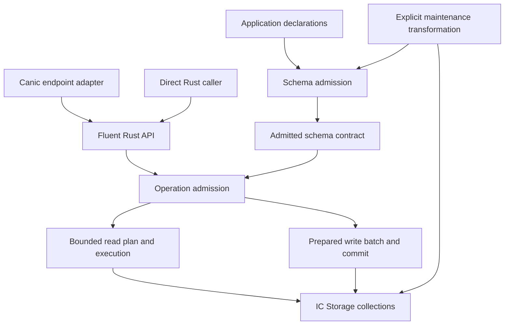

# IC DB system design

Status: M1 implementation beginning after the M0 entry review. The maintainer
authorized M1 on 2026-11-14 subject to the M0 gates. The authoring experiment is complete;
the maintainer selected the current attribute-owned declarations.
Private source releases to `dragginzgame/ic-db` are authorized when requested;
live deployment and replacement of IcyDB are not. Written 2026-11-13.

Maintainer decision (2026-11-13): freeze IcyDB's local checkout and GitHub
repository pending the IC DB experiment. Preserve existing committed/uncommitted
work, releases and data. Read-only research remains allowed; further edits,
commits, pushes, merges, releases or deployments require an explicit maintainer
decision to lift the freeze or authorize an exception. This records a work freeze,
not a GitHub archive/branch-protection change or an IcyDB retirement decision.

IC DB explores a leaner rewrite of IcyDB for Rust applications on the Internet
Computer, retaining broad fluent query capability and familiar attribute-based
schema authoring. IcyDB supplies requirements, failure examples and useful
algorithms; its accumulated architecture is not a blueprint to reproduce.
Challenge inherited mechanisms and prove platform assumptions before building
infrastructure around them. This remains a separate design-stage project.

No code-size reduction, runtime improvement, storage safety or feature parity is
claimed. An empty library is not a smaller equivalent database.

Accepted scope decision: IC DB exposes a fluent Rust API only. SQL is excluded,
not deferred; there is no separate public dynamic-query frontend. This decision
does not remove SQL from IcyDB or promise parity with its fluent operations.
The target is a broad, bounded, single-entity fluent query builder, including
grouping and distinct, with `#[entity]`-style schema authoring. SQL, joins and
window functions are explicit exclusions. This is a multipurpose database engine
specialized for the IC, with application-defined schemas and no built-in business
domain. Exact fluent semantics and bounds remain to be specified. More code is
acceptable where it delivers useful coherent capability.

Schema changes use compiled, versioned maintenance transitions; general runtime
DDL and online schema activation are excluded. The preferred commit design has
no database-owned ordinary-write WAL (write-ahead log), relying on synchronous
bounded batches and IC message rollback. M0 must prove this with the actual
storage supplier. Durable migration progress remains required.

Resumable aggregation is required within explicit bounds. Application result
mapping uses ordinary Rust iteration, not engine callbacks. The broad schema
type surface is retained unless a concrete reason supports a deliberate cut.
Hours-long maintenance is acceptable; copy space is an accepted cost in a system
that scales across canisters. Efficiency is judged against comparable IcyDB work.

## 1. Product contract

An application should define structured records, write them consistently, query
through useful indexes under explicit resource bounds, and reopen them after a
supported executable upgrade. It should be possible to understand which bytes
are authoritative and why a failed operation cannot leave contradictory records
and indexes.

The database owns row semantics, index/constraint consistency, query results and
its supported persistence transitions. The application owns authorization,
identity issuance, business transactions, tenant routing and cross-canister
coordination. The Canic adapter owns all product endpoint exports, guards,
transport and lifecycle composition. IC DB supplies no endpoint generation or
registration; its Rust library remains usable directly without mounting endpoints.
Standalone applications can expose their own endpoints through Platform's generic
guard/decode/encode hooks without Canic. The six qualification hosts demonstrate
this with bounded Wire frames and no Wire Endpoint dependency. This does not add
endpoint generation to database macros. `make m0-endpoints` qualifies raw admission
refusals and reply-encoding traps, including persistence across an outgoing call
and rollback of the later callback's writes.

The target is a useful bounded embedded database, not PostgreSQL completeness,
a distributed database, a general workflow engine or a memory-backend framework.
The intended reduction comes from simpler mechanisms and explicit exclusions,
while preserving broad, application-neutral database capabilities. Exact API and
stored-format compatibility are not promised; no IcyDB retirement is authorized.

### Application-neutral qualification and secondary compatibility

The primary design inputs are accepted database capabilities, IC execution and
storage constraints, and applicable IcyDB lessons. No application's current usage
defines the product's schema, architecture, capability ceiling or milestone order.

Use small synthetic schemas and workloads to exercise independent obligations:

| Workload family | Required evidence |
| --- | --- |
| Typed records and atomic writes | Key ownership, nested/optional values, indexes, uniqueness, references, final-state batches and unchanged reopen |
| Filtered, ordered enumeration | Compound/range access, residual predicates, projection, ties, sparse pages, byte/work bounds and live updates |
| DISTINCT and aggregates | Selected tuple equality, grouping, group filtering/order, empty input, high cardinality and bounded exact resumption |
| Schema evolution | Encoding/index changes, admission, identified transformations, cross-chunk constraints, recovery and allocation reuse |
| Composition and scale | Multiple unrelated schemas, entity/index counts, query shapes, mapping closures and separately mounted host adapters |

Vary data distributions and operation combinations, including rejected and
adversarial cases; no one fixture establishes generality. Small probes choose
mechanisms at M0. The delivered engine qualifies supported combinations in M1–M3.
Independent expected results and declared bounds are required. IcyDB's tests and
history provide further failure cases to rederive, not an automatic obligation
to restore every historical mechanism.

The private [Toko repository](https://github.com/dragginzgame/toko) on GitHub is a
tier-2 compatibility target: its application needs should be accounted for, but
they do not guide the architecture. Inspect it read-only at recorded revisions
when assessing coverage. Translate any gap into a generic capability or an
explicit application integration consequence; do not embed its business model,
copy its schema into the engine, or cut capabilities it does not happen to use.
Toko compatibility does not override the accepted SQL/join/window exclusions.
It is not a prerequisite for specifying generic capabilities or starting M1.

The deleted local Toko checkout was obsolete. Earlier conclusions drawn from it
are superseded and must be rechecked remotely before making compatibility claims.
Do not restore or consult that checkout. This source decision does not change the
independently selected Toko Tooling engineering baseline. No Toko modification,
publication or deployment is authorized.

## 2. Complexity budget and exclusion rules

Every subsystem must name its consumer or accepted product capability, one
authoritative owner, introduced state, failure it prevents and executable
acceptance witness. Each persisted
field needs a writer, reader, invariant and retirement rule. A cache must name
its invalidation owner and remain disposable.

Start without these inherited mechanisms:

- A universal core with mandatory model/view/ops/workflow/adapter layers.
- Separate mutable schema authorities for generated declarations and runtime use.
- Additional query frontends alongside the fluent Rust API.
- SQL parsing/binding/lowering, SQL command caches and text-result conventions.
- General runtime catalog editing and online schema activation.
- Ordinary-write WAL, replay and checkpoint machinery unless M0 proves a gap.
- Joins and window-function execution.
- General backend-neutral storage traits without a second required backend.
- A universal resumable-job interpreter for unrelated database operations.
- Automatic repair/reconciliation of unknown or obsolete persisted formats.
- Generic access-plan conversions, positional side arrays or repeated expression
  normalization unless their semantic or measured execution benefit is shown.
- Plan caches, exact-count acceleration, compiled constraint machines and broad
  generated adapter families as prerequisites for the first useful database.
- Multiple release groups, custom receipt frameworks or native tool packages
  before the corresponding product has a delivery requirement.

Distinguish feature deferrals from proposed enduring constraints: ordinary atomic
writes fit one synchronous message, schema changes use explicit maintenance, one
required storage supplier owns backing mechanics, and access is fluent-only with
no SQL frontend. Additions must preserve this advantage or explicitly justify
surrendering it. An accepted broad fluent capability is sufficient product need;
absence from a particular application is not a reason to cut it. Reintroduction of a mechanism requires
a concrete need and comparison with the simplest correct
alternative. Specialized execution is allowed when Wasm/instruction evidence
justifies it. Fewer lines alone do not justify slower execution or weaker guarantees.

## 3. Proposed ownership and dependency direction



Arrows are responsibility boundaries, not a mandate for a crate per box. The
product has the `ic-db` runtime/facade with internal modules and a small
`ic-db-macros` procedural-macro crate, re-exported through `ic-db` so applications
use one public entry point. Do not recreate
separate core/model/schema/diagnostic packages without an actual boundary need.
The runtime depends on IC Storage, Platform Types and the scalar/hash libraries
selected in its manifest; it owns database semantics and durable codecs. The
independent `qualification/` workspace contains the Wasm probes and fixture CLI;
no product dependency may point back into it. Endpoint generation belongs to the separately
owned Canic adapter; qualification exports are private experiment controls.
The required native CLI is a separate client boundary, not part of the Wasm
executor. Its executable currently lives with the qualification driver and reads
a local M1 fixture; add the product CLI package when the real adapter contract exists.

| Owner | Authoritative responsibility | Not its responsibility |
| --- | --- | --- |
| Admitted schema contract | Entity/field/index identities, types, layout and the selected format | Business ownership, competing generated/durable authorities |
| Row storage | Current records and their admitted encoding | Automatically accepting a changed Rust type |
| Index maintenance | Derived index entries consistent with committed records | Independent business facts or a separate schema authority |
| Read admission/execution | Bound semantics, access choice, resource limits and continuation | Caller authorization, background repair |
| Write admission/commit | Bounded mutation set and atomic row/index outcome | Cross-canister transactions or network calls |
| Maintenance | One selected source-to-target transformation and its recovery | Concurrent online DDL, generic background work scheduling |
| Canic adapter | Endpoints, guards, transport, lifecycle ordering and operational access | Query semantics or independent database state repair |

IC Storage owns allocation handles and collection/backing mechanics; IC DB owns
cross-record and cross-index invariants. The supplier boundary must be proved,
not inferred from the word "storage". Do not recreate Memory/Storage layers merely
to reproduce old package boundaries. Testkit owns PocketIC provisioning/lifecycle;
Build owns generic Wasm build mechanics. Choose their current published versions
when an experiment actually needs them, not speculative pins in this design.

Keep generic typed code at small boundaries: builders, codecs and result
conversion. Prefer shared concrete planning, traversal, grouping, distinct and
commit machinery, so each entity, closure type or fluent chain does not instantiate
another complete executor. Avoid encoding every fluent chain in nested executor
types. Ordinary application `.map()` closures should not specialize database
execution. Do not mandate boxing, a universal iterator or dynamic dispatch
everywhere. Reuse existing IcyDB performance lessons; specialization needs measured
Wasm/instruction value, not another speculative optimization framework.

## 4. Schema and identity: challenge the persisted catalog

Keep the current attribute-owned entity/record declarations with empty struct
bodies. After reviewing the annotated-struct experiment, the maintainer selected
the existing style for readability. Alternative forms are optional future work.
Blanket source compatibility is not required. Macros generate the compiled contract,
typed field references and necessary codecs/accessors. They do not generate a
second schema authority or host endpoints. Review individual attributes against
their retained responsibility; this is not blanket source compatibility with
IcyDB's existing options or generated artifacts.

### Authoring and inspection contract for M1

Keep field definitions inside the entity attribute. Latest maintainer direction:
do not require authors to allocate numeric field, entity, index or schema-key IDs.
Use resolved types and field paths, derive unambiguous names, and allow meaningful
explicit names where selection or stable identity needs them. Keep any compact
numeric physical handles internal. Record primary-key values are application data
and are unaffected by this authoring decision.

This supersedes the earlier acceptance of explicit entity/index IDs and is now
implemented for scalar entities. The default logical entity name is its Rust type
name; optional `name = "StableName"` preserves identity across source renames or
disambiguates types with the same short name. Rust module paths remain build-time
resolution metadata, so host and Wasm crate roots do not change stored identity.
Index names default to their ordered field names joined by a comma, for example
`"amount,id"`; optional `name = "by_amount"` overrides that identity. Names are
1–64 UTF-8 bytes. Longer derived names require an override. Two indexes on the
same fields require distinct names; uniqueness and membership remain part of each
index's complete contract. No numeric authoring ID syntax remains supported.

References name their target Rust type. Select a declared unfiltered reverse index
leading with the reference field when unambiguous; use `index = "name"` to select
among multiple candidates. Missing/ambiguous paths refuse during macro expansion;
missing target declarations refuse schema admission. This does not create indexes
or authorize unbounded reverse scans. For example, `references(entity = "User")`
uses Rust resolution, including imports and `Self`.

Full logical names define the contract. A const FNV-1a/32 of each name supplies
compact internal storage handles; admission rejects collisions among entities or
among one entity's indexes. Handles never substitute for full-name admission,
including reference targets. This avoids a durable assignment registry while
retaining the compact physical prefixes. The grammar is version 2; old numbered
contracts refuse intact. There is no automatic migration or data recreation.

The implemented scalar spelling is:

```rust
#[entity(
    pk(field = "id", source = "external"),
    index(fields = ["amount", "id"]),
    fields(
        field(name = "id", value(item(prim = "Nat64"))),
        field(name = "category", value(item(prim = "Text", max_bytes = 64))),
        field(name = "amount", value(item(prim = "Nat64"))),
        field(name = "note", value(opt, item(prim = "Text", max_bytes = 512))),
        field(name = "published", value(item(prim = "Bool")))
    )
)]
pub struct Entry {}
```

`Entry` is synthetic application code, not an engine-owned entity. Its fields,
types, limits and index are example choices. Exact attribute spelling is provisional.
Field names are the field identities within their owning entity or nested record;
duplicate names refuse. Authors supply no numeric field IDs. Canonical contracts
include the exact names, never declaration positions, inferred numeric identities
or a hidden assignment registry. Renaming a field changes the contract and requires
an explicit supported transition; do not silently infer a rename from similar
types or names. Reordering declarations is compatible only if the selected codec
preserves the stored layout. Entity/index authoring follows the name/path policy
above; existing numeric contracts remain identifiable and refuse intact.
References resolve to the target identity and complete key contract.
Codec, comparator and supplier versions remain part of the canonical contract;
an entity ID alone never authorizes reading changed bytes.

The disposable comparison compiled both styles with matching inspection and typed
keys; it did not establish codec correctness, constraint enforcement or Wasm savings.
It is retired following the maintainer's readability decision. Retain one authoring
path, without a mandatory second DTO or compatibility frontend. Attribute removal
is permitted when justified: tell the maintainer which attribute is removed, why,
and which behavior changes or moves elsewhere. Keeping the familiar declaration
style does not require importing IcyDB's generated runtime or endpoint machinery.
Generated Rust values still require write admission, including managed-field checks.

Maintainer clarification: retain IcyDB's two-stage schema path expansion and
host-side `ctor` registration for the richer schema graph. The first stage emits
typed Rust references and canonical path metadata; Rust resolves those references
rather than the procedural macro guessing module/import resolution. Constructors
collect the compiled schema nodes in the host build; the second stage validates
and seals the complete graph before generating the database artifacts. Registration
order must not determine schema identity or stored layout. Keep duplicate/missing
node and invalid-link checks, and keep this collection machinery out of deployed
Wasm. This is build-time authoring infrastructure, not a durable runtime catalog.
Adapt the frozen
[path and constructor emission](https://github.com/dragginzgame/icydb/blob/6d421e3601a3d71e42af23ea5fe6b168cb6ef2ac/crates/icydb-model-macros/src/node/traits.rs)
and [graph collection/sealing](https://github.com/dragginzgame/icydb/blob/6d421e3601a3d71e42af23ea5fe6b168cb6ef2ac/crates/icydb-model/src/build/mod.rs),
without importing endpoint generation or runtime schema reconciliation.
Rust resolution paths and durable schema identity remain distinct: map resolved
nodes to their declared schema names/identities under the compiled-contract rules.
The scalar entity slice now implements both stages. `Entity::PATH` carries the
compiler-resolved declaration path; typed reference spelling such as
`references(entity = "Entry")` lowers through `Entity::NAME` and its generated
handle, independently of the target descriptor, so self/cyclic relationships do
not create recursive constant evaluation. Numeric target IDs are no longer accepted. The optional native-only `ic-db/build` feature collects nodes
using `ctor`; `build::generate(source_module, target_module)` selects a module
subtree, validates it through the existing `Schema::new`, seals registration and
emits typed schema assembly with an expected fingerprint. The target compiler
resolves the generated paths; target admission refuses host/target contract drift.
The build script explicitly maps its module root to the target module root; this
is not a source-file/import resolver. Declaration visibility must permit the emitted
Rust references. No second persisted schema representation is introduced.
An admitted `Schema` can be cloned for host-owned reuse: it contains immutable
executable metadata only. Generated assembly validates the host/target fingerprint
once per thread, retains that immutable schema and returns clones. It never caches
database admission. The local M1 host also retains supplier runtime custody; each
call still opens a fresh database/collection lease and reads the current manifest.
Revisions are validated by operations that need them, as described below.

The actual M1 Wasm fixture now compiles the same schema module in its host build
script and target, replacing the manually maintained entity list. It exercises
a cross-module re-export and an optional self-reference with an unchanged golden
fingerprint. Native checks adapt IcyDB's order-independent assembly, duplicate
registration and late-registration cases; missing targets and unresolved Rust names
refuse. Wasm record/rollback/upgrade checks pass. The ctor dependency and collection
state are excluded on Wasm even if the build feature is selected. Workspace
`unsafe_code = deny` permits ctor's narrowly generated host internals; the runtime
and macro implementation crates retain `forbid(unsafe_code)`. No hand-written
unsafe code or extra product crate is added. Named record/payload-enum links now
participate through the same pipeline and bounded graph traversal described below.
This does not complete the broader type surface or prove composition growth costs.

| Generated or shared surface | Initial responsibility |
| --- | --- |
| Concrete entity and key types | Typed values; composite keys preserve declared component order; optional absence remains explicit |
| Typed field/index references | Construct admitted fluent operations; no specialization of the complete executor for each chain |
| One compiled descriptor | Stable identities, display names, types, bounds, keys, references, write ownership and semantic versions |
| Row/key codecs | Exact bounded encoding under that descriptor's contract; no lossy numeric coercion |
| Shared inspection | Project the compiled descriptor and separately report durable manifest admission/maintenance status |

Prefer one public macro emission contract through the `ic-db` facade; internal
host-build collection and target emission may remain separate stages. Do not require
separate user-facing schema-only/runtime import modes or generate insert/patch/replace helper
families before their distinct input contracts require them. This is a generated
surface choice, not removal of insert/update/delete or managed values. Defaults,
generated keys and timestamps must retain explicit ownership in write admission.
Canic endpoint definitions, guards and transport bindings stay outside these macros.

`db schema` must eventually show each entity's name and stable ID; field names,
types, optionality and bounds with units; ordered primary/index components,
uniqueness and supported predicates; reference targets; and declared default or
managed-field policies. The same response reports executable contract identity,
stored identity and admission/maintenance state. Display labels come from the
executable, not a separately editable durable catalog. On mismatch, label the
compiled description as unadmitted; do not claim it describes unknown stored
bytes or reconstruct a missing manifest. Inspection must remain bounded and use
the host's authorization policy. The current M1 console renders structured compiled
metadata from its local host; full deployed inspection remains implementation work.

M1 acceptance includes compile failures for duplicate field names/other identities, unknown index
fields, unsupported key types and contradictory declarations; round trips of
typed optional/nested values; identical descriptor meaning in typed access and
inspection; and refusal of field renames without an admitted transition. Other
source renames preserving explicit logical names reopen only when encoding/semantics
remain compatible.
The existing native identity probe supports the candidate sensitivity
rules, not these macro/runtime integration claims. Implement and qualify them in
the product once M1 begins rather than adding another disposable macro framework.

### Compiled authority and durable admission

The deployment-defined starting contract creates an opportunity to avoid the
full persisted dynamic catalog, not merely to rewrite its reconciliation code.
**Prefer a compiled canonical schema admitted against a minimal durable format
manifest**, subject to the M0 reopen/evolution experiment. Do not automatically
inherit IcyDB's accepted-snapshot architecture as a requirement of the new product.

The compiled schema owns the current executable's type and operation semantics.
The durable manifest identifies the database incarnation, admitted format/schema
identity and physical collection/layout identities needed to open its records.
Its purpose is admission, not a second editable copy of the schema. Exact schema
identity must cover every behavior relevant to decoding and index consistency;
its definition cannot be just a source name or an unstable Rust hash.

Ordinary access opens only when executable and manifest are admitted together.
A missing/corrupt manifest is an error, never permission to reconstruct it from
generated types. A mismatched executable cannot reinterpret old bytes or silently
accept new declarations. Fresh initialization requires a proven fresh backing.
Typed accessors reference the admitted compiled contract; there is no recurring
proposal/reconciliation/candidate-publication pass on ordinary startup.

For M1, select SHA-256 with the domain prefix `ic-db:schema:v1\0` over the bounded
canonical contract bytes. Retain the full 32-byte fingerprint in the minimal
manifest, without a second competing schema hash. The compiled schema producer
computes it; reopening compares the admitted identity before row decoding.
This identifies a contract, not an authorized caller or a checksum of every row.
Follow the shared hashing policy's approved SHA-256 default; do not use a Rust
type name, `DefaultHasher`, inferred field number or truncated digest as authority.

The canonical contract includes field names and type/size rules, ordered primary
and secondary key components, constraints, semantic versions and supplier-format
identity. Sort entity/index identities and field names canonically while preserving
key component order. Explicitly encode lengths and tags; reject duplicates and
dangling references before hashing. The native witness now covers primary-key
changes and an independent SHA-256 vector. Its small grammar is not the complete
product contract. The grammar below settles what those encodings must identify;
the product's exact tags and byte vectors must be fixed before M1 persists them.

IC DB owns durable row encoding and decoding, independently of transport formats.
The product has no `ic-wire` dependency. Generate storage traversal in canonical
field-name order so names need not be repeated in each row; keep primary/index key
encoding separate because payload byte order does not establish index ordering.
A field rename still changes schema identity. Database admission enforces field
and whole-row bounds; codec changes require an explicit contract version and
supported transition. Transport adapters convert only at their own boundary.

The earlier fixed three-field Wire candidate probe checks literal bytes, absent/empty distinction,
integer extremes, UTF-8 byte bounds, schema-before-payload admission, truncation,
unknown framing, trailing bytes and four Wire work limits. It is native evidence
using Wire 0.22.1, not a production frame, generated codec, rich-type proof or Wasm
budget. Wire can accept noncanonical primitive encodings; never decode/re-encode
an external byte sequence to establish its original identity. These checks do
not detect every valid-value bit change or establish a row checksum policy.
That historical probe does not select Wire for product persistence. The current
small scalar codec belongs to IC DB; IC Storage owns backing collections.
Frozen IcyDB's
[persisted scalar codec](https://github.com/dragginzgame/icydb/blob/6d421e3601a3d71e42af23ea5fe6b168cb6ef2ac/crates/icydb-core/src/db/data/persisted_row/codec/scalar/mod.rs)
is the starting point for the current scalar implementation. Adapt its exact
little-endian payload writes, slice-to-array reads and strict boolean validation;
extend that approach to the already-supported 128-bit integers. Carry its
[exact-width regression cases](https://github.com/dragginzgame/icydb/blob/6d421e3601a3d71e42af23ea5fe6b168cb6ef2ac/crates/icydb-core/src/db/data/persisted_row/codec/scalar/tests.rs)
into generated-record tests here. The earlier
[storage-size investigation](https://github.com/dragginzgame/icydb/blob/6d421e3601a3d71e42af23ea5fe6b168cb6ef2ac/docs/design/0.257-typed-query-explain/0.257-storage-size.md)
explains why declared numeric widths belong to storage semantics rather than a
generic widened runtime representation.

Keep IC DB's sequential schema-selected rows: the compiled contract supplies
type, field order and scalar width. IcyDB's per-slot null/value envelope, slot
directory and generic value materialization are not required for this layout.
Optional fields retain explicit presence; variable fields need u32 byte lengths
because this layout has no slot directory. Primary/index key ordering stays
separate from little-endian row payloads. No IcyDB or Wire dependency is added.
This removes the provisional varint/zigzag decoder, at the cost of larger small
integers: the three-Nat64 row `(42, 2, 7)` uses 24 payload bytes instead of 3.
Fixed-width decoding is a simplicity decision, not a measured cycle/Wasm saving.
Richer types must start from their relevant owned IcyDB codecs and qualify their
domain validation before admission; this increment does not implement them all.

### Compiled type graph and stored traversal

Use one finite compiled graph of named type definitions, not recursive expansion
of every nested definition. Include the reachable definitions once in canonical
name order; fields and enum variants also use exact UTF-8 name order. Fields are
scoped to their record, variants to their enum, and named types to their declared
schema namespace. Reject duplicate or unresolved symbols. References in this
graph are type links, distinct from enforced references to entity rows. Recursive
values remain supported through finite constructors such as optional/list fields
or an enum base case; reject required-value cycles with no finite constructor.
Value byte/node/depth and collection-count bounds remain independent of finite
schema-graph size. No runtime type registry or arbitrary-value interpreter follows
from this compiled metadata requirement.

| Contract component | Canonical content and storage consequence |
| --- | --- |
| Scalar or named scalar wrapper | Exact primitive kind/width, units/domain, codec/comparison/normalization versions and bounds; a wrapper's added rules are included rather than erased |
| Optional, list, set, map | Referenced component types, cardinality/count/byte bounds and comparison rules; absence is separate from empty; lists retain order |
| Record or tuple | Named record fields in canonical name order; tuple components in declared position order; recursively resolved component contracts |
| Enum | Variant names and payload contracts; derive compact row ordinals from canonical variant order, never Rust declaration positions |
| Field write policy | Authorable/managed ownership, required/optional behavior, typed literal default or versioned producer, normalization/validation policy and fixed inputs |
| Key, index, reference | Ordered field-name paths and directions, unique/present-only membership rules, target entity identity and full key contract, restricted-deletion semantics |

Names identify nested types and enum variants as well as fields; authors need no
numeric IDs for these. Entity/index authoring follows the name/path policy above. A name change
requires an admitted transition; ordinary source declaration reordering does not
change names or canonical order. A compact stored ordinal is a position within
an already admitted contract, not a separately persisted identity assignment.
Adding/removing/renaming an enum variant changes the contract even if some row
ordinals happen to stay the same. The earlier probe's numeric enum identities
were a candidate mechanism, not a shipped API; the current name-based witness
replaces it. No existing product attribute or retained data is removed.

The product now implements named records and unit/payload enums:

```rust
#[record(fields(field(name = "label", value(item(prim = "Text", max_bytes = 64)))))]
pub struct Details {}

#[enum_(
    variant(name = "Ready"),
    variant(name = "Data", value(item(is = "Details"))),
    variant(name = "Next", value(item(indirect, is = "Self")))
)]
pub struct Lifecycle {}
// In an entity's fields(...):
// field(name = "state", value(item(is = "Lifecycle")))
// field(name = "previous", value(opt, item(is = "Details")))
```

`name` overrides preserve logical identity across Rust source renames; Rust resolves
imported/qualified paths. The compiled link stores the exact logical name and a
function returning static metadata, which breaks recursive constant evaluation.
Function/static addresses are never durable identity. A bounded traversal visits
static nodes, coalesces equal definitions by name and refuses conflicting ones;
registration order cannot affect canonical bytes. Transitive definitions are
checked on typed access as well as reopen. Constructor collection remains host-only,
and no second mutable registration mechanism is added for named types.

Current bounds are 32 logical definitions (64 visited static declarations), 16
fields per record, 64 variants per enum and 64 UTF-8 bytes per name. Nested records
may be empty. The graph must have a finite value for every type: optional edges,
unit variants, empty lists and finite payload alternatives provide base cases. A least-fixed-point
check rejects required-value cycles with no finite constructor. `indirect` boxes a
named Rust value but does not change its stored representation or contract.

Typed encoding, decoding and borrowed stored-row inspection share a 32-level depth
limit, 256 structured-value visits across the whole row, and the existing 4 KiB byte
limit. Each entered record/enum/list/set/map counts once, including empty records, empty
lists and unit variants; absent optional values do not count. Scalars retain their existing byte
and field limits. Write exhaustion returns Limit during preparation; malformed or
over-budget stored values return Corrupt. Nested writes reuse one output buffer;
there is no buffer or generic owned value tree for each nested value. Records
encode canonical fields; enum bytes are a canonical ordinal followed by just the
selected payload, including explicit presence when that payload is optional.

The provisional unit-only `Enum` trait/`EnumSchema` give way to one generated
`Value` codec boundary and finite metadata for both shapes. This trait is a small
typed codec interface, not IcyDB's materialized universal value representation.
Named metadata uses `ICDBTY02`, including traversal limits and payload shapes.
Earlier unit-only manifests refuse intact; scalar-only identities remain unchanged.
No fallback decoder or migration is implied. `db schema` renders each reachable
record/enum/set/map definition once, using names for recursive links.

The local CLI supports `db schema ENTITY` (or `schema ENTITY` interactively),
selected by exact declared name. It displays fields, indexes, reference targets
and only reachable named definitions, once each even through recursion.
This retains IcyDB's describe-by-name outcome using the existing admitted metadata
and host-owned inspection projection. No catalog, database executor or generated
endpoint is added; production endpoints remain Canic's responsibility.

All-unit enums now support secondary indexes, including optional/boxed fields,
compound keys and sparse uniqueness. The component is the existing canonical
one-byte ordinal; optional presence keeps absence distinct from the first variant.
Query operands carry the complete enum definition and refuse another type,
changed alternatives or invalid ordinals. Declaration reorderings stay compatible.
Adding an index changes the admitted schema as usual; existing row codecs and
contracts without that index are unchanged. Indexed inspection still consumes
the shared structured-value budget. Any payload variant excludes the whole enum
from indexes, even when the selected value is a unit variant.

This carries forward the whole-definition capability and exact-identity lessons
from frozen IcyDB's `icydb-core/src/db/index/key/build/accepted_enum_tests.rs`
at `6d421e3`. It does not copy persisted catalog/type/variant IDs: the compiled
contract already fixes those meanings here. Native literal-byte, uniqueness-swap,
wrong-operand and corrupt-row/key witnesses accompany the Wasm index
rollback/reopen/upgrade probe. No attributes, durable metadata or extra execution
path are introduced; payload-enum ordering remains a separate decision.

Unit enums also serve as set elements and map keys using `item(is = "Status")`
and `key(is = "Status")`. Generated unit enums implement Rust ordering in the
same canonical variant-name order as their index components. The existing
collection count framing and ordinal codec are reused; enum keys consume the
shared structured-value budget. Transitive contract identity includes key types.
Payload enums, records and collections still refuse as collection keys/elements,
even if application code supplies a Rust ordering implementation.

Frozen IcyDB's `value/map.rs` and `value/tests.rs` at `6d421e3` establish canonical
map normalization and duplicate-key refusal. We retain that invariant at the
stored-byte boundary before a `BTreeMap`/`BTreeSet` can hide duplicates; caller-side
Rust collections still have their ordinary insertion semantics. This extends
the existing ordered decoder and named-type admission, without copying the
universal runtime-value comparator. No extra durable metadata, dependency or
collection executor is introduced. Existing admitted contracts keep their bytes;
new enum-keyed declarations have their own complete schema identity.

This adapts frozen IcyDB’s authoring and its duplicate-definition, malformed
payload, recursive graph/depth and exact-admission lessons (`6d421e3`,
`icydb-model/tests/composite_hooks.rs` and
`icydb-core/src/db/schema/enum_catalog/codec/tests.rs`). It does not copy catalog
publication, persisted variant assignments, per-slot framing or Wire conversion.
Independent bytes/hashes and native/Wasm boundary, rollback and reopen witnesses
qualify this implementation. Nested references/indexes, payload-enum/record/collection
keys and set elements, tuples and other retained types remain later increments.

Ordered lists are now implemented for entity/record fields and enum payloads:
`value(many, max_items = 3, item(prim = "Nat16"))` produces `Vec<u16>`;
`opt` wraps the list in `Option`, and `item(is = "Type")` selects named elements.
The list preserves order and duplicates; absence differs from an empty list.
Every list declares a maximum from 0 through 256, and all lists in one row share
a 256-item total. A list of empty records can be tiny in bytes yet expensive to
traverse, so item, structured-value, depth and byte limits are independent.
Counts are checked before element allocation or traversal in both typed decoding
and shared borrowed inspection. Encoding writes a u32 little-endian count followed
by the ordered element payloads into the existing single row buffer.

`many` is retained from frozen IcyDB's `icydb-model/tests/composite_hooks.rs`;
the checked reader and recursive list-bound lessons come from
`icydb-core/src/db/codec/reader/mod.rs` and
`icydb-core/src/db/schema/enum_catalog/codec/tests.rs` at `6d421e3`.
IC DB uses its own sequential codec and shared budget, without importing a
materialized universal list value, Wire encoding or durable catalog. Recursive
`Vec<Self>` edges need no Box and have an empty constructor. Direct inline lists
of lists and optional elements are not yet authored; named records can contain
further lists. List keys/indexes/references remain unimplemented.
No existing attribute is removed. The fixture's ListRow and ListNode expose these
shapes in `db schema`; native/Wasm probes cover exact bytes, shared bounds,
malformed stored elements, rollback and unchanged upgrade.

Named scalar sets now use `#[set(item(prim = "Int16"), max_items = 3)]` on an
empty struct and `value(item(is = "Scores"))` at its use sites. The generated
type is a tuple wrapper over `BTreeSet<T>`, retaining IcyDB's named set shape
(`icydb-model-macros/src/node/set.rs` at frozen `6d421e3`). Its stored count is a
u32 followed by elements in strictly increasing logical order: exact integer
order, false before true, exact text/blob byte order, and principal length then
significant bytes. This is not lexicographic order of little-endian row payloads.
The decoder checks each adjacent pair before inserting into the result; duplicate
or descending stored entries refuse as Corrupt. Application construction retains
normal `BTreeSet` behavior, including explicit insert's duplicate result. No
database normalizer or implicit transformation runs on keys.

All existing scalar families and unit enums are supported; other named/container
elements await an explicit logical comparator. Sets are usable in entity/record fields, enum
payloads and lists through existing named links. Optional sets distinguish absence
from empty. Empty sets are finite constructors and consume one structured value;
their elements share the 256-item row total with lists, in addition to declared
0..256 counts, depth 32 and 4 KiB bytes. Typed reads and borrowed inspection share
one strict ordered traversal; inspection retains only the preceding scalar or
borrowed slice. There is no new value tree, persistent catalog, index or crate.
This carries forward IcyDB's immutable-key lesson from
`icydb-model/tests/ui/collection_normalizers/immutable_keys.rs`; normalization
policies and set-member queries/indexes remain separate work. Independent golden
bytes/hashes and native/Wasm checks qualify ordering, mixed collection bounds,
refused corrupt writes, no-op revisions, late traps and upgrade/reopen.

Named maps now use `#[map(key(prim = "Int16"), value(opt, item(prim = "Text",
max_bytes = 4)), max_items = 3)]` on an empty struct. This generates a tuple
wrapper over `BTreeMap<i16, Option<String>>`; fields use the usual named path.
Retain IcyDB's `key(...)`/`value(...)` spelling, scalar-key and immutable-key rules
from `icydb-model-macros/src/node/map/mod.rs` and
`icydb-model/tests/ui/collection_normalizers/immutable_keys.rs` at `6d421e3`.
Key order is the same exact scalar/unit-enum order as sets. Values use ordinary scalar,
optional, bounded-list and named-type semantics, without an ordering requirement.
Keys cannot be optional or containers. Named keys admit only unit enums; boxing
a unit enum does not change its logical order or stored contract.
Nested entity references, normalizers and member indexes remain unimplemented.

Map bytes are a u32 entry count followed by ordered key/value pairs. One shared
set/map traversal rejects non-increasing keys before a Rust collection can erase
duplicate evidence; values do not participate in key identity. Missing keys,
present keys with absent values, and empty values remain distinct. Application
construction retains ordinary explicit `BTreeMap` insertion/replacement semantics.
Count admission precedes traversal/allocation. Each entry consumes one of the
row's 256 collection items; nested collections consume additional items. Empty
maps are finite constructors and count as one structured value. Recursive map
values need no Box; the existing explicit Box option also remains usable, unlike
IcyDB's old blanket indirect-map-value refusal. The compiled graph and shared
32-depth/256-node/4 KiB traversal limits establish the current boundary instead.

Borrowed inspection traverses values without materializing them and retains only
the preceding scalar key or borrowed slice. MapTree's Wasm witness checks the
exact depth/node boundaries with independently framed bytes. Native/Wasm probes
also qualify scalar key order, optional values, list/map shared counts, malformed
entries, incompatible reopen, unchanged refused writes, no-op revisions, late
traps and upgrade preservation. No new durable state, dependency, crate or
universal value representation is added.

Policy functions are identified by a declared semantic name/version and canonical
typed fixed inputs. Changed behavior requires a version change; hashing source
declarations cannot detect an unversioned function edit. Defaults/generators run
during write preparation only, never decode or reopen. Literal defaults are
type-checked and encoded under the field's selected storage contract. The graph
is executable metadata and hash input; the manifest still stores its fingerprint,
not a second editable catalog.

Stored records traverse canonical fields and write no per-row field names. Enums
write the admitted ordinal and that variant's payload; reject unknown ordinals or
payload mismatch. Sets/maps use strictly ordered canonical elements/keys under
the declared logical comparator, not lexicographic row-payload bytes. Validate
each decoded entry before insertion into a Rust map/set can silently overwrite
or deduplicate it. Input normalization precedes
uniqueness checks; normalization collisions refuse rather than select a winner.
This does not add member indexes, flattening or implicit nested-reference checking.

The native recursive-row witness covers canonical record/enum traversal, map/set
construction-order independence, list ordering, absent versus empty, and malformed
collection/variant refusal. Its fixed maximum is eight tree nodes, three levels,
three entries per collection and eight UTF-8 bytes per string. All-maximal values
must fit its separate 512-byte Wire payload envelope, 512 traversal visits and
64-KiB allocation allowance; that allowance is conservative accounting, not a
measured heap allocation. It is a handwritten fixture, not generated product code,
full type coverage, a selected product limit or a Wasm cost proof. Product macros
must prove the same traversal from authored declarations before first persistence.

A schema-changing executable must explicitly carry the supported source decoding
contract and the transformation to its target, or use a separately approved
export/import path. Old decoders are scoped to that maintenance operation, not
normal runtime fallbacks. They may retire only after their source data and
recovery obligations have been explicitly retired. Arbitrary historical readers
and generic runtime schema editing are not prerequisites.

M0 must prove that the compiled-schema/minimal-manifest arrangement rejects
incompatible layouts and recovers supported maintenance without missing historical
code. Inspection may expose the compiled contract through Rust methods; it does
not require an editable runtime catalog. If this arrangement fails, identify the
missing invariant and reconsider its mechanism explicitly, without silently
restoring runtime DDL or implementing two permanent schema-authority modes.

Include logical entity/index identities and field names in the canonical contract;
the intended authoring surface no longer requires numeric entity/index IDs.
Field renames are contract changes; never infer identity from similar names. Permit
unambiguous ergonomic index names with explicit overrides rather than requiring
users to invent every name. Exact identity encoding and allocation are M0/M1
choices, not reasons to copy the current tag/lineage pipeline wholesale.

Retain decimals, large integers, principals/accounts, enums, optional fields,
nested records, lists/maps/sets, composite keys, defaults and managed timestamps.
Current consumer types are experiment inputs, not the product ceiling. A cut needs
a concrete technical or product reason and an explicit decision. Attribute/API
spelling may change while useful semantics remain. Specify ranges, comparison,
text order, null/optional distinctions, default/timestamp behavior and codec limits
once for reads and writes. Retained types must not acquire lossy conversions.
Storing a collection does not imply arbitrary indexing/querying of its contents;
those operations and custom codecs still need explicit contracts.

M0 records a compact type-operation matrix: storage, equality, ordering, indexing,
grouping/distinct and aggregate inputs. Retention does not imply every operation
for every type. Cross-operation witnesses cover decimal equality versus uniqueness/
grouping, composite-key encoding versus comparison, set/map construction order,
enum rename/reorder identity and timestamp preservation during maintenance.
Supported operations must agree; this does not require a universal value engine.

The implemented scalar optional-unique contract requires explicit present-only index
membership. Multiple absent values are allowed and have no entry in that unique
index; present values use the same equality as comparisons and other indexes.
For composite unique keys every optional component needs that guard. An ambiguous
unguarded declaration refuses rather than silently choosing a null policy. The
compiled `present_only` option expresses the complete guard without SQL text;
ordinary non-unique indexes and
grouping/DISTINCT still retain absence under their own declared semantics.
The product now qualifies optional scalar composite membership and macro
diagnostics, including release/acquire, references and rollback. Nested membership
and arbitrary partial-index predicates remain separate work.
Application-specific naming, normalization and length policies are not built into
the engine; its declared type/comparison semantics remain shared and exact.

The following write policies retain useful IcyDB guarantees without requiring
its public structural mutation lane or SQL `DEFAULT` syntax:

| Input or operation | Selected contract; implementation status below |
| --- | --- |
| Explicit optional `None` | Store absence; never reinterpret it as omission or request a default |
| Insert omission | Resolve a declared default, otherwise optional absence; refuse a missing required value |
| Partial update omission | Preserve the current value; no implicit default reapplication |
| Whole-row update/replacement | Supply all authorable fields and preserve the selected primary key; missing-row behavior must be explicit, not an implicit generated-key insert |
| Database-generated identity | Allocate during bounded preparation, validate the final key before mutation, publish any persistent allocator change with the batch; return the assigned key/row; no gap-free or secret-ID promise |
| Managed timestamps | Capture one time per batch; insert sets declared creation/update roles; a semantic change preserves creation and sets update time; no-ops preserve both even with an earlier clock; reject regression on real changes and corrupt stored ordering on every path |
| Reopen and maintenance | Do not rerun defaults, key generation or timestamp assignment on decode; transformations preserve values unless their recorded identity explicitly authorizes a change |

Database-owned inputs must be structurally unauthorable or explicitly refused;
they cannot silently override managed policy. Default/generator outputs still
pass ordinary type, size, uniqueness and reference admission before mutation.
Version semantic changes to these policies in the compiled contract.

The 0.6 typed insert slice implements omission with `Entity::insert()` and
`Batch::insert_input`, returning the materialized entity before commit. One small
input per entity contains optional supplied fields; an optional stored field has
an outer omission marker, so explicit `None` remains distinct. This construction
feeds existing encoding, constraints and commit logic. Fully specified inserts
and replacements remain available; there is no partial-update builder yet.
Literal defaults initially support signed/unsigned 8–128-bit integers, Bool and
bounded Text, including optional present defaults. Missing required inputs refuse.
Primary-key defaults, nested-record defaults and richer producers remain separate
increments, not retired capabilities.

Static literal metadata uses the owned scalar codec in a versioned schema-hash
trailer. Default-free contracts retain their fingerprints; changing a default
requires an admitted transition. No row layout, manifest field, journal or
dependency is added. Inspection shows defaults beside bounds in the Info column.
Native and real Wasm witnesses cover exact integer boundaries, explicit values,
default uniqueness conflicts, refused/trapped writes, no-op replacements and
unchanged reopen/upgrade. A separately assembled byte/hash oracle covers the
fixture contract.

The subsequent 0.6 managed-time slice declares nonoptional scalar Timestamp
fields with `managed = "created_at"` or `"updated_at"`, at most one of each.
Either role may stand alone; nested/optional managed fields refuse. `Batch::at`
holds one explicit host-supplied Timestamp and never reads a clock or awaits.
Generated insert inputs omit managed setters. Direct fully authored insertion of
these entities refuses; the typed input returns its prepared assigned times.
Replacement takes a complete entity with its current stored timestamps: changed
or stale timestamp values refuse, creation is preserved, and a real change sets
update time. The caller reads after commit if it needs the final assigned value.
Equal timestamps are not an optimistic-concurrency token: distinct changes may
share an operation time.
Deletes need no operation time because they assign none.

This retains IcyDB's frozen-time, no-op and corrupt-order regressions from
`persisted_row/patch/tests.rs`, including rejection of inverted stored time even
when authorable fields do not change. The canonical row codec makes byte equality
the current semantic no-op test. A shared bounded preparation function locates only
the two fixed-width time fields, checks ownership/progression and rewrites update
bytes; ordinary index extraction and commit then enforce final-state constraints.
No generic slot/provenance overlay, mutation interpreter or per-entity executor
is introduced. A no-op validates stored order without rebuilding its index keys.

Managed policy has its own versioned fingerprint trailer; entities without it
retain their existing identities. Row codecs and manifest fields are unchanged.
The added state is transient batch time and static field policy, plus the timestamp
values explicitly authored into an application's rows. Reopen/decode preserve them;
changed policy requires an explicit supported transition. Clock trust remains with
the host, and no cross-canister or strictly increasing timestamp promise is made.

This carries forward frozen IcyDB `6d421e3`'s omission, explicit-value and
insert-only default guarantees, including its narrow-integer regression lessons
from `db/data/persisted_row/patch`. It does not copy that structural mutation
engine, slot/provenance model or SQL default lane: typed construction resolves
omission before the single existing write path. No authoring attribute is removed.

The initial operation matrix below is a proposed product contract, not delivered
coverage. `Conditional` means an explicit component/comparator and encoded-size
contract is required; it does not mean dropping the capability for lack of a caller.
All families remain storable within declared bounds. Count is available over rows;
counting a selected field must separately define absent-value treatment.

| Type family | Equality | Ordering / index keys | Grouping / DISTINCT | Aggregate inputs beyond count |
| --- | --- | --- | --- | --- |
| Signed/unsigned integers, including 128-bit and U256 | Exact within admitted numeric rules | Exact order; no conversion through float | Same equality as predicates/uniqueness | Sum, average, min/max; explicit accumulator/result range and overflow |
| Decimal | Numeric equality; `1.0 = 1.00` | Comparator and canonical key agree across equivalent scales | Same scale-insensitive equality | Sum, average, min/max; precision/rounding policy must be explicit |
| Finite Float32/Float64 | Declared normalization, including signed zero | Versioned total order over the admitted finite domain | Same normalized equality | Sum, average, min/max; deterministic accumulation/rounding contract |
| Bool, text, bytes | Exact base equality; text transforms are explicit | Declared comparator and bounded key bytes | Same equality and bounded retained key bytes | Min/max where ordered; no implicit numeric conversion |
| ULID, principal, subaccount, account | Canonical identity equality | Explicit identity comparator/key contract | Same identity equality | Min/max where ordered |
| Date, timestamp, duration | Exact typed units | Chronological/numeric unit order | Same typed equality | Min/max; duration arithmetic needs explicit range/result units |
| Enums | Variant name plus payload equality within the admitted type | Canonical name order, then admitted payload comparison | Same variant/payload equality | Min/max when payload ordering is admitted |
| Optional values | Distinguish absence from zero/empty | Explicit absent ordering; contained type rules | One absent group/distinct value; contained type rules | Explicit absent/empty-input semantics for contained aggregate |
| Nested records, tuples, composite keys | Component equality under stable field identities | Conditional lexicographic components and key-size bounds | Conditional canonical whole-value equality | Min/max when whole-value order is admitted |
| Lists | Order-sensitive element equality | Whole-value/element index operations require separate admission | Conditional on bounded canonical element semantics | Whole-value count; arithmetic requires an explicit selected scalar operation |
| Sets/maps | Construction order must not change equality | Whole-value or member access/indexing remains an explicit decision | Conditional canonical set/key/value equality | Whole-value count; no implicit flattening/reduction |

Do not infer arbitrary member queries from storage or grouping support. IcyDB's
inspected contract already refuses map predicates/indexes and restricts nested
paths; retaining these values does not promise previously unavailable traversal.
Any additional restriction of a retained operation still needs a concrete reason.
Accepted 2026-11-14: decimal averages use a documented decimal precision and rounding
mode with explicit overflow errors, rather than a new rational result type or
refusal of every repeating fraction. Accepted 2026-11-15: the result record selects
Decimal scale 0–28, with one final rounding to nearest, ties to even. Overflow
refuses without reducing the selected precision. Continuation must not round
each chunk in a way that changes the completed answer.
Defaults and managed timestamps are authoring/write behavior: migrations preserve
them unless the identified transition deliberately changes them. Exact comparator
identities, numeric result types, float rounding, null/empty aggregate outcomes and
conditional cells remain M0 decisions, with cross-operation witnesses before
implementation claims. Removing SQL must not silently remove finite floats,
dates/durations, field-to-field comparison or supported text/collection predicates.

Derived lookup/layout tables remain disposable and need a measured purpose.
Do not serialize caches or hash multiple equivalent schema representations.

M0 must settle this identity sensitivity table. The canonical contract includes
explicit codec, comparator and supplier-format versions where declarations alone
cannot detect a change; it does not require several competing hashes.

| Change | Proposed admission requirement |
| --- | --- |
| Rust source rename preserving declared logical schema identity; documentation/presentation only | Same contract if encoding and stored semantics are unchanged |
| Logical entity/index identity rename | New contract with an explicit supported transition; no automatic matching |
| Field, nested-type or enum-variant rename | New contract with an explicit supported transition; update references; no automatic name matching |
| Row encoding | Identify accepted source decoder and admitted transition |
| Index key encoding or text order | New contract; reconstruct affected indexes |
| Null order or uniqueness semantics | New contract; validate target ordering/constraints |
| Supplier collection format | Explicit supplier compatibility identity and supported transition |

The native M0 witness exercises these inputs in one bounded canonical byte
contract. Fields are ordered by their exact names, which are included in identity;
enum variant names are included too; entity/index display names and declaration
order are excluded. Those witnesses use the earlier numbered entity/index contract;
the M1 native/Wasm witnesses separately qualify the new named contract. Index column order
and versioned stored semantics are included. This does not detect
an unversioned codec/comparator code change. The selected SHA-256 fingerprint has
a fixed domain and independent golden vector. The type-graph grammar above is
the product direction; its complete byte encoding and generated traversal remain
implementation gates, not claims established by the small identity witness.
Declaration reordering is compatible only when the actual codec preserves layout.

Direct compatibility names an exact accepted source contract, its proven rule
and the transition installing the target identity atomically. It is not permissive
startup reconciliation. Unchanged identity needs no transition.

### Schema maintenance and the DDL boundary

Use deployment-defined schema and explicit maintenance-window evolution.
Hours-long maintenance is acceptable. Source-plus-target capacity is an accepted
tradeoff; expected scale-out is across canisters, not a demand for in-place
migration to minimize temporary space. Per-message work and cleanup remain bounded,
and insufficient capacity must refuse safely rather than damage retained source.
SQL `CREATE`/`ALTER`/`DROP`, independent runtime catalog editing and online
constraint/index activation are excluded. Internal maintenance still creates
target collections, transforms rows, rebuilds indexes, validates constraints,
publishes the target and cleans retired collections for supported reuse. These operations belong
to one admitted transition, not a general public DDL interface.

A supported executable upgrade must reopen its data. A schema change is separately
classified as unchanged, directly compatible under a proven rule, or requiring
an explicit transformation. For example, adding an optional field is not declared
safe until its row-decoding and index consequences are proved.

The preferred transformation is bounded copy/validation followed by cutover:

1. Install code carrying the target contract, source decoder and versioned Rust
   transformation. This maintenance-specific Rust function computes target records
   synchronously within chunk bounds, without external effects or reentrant
   database mutation; its version and fixed inputs are stable. It is separate from
   ordinary result mapping and does not introduce general query callback hooks.
2. Establish the durable maintenance gate before copying; ordinary reads and
   writes close and source data stays frozen.
3. Copy affected data into new collections and build its indexes in bounded
   chunks. Commit each chunk's rows, indexes, allocator changes and progress in
   one message; a trap must revert the whole chunk, including progress.
4. Complete validation over all affected dependencies before publication.
5. Atomically switch the manifest/root to the target and reopen admitted access.
6. Clean recorded retired source collections in resumable bounded steps once
   recovery obligations permit it. Reuse requires explicit ownership and format
   admission; cleanup does not return their backing to a global free pool.

For example, adding an index changes the declaration, deploys an admitted
transition, builds and validates the index during maintenance, then publishes
the target. Unaffected collections need not be copied. Retain source until
cutover is committed and recovery obligations are settled. Prove peak space and
bounded cleanup; reject this candidate if it exceeds the declared capacity envelope.
In-place rewriting is not an automatic fallback.

Maintainer direction (2026-11-14): IC Storage is expected to be overhauled when
Rust OP is available. Do not optimize IC DB around today's supplier internals,
allocation layout, reclamation limits or performance quirks. Specify the storage
capabilities the database needs, retain version-specific probe evidence, and
requalify the revised supplier. Current correctness and capacity limits still
apply to experiments using the selected version; future capabilities are not
yet established. Defer supplier-specific optimization until that overhaul.

IC Storage's existing allocation reset is an investigated candidate for alternating reusable
collection slots: a later target may use a fully retired slot after source
preservation obligations end. Reset must be authorized by the durable role and
committed atomically with the slot's new format/progress identity. Never choose a
slot by emptiness alone or reset the live source. Fixed-slot reuse keeps allocation
mechanics in the supplier, but introduces database ownership/role checks and
retains each slot's high-water capacity. The capacity probe below tests the reset
and copy mechanism only; complete alternating cutovers, cancellation, index-slot
ownership and obsolete-executable refusal would be required before selecting it.
Do not advance this into the product architecture merely to accommodate the
current supplier; retain the probe as evidence pending the planned overhaul.

The durable maintenance record retains source and target contract identities,
source/target collection identities, immutable transformation identity/version
and fixed inputs, progress and current phase. This is operation-specific recovery
state, not an ordinary-write WAL or arbitrary transaction replay service.
Resume requires explicit support for that exact transformation, even when source
and target schemas match. Changed transformation code requires a deliberate
restart from preserved source or a separately proven recovery transition; hashing
the whole executable is unnecessary. Retrying cannot select a new source silently;
cancellation before cutover cannot expose target data. After
cutover, cleanup resumes against the retired source, not the live target. Derive
phases from actual irreversible boundaries, not accounting-only transitions.

All supported executables interpret one durable maintenance gate:

| Durable state | Admission and recovery |
| --- | --- |
| Source live, no transformation | Source-compatible executable may serve |
| Source frozen, target building/validating | Ordinary access closed, including under source executable A |
| Cancelled before cutover | Bounded target cleanup; reopen source only under a source-compatible executable after the gate safely clears |
| Target published | Target-compatible executable may serve; source-only executable refuses |
| Retired source awaiting cleanup | Cleanup touches only recorded retired allocations |

A maintenance-only source decoder in B does not authorize B's typed API to serve
the source after cancellation. Source retention after cutover does not promise
rollback after target writes. Before publication, validate the full affected
dependency set of rows, indexes and selected constraints, including unique-value
collisions introduced in different chunks.

Failed validation never publishes the target. Supported code may resume or cancel
the recorded transformation while preserving source. Canic exposes authorized
maintenance controls; it does not own progress or implement another recovery path.

## 5. Reads and query semantics

Fluent Rust builders construct one admitted operation representation. There is
no SQL parser, SQL adapter or separate public dynamic query API. Runtime values
and conditional builder composition can still support application-selected
filters and ordering; applications map their allowed inputs into fluent calls.
Do not replace SQL with a general string-based expression language.

The intended fluent surface is broad within one entity: composable predicates,
field projection, indexed lookup/ranges, ordering, pagination, multi-field grouping,
distinct results, count, sum, min, max and average, with group filtering and ordering
by aggregate results. These are accepted baseline capabilities. M0 specifies exact
types, null/empty/overflow behavior and distinct field/tuple equality. Review
computed expressions and richer ordering on their fluent usefulness and bounded
implementation, not whether SQL originally motivated them. Joins and window
functions remain excluded; broader relational machinery is not implied.

Specify composition before builder spelling. M0 uses a few worked queries with
small inputs, exact outputs, limit/continuation placement and explicit refusals.
Resolve input versus group limits, the distinct projection/tuple, counting distinct
values, post-group filters, ordering stages and equivalent/rejected method orders.
A scan work budget yields incomplete execution; it never silently limits the
mathematical input and turns a whole-query aggregate into a prefix aggregate.

Small composition witnesses, now checked natively with builder spelling still open: input
`(id, category, value)` is `(1,A,10), (2,B,20), (3,A,30), (4,B,20)`.

| Admitted operation | Exact result and limit placement |
| --- | --- |
| Project category, distinct, order category, output limit 1 | First page `[A]`, then `[B]`; duplicates across work/page boundaries stay suppressed |
| Count distinct projected category | `2`, not four entity rows or a sum of page-local distinct counts |
| Project `(category, value)`, distinct, count | `3`; equality covers the selected tuple, not category alone or hidden entity IDs |
| Group category, sum value, keep sums greater than 35, order sum descending then category ascending, output limit 1 | Complete groups are `(A,40), (B,40)`; first output page is `(A,40)` |
| Same grouped operation, input work budget 2 per advance | First advance is incomplete with no final output; it cannot apply the group filter/limit to prefix sums `(A,10), (B,20)` |
| Filter input value at least 20, then the same grouped operation | Only `(B,40)` survives; A sums to 30 after the row filter and fails the group filter |

Output limits apply after the selected projection/distinct or completed group
filter/order stages. An input-prefix limit, if supported later, must be an explicit
different operation. Admission must reject ambiguous stage combinations rather
than allowing method-call order to silently change this meaning. These examples
specify semantics; they do not claim a product fluent engine is implemented.
The native witnesses vary work budgets 1–4, page completed results, and refuse
distinct-key/group capacity overflow without publishing a truncated answer.
Their four-entry finalization bound does not qualify production instruction or
byte limits. Builder method-order admission remains an implementation obligation:
row predicates and aggregate predicates must target explicit stages, while an
output limit must never become an input-prefix limit because of call order.

Optional aggregate inputs have a separate worked contract. For the six projected
values `[10, None, 30, 10, None, None]`, row count is `6`, present-field count is
`3`, and distinct present-field count is `2`. Projection DISTINCT produces
`[None, 10, 30]`: counting those result rows gives `3`, while counting their
present field values gives `2`. The fluent API must distinguish these operations
explicitly; SQL removal does not remove either capability.

Sum, average and extrema ignore absent operands. This input has sum `50`, minimum
`10`, maximum `30` and mathematical average `50/3`. Empty and all-absent inputs
yield zero field counts and no sum/average/extremum; a present zero yields
`Some(0)`, not absence. Carry total and present-value count across advances rather
than averaging chunk averages. The native example varies work budgets 1–6 and
uses an exact `u128` total for at most six `u64` operands, including totals above
`u64::MAX`. Its numerator/denominator pair is an oracle for average semantics,
not a selected public result type. Production numeric widening, decimal rounding,
overflow and grouped combinations still need type-specific qualification.

Absent group keys form one group; ignoring absent aggregate operands does not
discard that group or an all-absent group. A five-row witness produces
`(key=None, sum=40, rows=2, values=2)`, `(A, None, 2, 0)` and `(B, 0, 1, 1)`.
All three appear in completed output before filtering. An explicit completed
group predicate requiring a present sum greater than zero retains only the first.
The witness declares absent keys first; production ordering must remain explicit.

Remove SQL-only syntax, name/alias binding, literal parsing, statement lowering,
command caching and SQL-facing administration/formatting. Trace shared users
before excluding an underlying capability: comparison, expression evaluation,
projection and aggregation may still serve fluent queries. Origin in SQL work
alone is not evidence that a mechanism is SQL-only. Do not recreate a SQL AST or
compatibility layer behind the fluent builder.

Return bounded typed results that callers can iterate and transform with ordinary
Rust `.map()`. Use a common page container generic over its result type (`Page<T>`
conceptually), with normal iterator access. Entity reads return entities;
projections return projected records/tuples; ungrouped aggregation returns an
aggregate value; grouped pages contain keys and aggregates. Incomplete aggregation
returns an explicit progress outcome. Do not force these results into full entities.
Exact API spelling remains open; no custom engine callback subsystem is required.
Iteration must not hide cross-message fetching or discard page continuation.
Application mapping is outside query planning, bounds and persisted continuation;
mapping a page does not implement global filtering, sorting or aggregation.
Keep database predicates, ordering, grouping and distinct in the fluent operation.
Arbitrary predicate, sort-key, reducer or update callbacks are not part of this
initial contract. Callers construct updated values before submitting a batch;
the database validates them normally. No closures or captures are persisted.

Schema inspection, query explanation and integrity checks may have Rust methods
where needed; SQL command forms are excluded. Ad hoc text
queries, SQL scripts and SQL catalog editing have no compatibility path. M0 must
identify affected consumers/operators and accept their replacement workflows or
exclude them from initial adoption, accounting for application code added.

`make db` installs/updates the native `db` binary without launching it. The `db`
command provides interactive and scriptable schema inspection and bounded queries
(`db schema`, `db query --limit 2`). Schema output comes from the executable's
compiled contract plus durable admission/status, including fields and indexes;
it is not a second editable schema catalog. The CLI uses explicit commands and
options, not SQL or an arbitrary expression language. In the product, the Canic
adapter maps allowed requests into fluent operations under the same admission,
ordering, work/byte limits and continuation semantics as application callers.
No separate CLI planner or executor is permitted. Canic owns remote endpoints,
authentication and authorization; the database owns semantics. Surface partial
pages and refusal reasons explicitly and return nonzero status for failed scripts.
The current M1 console reads only a labelled local synthetic fixture. Its `query`
command targets Entry implicitly because that is its sole queryable entity.
When multiple entities become queryable, require explicit entity selection;
do not infer a default from schema order. Connecting to real deployments and
exposing broad fluent operations remain implementation work.

For the first query subset, support primary-key lookup, required index equality
or range lookup, composable bounded filters, projection, deterministic order,
page limits, grouping, distinct results and selected aggregates.
Choose a simple deterministic access rule before adding a cost model. An index
restriction is a derived optimization, not a second complete filter authority.
Residual truth semantics remain authoritative when an index covers only part of
a filter. Specify error precedence, null behavior and numeric comparison once.

Physical execution may specialize primary-key, index and bounded scan paths.
Share admission and continuation rules without forcing every hot loop through
one generic iterator framework. Reject unsupported or unbounded query shapes
explicitly; do not quietly fall back to an arbitrarily large scan.

Admit ordering only when the access path supplies the complete requested order
with its unique tie-breaker, or the entire candidate set fits an explicit sort
bound. Sorting a bounded prefix of a differently ordered index cannot establish
global order; refuse that shape when neither proof holds.

Accepted browsing contract:
keyset pagination over a total order with a unique tie-breaker, with documented
live-data behavior across calls; no snapshot-isolation claim. Bind continuations
to the database incarnation, schema/query/order and progress, and bound decoding.
If a cursor carries trusted progress or planner decisions, authenticate it or
revalidate all such claims. Treat application authorization independently on
every request. Inserts/deletes and updates to order or predicate fields are live:
a returned row moving beyond the cursor can repeat; an unseen row moving behind
it can be omitted; predicate membership can change. A tie-breaker gives no
at-most-once identity guarantee. This live behavior is accepted for browsing.
Exact enumeration, where required, needs a separate explicit contract; resumable
aggregation must not silently inherit browsing's duplicate/omission behavior.
Test these cases and schema changes before implementation.

Preferred bounded-scan response: return a possibly empty or partial page with a
continuation when work is exhausted. Only explicit completion ends enumeration.
Advance past the last fully processed candidate, including residual nonmatches,
not merely the last returned row. Count examined index candidates and fetched
rows separately. If a qualifying row cannot fit the remaining output bytes,
retain a position before it so the next page retries it; a row exceeding the
whole response allowance produces an explicit size refusal, not an endless
empty page or silent skip. M0 must accept these progress/retry semantics.

Bound requests using visible limits: bytes, terms/depth, batch size, rows examined,
rows returned and work per continuation. A small query language should not need
an elaborate weighted accounting framework. A bound must stop work before the
protected resource is exceeded, not merely count afterward.

### Constrained resumable aggregation

Aggregation must support bounded advancement across calls, not only refusal when
input exceeds one call's budget. Limit each advance's input work and bytes; also
bound total group cardinality, intermediate-state bytes, output size and the
number of retained jobs.
Resumption is not a promise of unlimited cardinality or arbitrary reducers.
Specify distinct-key retention and its interaction with aggregation separately.
Per-message bounds cover every phase: accumulation, finalization, group filtering,
aggregate ordering, materialization, invalidation and cleanup. Either cap group
state so finalization provably fits one message or advance it in bounded steps.

The operation has an explicit incomplete/complete outcome. Never present partial
accumulators as completed results; group filtering and aggregate ordering operate
on complete results unless a separately proved execution path can finalize groups
earlier. Page-local deduplication is not whole-query distinct. Completed output
may itself need bounded pagination and cleanup.

For a projection whose access path orders by the distinct key, product
`.distinct()` suppresses adjacent equal keys across pages without a retained
seen-set, following the earlier M0 witness. Predicates must be constant within
each duplicate class. Prefer that direct path when its proof holds; it does not
remove the need for bounded retained keys or full collection for other admitted
DISTINCT shapes. Predicates varying within a class and ordering by another field
need their own progress/equality proof. Live ordered enumeration
still does not establish a frozen input for an exact count or aggregate.

Accepted 2026-11-14: use explicit source-change invalidation with a conservative
per-entity revision and bounded server-retained jobs. Even mutations unrelated to
the selected fields invalidate the job. Exact completed results are promised;
completion during continuous writes is not. Callers decide when to retry; do not
restart invisibly. Hours-long schema maintenance does not authorize query write
freezes. Measure observed completion under varied write rates without introducing
snapshot/versioned storage or accumulating over live pages that repeat/omit rows.

Committed row mutations advance the entity revision atomically with data/index
changes; refused/trapped mutations leave no revision advance. Restoring old values
still counts as change, reopen preserves its meaning, and intermediate aggregate
state writes do not invalidate the input. Prove these properties without adding
a change log or historical rows.

The first fixed grouped-sum probe supports this mechanism's exactness and retry
safety, but all five synthetic contended attempts invalidated (section 12).
Do not select it as a general completion guarantee. A compound application
calculation reading multiple entities needs a coherent boundary for all of them;
one entity's revision cannot certify the other reads. This does not add database
joins or authorize an aggregate write freeze.

Bind server-retained state to database/schema/query/algorithm identity and the
source boundary; advance accumulators and position atomically, and prove retries
cannot double-count. Canic checks caller permissions. Jobs have quotas and explicit
expiry; expired jobs cannot resume and cleanup is bounded. Resume after an upgrade
only when the executable explicitly supports the job's schema/algorithm identity;
otherwise refuse resumption and require explicit supported cleanup. Capacity
exhaustion returns an explicit failure with bounded cleanup, without automatic
spill into more stable storage.
The M2 retained-aggregate slice below selects concrete quotas and cleanup limits.
Persist no user closures. This is a focused
aggregation mechanism, not a general resumable-job framework or ordinary-write WAL.
Use application-neutral correctness/high-cardinality cases across varied write rates.

The product now provides `start_count`/`resume_count`,
`start_count_distinct::<Record>`/`resume_count_distinct::<Record>`,
`start_group_count_distinct::<KeyRecord, Record>`/`resume_group_count_distinct::<KeyRecord, Record>`,
`start_sum::<Record>`/`resume_sum::<Record>` and
`start_avg::<Record>`/`resume_avg::<Record>`, plus
`start_min::<Record>`/`resume_min::<Record>` and
`start_max::<Record>`/`resume_max::<Record>`, and
`start_group_count::<KeyRecord>`/`resume_group_count::<KeyRecord>`,
`start_group_sum::<KeyRecord, Record>`/`resume_group_sum::<KeyRecord, Record>` and
`start_group_avg::<KeyRecord, Record>`/`resume_group_avg::<KeyRecord, Record>`.
One `AggregateJobs` collection uses a
separate host-governed allocation, leaving the row manifest and codec unchanged.
Its versioned header admits the owned codec version and owns a fresh incarnation
and monotonic slot generation.
At most 16 slots retain 4096 encoded bytes each; expiry is fixed at creation and
at most one hour after host-captured time. A job admits one million candidates;
each advance examines at most the fluent work limit (1–512) and reads at most
64 KiB of source row/key bytes. Candidate bounds reserve room before another
fetch; neither this byte count nor the encoded-state cap claims total allocator
or traversal memory. Finalization of one count/sum/average is fixed-size and
output-bound. Job records use the cursor codec's own encoded-frame bound.

Re-admit the caller's fluent query on each advance. Bind the exact database/schema,
access path, predicates, source entity, numeric operation, operand/result type and
algorithm version; resource budgets can change. Persist only this binding, captured revision,
expiry, phase, sequence, progress position/counters and exact count/accumulator.
Do not serialize another query AST or expose a prepared-write handle. Sequence
zero begins advancement; an older sequence reads the current saved state and a
future sequence refuses. Mutation of cursor and accumulator is one record write
inside the enclosing message's rollback boundary. Decode/validate result output
before persisting completion. Arithmetic/output refusal preserves the checkpoint.

Average reuses the retained exact total and present count; divide and round once
at completion to the result record's declared Decimal scale, nearest with ties
to even. Never average page means or round a partial total. Sum and average have
distinct operation tags even when their Decimal result shapes match; the original
sum binding stays unchanged. The one-million-candidate cap still bounds signed
128-bit totals plus 28 scale digits inside I256. An unsigned scale-up overflow
cannot yield an i128-fitting result after division by at most one million.
These arithmetic bounds extend the synchronous proof without adding another
accumulator, schema representation or durable format. Synchronous scalar, grouped
and retained numeric queries share one owner for result admission and selection
of the source fields to inspect.

Retained scalar minimum/maximum reuse synchronous exact projection admission,
comparison and strict winner replacement. They persist only the winning record
bytes; the existing outer count is a zero/one presence marker. Resume validates
that marker, optional presence and complete value framing before reconstructing
the ordered comparison key. No durable duplicate key or universal value tree is
added. Distinct operation identities prevent switching minimum/maximum or numeric
terminals; existing identities and payloads are unchanged. State must fit the
complete 4096-byte job envelope even for a provisional winner. The output budget
applies only at completion, allowing a smaller final minimum to replace a large
provisional one. Empty/all-absent input yields `None`; source changes, retry,
expiry and cancellation use the shared lifecycle. Scalar value finalization and
save are shared with sum/average.

`start_group_min::<KeyRecord, Record>`/`resume_group_min::<KeyRecord, Record>`
and matching maximum terminals extend the same winner contract to groups.
Persist canonical key-record order, a presence tag and the present winner bytes;
reconstruct both comparison keys on resume. The outer count records how many
groups have a winner. All-absent groups remain with `None`; required operands
cannot restore a winnerless nonempty group. Scalar/grouped winner validation
shares full presence/value framing checks. Grouping and operand records may
overlap; operation, key, operand and complete selection bind the job. New grouped
extrema identities preserve all existing payloads and identities. Start/resume
and output pages share grouped numeric machinery. The 32-group/4096-byte complete
job bounds apply before output selection, including groups later excluded.
No extra allocation, durable comparison-key copy or output cache is introduced.

Retained grouped row counts use the same grouping table, projection admission,
comparison codec and completed-output selection as synchronous `group_count`.
Their payload stores key-record bytes and counts in canonical comparison order;
resume reconstructs and validates comparison keys, strict ordering and total count.
No duplicate durable comparison keys or separate grouping executor are added.
The retained `start_count_field`/`resume_count_field` and
`start_group_count_field::<KeyRecord>`/`resume_group_count_field::<KeyRecord>`
terminals reuse synchronous presence admission and the same count checkpoint.
They accept any stored top-level type and count present empty values; zero-count
groups remain present. A field-count identity binds the field name even when
required, independently of ordinary row counts. Existing identities and encoded
payloads stay unchanged; no durable field registry or extra state is added.
This retains the null-exclusion lesson in frozen IcyDB `6d421e3`'s
`value_reducer/tests::count_ignores_owned_and_borrowed_nulls` through IC DB's
existing validated field spans, without a universal value conversion.

Retained scalar DISTINCT counts share synchronous tuple-projection admission and
the exact comparison-key set. Persist a sorted set of at most 32 keys inside the
existing 4096-byte whole-job frame, with a separate algorithm identity. On resume,
validate full typed key components using the owned key codec, optional tags,
strict ordering, set cardinality and the outer count. No original projected rows
or duplicate key representations are retained. Empty input counts zero; all-absent
tuples count once. This intentionally differs from frozen IcyDB `6d421e3`'s
`grouped_distinct/aggregate/tests` distinct-field null exclusion: the product
terminal counts tuples, preserving its synchronous semantics. The equality/key
codec is shared; no universal value dispatcher or second DISTINCT executor is added.
Keys seen in earlier steps remain in the set. State/output refusal preserves the
checkpoint, and source revision changes invalidate unfinished work as for counts.

Retained grouped DISTINCT counts use the same grouping table and key-set codec.
Persist each group key record followed by its nonempty sorted distinct set; sum
set cardinalities in the outer progress count, bounded by examined input. Groups
have independent 32-key limits and a separate 32-group cap; the existing whole-job
4096-byte limit covers all sets together. Transient accumulation retains the shared
group-state allowance. Bind both projections (including overlapping fields) and
completed-group selection under a grouped-DISTINCT algorithm identity. Group keys
are reconstructed as before; scalar key-set bytes and prior job identities remain
unchanged. Empty input completes with no groups, and an all-absent tuple contributes
one. Finish all input before filtering/order/limit, using the same output conversion
as other grouped counts. The frozen IcyDB completed-group selection distinction
still applies; this adds no parallel DISTINCT routing or generalized job engine.
The job-frame codec owns bounded opaque accumulator bytes; each admitted operation
owns its payload validation. Existing scalar payload bytes and bindings stay valid.
New grouped payloads have an independent algorithm identity; executables without
that algorithm cannot resume them. This is not a promise that older executables
can interpret or clean up newly introduced payloads.

Retained grouped sums/averages extend the same payload with each group's exact
32-byte numeric total and present count. Reuse scalar numeric identity for operand,
operation and result type/scale under a separate grouped-numeric algorithm identity;
existing scalar and grouped-count identities/bytes stay unchanged. Reuse the same
numeric restore validation and grouped result conversion as existing terminals.
All-absent groups retain zero count/total and complete as `None`; empty input
completes as an empty vector. Average divides by each group's present count and
rounds only at completion. Finalize all groups before selection: an excluded
overflow still refuses without saving partial progress. Retain IcyDB `6d421e3`'s
null-exclusion and typed-overflow lessons from `value_reducer/tests`, with IC DB's
already selected I256/U256 totals and declared-scale rounding rather than its
universal `Value` coercion path. This adds no arithmetic engine or job collection.

The first retained grouping envelope is 32 groups inside the existing 4096-byte
whole job frame, including cursor and metadata. It is deliberately smaller than
the synchronous 128-KiB group-state envelope. Large key/group combinations refuse
instead of spilling; output filtering/limits cannot conceal that refusal. Per-step
scanning still uses the shared bounded in-memory grouping allowance. Encoding the
checkpoint, finalizing/filtering/sorting at most 32 groups and converting output
must all succeed before persistence. Output refusal preserves previous progress.
Group predicates, order and output row limit are mathematical result selections,
so they bind the job; work/output-byte allowances remain adjustable. Return only
complete selected groups. Larger retained-state envelopes need separate evidence.

Retained grouped resume methods return `GroupPage { rows, next }` for row/field/
DISTINCT counts, sums, averages and extrema. This deliberately replaces the earlier vector result;
callers map `rows` while retaining `next`. Without a page request, the full selected
result must fit as before. `.group_page(size, after)` is a resume-only modifier:
page size 1–32 and byte allowance can vary, while `limit` continues to cap the
entire selected result. Finalize all groups, filter and order before slicing; a
hidden overflow still refuses. Empty input has empty rows and no continuation.
Byte exhaustion returns a partial page and a position before the unreturned group;
if the first group cannot fit, refuse `RowTooLarge` without changing progress.

`GroupCursor` is a fixed 28-byte logical cursor containing the job handle and an
ordinal in the at-most-32 completed selected groups. Validate framing, job identity,
completed phase and result bounds. Query admission still verifies the job's bound
semantics. A caller can edit a position to skip rows, but cannot change results or
advance input; host authorization remains separate. First-page requests can advance
input normally; a continuation cannot bypass unfinished accumulation. Completed
results stay fixed across later source writes, retries and supported upgrades.
Expiry/cancellation still apply. Recompute the bounded finalization on each page,
without a durable output cache or page position. Existing job formats and identities
remain unchanged, and first-page finalization/output refusal preserves progress.

Running jobs explicitly invalidate on a source revision change, including on a
replayed request. A completed result keeps its captured boundary despite later
writes, until expiry or cancellation. `cleanup_expired` examines at most 16 slots
and removes at most its requested 1–16 jobs, preparing all refusals before deletion.
There is no implicit cleanup on capacity refusal, and generation checks prevent
stale handles from affecting reused slots. Unsupported store formats refuse intact;
schema/algorithm/query mismatches refuse resumption. A known-format incompatible
job remains cancellable/expirable independently of database admission. Future format
changes need an explicit recovery/cleanup rule. Logical deletion does not imply
physical shrink; no storage-supplier size-class optimization is introduced.

The M0 fixed grouped-sum probe supplies the atomic revision/progress and retry
precedent. Frozen IcyDB `6d421e3`'s `grouped_fold/count/window` and
`grouped_fold/generic/page_finalize` distinguish completed-group filtering/paging
from accumulation; keep that distinction without copying their `Value`, projection
or route machinery. The product reuses its existing scanner and exact reducers.
`make m2-jobs` qualifies completed-group pagination and
scalar/grouped count, DISTINCT count, sum and average jobs;
the CLI's existing aggregate selectors remain synchronous.

## 6. Writes, commit and recovery

Prefer no database-owned WAL for ordinary writes. Prove the message rollback
boundary instead of introducing durable batch records, replay, checkpointing or
log retirement. This choice is conditional on the M0 Wasm/supplier evidence;
removing SQL is not its justification.

Insert, replace/update and delete lower into one concrete prepared batch of row
and derived-index changes. Read required current rows once, validate types and
constraints, calculate changes, then commit. Distinct user commands retain their
semantics; they do not each get a staging/validation engine.

The initial API uses reads of current state followed by one explicit atomic batch
within the same synchronous message. It has no general transaction closure or
read-your-own-staged-writes context. Crossing a message boundary between reads
and submission does not preserve the read assumptions.

Retain reference existence checks and restricted deletion. Validate these against
the intended final batch state; dependent changes are explicit batch commands.
Automatic recursive cascades are excluded initially, and finite batch/fan-out
limits apply to explicit dependent writes.
Every enforced reference needs bounded target-existence and reverse-reference
checks, normally through a maintained ordinary index. A target delete must account
for references deleted/repointed in the same batch, then detect any surviving
reference without an unbounded scan. A mapping's reference to an existing user
does not require every user to have a mapping; declare that inverse requirement
separately if needed. Nested stored containers do not automatically gain enforced
member references; qualify the explicitly supported reference locations.

Preferred candidate: ordinary recoverable refusals occur during preparation.
Decode within bounds, read current records, and validate the complete intended
mutation set before persistent mutation. Then synchronously apply every row,
index and necessary allocator change without external calls. After mutation
starts, complete or trap the enclosing message through the proven rollback
mechanism; never return a partial `BudgetExceeded`. Keep preparation internal to
this operation, with no public prepare-now/commit-later handle.

Preparation establishes structural bounds on encoded bytes, mutations, index
fan-out and peak memory. Remaining commit failures must roll back. The
[IC message execution contract](https://docs.internetcomputer.org/references/message-execution-properties/)
provides message rollback on traps, not on normal application error returns.
A database success is not an independently durable commit:

| Surrounding application behavior | Proposed outcome |
| --- | --- |
| Batch succeeds; message completes normally | Effects persist |
| Batch succeeds; later code in the same message traps | Batch rolls back too |
| Batch A succeeds; B is refused; application normally returns an error | A can persist |
| Batch succeeds before an inter-canister call; later callback traps | Earlier execution's effects remain |

A commit-time trap also rolls back earlier application work in that message.
The Canic adapter must preserve this boundary, not translate an abort into normal
success or error return. Selectively undoing a batch while preserving earlier
message work is outside this contract. Audit history or change feeds, if selected,
need their own requirements; neither is supplied by the migration progress record.

The public cross-record example is one `batch(insert parent, insert dependent)`
(conceptual API), with authorization and stable IDs supplied by the application.
Separate successful database calls do not form one application transaction.

Atomicity alone does not define valid batches. Initial candidate semantics:

| Interaction | Proposed result, subject to M0 acceptance |
| --- | --- |
| Multiple commands for one entity/primary key | Refuse |
| Two mappings claim one principal | Refuse |
| Multiple absent values in an explicitly present-only unique index | Accept; retain separate reference checks and omit only that unique-index entry |
| Release/acquire or exchange unique values across distinct rows | Accept if complete final-state uniqueness holds |
| Create user and mapping | Accept if final-state constraints hold; a mandatory mapping per user is a separate declared constraint |
| Delete user leaving its mapping | Refuse under the selected mapping constraint |

Validate interactions against the complete intended result, not independently
against unchanged storage. An in-memory mutation set may suffice; it does not
justify a durable overlay. M0 must prove the chosen semantics with the supplier.

The fixed final-state batch witness now passes these cases (section 12). It stages
at most eight commands in memory, validates changed mappings against final users
and final principal ownership, then removes all touched old index entries before
installing the new rows/indexes. A reverse `(user, mapping)` index permits restricted
deletion to skip mappings deleted/repointed in the same batch. Each skipped old
reference consumes a distinct batch command, so at most the batch bound plus one
candidate is needed to find a surviving reference or exhaust the range. Newly
created references to a deleted user are refused during final-state validation.
This argument relies on maintained index integrity; corruption is not permission
to ignore a reference. The witness qualifies these fixed semantics, not generic
constraint generation, nested references or production resource envelopes.

M0 must establish which guarantees come from IC execution and IC Storage. If the
no-WAL candidate fails, name the exact uncovered failure before reconsidering a
database-owned commit mechanism and its replay/visibility/retirement owner. Do not
copy IcyDB's canonical/live/tombstone/provenance layers first or remove existing
IcyDB protections. Native tests alone cannot prove IC message rollback.

Success would establish disciplined use of IC rollback, not independent
cross-collection transactions supplied by IC Storage.

Malformed stored bytes fail closed through bounded fallible decoding. Recovery
must distinguish incomplete current-contract work from corruption and unsupported
formats. Integrity inspection reports inconsistency; it does not silently repair
business data. Runtime metrics and errors expose actionable state without becoming
another persisted authority or a large mirrored diagnostic taxonomy.

## 7. Capability disposition proposal

"Initial" below is a proposed implementation scope, not a statement of availability.
"Consumer-gated" means a decision remains open; it is not a parity backlog or an
approved removal from IcyDB. Accepted fluent product scope also justifies work
without a current application caller. This inventory covers inspected major families,
not every public API or downstream consumer.

| Existing responsibility | Proposed disposition | Admission or preservation witness |
| --- | --- | --- |
| Durable structured records and stable IDs | Initial | Write/reopen and exact application ID preservation |
| Primary-key and unique secondary indexes | Initial | Duplicate batch refusal and row/index agreement |
| Attribute-based schema and fluent access | Retain familiar authoring style | Compiled contract and typed helpers; no required Canic endpoints |
| Runtime-selected filters | Required through fluent composition | Runtime operands and supported predicate combinations share bounded admission |
| SQL SELECT/mutation syntax and separate dynamic frontend | Excluded by accepted fluent-only scope | Identify affected callers and accepted replacement workflows |
| SQL DDL and general runtime catalog editing | Excluded | Schema defined in code; supported changes use explicit maintenance |
| Joins and window functions | Excluded | Fluent admission exposes no such operations |
| Explicit schema transformation | Initial persistence journey | Interruption, resume, cutover and cleanup witness |
| Online constraint/index activation | Excluded from the selected maintenance contract | Indexes and constraints validated before maintenance cutover |
| Ordinary-write WAL/replay | Omit subject to M0 proof | Wasm rollback covers row/index/allocator changes and host composition |
| Durable migration progress | Required | Exact transformation resumes; chunk data and progress commit together |
| Relations and referential actions | Reference validation and restricted deletion; explicit dependent batches | Final-state constraints hold; no automatic recursive cascades |
| Broad types, composite keys and nested collections | Retain accepted authoring surface | Exact codecs, limits and supported query semantics; concrete reason required for cuts |
| Optional fields, defaults and managed timestamps | Retain with explicit semantics | Insert/update/old-row decode agree; no ambiguous omission |
| Expression/prefix/partial indexes | Review against broad fluent scope | Representative query plus ordering, bounds and maintenance proof |
| Projection and composable predicates | Required fluent capabilities | Typed results and consistent bounded filtering |
| Grouping and distinct results | Required fluent capabilities | Defined equality/null behavior, complete results and bounded high-cardinality execution |
| Multi-field grouping, count/sum/min/max/average, group filtering and aggregate ordering | Required baseline | Defined empty/null/overflow behavior and independent result oracle |
| Resumable aggregation | Required, explicitly constrained | Input consistency, bounded state/work, retry-safe advancement and cleanup |
| Computed expressions and richer ordering | Review for fluent usefulness | Retain useful bounded behavior; exclude SQL-only machinery |
| Exact-count acceleration and query caches | Defer optimization | Measured benefit with invalidation cost included |
| Pagination | Initial explicit live-data contract | Stable order, tamper/refusal and inter-page mutation cases |
| Resumable bulk mutations | Defer ordinary API | Work cannot fit a bounded batch; select explicit semantics |
| Cross-canister transactions/replication/sharding | Application/infrastructure owned | No distributed atomicity claim from local batch success |
| Memory allocation and raw collections | IC Storage owned | Checked ownership and actual supplier guarantees |
| Result mapping | Ordinary Rust iteration over bounded results | No engine callback hooks or hidden page fetching; preserve continuation |
| Endpoints, guards and lifecycle composition | Canic adapter owned | Direct library use and separately composed Canic endpoints |
| Wasm build and PocketIC infrastructure | Build/Testkit owned | No duplicate provisioning/cache/server manager |
| CLI/schema inspection and queries | `make db` installs; `db` runs | Thin no-SQL client, shared fluent semantics, bounded output, Canic-owned remote integration |
| Integrity/error/metrics reporting | Initial bounded essentials | Corruption and incomplete operation produce useful diagnostics |
| Old formats, cancelled plans and compatibility aliases | Historical research only | Unsupported bytes rejected intact; no legacy read path |
| Historical implementation-shape tests | Do not port mechanically | Retain requirements and independent semantic oracles |

## 8. Experiments before an engine

Keep experiments in an independent qualification workspace when authorized.
Use small native/Wasm probes, not a prototype universal database framework.
M0 chooses contracts and proves candidate mechanisms with small representative
examples. The list below names evidence questions, not a full feature matrix to
implement twice. Full supported combinations belong to the delivered M1–M3 engine.
Prove one migration's data/progress boundary and one representative resumable
aggregate; do not build general migration or grouped-query engines in qualification.

1. **Commit boundary:** use the actual Wasm environment and selected supplier;
   inject failure before, between and after row/index/allocator mutations. Contrast
   normal error returns with traps and exercise section 6's composition and
   intra-batch cases, reference validation and restricted deletion. Independently
   inspect allocator metadata and index entries,
   not just reads through the writer's own lookup path. Establish whether the
   bounded contract can dispense with an ordinary-write journal.
2. **Schema authority:** qualify the compiled-schema/minimal-manifest candidate
   for unchanged reopen, changed declarations, unsupported
   formats and interrupted installation. Prove that generated metadata cannot mask
   missing/corrupt format metadata, and that source decoders remain available for
   the selected maintenance recovery. Specify the retained type-operation matrix
   and probe a few cross-operation boundaries; qualify the full matrix in M1–M3.
3. **Maintenance:** select a representative encoding change and index rebuild
   that expose retained storage and constraint obligations. Interrupt every
   progress/cutover/cleanup boundary; test cancellation and source executable A's
   refusal while frozen. Interrupt B, install B-prime with the same target schema
   but a different transformation identity, and require refusal without mixed
   results. Inject failures between chunk data and progress writes and prove
   both revert together. Test target uniqueness collisions across chunks, complete
   dependency validation, source preservation and allocation reuse on a second
   migration. Exercise prolonged maintenance, capacity refusal and restart recovery;
   hours of downtime are accepted, but unbounded individual messages are not.
   Separately test upgrade-hook traps and multi-message transformation recovery:
   [atomic executable upgrades](https://docs.internetcomputer.org/references/ic-interface-spec/management-canister/)
   do not supply atomicity for an entire multi-message database transformation.
4. **Query contract:** derive cases from the retained capability matrix, with
   fluent operand validation and an independent result oracle. Prove ordering admission,
   sparse-filter empty/partial-page progress, output-byte retry without skips,
   and insert/delete/order-field/filter-membership changes between pages.
   Include grouping/distinct cases with repeated keys across work/page boundaries,
   nulls, empty input and high cardinality; prove result completeness or refusal.
5. **Resumable aggregation:** use one small grouped aggregate across bounded
   advances with an independent oracle. Probe revision invalidation first, including
   row/revision rollback, value restoration, reopen and self-invalidation avoidance.
   Exercise representative writes to distinguish exactness from completion.
   Bound finalization/order/materialization as well as scanning. Define replay,
   cancellation/expiry and upgrade contracts; probe the selected state/progress
   mechanism now and qualify the full aggregate family during M2.
6. **Composition and size:** compare an empty host, a small typed-record workload,
   varied representative entity/index sets, and those workloads through the Canic
   adapter. Vary entity count, fluent-chain shapes, application mapping closures and
   endpoint count independently; attribute incremental Wasm costs to each.
   Confirm ordinary result mapping does not instantiate another executor. Reuse
   applicable IcyDB performance evidence and target remaining uncertainties.

These experiments may disprove the proposed architecture. In particular, do not
assume IC Storage supplies cross-collection transactions or that a maintenance
copy fits the real storage budget. Evidence precedes the implementation choice.
Prove progress separately from safe rollback: selected insertion, growth and
reclamation primitives must fit the advertised message envelope. Repeatedly
trapping safely on the same oversized operation is not successful continuation.

## 9. Delivery and deletion gates

| Milestone | End-to-end result | Exit condition |
| --- | --- | --- |
| M0 — Scope and feasibility | Application-neutral capability contracts and small mechanism probes | Outputs below accepted; no product engine yet |
| M1 — Useful persistent records | Application-defined typed schemas support indexed reads and bounded cross-record writes | Real public API, bounded atomic batch, reopen, rejection tests and team instructions |
| M2 — Fluent queries | Broad filtering, projection, ordering, live pages, grouping, distinct and constrained resumable aggregates | Shared semantics, exact completed aggregates, bounded state/work and measured cost |
| M3 — Schema maintenance | Executable B preserves promised state through one selected transformation | Interrupted progress, cutover, cancellation/cleanup and same-contract recovery qualified |
| M4 — Product qualification | Reusable host adapter and comparative evidence across representative workloads | Net responsibility reduction, acceptable costs, explicit remaining capability gaps; tier-2 integration findings recorded separately |
| M5 — Additional capabilities | Extensions beyond retained types, required relations and aggregate baseline | Each extends a working journey and deletes any superseded mechanism in that scope |

Within M2, implement filtering/projection/ordering/live pages first, then distinct,
grouping and aggregate semantics, then resumable exact aggregation and completed
output pagination. This sequences delivery without reducing the accepted scope.

**2026-11-15 boundary review.** The delivered persistent-record subset has native
and Wasm evidence for declared schema identity, owned codecs, primary/secondary
reads, final-state batches, reference restrictions, managed values, rejection,
upgrade/reopen and message rollback. Key-size, allocation/failure and entity-growth
probes provide the separately scoped evidence recorded below. This permits M2
work on that admitted subset; it does not declare the entire retained type-operation
matrix or all M1 combinations qualified. Nested references/indexes, other named
collection keys, composite primary keys and additional authoring policies remain
explicit gaps, not silently removed capabilities. M3 transformation recovery and
M4 Canic integration/full-workload comparisons remain separate gates.

The first M2 slice now delivers `Database::query::<E>()` with up to eight AND
comparisons over top-level ordered scalar/unit-enum fields. Runtime field names
resolve against the admitted entity, and operand widths/types must match exactly.
Equality includes absence; inequality is its complement. Range predicates require
a present operand and do not match absent fields. No numeric coercion, callbacks,
arbitrary expression language or separate public dynamic frontend is added.

Primary-key order is the default. `using_index(name, prefix)` adds exact leading
component constraints and uses the complete physical index order, including the
primary-key suffix on nonunique indexes. `descending()` reverses that whole order.
Sparse indexes require present prefix operands for every optional indexed field;
an incomplete sparse path refuses rather than silently losing otherwise matching
rows. Prefix admission and complete-key bounds share the direct-read implementation.
`order_by(&[...])` accepts 1–4 distinct ordered top-level fields and appends the
primary key unless explicitly listed last. It selects a complete ordered path;
`descending` reverses every component together. Unknown/unorderable fields,
duplicates and a nonfinal primary key refuse. With an explicit index the same
order proof checks that requested path. Without `order_by`, existing primary or
explicit-index semantics and cursor bindings remain unchanged.

Selection first admits all predicates, including contradictions. Equality terms
supply exact leading index operands; all predicates remain residual checks.
Ordering compares requested and physical field sequences after removing constant
components, ending at the unique primary key. Sparse indexes retain the same
conservative present-prefix requirement. Compatible indexes rank by longest
equality prefix, then fewest fields, then logical name. Prefer direct primary
traversal when it supplies the order and no compatible index has a restrictive
prefix. This is deterministic bounded metadata inspection (at most eight indexes
of four components), without statistics, catalog state, plan caching or sorting.
No supported path means `InvalidQuery`, never a sorted bounded subset.
Optimized range seeks, mixed directions, bounded sorting, OR, broader grouping and
general DISTINCT remain work; this is not a general cost-based planner.

`limit` bounds returned rows (1–32), `work_limit` bounds examined candidates
(1–512), and `byte_limit` bounds summed encoded output-row bytes (1–131072).
Default limits are 32 rows, 128 candidates and 131072 bytes. Literal text operands
are bounded to 4096 bytes before encoding; eight terms and four prefix components
bound request preparation. Transport framing and its separate limits remain with
the host. Every fetched row is structurally validated, including unselected fields;
predicates borrow a bounded 16-slot field view and only returned rows become typed
entities. This is transient borrowed data, not a persisted slot layout or a new
universal owned value tree. Mutation inspection uses the same field decoder.

`fetch_as::<R>()` now returns a `QueryPage<R>` using an existing `#[record]`
declaration as the output shape. It matches 1–16 top-level fields by name and exact
value shape, including optionality, declared bounds and complete transitive named
definitions. Entity defaults, managed-time policies and reference enforcement do
not become output-record policies. No aliasing, coercion, nested path selection
or computed projection is implied. An output type is not registered in the stored
schema and changing its Rust name alone does not change query meaning.

The first product `.distinct()` slice admits complete entities and projections
containing the primary key as inherently unique. Other projections must form the
leading tuple of a selected index after fixed prefix components. Predicates may
read only projected fields or fields fixed by that actual selected prefix.
Ordering supplies the admitted prefix count for both automatic and explicit paths;
DISTINCT does not independently infer it from equality terms. All operands and
residual predicates remain validated, including contradictions.
Projection field order need not match index order; equality
covers the complete selected tuple. Unsupported shapes refuse before traversal.
The existing key codec supplies equality, including optional absence. One bounded
previous-key buffer suppresses adjacent duplicates; examined duplicates still
undergo whole-row/index validation and consume work. An exclusive cursor's last
processed physical key supplies the previous equivalence class even if its row
has been deleted. An inclusive byte-retry cursor starts at an unreturned class.
Every duplicate class is either wholly rejected or emitted before continuation
advances through it. Thus a cursor inside a rejected class cannot hide a later
match in that same class. Filters varying within a class still refuse: an early
nonmatch followed by a matching duplicate needs additional progress semantics.
Cursor binding includes DISTINCT but
its frame, stored schema and durable state do not change. Live updates retain
live-enumeration limitations, never an exact aggregate input guarantee.

This retains IcyDB's ordered-adjacent proof and cross-page equality invariants
from `db/executor/projection/materialize/distinct` and
`db/executor/pipeline/operators/distinct/tests` at frozen revision
`6d421e3601a3d71e42af23ea5fe6b168cb6ef2ac`. It does not copy IcyDB's global replay
or projected-value cache: this admitted path needs neither. General noncontiguous
DISTINCT remains product work, not an omitted capability.

The first aggregate terminals are synchronous `count()` and
`group_count::<Record>()`, returning `Aggregate<u64>` or
`Aggregate<Vec<GroupCount<Record>>>` with execution/encoded-output costs. Counts
include every matching row; an absent group key is a group, not a discarded
operand. Empty scalar counts yield zero and empty grouped counts yield no groups.
`count_field("field")` counts present values of any top-level stored type,
including present empty blobs/collections. It reads validated presence tags from
the existing row spans, without requiring ordered-value support or typed decoding.
`group_count_field::<Record>("field")` applies that rule to each group and retains
groups with zero present operands. `count_distinct::<Record>()` counts projected
tuples, including absence, using a bounded comparison-key set; output `limit` does
not truncate this scalar count. Filtering out absence before distinct counting
expresses distinct-present counting.
Grouping uses exact top-level ordered scalar/unit-enum record fields. It does not
require an index or contiguous groups: a bounded transient map uses the existing
ordered component codec for tuple equality and order. Output keys follow canonical
field-name order, independent of the source declaration or traversal order.

All matching input is counted before `limit` selects the first completed groups.
This output selection has no continuation yet. Cursors, DISTINCT, explicit
`order_by` and `descending` refuse rather than acquiring ambiguous aggregate
meaning. Explicit index prefixes and ordinary row filters retain their meaning.
Each operation uses the existing scan work bound; completion must be observed
before it is reached. An exact-boundary scan therefore conservatively refuses
with `Limit`, as does input beyond that bound, without a partial answer. The
existing scanner still validates every examined source row/index, including
nonmatches, and count-only execution never materializes full typed entities.

Initial synchronous group bounds are 32 retained groups, a 4096-byte encoded
comparison key and 128 KiB retained comparison keys, record capacities and reducer payloads. Map
nodes and fixed bookkeeping are separately bounded by group cardinality; the
byte cap is not a measured total peak-memory claim. Group keys have their own
bound, not the physical 512-byte index-key cap. The validated source-row bound
limits transient key encoding; oversized keys refuse before retention. Finalization
visits at most 32 groups and applies the output-byte allowance to key-record bytes
plus eight count bytes. Work/state/cardinality/combined-output refusal returns
`Limit`; an individually oversized output returns `RowTooLarge`.

This follows IcyDB's exact grouping/equality and empty/null lessons, inspected at
`6d421e3` under `db/executor/aggregate/value_reducer/tests` and
`db/executor/aggregate/runtime/grouped_fold/utils/path_key`. Row count is explicitly
distinct from IcyDB's present-value reducer count. Shared ordered codecs and named
record conversion replace a universal owned value/reducer layer for this slice.
The present-field terminal retains that reducer's tested null-exclusion behavior;
it does not silently apply null exclusion to distinct projected tuples. The
`[10, absent, 30, 10, absent, absent]` witness distinguishes row count 6,
present-field count 3, distinct tuple count 3 and distinct-present count 2.
These synchronous terminals add no job records, revisions, journal, format or
macro changes. They establish aggregate semantics independently of the retained
count/sum/average and grouped-count jobs described above. Further numeric
combinations remain subsequent implementation work; retained completed-output
pagination is described above.

`group_count_distinct::<KeyRecord, Record>()` now counts unique projected operand
tuples inside each group, with overlap between the projections allowed. It shares
one distinct reducer with scalar `count_distinct`: store comparison keys only,
using the same tuple encoder as group keys. An absent tuple participates, so an
all-absent group counts one. This remains separate from present-field counting.
Scalar distinct counting no longer retains a group map and projected-record copies.

Each set admits at most 32 distinct keys, independently of the 32-group cap. The
128-KiB query state budget charges every retained key capacity, plus the existing
group keys, output records and reducer payloads. Set/map node counts are bounded
separately by those cardinalities. Duplicate values add no retained charge, even
after reaching the set cap. New distinct values that exhaust a bound refuse before
group filtering/order/output limits; final counts use the ordinary Nat64 selection
and output path. No cursors, durable seen-set or new schema representation is added.

This retains IcyDB `6d421e3`'s independent per-group distinct-state and cardinality
lessons from `aggregate/runtime/grouped_fold/bundle`, without importing compiled
expressions, aggregate bundles or a separate global-distinct execution route.
Native witnesses cover nonadjacent duplicates, absent and overlapping tuples,
Decimal equality, independent group/distinct caps, shared byte exhaustion and
whole-row corruption. The Wasm/CLI probe covers unique amounts, repeated category
values and an absent note; grouped results survive reopen through the same engine.

The next synchronous terminals, `min::<Record>()` and `max::<Record>()`, accept
one exact projected field and return `Aggregate<Option<Record>>`. Multi-field
projections refuse rather than choosing tuple extrema or independent field
extrema implicitly. Ordered scalars and unit enums retain their stored types;
optional absence is ignored. Empty/all-absent input returns `None`; a present
zero returns a record, with its declared optional wrapper when applicable.
Equality keeps the first encountered value. No index is required.

Counts and extrema share aggregate admission and the existing scanner through
a closed internal accumulator choice. Extrema retain one ordered component key
(at most 4096 logical bytes) and one encoded projected value (bounded by the
4096-byte source row), with temporary candidate encoding bounded by that same
row contract. This is not a physical peak-memory measurement. Only winning
values are copied and only the completed result is decoded at the typed boundary.
The output byte allowance applies after complete scanning, so a large provisional
winner cannot reject a smaller final result. `None` has zero payload bytes;
transport option framing is outside this metric. Work exhaustion refuses even
if a plausible minimum/maximum has already been found. Cursors, DISTINCT and
explicit ordering retain the existing aggregate refusals.

This adapts IcyDB `6d421e3`'s `value_reducer` null exclusion, strict winner
replacement and selected-value ownership lessons, including its borrowed text
regression. Exact schema types and the existing ordered component codec replace
its numeric-or-strict value comparison here; no universal value tree, coercion
or generic reducer framework is imported. Native witnesses cover optional zero,
empty input, decimal agreement, owned text, final-output limits and key/work
refusals; the Wasm/CLI witness covers exact amounts, absent notes, present zero
priority, upgrade/reopen and unchanged backing bytes. Scalar extrema also have
retained start/resume terminals under the contract above. Schema macros, stored
contracts and cursor formats are unchanged.

`group_min::<KeyRecord, ValueRecord>()` and `group_max::<KeyRecord, ValueRecord>()`
extend this contract through the same grouping table as counts. Keys use an exact
record projection; the operand uses an exact single-field record, with overlap
allowed. `GroupValue { key, value: Option<ValueRecord> }` retains absent-key and
all-absent groups; empty input has no groups. Output defaults to canonical key order,
with limits applied after complete input. Encoded bytes count the key record plus
the present winning record, excluding transport framing. State admission includes
new groups and growing winners; replacement releases the previous winner's
charge before admitting its replacement. Temporary candidates remain row-bounded.
Counts and extrema use the same concrete reducers for scalar and grouped execution,
with no parallel count map or user-extensible reducer framework. This retains
IcyDB `6d421e3`'s independent group state, winner ownership and memory-admission
lessons from `aggregate/contracts/state/grouped/tests` and
`aggregate/runtime/grouped_fold/bundle`. Qualification covers interleaved groups,
absence/zero, overlap, independent result oracles, shrinking/growing text winners
and work/state/output refusals. Completed-output pagination remains implementation work.

Completed grouped counts/extrema/sums now accept `filter_groups(comparison, operand)`
and `order_groups(GroupOrder)`. Up to eight group predicates are ANDed independently
of the eight input predicates. Counts admit exact Nat64 operands; extrema admit
the exact source field type, including declared scale/enum identity. Grouped
extrema are nullable even for required inputs: absence supports Eq/Ne, while
range comparisons require present operands/results. Invalid operands refuse even
for empty input. Row fetches, scalar counts/extrema/sums and distinct counts refuse
group modifiers, including an explicit default key order.

The stages are input filtering, complete accumulation, group filtering, group
ordering, output limit and byte admission. Builder call order cannot change these
stages. Default `GroupOrder::Key` uses canonical keys. AggregateAscending and
AggregateDescending compare completed values and always break ties with ascending
keys; absent extrema sort first ascending, last descending. The last order call
wins. Input work and retained group/state caps still apply to groups later excluded;
only selected output records consume output bytes. No cursor or implicit retry is
added. At most 32 groups reach finalization, allowing one bounded in-memory sort.
Admitted predicate keys are separately bounded to eight keys of at most 4096
logical bytes; source literals also retain the row-byte bound before encoding.

This preserves IcyDB `6d421e3`'s completion-before-HAVING and
HAVING-before-pagination behavior from
`aggregate/runtime/grouped_fold/generic/page_finalize`. Its general projection,
top-k and page-resumption machinery is not copied: this slice has one aggregate
value per group and the accepted small synchronous cap. Native witnesses cover
stage composition, ties, absence, exact operand refusal and resource bounds;
Wasm repeats group filtering/order after upgrade with unchanged backing bytes.
The local CLI maps `--group-min` (Nat64 aggregate >= operand) and
`--group-order key|asc|desc` to these fluent methods without local result sorting.
No durable state, schema contract, cursor format or macro changes are introduced.

Scalar integer `sum::<Record>()` now returns `Aggregate<Option<Record>>` through
the same scanner. The single-field record names the source field, preserves its
optionality and explicitly selects an equal or wider integer result type within
the same signed/unsigned family (including unsigned widening to U256). All other
projection operations retain their exact-type contract. Narrowing, cross-family
conversion, unsupported inputs and malformed result shapes refuse before scanning,
including empty input. Group modifiers and ordinary aggregate-incompatible
modifiers refuse. Output limits do not truncate input.

The accumulator is one I256 or U256 plus presence, without per-row allocations.
The 512-candidate work cap bounds signed 128-bit input totals well inside I256.
Unsigned U256 overflow refuses on addition; final conversion to the selected
result width reports `ArithmeticOverflow` if it cannot fit. Signed cancellation
is therefore independent of a narrow overflowing prefix. Empty/all-absent input
returns `None`; present zero returns a record with the declared optional wrapper.
Final bytes come from the ordinary database-owned codec. No arithmetic result
format, persisted state, schema/macro change or dependency is added.

This retains IcyDB `6d421e3`'s absent-input, exact U256 and typed-overflow lessons
from `aggregate/value_reducer/tests`, without importing its general numeric
coercion path. Its Nat128-to-decimal representability refusal does not apply to
this integer-only path. Signed overflow is checked at final result conversion,
not at the narrower running-result boundary. Native witnesses cover every integer
width, widening beyond u64/u128, cancellation at both i128 bounds, U256 overflow,
absent/zero results, source corruption and admission/work/output refusal. Wasm
checks sums across upgrade and an exact widened total beyond u64, with unchanged
backing during queries. Float arithmetic and resumable grouped execution remain
required implementation work.

Decimal sums now use the same accumulator at the field's declared scale (0–28).
The result record must preserve scale and optionality. Each borrowed value supplies
its exact fixed-scale coefficient; at most 512 signed i128 coefficients fit I256.
Final conversion must fit an i128 coefficient at that scale, even when removing
trailing zeros would fit a different representation. There is no intermediate
rounding, rescaling or integer/Decimal coercion. Empty/all-absent and present-zero
semantics match integer sums. The ordinary owned Decimal codec supplies result
bytes and canonical comparison keys for group filtering/ordering.

This carries forward IcyDB `6d421e3`'s absent-input and typed-overflow regressions
from `aggregate/value_reducer/tests`. Its general numeric-to-Decimal conversion
path is not copied. Unlike its bounded running Decimal total, this synchronous
I256 total permits overflowing i128 prefixes to cancel before final conversion.
Native witnesses cover scale/optionality refusal, exact cents, 28-place precision,
both signed coefficient bounds and excluded-group overflow. Wasm repeats exact
scalar/grouped results after upgrade and verifies unchanged stable bytes, including
overflow refusals. The CLI seeds three DecimalRow samples through its private write
endpoint and constructs the ordinary fluent queries; schema and durable formats
remain unchanged. Averages use the separately selected contract below.

`group_sum::<KeyRecord, ResultRecord>()` now uses that same exact sum reducer inside
the existing group table. Group predicates admit the result type, not the source
width: a widened Nat128 result requires Nat128 operands. Absent keys and all-absent
groups remain; sum and key projections may overlap. Min/max/sum share
`GroupValue { key, value }`, replacing the narrower GroupExtremum name without a
compatibility alias. Named imports must change; schema attributes do not.

A bounded completion phase consumes every retained reducer before filtering,
sorting and limiting. Any group's result-range overflow refuses the whole query,
including groups outside the requested output. This is deliberately stricter than
lazy finalization of only selected output. Final result key/record allocations
replace the accumulator payload's state charge and must still fit the 128-KiB cap.
At most 32 groups complete; there is no job interpreter or extra durable state.
Counts and extrema use the same completed-result selection path. IcyDB's one-table
per-group state and completed-value-before-HAVING lessons remain applicable;
its lazy/continuation selectors are unnecessary for this bounded synchronous slice.

Native witnesses cover integer widening, absent/zero groups, stable ties, signed
cancellation and overflow in excluded groups. A large-key witness fits count
state but refuses sum finalization even when a filter removes all output. Wasm
repeats grouped sums and selection across upgrade, verifies widened totals beyond
u64, and checks unchanged backing during reads. CLI selectors construct the same
fluent calls. The fixture's nonnegative u64 `--group-min` argument is explicitly
converted to the selected sum result's Nat128, Int128 or Decimal type at its adapter.

`avg::<ResultRecord>()` and `group_avg::<KeyRecord, ResultRecord>()` now accept
integer inputs of every width, including U256, and Decimal inputs. The result
record preserves the source name/optionality and selects Decimal scale 0–28.
The shared numeric reducer retains an exact I256/U256 total and present count.
Finalization aligns source/result scale and divides once, using quotient/remainder
to round to nearest with ties to even. The final fixed-scale coefficient must fit
i128; there is no precision fallback. Empty/all-absent input yields `None`, while
rounded zero is present. Finalized rounded values determine group filtering and
ordering, including ties; all groups must finish before selection.

The synchronous 512-candidate cap bounds signed totals and the scale multipliers.
Unsigned totals too large for I256, or overflowing U256, cannot yield a fitting
Decimal average after division by at most 512; they refuse explicitly. Otherwise
division precedes result conversion, so an oversized individual U256 value or an
unrepresentable sum need not prevent a fitting average. Retained-state admission
charges 32 bytes for the total and 8 for the average denominator, with fixed
metadata still bounded by the group cap. No average-specific scanner, group table,
result format, schema attributes or durable state is added. The private numeric
module owns sum/average admission and arithmetic; output admission remains shared.

IcyDB `6d421e3`'s `numeric::average_decimal_terms_checked` and reducer tests supply
the total/count, absence and typed-overflow lessons. Its Decimal division chooses
the greatest fitting scale up to 18 and rounds ties away from zero. This design
instead uses the maintainer-selected result scale and ties-to-even contract;
neither a general numeric conversion layer nor fitting-scale retries are copied.
Native witnesses cover every integer width, signed ties, repeating fractions at
28 places, absence, rounded group comparisons and final overflow. Wasm checks
rounding, upgrade/reopen, an overflowing sum with a fitting average and unchanged
stable bytes. The CLI's average selectors choose scale 2. Floating arithmetic and
resumable grouped execution remain required subsequent work; scalar average jobs
reuse this arithmetic and are described above.

The existing row inspector optionally records at most 16 validated byte ranges,
including optional presence tags. Filtering/index integrity still use borrowed
values; matching rows copy only selected field bytes into the output record codec.
The root record adds no extra nesting level to the original entity's budget.
Full-row validation remains mandatory, including omitted structured values and
shared depth/node/item bounds. The supplier still fetches the whole row; this is
selective materialization, not partial storage I/O. Output byte admission occurs
before copying/decoding and counts projected bytes, so a large omitted blob cannot
cause `RowTooLarge`. All other page/progress rules remain shared with entity reads.

`QueryPage<T>` reports results, examined/fetched counts, encoded bytes and `next`.
Reaching a row/work limit may conservatively require a final empty page. An output
limit retries the first unreturned candidate through an inclusive position;
`RowTooLarge` refuses an individually oversized match. A cursor carries version,
query binding and one bounded physical-key position, with a maximum 546-byte frame.
Binding includes incarnation, schema, entity/access path, exact prefix/predicate
sequence and direction; explicit ordering additionally binds its field sequence,
and projected reads bind their field shape.
Equivalent record names share that shape, while entity/projected-result cursors
are distinct. Existing entity-result cursor bindings remain unchanged.
Page resource limits may change. Resume validates all key
framing and retains no trusted counts or route authority. Callers may select a
logical boundary; cursors are not authentication tokens or exact-enumeration proofs.
An unchanged-schema upgrade preserves their meaning; live updates retain the
documented duplicate/omission behavior.

Frozen IcyDB `6d421e3` supplies the relevant precedents: cursor direction/signature
mismatch tests, strict token framing, residual-filter admission and borrowed scalar
projection tests under `db/cursor`, `db/executor/projection/eval` and
`db/data/persisted_row/reader/structural_slot_reader/tests`. The new path retains
exact admission, complete residual checks and small borrowed reads, without its
catalog/layout route pins, authenticated progress counters or historical readers.
Unlike a lazy false predicate, the chosen initial reader validates the complete
stored row before deciding membership. Selective output retains IcyDB's direct
projection lesson (do not construct unused owned values), using existing record
codecs rather than cached universal values or a slot/catalog envelope. No macro
expansion, durable state, dependencies or execution specialization were added.
The ordering increment also retains the uniform-direction/primary-key tie-break
and equality-prefix lessons in frozen IcyDB's `query/plan/order_contract` and its
admission tests. One small shared proof owns explicit and automatic paths. Broader
grouped contracts, construction budgets and expression-label machinery are not
imported into this structurally bounded field-order slice. Independent full-sort
oracles check duplicate values, both directions and page/work bounds.
`make m2-queries` selects native
and Wasm correctness witnesses. The local `db query [Entry|Document|DecimalRow]` adapter now
constructs the same fluent calls, with explicit field ordering, direction, bounded
execution and typed `id`/`id,amount` output shapes. `Entry` remains the default.
The fixture accepts Entry amount/category filters and a Document entry-reference
filter. This finite host mapping is not a public dynamic engine or general literal
language. Supporting another entity requires an explicit typed host adapter;
schema inspection still covers all entities. Production endpoints remain Canic-owned.
The old post-page filtering endpoint is removed. Numeric `--after ID` is replaced
by a hexadecimal cursor, and normal output reports results, work and continuation
without command tutorials. `make m2-cli` checks real installed-layout use; broader
remote CLI integration remains separate. Source codecs, schema identity and stored
data are unchanged; only private fixture transport changes.

M0 exits with application-neutral schema/query/write contracts,
the broad fluent capability inventory and SQL-only exclusion rationale;
ordinary batch and intra-batch contracts backed by a Wasm rollback probe; schema
identity/compatibility decisions; a minimal identified-maintenance recovery probe;
ordering, page-exhaustion and grouping/distinct contracts, including resumable
aggregation input consistency and state ownership; supplier ownership,
allocation, rollback and reclamation evidence; and a comparable baseline with
numeric acceptance budgets.
Record results against these contracts in this design and executable experiments,
not a parallel local issue queue. Small probes are disposable when disproved.
Keep further architecture changes tied to probe evidence or explicit product
decisions; M0 is not a disposable implementation of the full database.

The maintainer authorized M1 on 2026-11-14 once M0 gates are satisfied. The requested
authoring experiment is complete. This is not authorization for deployment or IcyDB data
migration. Do not recreate the old module tree under new crate names.
Each accepted milestone includes its callers, tests, diagnostics, instructions
and removal of abandoned prototypes. Keep one
chosen implementation in IC DB. IcyDB remains a separate working product until
an explicit replacement decision; leaving it intact is not an excuse to support
two engines behind a permanent adapter in the new product.

### Persistent-record delivery and M1 gates

Before implementing each subsystem, inspect IcyDB's relevant implementation,
regression tests and explanatory history. Its accumulated work supplies solved
mechanisms as well as requirements and counterexamples. Identify the user outcome,
original failure, established solution and changed assumptions; reuse or adapt
sound code where it fits this contract. Reimplementation alone is not a benefit.
Carry applicable failure cases into IC DB's qualification. SQL-authored tests can
still establish retained fluent behavior.
Do not transplant their SQL transport, schema lifecycle or generated adapters
along with the invariant. Reading a historical test is not evidence that it passes
in the new engine, or that every historical requirement remains applicable.

The read/write boundary review at frozen revision `6d421e3` illustrates this:
[canonical commit-key preparation](https://github.com/dragginzgame/icydb/blob/6d421e3601a3d71e42af23ea5fe6b168cb6ef2ac/crates/icydb-core/src/db/commit/prepare/mod.rs)
retains its decoded key, with
[regressions](https://github.com/dragginzgame/icydb/blob/6d421e3601a3d71e42af23ea5fe6b168cb6ef2ac/crates/icydb-core/src/db/commit/prepare/tests/mod.rs)
for truncation, trailing bytes and wrong entity identity.
[Direct row readers](https://github.com/dragginzgame/icydb/blob/6d421e3601a3d71e42af23ea5fe6b168cb6ef2ac/crates/icydb-core/src/db/data/persisted_row/reader/direct.rs)
share row opening and primary-key validation before selected-field decoding.
These are established ownership/validation lessons for our typed boundary;
this inspection does not claim every IcyDB read path decodes exactly once or
establish performance parity. Its historical-layout and journal obligations remain
distinct from IC DB's exact-schema, synchronous-message contract.

M1 delivers application-defined schemas, not a prescribed user/account model.
Use a small synthetic parent/dependent schema to establish typed records,
references and bounded batches, plus unrelated scalar/composite/nested schema
examples to expose accidental domain coupling. Fixture names are test vocabulary,
not built-in entities. The retained type-operation matrix defines the scope;
application-specific fields, defaults and string limits do not enter it.

Keep the current attribute-owned declarations and small generated typed boundaries.
Section 4 defines the proposed authoring, generated surfaces, inspection output
and acceptance cases. Deliver the first typed schema and `db schema` integration
together, with the runtime and host responsibilities kept at their stated owners.

The M1 API journey is create a fresh database; reopen a compatible one; insert
related records in one bounded batch; look up by primary and secondary key;
read/modify/replace typed values; reject conflicts; reopen after upgrade.
Whole-row replacement must distinguish present/absent values and preserve the key.
If partial updates are exposed, omission and setting an optional field to `None`
must remain different operations. Generated IDs, defaults and timestamps have
explicit ownership; conversion from a row must not silently replace a supplied ID.
Exact method and generated-helper names remain open until this journey compiles.

**M0 entry review: sufficient to begin the first M1 persistent-record slice.**
Sections 4–6 fix the capability, identity, write and query contracts; section 12
records passing mechanism probes and their limits. The frozen-engine baseline
now supplies the numerical acceptance budgets below. This closes investigation
as an implementation prerequisite, not product qualification. Exact product byte
vectors and generated traversal must pass before the slice persists data; full
type combinations, arithmetic policies and operational limits remain attached to
the milestones that implement them. The maintainer accepted the grill
recommendations on 2026-11-14:

| Contract area | Accepted direction and remaining work |
| --- | --- |
| Generic capability contract | Carry sections 4–6's type, absence, final-state batch and query-composition rules into the product. Resolve conditional operations and numeric result/rounding rules before implementing those operations; no implicit capability cut or guessed conversion. |
| Aggregate completion | Explicit source-change invalidation, conservative per-entity revisions and bounded server-retained state. Exact completed results, no completion guarantee during continuous writes. Expiry, incompatible-upgrade invalidation and capacity refusal are accepted; concrete quotas remain to be selected. |
| Durable compatibility and capacity | The compiled type-graph grammar includes named fields/types/variants, ordered keys, bounds and versioned write policies. SHA-256 identifies that contract; the product owns bounded durable encoding independently of Wire transport. Scalar codec version 3 has independent byte vectors; qualify richer generated traversal before persisting those types. Retain identified copy-and-cutover; requalify capacity after the IC Storage overhaul. |
| Comparative acceptance | Section 10's SQL-disabled scalar workload supplies the initial ceilings below. Compare matched delivered operations, including settling work; richer workloads need their own baseline before claiming savings. |

Initial scalar-slice acceptance ceilings use the exact section 10 host/profile,
32-row dataset and reachable operations: 3,085,116 uncompressed Wasm bytes and
2,976,507 code-section bytes; 1,098,700/1,072,863 instructions for primary-key
hit/miss; 3,083,202 for the eight-row indexed listing; 2,932,585 instructions and
10,027,045 cycles for the read/modify/replace call, with complete-journey ceilings
of 7,022,010 instructions and 21,196,330 cycles including settling. Compare insert
costs against the baseline's per-position samples, not a best-case average.
Do not move work outside the interval to pass. A regression needs the maintainer's
explicit tradeoff decision. These are gates on matched workloads, not universal
limits on richer features or promises already achieved by the first scalar slice.
The recorded baseline predates the M1 supplier patch updates; refresh both sides
under a matched graph before reporting comparative results.

M1's ordinary mutation path owns the atomic entity revision; M2 owns aggregate
state and advancement. Canic checks
caller permissions, while the database validates job/query/schema/source identity.
Concrete job quotas, expiry durations, supported upgrade identities and cleanup
limits remain M2 implementation contracts. Completed output belongs
to its captured input boundary. This requires no row history or ordinary-write WAL.
Opening is manifest admission, not a scan of every entity revision. Explicit
revision reads validate the current counter. Batch preparation reads each touched
entity's counter once, including no-op replacements; only real changes advance it.
Malformed/missing counters refuse the complete affected batch before persistent
mutation, and exhausted counters refuse real changes but permit no-ops. No counter
survives the operation in a cache. Ordinary row reads and unrelated writes can
proceed despite another entity's broken revision metadata: this intentionally
narrows corruption detection from eager opening to the operation using that counter.
Requiring eventual completion under continuous writes later would be an explicit
scope change; the five contended probes do not establish it.

The first M1 increment should connect the entity macro, one compiled descriptor,
bounded codecs and `db schema` to the persistent-record journey above. Keep runtime
execution in `ic-db` and put only necessary code generation in the small macro
crate. Canic owns product transport. Do not ship a standalone descriptor framework
and then build a separate database around it. Familiar IcyDB authoring and integrity
semantics carry over; its catalog lifecycle, public dynamic frontend and generated
endpoint machinery do not.

**Current M1 implementation.** `ic-db` owns shared mutation and storage access;
`ic-db-macros` owns typed records, canonical codecs and compiled metadata.

**Accepted IcyDB carryover sequence.** Reuse solved mechanisms and failure cases;
neither the absence of slots nor the absence of runtime values is a product goal.

| Piece | Decision and delivery boundary |
| --- | --- |
| Owned scalar codecs | Adapted for the current scalar types, with independent bytes and malformed-input checks. Start remaining rich types from their relevant owned IcyDB codecs and domain-validation cases. |
| Borrowed field access | Shared stored-key inspection in writes, references and fluent predicates validates values without constructing a complete entity. Field/row validation and physical key/index checks remain. |
| Selective query reads | M2 predicates borrow selected scalars; typed record projection copies validated selected field ranges and decodes only output. The 1024-byte blob witness measures full versus ID-only materialization. Aggregation and broader compositions remain work. |
| Equality, ordering and hashing | Inspect and adapt IcyDB's type-specific rules together before adding predicates, uniqueness, grouping or DISTINCT for each type. Do not let different facilities invent incompatible meanings. |
| Offset tables | Conditional on measured selected-field workloads. Sequential rows remain the current format; fixed compiled offsets or bounded skipping may suffice. A durable directory needs an explicit format decision. |
| Decoded-field caches | Conditional on demonstrated repeated field decoding in one operation; no eager general value cache. |
| Runtime value representation | Add the smallest borrowed/owned representation required by admitted fluent operations. SQL removal does not make shared value handling unnecessary, but does not justify importing the complete existing Value layer. |

The frozen IcyDB
[scalar view](https://github.com/dragginzgame/icydb/blob/6d421e3601a3d71e42af23ea5fe6b168cb6ef2ac/crates/icydb-core/src/db/data/persisted_row/codec/scalar/mod.rs)
and [selective reader regressions](https://github.com/dragginzgame/icydb/blob/6d421e3601a3d71e42af23ea5fe6b168cb6ef2ac/crates/icydb-core/src/db/data/persisted_row/reader/structural_slot_reader/tests/direct_projection.rs)
establish useful precedents: borrow variable payloads and avoid a decoded-value
cache for direct scalar access. Adapt those properties to IC DB's admitted layout;
do not import historical fallback readers, runtime schema reconciliation or the
surrounding adapter layers. Retaining IcyDB's mechanisms does not establish parity
or a performance improvement until matched workloads qualify them here.

| Stored family | Implemented semantics |
| --- | --- |
| Finite Float32/Float64 | Exact finite IEEE values; both zero signs normalize to positive zero |
| U256 | Exact unsigned 256-bit domain; 32-byte big-endian row/index payload |
| Ulid | Exact 16-byte identity; canonical uppercase text; timestamp-prefix byte order |
| Date | Proleptic Gregorian years 0000–9999; signed epoch days, including pre-1970 dates |
| Timestamp | Full signed i64 Unix-millisecond domain; sub-millisecond conversion floors |
| Duration | Full unsigned u64 millisecond domain; sub-millisecond conversion explicitly truncates |
| Decimal | Exact i128 coefficient at a declared scale 0–28; no implicit rounding |
| Nat/Int8/16/32/64/128 | Exact Rust integer domains; no narrowing or floating-point coercion |
| Bool | Exact true/false values |
| Principal | Canonical Platform Types identity; zero to 29 significant raw bytes |
| Subaccount | Exact 32-byte opaque value; lexicographic order |
| Account | Owner then effective subaccount; absent and explicit-zero subaccounts share one identity |
| Bounded Text | Exact UTF-8 bytes, without normalization |
| Bounded Blob | Arbitrary raw bytes; explicit length framing, including empty values |
| Optional forms of these types | Absence remains distinct from empty, zero and false |

Field validation runs before encoding and after decoding; whole-row bounds apply
independently. Secondary indexes admit Nat/Int8/16/32/64/128, U256, Ulid, Date,
Timestamp, Duration, Decimal, finite Float32/Float64, Account/Subaccount, Principal,
Bool and bounded Text components, including optional values; primary keys require
non-optional signed/unsigned 8–128-bit integers, U256, Ulid, Principal, Account or Subaccount. Required/optional
references match the target key type exactly.
Storage support does not imply arbitrary indexing, predicates or arithmetic.
Richer types, broader references, generated identities and fluent queries remain work;
no retained capability or product attribute has been retired.

Date fields use `value(item(prim="Date"))`, including optional/list forms and
scalar set/map keys. `ic_db::Date` adapts frozen IcyDB `6d421e3`'s
`icydb-schema/src/date/mod.rs` bounded March-cycle Gregorian conversion, strict
`YYYY-MM-DD` parser, formatting and checked day arithmetic. Its valid epoch days
are -719,528 through 2,932,896 (0000-01-01 through 9999-12-31). The owned scalar
codec stores four little-endian signed bytes; keys use sign-biased big-endian
bytes. Both row and key readers reject out-of-domain values, including unindexed
fields examined during writes. Optional absence differs from epoch day zero.
Tag 23 binds the type, without changing schemas that omit it. There is no calendar
dependency, clock read, timezone conversion or transport codec. IcyDB's numeric
conversion and Serde/Wire layers are omitted; its leap-century, strict parsing,
range and overflow failure cases carry over. A separate month/day counter checks
the complete supported calendar without repeating the March-cycle algorithm.
Native/Wasm checks cover independent bytes/fingerprints, ordered indexes, collection
duplicates, unique swaps/refusals, rollback and unchanged upgrade.

Timestamp/Duration use `value(item(prim="Timestamp"))` and `prim="Duration"`,
with optional values, lists and scalar collection keys. The public wrappers adapt
IcyDB `6d421e3`'s `icydb-schema/src/time_atoms` and its database-owned scalar codec:
signed i64 Unix milliseconds and unsigned u64 duration milliseconds occupy eight
little-endian row bytes. Ordered keys use sign-biased big-endian timestamp bytes
and ordinary big-endian duration bytes. Every bit pattern is valid in its own
type; neither integer coercion nor Timestamp/Duration interchange is admitted.
Tags 24/25 bind these meanings without changing schemas that omit them.

Retain IcyDB's negative-time correction: sub-millisecond timestamps and whole
timestamp seconds use Euclidean division, so -1 microsecond becomes -1 millisecond,
not zero. Duration's sub-millisecond constructors explicitly truncate. Larger-unit
constructors and Rust arithmetic operators preserve IcyDB's saturation contract;
timestamp/duration arithmetic computes in i128 before clamping. Thus MIN timestamp
plus MAX duration reaches MAX timestamp exactly. Timestamp subtraction returns a
nonnegative duration, clamping earlier-minus-later to zero. These value operations
do not define aggregate overflow/rounding, which remains separately specified.

Preserve duration integer/suffix parsing with checked scaling and timestamp integer
or strict RFC3339 parsing, including offsets and fractional flooring. Timestamp
calendar parsing shares `Date::parse` rather than duplicating calendar admission.
The timestamp numeric domain is wider than the parser's four-digit calendar;
display uses integer milliseconds. Omit Serde/Wire, runtime clock access, timers
and managed write policies. No dependency or durable state is added. Native/Wasm
witnesses carry the relevant IcyDB flooring, offset, invalid-calendar, overflow and
full-range arithmetic cases, and independently check bytes, schema identity,
collection ordering, unique swaps/refusals, rollback and upgrade preservation.
Automatic created/updated timestamps remain a later write-policy increment.

Decimal fields use `value(item(prim="Decimal", scale=2))`; declared scale 0–28
is required, including for list elements and scalar set/map keys. The maintainer
explicitly retained this IcyDB constraint. `ic_db::Decimal` adapts frozen IcyDB
`6d421e3`'s `icydb-schema/src/decimal` exact comparison and text parsing. Public
values normalize fractional trailing zeros and zero at construction, making
Eq/Ord/Hash agree without a runtime numeric conversion layer. Values retain the
full i128 coefficient domain; comparison never passes through floating point.

Adapt the database-owned `structural_field/typed.rs` codec: signed big-endian
coefficient (16 bytes), followed by one scale byte. Encoding rescales exactly to
the declared scale and refuses excess precision or coefficient overflow. Decode
checks the stored scale against the declaration before normalization; numerically
equivalent bytes with another scale are corruption, including unindexed fields
examined during deletion. Tag 26 plus a little-endian u32 scale binds this rule
into schema identity. Schemas without Decimal keep their identity.

Retain IcyDB's `index/key/ordered/normalize.rs` bounded sign/exponent/digits
algorithm (at most 45 bytes). It gives canonical, scale-independent numeric keys
for `1.0 = 1.00` without changing the exact-operand boundary or specializing the
executor by field scale. A smaller fixed-coefficient key would need the declared
scale at every key construction boundary; this increment favors the established
algorithm over that extra plumbing. Key integrity rejects redundant encodings,
invalid exponents/digits and values outside the field's fixed-scale domain.

Optional absence remains distinct from zero. Lists preserve repetition; sets/maps
use canonical numeric equality and reject duplicate stored members before
materialization. Native witnesses use independent I256 alignment, literal row/key
bytes and a separately authored schema fingerprint. Wasm witnesses cover full
coefficient bounds, precision refusal, equivalent-value no-ops/unique refusal,
unique exchanges, whole-message rollback and unchanged upgrade. No dependency,
durable metadata or job state is added. IcyDB's Serde/Wire, generalized numeric
conversions and saturating/divide-by-zero arithmetic are not imported; Decimal
aggregate precision, rounding and overflow remain a separate accepted contract.

ULID fields use `value(item(prim="Ulid"))`, including optional/list forms and
scalar set/map keys. `ic_db::Ulid` adapts IcyDB's schema-owned 16-byte atom and
strict canonical uppercase text wrapper. Unlike re-exporting the upstream value,
this preserves IcyDB's rejection of lowercase/alias text and does not expose an
automatic generator. Both row and ordered-key codecs store the exact 16 bytes,
with the six-byte timestamp prefix first. All 128-bit patterns are valid; truncated
or surplus payloads refuse. There is no coercion from Nat128 or Text. Tag 22 binds
the new type; schemas without ULID retain their identities. Supplied ULID primary keys and references are now admitted as described below.

The inspected frozen IcyDB `6d421e3` sources are `icydb-schema/src/atom/mod.rs`,
the database-owned `persisted_row/codec/scalar` implementation, and
`icydb-core/src/types/ulid/{generator,tests}.rs`. The 16-byte codec and canonical
text behavior carry over, without Serde/Wire or generated endpoint layers.
The `ulid` 3.0.0 dependency supplies text conversion with default features disabled,
matching IcyDB: its `std` feature would enable native `rand`. It nevertheless
declares `web-time` for wasm32-unknown-unknown, adding browser-related packages to
the resolved graph; the actual fixture, including reachable text parsing/display,
imports only `ic0`. This is a dependency/build cost, not an enabled browser clock.
Independent byte/schema vectors, malformed text/widths, collection duplicates,
row limits, uniqueness/no-ops, message rollback and unchanged upgrade qualify
storage. They do not qualify generation or cross-canister uniqueness.

**ULID generation carryover and the first 0.6 increment.** IcyDB owns
its generator because the upstream generator requires std. Native IcyDB lazily
seeds an `ic-entropy` stream from `getrandom`; Wasm instead constructs a
deterministic component from timestamp bits and a process-local sequence. It
increments the previous 80-bit suffix for equal/backward timestamps and refuses
overflow without changing the previous value. Commit `4cedc33e` changed the
generator to accept the write operation's timestamp; generated fields must use
that same captured time rather than independent clock reads.

The explicit product `UlidGenerator` retains these ordering/overflow invariants
without copying IcyDB's global generator or its target-specific randomness paths.
Construction and suffix increment delegate to the existing feature-free `ulid`
dependency. The caller supplies one operation `Timestamp` and 80 bits of host
randomness. Negative or greater-than-48-bit millisecond times refuse before any
state change. A first issuance at epoch zero uses the supplied randomness rather
than treating a nil ID as an earlier issuance. Equal/backward times increment
the previous suffix; exhaustion refuses without wrapping into another timestamp.
The logical timestamp in that ID may differ from the operation time that future
managed timestamp fields use.

Successful issuance advances caller-owned state before database preparation.
Expected application or database refusals may therefore consume IDs and leave
gaps; an IC trap reverts state in its current execution. `last()` and
`resume_after()` expose explicit checkpoint/restoration, without adding database
metadata. The host must retain its authoritative last-issued value to preserve
monotonicity across upgrades. Reset/stale state can repeat IDs; separate streams
require independently provisioned randomness. This does not promise cross-canister
uniqueness or secret-token suitability. The native and installed Wasm witnesses
cover range/exhaustion, ordering, refusal/trap consumption, real indexed inserts
and explicit restoration. They do not qualify an automatic recovery service.
Any asynchronous entropy acquisition must precede the synchronous mutation
boundary; no randomness call may split an ordinary batch. Literal schema defaults
and managed timestamps are implemented separately above; automatic identity
generation attributes remain a later write-policy
increment, with one captured operation time and existing-row values preserved
where required. The explicit ULID utility itself changes no authoring attribute
or persisted contract; schema-owned policies are separate, versioned additions.

Account/Subaccount fields use `value(item(prim="Account"))` or
`prim="Subaccount"`, including optional/list forms and scalar set/map keys.
The public values are re-exported Platform Types, with no extra database wrapper.
Subaccount rows and keys contain exactly 32 raw bytes. Account rows contain the
existing Principal encoding (u32 little-endian owner length, then raw owner)
followed by 32 effective subaccount bytes. Absent and explicit-zero subaccounts
therefore encode identically; decoding zero returns `subaccount: None`. This
deliberately spends 32 bytes on default subaccounts for one simple canonical
layout. A whole optional account's absence remains a separate presence tag.
Account keys use the Principal key's one-byte length and raw owner, then the
same 32 subaccount bytes. Ordering agrees with Platform Types: owner length,
owner bytes, then effective subaccount. Operand types must match exactly.

This retains frozen IcyDB `6d421e3`'s default-account equality and boundary cases
from `icydb-schema/src/account/tests.rs` and `subaccount/tests.rs`, and adapts the
owned scalar codec's fixed 32-byte Subaccount payload. The Account row composition
is new; it is not copied from a Wire representation. IcyDB's separate wrapper,
transport conversions and packed presence-first account ordering are not retained:
the existing platform value already supplies the selected equality/hash/order.
Tags 20/21 bind Subaccount/Account into the contract; schemas without them retain
their identities. No new dependency, durable metadata or authorization policy is
added. Independent byte/order witnesses cover owner lengths 0–29, zero identity,
duplicate stored map keys, malformed lengths and row limits. Wasm probes cover
unique exchanges, no-ops/refusals, complete-message rollback and unchanged reopen.

Float fields use `value(item(prim="Float32"))` or `prim="Float64"`, with
optional/list forms and scalar set/map keys. Public `Float32`/`Float64` wrappers
admit finite primitives through `try_new` and expose them through `get`. Both
zero signs normalize to positive zero at construction. No integer/other-width
coercion, float arithmetic operators or aggregate implementation is implied.

The row codec stores exactly four/eight little-endian IEEE-754 bytes. Finite
extrema and subnormal bits remain exact; decoding refuses NaN, infinities and
negative-zero bytes instead of repairing persisted data. Secondary keys transform
the canonical bits by complementing all bits for negative values, or flipping
the sign bit for nonnegative values, then store big-endian bytes. This yields
numeric order over the finite domain; key validation also refuses noncanonical
encodings. Equality, hashing, collection keys, no-op detection and uniqueness
share one zero representation. Absence remains distinct from zero.

This adapts frozen IcyDB `6d421e3`'s `icydb-schema/src/atom/mod.rs` finite
wrappers, its owned `persisted_row/codec/scalar` payloads, and the ordering/domain
regressions in `db/index/key/tests/ordered_semantics.rs` and
`db/numeric/tests.rs`. The existing M0 finite-order probe is also retained as
independent evidence. IcyDB's numeric conversion engine, Serde/Wire paths and
SQL float literal machinery are omitted; their finite-domain failure cases still
apply. Strict refusal of persisted negative zero is an explicit tightening from
IcyDB's normalizing decoder. New tags 18/19 bind these semantics; schemas without
floats keep their identities. This adds two small scalar types and extends shared
codec/key traversal, with no new dependency, durable metadata or numeric engine.
Native/Wasm witnesses cover independently framed schema/row bytes, extreme and
subnormal ordering, malformed payloads, zero no-ops/unique refusals, final-state
swaps, complete-message rollback and unchanged upgrade/reopen. Aggregate
accumulation/rounding and fluent grouping/DISTINCT remain M2 work.

U256 fields use `value(item(prim="U256"))`, optionally with `opt`; the public
Rust type is `ic_db::U256`, re-exported from feature-free ethnum 1.5.3. The owned
row codec preserves IcyDB's exact 32-byte big-endian U256 payload, rather than
applying native-width integers' little-endian row convention. Ordered keys use
the same fixed-width bytes; index operands must be U256, without implicit Nat128
coercion. Lists, scalar sets and map keys/values preserve the full domain through
the existing shared codec. Tag 17 binds this type into the compiled contract;
contracts without U256 keep their identities. Supplied U256 primary keys and exact references are now admitted.

This adapts frozen IcyDB `6d421e3`'s
`icydb-core/src/db/data/persisted_row/codec/scalar/{mod,tests}.rs` payload and
malformed-width regressions, plus the high-bit/maximum cases from
`icydb-schema/src/u256/tests.rs`. It uses IcyDB's underlying integer supplier
without copying its wrapper, Serde/Wire conversion or NumericValue/Decimal
machinery. There is one new product dependency, no new product crate, durable
state or executor. The later scalar-sum slice above adds explicit U256 aggregate
semantics; Rust integer methods alone were not aggregate qualification.
Native/Wasm qualification covers literal bytes and independently framed schema
hashes, ordering across 128 bits and the highest bit, optional uniqueness swaps,
row byte exhaustion, malformed keys, preparation refusals, late message traps
and unchanged reopen/upgrade. Shared stored inspection also checks U256 map keys
before a deletion, so unindexed malformed data cannot bypass preparation.

Principal fields use `value(item(prim="Principal"))`, optionally with `opt`.
The Rust value is the re-exported `ic_platform_types::Principal`, not another
database wrapper. Adapt the bounded raw-identity rule in IcyDB's owned scalar
decoder and its [principal admission regressions](https://github.com/dragginzgame/icydb/blob/6d421e3601a3d71e42af23ea5fe6b168cb6ef2ac/crates/icydb-schema/src/atom/tests.rs).
The row carries a u32 little-endian length followed by at most 29 significant
bytes; no principal text, checksum string, Serde or Wire encoding is persisted.
That bound belongs to this durable contract even if the supplier later expands
its API. Management-canister (empty), anonymous (`[4]`) and other admitted opaque
identities are values, with application authorization policy outside the database.
`None` differs from `Some(management_canister())`; zero bytes are significant,
not removable padding. Decode and key inspection use the same admission rule,
with only a small stack identity copy and no heap field allocation.
Canonical identity ownership adds Platform Types as a direct dependency, including
its text-support dependencies, but no transport, facade wrapper or general value
layer. Secondary indexes and primary keys are now admitted as described below;
general predicates remain separate work.

Secondary keys adapt IcyDB's
[ordered scalar rules](https://github.com/dragginzgame/icydb/blob/6d421e3601a3d71e42af23ea5fe6b168cb6ef2ac/crates/icydb-core/src/db/index/key/ordered/semantics.rs)
and [Principal ordering regressions](https://github.com/dragginzgame/icydb/blob/6d421e3601a3d71e42af23ea5fe6b168cb6ef2ac/crates/icydb-core/src/db/index/key/tests/ordered_semantics.rs):
unsigned integers use exact-width big-endian bytes; signed integers flip the
leading sign bit; Principal compares length before significant bytes, matching
Platform Types. One shared component encoder serves generated typed keys,
stored-row inspection and lookup operands. The schema supplies component types;
no mixed-type tags, general Value engine, SQL coercion or new storage collection
is needed. `IndexValue` is the small exact key-operand boundary, not a second
public query frontend. For example, `index_prefix::<E>(1, &[owner.into()], 10)`
looks up a Principal-leading index; an integer field requires its exact Rust
width and signedness. Incorrect operand types refuse with `InvalidOperand`.
Direct prefix lookups require nonempty prefixes and 1–32 results. The fluent
builder supplies bounded queries and index continuation; Blob indexes remain
separate work.

Optional components use an explicit presence byte: `00` for absence, `01`
followed by the scalar payload for presence. Ordinary indexes retain every row
and sort absence first; empty text, zero, false and an empty Principal remain
present values. `IndexValue::Absent` selects absence in such an index. Optional
unique declarations require `unique, present_only`: every optional component
must be present for the row to participate. Absence in a lookup against that
index refuses rather than implying it enumerates missing values. This narrow
compiled membership policy adapts IcyDB's
[complete nullable-unique guard regressions](https://github.com/dragginzgame/icydb/blob/6d421e3601a3d71e42af23ea5fe6b168cb6ef2ac/crates/icydb-core/src/db/schema/snapshot/tests.rs),
without importing SQL predicates, a predicate compiler or runtime catalogs.
The option is refused on non-unique indexes and indexes with no optional fields.
A reference's designated reverse index must retain all rows. Omitting a unique
entry never bypasses row decoding, target-existence checks or restricted deletion.
One shared encoder decides membership for generated and stored-row keys;
temporary row information records an omitted entry as `None`. There is no durable
membership registry, overlay or second commit path. Native and Wasm witnesses
cover duplicates, compound completeness, present-to-absent release/acquire,
unique exchanges, incompatible reopen and full-backing rollback. The console
projects the compiled policy in an explicit Membership column.

Text indexes adapt IcyDB's
[terminated byte encoding](https://github.com/dragginzgame/icydb/blob/6d421e3601a3d71e42af23ea5fe6b168cb6ef2ac/crates/icydb-core/src/db/index/key/ordered/segments.rs).
Embedded zero is escaped as `00 FF`; `00 00` terminates the component. Empty
text, a string and its longer prefix-sharing neighbor, and adjacent compound
fields cannot alias. Ordering is exact UTF-8 byte order, with no normalization,
case folding or locale rules. Bool uses `00/01`, false before true, without
numeric coercion. Text operands are borrowed `IndexValue::Text(&str)`; lookup
admission enforces the field's UTF-8 byte bound before encoding. Stored-key
inspection also borrows text from the row buffer. The former eight-byte component
allocation assumption is removed; no separate text index executor is introduced.
`index_prefix::<E>(2, &[false.into(), "a".into()], 10)` matches complete leading
fields: it excludes `"aa"` and `"a\0"`. A future starts-with predicate needs its
own admitted semantics. Tests compare Unicode/empty/NUL tuple order with Rust
strings, check uniqueness and corruption refusal, and qualify the full row-size
escaping boundary natively. Wasm additionally checks a `(published, title)`
index's bounds, updates, complete backing rollback and unchanged upgrade.

Native witnesses compare every integer width's extrema and duplicate ordering
against Rust values, compare Principal lengths 0–29 against its canonical owner,
and exercise compound boundaries, unique swaps/release-acquire, stale entries,
restricted deletion and reopen. The Wasm host now uses a unique Principal owner
index and a compound `(entry_id, score)` signed index, with full-backing rollback,
final-state uniqueness and unchanged-upgrade checks. Key codec 1 is extended only
for previously refused index declarations: existing Nat64 bytes and fingerprints
are unchanged. Adding an index still changes that entity's contract and cannot
silently reopen existing data.

Narrow integers use their actual Rust types (`u8/u16/u32`, `i8/i16/i32`) and exact
1/2/4-byte little-endian payloads, adapting IcyDB's owned scalar routines and
width/extrema regression cases. Unlike IcyDB's widened runtime value path, typed
construction here already enforces representability; the database never truncates
an i64/u64 into a smaller field. Optional values keep their separate presence tag.
The new type tags preserve existing codec-v3 contracts. Narrow secondary and primary keys
are now admitted with exact references. The later scalar-sum slice above supports
these exact integers with explicitly selected result widening.

Blob fields use `value(item(prim="Blob", max_bytes=1024))`, optionally with
`opt`. They expose `ic_db::Blob`, an alias for `Vec<u8>` encoded directly by the
database-owned scalar codec, with no transport dependency. Bounds are 0–4096 bytes, with
zero admitting only empty payloads and the whole-row envelope still applying.
Text also permits an empty-only zero-byte bound; there is no type-specific
minimum-length rule hidden in `max_bytes`.
The frozen IcyDB
[accepted-field regression](https://github.com/dragginzgame/icydb/blob/6d421e3601a3d71e42af23ea5fe6b168cb6ef2ac/crates/icydb-core/src/db/data/structural_field/accepted/tests.rs)
informed empty/zero-bound/over-limit cases; its
[blob framing regression](https://github.com/dragginzgame/icydb/blob/6d421e3601a3d71e42af23ea5fe6b168cb6ef2ac/crates/icydb-core/src/value/hash/tests.rs)
also motivates explicit boundaries. These cases are requalified here with native
and Wasm codecs; no IcyDB value engine is copied. Blob indexes and predicates remain separate work.

Typed reads decode once, then verify the physical key/index against that value.
Batch construction encodes once and extracts keys directly from the admitted typed
value. Stored old rows now use one concrete metadata-driven key inspector at
mutation and reference boundaries, replacing a generated decoder callback per
entity. It scans canonical fields once, retaining only selected scalar key values
and borrowed text in a bounded stack array for primary/index construction. Unselected fields still
pass the same primitive, presence, length and UTF-8 checks as owned decoding;
the complete row must be consumed. Text/blob payloads borrow the supplier's row
buffer rather than allocating owned field values. The supplier still returns an
owned row buffer, and UTF-8 validation still examines text bytes: this is not a
zero-copy storage or constant-time field-access claim. Row bytes and fingerprints
are unchanged. The subsequent M2 slice reuses this reader for predicates and typed
record projection; borrowed public query results remain unimplemented.
Index membership verification is shared by indexed reads and reverse-reference
checks. No general decoded-value cache or public prepared transaction is
introduced. Typed read loops remain generic. The controlled entity-growth probe
in section 10 measures equivalent scalar entities; heterogeneous types and broad
query shapes still need composition evidence before expanding these loops.

The native record tests and Wasm host qualify scalar boundaries, incompatible
admission, final-state batches, indexed reads, rollback and reopen. They do not
establish comparative performance by themselves; section 10 records the separate
one-entity scalar comparison. Scalar routines and failure cases are adapted
from IcyDB; surrounding storage and mutation machinery follows IC DB's simpler
contract. The CLI uses
compiled metadata and `ic-host-text` tables, with storage identities in `db status`;
terminal rendering and test endpoints stay outside the product crates.

Supplied primary keys use `Entity::Key` (signed/unsigned 8–128-bit integers, U256,
Ulid, Principal, Account or Subaccount); `get`, `delete` and entity-page continuation retain that exact Rust type.
The sealed typed boundary converts to a small concrete key enum for shared
batch/reference execution. A local macro emits only identical typed conversions; it
adds neither a per-entity executor nor a general runtime value representation.
The compiled primary field selects the framing of row keys, index owner values and
nonunique index suffixes. Primary and secondary key encoding share the existing
ordered scalar encoder: signed integers bias the sign bit, unsigned integers use
big-endian bytes, and ULIDs retain their exact atom bytes. Payload widths are
1/2/4/8/16/32 bytes for fixed-width keys; Principal uses a length byte and 0–29
significant bytes. Account appends its 32-byte effective subaccount to that owner
frame; Subaccount keys contain exactly 32 bytes. Existing key bytes and admitted schema identities are unchanged;
new primary-key types were previously refused and cannot reopen another key type’s
data. No width or signedness conversion is implicit in arguments or references.

This retains IcyDB `6d421e3`'s entity-aware key validation and the corruption
regressions in `db/data/key/tests.rs` and `db/commit/prepare/tests/mod.rs`:
truncated/trailing keys, wrong row identity and inconsistent index ownership refuse
before mutation. Its broader structural/composite key taxonomy and raw-key caches
are not imported for these bounded scalar types. IcyDB’s structural primary-key
integer decoders enforce declared ranges before returning Int64/Nat64 components;
IC DB retains each exact field width instead of adding that normalization layer.
Native vectors cover every integer width, signed extrema and U256’s high half,
with exact row/index owner framing and malformed-owner refusal. Native/Wasm
witnesses cover ULID’s 64/80-bit boundaries, signed/unsigned zero and MAX, typed
pages ending at MAX, unique swaps, mixed-key cycles and unchanged upgrade/rollback.
No schema attribute is removed or added. Other identity/composite primary keys,
nested references and generated identities remain work.

Principal primary keys additionally retain the length-first encoding and
missing/oversized/truncated-length regressions from IcyDB `6d421e3`'s
`db/key_taxonomy/{mod,tests}.rs`. This extends our existing Principal index codec;
it does not copy the structural taxonomy or add a persistent representation.
Reference extraction consumes one framed component instead of assuming fixed width.
Empty management-principal identity remains distinct from optional absence.
Native/Wasm witnesses cover pages, lookup, full-width identities, cyclic references,
unique exchanges, no-ops, refusal/late-trap rollback and unchanged upgrades;
literal native vectors additionally reject malformed and wrong index owners.

Account/Subaccount primary keys extend that same typed boundary. Default-account
aliases (`None` and `Some([0; 32])` subaccounts) remain one identity for lookup,
duplicate insert/batch-target checks, references, no-ops and page continuation.
Decoding canonical zero returns `None`, as in the existing row codec. This retains
IcyDB `6d421e3`'s key-taxonomy malformed Account/Subaccount regressions and
`icydb-schema/src/account/tests.rs` default-identity guarantees. IC DB keeps its
already-selected owner/effective-subaccount layout instead of importing IcyDB's
packed Account representation. Native byte/corruption cases and a Wasm mixed-key
reference cycle qualify the result, including full-width identities, unique swaps,
whole-message rollback and unchanged upgrades. No durable state, dependency or
executor is added; the bounded shared key enum gains the two admitted types.

Required or optional supported integer/Ulid/Principal/Account/Subaccount fields accept `references(entity = "Entry")` alongside
their `value(...)` declaration. The target must be in the admitted schema and its
primary-key type must match exactly; the
selected ordinary index belongs to the dependent entity and must lead with this
field. Target existence and restricted deletion are validated against prepared
final rows and index changes. Parents and dependents may be inserted together in
either order; explicit dependent deletion/repointing may accompany parent deletion.
Cycles and self references are valid when their final targets exist. No recursive
cascade or implicit requirement that a parent have children is introduced.
Optional absence has no target; present zero still references the ordinary typed
integer zero or all-zero ULID.
An optional reference must use an unfiltered reverse index, just like a required
reference. Its presence byte is part of the existing component encoding; reverse
checks use the present-target prefix and never interpret absent entries as edges.
Unlinking, repointing or deleting all surviving dependants may accompany target
deletion in the same batch. Every reference is checked independently, even when
another reference on the row is absent. Nested references and other primary-key
types remain unimplemented here.

This retains the absence/target-existence distinction in frozen IcyDB's
[relationship projection](https://github.com/dragginzgame/icydb/blob/6d421e3601a3d71e42af23ea5fe6b168cb6ef2ac/crates/icydb-core/src/db/relation/reverse_index/mod.rs)
and [nullable relationship regressions](https://github.com/dragginzgame/icydb/blob/6d421e3601a3d71e42af23ea5fe6b168cb6ef2ac/crates/icydb-core/src/db/schema/application/tests/collection_relations.rs).
The scalar implementation is adapted to the existing compiled metadata and
ordinary indexes; it does not import IcyDB's broader collection/nested projection
or accepted-relation catalogs. Native cases cover absent/zero, independent
references, final-state cycles and unlinking 31 dependants, literal index bytes,
corruption refusal and incompatible optionality. The Wasm witness covers absence,
zero/max targets, no-op revisions, refused deletion, late-message rollback and
unchanged upgrade. No new namespace, stored representation, dependency or
attribute is added; old admitted contracts retain their identities. Newly optional
reference declarations change the fingerprint and cannot silently reopen required
reference data.

Each reverse lookup skips only old index entries removed by explicit batch
commands, then refuses on the first surviving dependent. At most 33 candidates
are examined per reverse range under the 32-command bound; malformed accessed
entries refuse. New references to deleted targets fail the target-existence check.
These checks add preparation work and compiled metadata, but no durable namespace,
second row representation, allocator or relationship executor. They reuse the
ordinary indexes and message rollback boundary. Native witnesses include cycles
and a 31-dependent deletion batch; Wasm witnesses cover refusals, paired changes,
reopen and backing-write traps while a dependent changes target.

The initial format uses one host-granted Storage B-tree allocation with logical
manifest, revision, row and index namespaces. This keeps concrete byte-oriented
execution shared, without a database allocator or specialization per query.
It is an initial layout, not a supplier-specific optimization or an operational
migration/reclamation claim. The host owns the allocation key and fresh database
incarnation; opening refuses missing authority or an incompatible fingerprint.
There is no production maintenance gate yet; this format is experimental and
must not be deployed as an upgrade-compatible product ahead of M3 admission.

The scalar contract grammar uses header `ICDBSC01`: five little-endian `u32`
versions (grammar=2, row codec=3, key codec=1, semantics=2, supplier contract=1),
entity count, then entities ordered by logical name. Each contains its
length-prefixed name, field count, sorted field names and type tags, primary-key
name, index count, then indexes ordered by logical name (name, flags byte, ordered
field names). Index flags use bit 0 for unique and bit 1 for present-only membership.
Counts/name lengths are `u32` little-endian; names are exact UTF-8. SHA-256 uses
domain `ic-db:schema:v1\0`. Generated physical handles are derived, not separately
serialized into the canonical contract. Supplier contract 1 is qualified here
against Storage 0.74.1. Earlier grammar 1 used explicit entity/index IDs and excluded
entity display names. Row codec 1 used Wire, 2 used provisional owned varints,
and 3 uses owned fixed-width scalars. Earlier numbered manifests refuse intact
before row decoding, including those already using row codec 3. No implicit
migration or historical fallback decoder is provided; data is not recreated.
Field tags are Nat64=`1`, Bool=`2`, Text=`3`, Int64=`4`, Nat128=`5`, Int128=`6`, Blob=`7`;
Nat8/16/32=`8/9/10`, Int8/16/32=`11/12/13`, Principal=`14`, U256=`17`,
Float32/Float64=`18/19`, Subaccount/Account=`20/21`, Ulid=`22`, Date=`23`,
Timestamp=`24`, Duration=`25`, and Decimal=`26` (followed by its u32 scale).
Lists use tag `16`, followed by four little-endian u32 bounds (declared maximum
items, row depth 32, structured values 256, total collection items 256), then the item
type tag and payload. The item is required and has no reference flag. Including
these limits in each list descriptor binds scalar-only lists as well as named
lists to their traversal contract; contracts without lists remain unchanged.
Optional fields set bit `0x80`. Named types use tag `15` and their length-prefixed
logical name. If any named definitions are reachable, append `ICDBTY02`,
u32 depth/node limits (32/256), a u32 definition count and definitions ordered by
name. Each begins with kind byte (1=enum, 2=record, 3=set, 4=map), name and u32 member count.
Sets have one item definition: member count 1, declared maximum count (u32),
shared collection-item bound 256 (u32), then the required scalar item tag/payload.
The existing named suffix binds their depth/node limits. Adding set definitions
does not change contracts that have no sets.
Maps have member count 2, declared maximum count (u32), shared collection-item
bound 256 (u32), the required scalar key tag/payload, then the value's type
tag/optionality/payload. Existing contracts without maps remain unchanged.
Record members encode name, type tag/optionality and type payload. Enum members
encode name, strict payload-presence byte and, if present, the payload's type tag,
optionality and type payload. Counts/name lengths remain little-endian u32.
Scalar-only schemas have no suffix; earlier `ICDBTY01` manifests refuse intact.
Text and Blob append their `u32` little-endian maximum byte length. These new tags
extend the grammar without altering unused type definitions. The codec version
change independently changes every schema fingerprint and integer row encoding.
References set tag bit `0x40` and append length-prefixed target entity name and
reverse-index name after the type payload. Adding new tags preserves contracts
that do not use them; changed codec semantics require a declared version change.
Independent golden fingerprints remain in the
[native record tests](../../crates/ic-db/tests/records.rs) and
[Wasm fixture tests](../../qualification/rollback-driver/tests/records.rs),
rather than a second fixture-identity ledger here. CLI sessions create fresh data;
changes to these examples are not migrations of an existing deployment.

The naming change retains IcyDB's automatic/explicit naming ergonomics and its
lesson that distinct definitions must not be conflated (frozen `6d421e3`,
`icydb-schema/src/naming` and `icydb-model/tests/index_names.rs`). It does not copy
IcyDB's expression/predicate-aware slug-and-digest labels: the present scalar index
surface needs ordered field tuples and optional names. Known handle collisions,
source renames preserving explicit names, ambiguous reverse paths, and old-format
refusal have focused regression witnesses. Broader future index forms must extend
this contract deliberately, rather than silently changing derived names.

Manifest key `[0]` stores `ICDBMF01`, fingerprint and 16-byte nonzero incarnation.
Revision/row/index keys start with tags 1/2/3, then the big-endian generated entity handle; rows add
the exact ordered primary-key bytes (declared-width integer, 16-byte ULID or
length-framed Principal/Account or 32-byte Subaccount). Index keys
add the generated index handle and declared components.
Integers occupy their exact width in big-endian order, with signed values' leading
sign bit flipped. Principal occupies one length byte followed by 0–29 raw bytes.
Bool occupies one strict 0/1 byte; Text escapes zero as `00 FF` and ends with
`00 00`. These component frames concatenate unambiguously. A complete physical
index key is capped at **512 bytes**, counting the namespace, components and
primary-key suffix where present. Query prefixes reserve the minimum valid
completion for unknown components and owner identity; per-field bounds apply
independently. Nonunique indexes append the primary key. Index values are the exact encoded primary
key; revisions are little-endian `u64`. Row values are database-encoded fields in
canonical field-name order, without a per-row schema catalog or checksum claim.
Integers use exactly 1/2/4/8/16 little-endian bytes for their declared 8/16/32/64/128-bit
width; signed values use two's complement. Booleans and optional presence use
strict 0/1 bytes; an absent optional field carries no payload. Text and Blob carry
a four-byte little-endian u32 byte length followed by raw bytes; Text requires
valid UTF-8. Principal uses the same u32 length framing with an intrinsic 29-byte
bound. Lengths must fit field and remaining-row bounds before copying.
Invalid tags, truncated fields/lengths and trailing bytes are refused. There is
one current encoding, with no adaptive format or transport serializer fallback.
Literal row/index vectors and the independent fingerprint accompany the generated
codec tests. Admission does not imply a full scan for corruption; accessed rows
and index entries are checked, while supplier corruption can trap.

**Complete-key budget — adopted in semantics version 2.** Frozen IcyDB
`6d421e3` retains the deliberate 0.277 reduction from 16,668 to 512 bytes,
introduced in `04bc27e56`. Its [decision record](https://github.com/dragginzgame/icydb/blob/6d421e3601a3d71e42af23ea5fe6b168cb6ef2ac/docs/design/0.277-ic-wire-trial/0.277-status.md)
rejects configurable limits, hashing and per-index policies. IC DB retains that
boundedness decision independently of SQL, without claiming 512 is a measured
optimum. Non-indexed values, row bounds and grouping/DISTINCT limits are separate.

The existing commit preparation admits complete after-image keys before no-op
shortcuts and retains those buffers for publication. Sparse omission precedes key
admission. A small bounded key type on the same map makes the supplier check
stored lengths before reading key payloads. No executor, map, journal, allocator
or configurable resource framework is added. New overlong keys return a limit
refusal before mutation; malformed supplier keys can trap without repair.
The canonical contract's semantics version changes from 1 to 2; supported row and
component encodings are unchanged. Old contracts refuse intact, without a fallback
reader, automatic migration, reset or authorization to discard their data.

IcyDB's [boundary tests](https://github.com/dragginzgame/icydb/blob/6d421e3601a3d71e42af23ea5fe6b168cb6ef2ac/crates/icydb-core/src/db/index/key/codec/tests/mod.rs)
and [assembly/membership tests](https://github.com/dragginzgame/icydb/blob/6d421e3601a3d71e42af23ea5fe6b168cb6ef2ac/crates/icydb-core/src/db/index/key/build/assembly_tests.rs)
inform the independent [native cases](../../crates/ic-db/tests/key_bounds.rs):
512 accepted/513 refused, escaping, combined fields, wider primary keys, sparse
omission, unchanged backing on refusal, no-op admission and successful retries.
The supplier read test verifies that an overlong key is rejected before payload IO.
The Wasm maximum-batch witness audits every row/index byte independently, with
512-byte keys, full 4 KiB rows, rollback, upgrade, no-ops and deletion.

Do not carry over the historical B-tree page-sizing explanation. Locked Storage
0.74.1 uses fixed 128-byte AVL nodes and separate payload blocks. The cap bounds
new index-key bytes to 128 KiB for 32 mutations with eight indexes; this excludes
old keys, temporary copies, values and allocator overhead. It is not a peak-memory
or instruction measurement. Requalify suppliers without optimizing the product
around current size classes.

Initial bounds: 32 entities, 16 fields/entity, 64 UTF-8 bytes/name, eight indexes/
entity and four components/index; 32 mutations/batch, 128 KiB total encoded new-row
payload, 4 KiB/row, 512 bytes/complete index key, and 1–32 rows/page. The flat scalar codec checks the input row
bound and field lengths before allocating owned values; total variable payload
cannot exceed the row envelope. Nested traversal additionally shares depth,
structured-value and collection-item bounds. Nat64-only records are smaller than that envelope; these are
structural limits, not proof that every supplier growth path fits an IC message.
Index-prefix reads return only a bounded first result collection; general index
continuation and fluent semantics remain M2 work. Native tests and the Wasm host
prove final-state refusals, index maintenance, unchanged reopen and late-message
rollback. The separate `make m1-commit-failures` host now traps after every observed
backing write in a three-row replacement with dependent repointing and refuses an actual growth request
during a 32-row insert batch. Complete backing, indexes and revisions roll back;
retry and unchanged-upgrade reopen succeed. The feature lives only in qualification,
with no product hooks, durable fault state or new allocator. Counts and reproduction
details live in the qualification README; they are supplier-version-specific,
not optimization targets. The same host now exhausts the real IC instruction meter
after the first backing write inside that replacement. PocketIC must report
`CanisterInstructionLimitExceeded`, with complete raw backing, revisions, indexes
and reference mapping unchanged; the subsequent successful replacement proves
retry remains usable. A fixed 4 KiB scratch loop belongs solely to the
qualification host, not the product's execution path. This preserves the invariant
tested by IcyDB's
[synthetic instruction-budget regressions](https://github.com/dragginzgame/icydb/blob/6d421e3601a3d71e42af23ea5fe6b168cb6ef2ac/crates/icydb-core/src/db/resource/instruction_tests.rs),
but uses an actual IC limit rejection rather than importing its budget trackers,
diagnostic framework or mutation-job state. These results prove rollback at the
selected boundary, not that all structurally admitted batches finish within the
instruction envelope. The separate `make m1-write-envelope` now exercises a
32-row/128 KiB batch with eight four-field indexes, 512-byte keys and unindexed padding.
Independent raw-byte expectations cover all 32 rows and 256 index entries; no
product budget tracker or mutation executor is added. The
[qualification contract](../../qualification/README.md#maximum-write-envelope)
records the measured costs and limits of this selected shape. Tree size, richer
constraints/types, allocator history and peak heap need their own evidence. Section 10
records the first matched scalar costs. The separately selected
[high-fan-out comparison](../../qualification/README.md#matched-high-fan-out-writes)
uses 48-byte Text values because frozen IcyDB rejects the original large keys
under its 512-byte index-key bound. Before host reuse and operation-specific
revision admission, the shared 32-row/eight-index workload measured
76,139,333 insert and 149,570,696 replacement instructions for IC DB; IcyDB
uses 461,923,130 and 1,190,386,058 including explicit journal settling. Immediate
IcyDB calls alone use 184,260,093 and 528,829,971. Both fixtures include empty
unindexed padding after the maximum-row probe was adapted to bounded keys.
Both engines pass logical row and relevant index-membership checks. The report records differing
host populations, codecs, measurement boundaries and artifacts; no product or
frozen-engine code is changed for this comparison. These results do not imply
completion of M1 or a universal performance ratio.

Qualification follows the mechanism that becomes real:

| Delivery gate | Evidence required before claiming that result |
| --- | --- |
| M1 persistent records | Macro diagnostics and codec bounds; absent/default/managed-value behavior; exact admission and incompatible reopen refusal; row/index/allocator/revision atomicity, including instruction exhaustion and relevant supplier failures; first matched Wasm and complete read-modify-write measurements |
| M2 fluent execution | Delivered type/operation combinations, full-sort and aggregate oracles, bounded continuation/finalization/cleanup, contention outcomes and entity/query-shape growth |
| M3 supported maintenance | Real codecs and dependency validation, complete repeated migrations, cancellation/reopen, capacity refusal and progress within supported per-message bounds |
| M4 adoption | Comparable costs across retained capabilities and host integration; explicit scope reductions and relocated responsibilities; comparison with targeted IcyDB simplification |

These gates do not report missing product tests as passed M0 evidence. Nor do they
require implementing the full type/query/migration engine inside qualification.
M0 contract acceptance and implementation authority remain separate from these
later delivery gates.

## 10. Measurement and qualification

Before claiming an improvement, capture the same workload/data and comparable
semantics against a fixed IcyDB candidate. Record source revision plus dirty-file
identity, lockfiles, compiler, features, target, build profile and selected supplier
graph. Comparing the new minimal core with every IcyDB feature enabled is invalid.
Use an IcyDB build with SQL disabled when attributing fluent-runtime savings;
removing an optional SQL frontend alone is not proof of a smaller fluent engine.

The comparison candidate is frozen IcyDB revision
`6d421e3601a3d71e42af23ea5fe6b168cb6ef2ac` (clean checkout verified 2026-11-14).
Its existing empty, one-entity and ten-entity typed audit actors are workload
inputs, not automatically matched benchmarks. Check the resolved feature graph
for SQL exclusion and match reachable operations, schema/index sets, datasets and
host work before comparing. Preserve that checkout and its history.
The retained [Wasm footprint report](https://github.com/dragginzgame/icydb/blob/6d421e3601a3d71e42af23ea5fe6b168cb6ef2ac/docs/reports/recurring/wasm-footprint.md)
describes an older SQL-enabled build, omits code-section bytes and explicitly
distinguishes planner-free typed lookup from dynamic planning. The historical
[performance matrix](https://github.com/dragginzgame/icydb/blob/6d421e3601a3d71e42af23ea5fe6b168cb6ef2ac/docs/reports/recurring/perf-matrix.md)
also uses an older revision and PocketIC version. Reuse their workload and
attribution lessons; neither is a numerical baseline for this candidate. The first
SQL-disabled IcyDB-only baseline is recorded below, followed by the current
matched scalar comparison. Broader fluent/runtime parity remains unmeasured.

Baseline admission checked after the 0.1.1 release (2026-11-14): the frozen product
workspace resolves offline with its existing lockfile. Selecting only `icydb`
with `--no-default-features --target wasm32-unknown-unknown` reports facade
features `[]` and core features `[default]`, without SQL. Whole-workspace metadata
instead unifies SQL from other members, so it is not evidence of the selected
measurement graph. The frozen database package version is 0.310.2; the recorded
Git revision, not a later design directory's version, identifies the baseline.

The historical typed audit actors belong to the separately deferred
`testing/canic-adapter` workspace. Its locked offline resolution currently refuses:
Runtime guard 0.17.1 (via Storage 0.64.0 in the logical-memory fixture) conflicts
with `ic-cdk-executor` 2.0.0 (via Platform 0.8.3 in the older actor graph).
IcyDB's own instructions already classify that adapter workspace as deferred.
Do not alter the frozen source or use this refusal as evidence that the product
engine cannot build. The next baseline should use the resolving SQL-disabled
product graph with a minimal, matched host; qualify Canic composition separately.
These are dependency-admission findings, not compiled Wasm, instruction/cycle
measurements or a reason to lower the comparison's behavioral requirements.

The subsequent `make m0-icydb-baseline` probe builds that immutable Git revision
through the qualification workspace, independently of local IcyDB files. It uses
the then-reviewed supplier selection (Storage 0.74.0, Runtime 0.22.2,
Types 0.20.2 and Wire 0.22.1), not the original IcyDB lockfile. Target facade
features are empty, core features are `default`, and only the native schema
generator adds `build`; SQL is disabled. One synthetic journaled entity has three
Nat64 fields (`id`, `category`, `amount`) and one `(category, id)` index.
Thirty-two independent inserts, duplicate refusal, hit/miss reads, an ordered
category listing, an index-changing read/modify/replace and unchanged-upgrade
reopen pass against independently constructed expected tuples.

Measured on 2026-11-14 with Rust 1.100.0/LLVM 23.1.5, the qualification `release`
profile (`z`, fat LTO, one codegen unit, abort, stripped symbols), no post-link
optimizer, and Testkit 0.104.0/PocketIC 16.1.0 application subnet:

| Baseline observation | Result |
| --- | --- |
| Complete uncompressed Wasm | 3,085,116 bytes |
| Code-section payload, Host Artifacts inspection | 2,976,507 bytes |
| Primary-key hit / miss | 1,098,700 / 1,072,863 instructions |
| Category listing, eight matching rows | 3,083,202 instructions |
| Read/modify/replace call | 2,932,585 instructions; 10,027,045 cycles |
| Subsequent settling call | 4,089,425 instructions; 11,169,285 cycles |
| All rows/index results after unchanged upgrade | Pass; two explicit startup advances |

The artifact SHA-256 is
`fb3899e4f2e910620b6eabd17ecb50a7aea97c17b34210f9790e861883805c99`.
The [benchmark instructions](../../qualification/README.md#frozen-icydb-baseline)
define the workload, measurement boundaries and reproduction command. Raw build,
feature/compiler records and local runs live in the ignored qualification evidence
directory. The M1 lockfile subsequently advances Storage to 0.74.1, Runtime to
0.22.3 and Types to 0.20.3; rerunning now measures that newer graph. Preserve this
older artifact/version record and refresh the baseline before matched comparison.
Successful journaled writes request follow-up work: the driver explicitly settles
after each write and reports it separately. Include both parts in a complete-journey
comparison; the measured replacement totals 7,022,010 instructions and 21,196,330
cycles under this settling policy. It does not measure Canic's actual scheduling
policy or sustained-write throughput. Counter intervals include database session
and request accounting/result mapping but exclude Wire encoding; cycle deltas
include host/system costs. No query-cycle estimate is inferred.

This establishes one baseline, not general budgets, product parity or savings.
It uses IcyDB as a dependency, without copying engine source into IC DB. The two
fixture packages accommodate its native schema/actor generator; they do not set
the new product's crate structure. Keep its genuine journal/startup costs in the
comparison while excluding SQL and the old audit host. No IC DB runtime capability
or attribute was removed by this measurement. M1 must run the same values and
operations through its delivered engine before comparing these numbers; broader
schema, entity/query growth, aggregate and host workloads remain unmeasured.

### First matched scalar comparison

`make m1-records-comparison` now runs that same workload against a one-entity
qualification host using the actual IC DB product and a freshly rebuilt frozen
IcyDB host. Both use Storage 0.74.1, Runtime 0.22.3, Types 0.20.3, Wire 0.22.1,
Testkit 0.104.0/PocketIC 16.1.0, Rust 1.100.0/LLVM 23.1.5 and the same release
profile above. SQL remains disabled. One shared tuple oracle checks all operations
and rows/indexes after unchanged upgrade; it does not use either engine's codec
to construct expected results. The five query/update exports are checked in both
artifacts. IC DB's host has one additional init export for explicit fresh creation.

Measured on 2026-11-14, with no product optimization introduced for this experiment:

| Observation | IC DB | Frozen IcyDB, refreshed suppliers |
| --- | ---: | ---: |
| Complete uncompressed Wasm, bytes | 166,621 | 3,085,668 |
| Code-section payload, bytes | 146,986 | 2,977,061 |
| Primary-key hit, instructions | 483,962 | 1,098,830 |
| Primary-key miss, instructions | 489,410 | 1,072,993 |
| Eight-row category listing, instructions | 773,657 | 3,083,167 |
| Read/modify/replace call, instructions | 831,463 | 2,932,678 |
| Read/modify/replace call, cycles | 7,845,420 | 10,027,138 |
| Replacement settling, instructions / cycles | 0 / 0 | 4,089,572 / 11,169,432 |
| Complete replacement journey, instructions | 831,463 | 7,022,250 |
| Complete replacement journey, cycles | 7,845,420 | 21,196,570 |
| Individual insert range, instructions | 613,640–758,137 | 1,908,427–2,338,737 |
| Individual insert range, cycles | 7,602,078–7,748,620 | 8,977,172–9,409,669 |

All 32 insert positions are lower for IC DB in both measures before settling;
the driver retains every sample and IcyDB's separate settling costs. The initial
scalar ceilings in section 9 pass for this delivered slice. Complete Wasm is
94.6% smaller; complete replacement uses 88.2% fewer measured instructions and
63.0% fewer cycles under the recorded settling policy. The immediate replacement
call alone uses 21.8% fewer cycles. Query cycle estimates are not inferred.

These are bounded workload observations, not full-product savings. IC DB's direct
index-prefix read does not yet include a fluent planner; IcyDB uses its fluent
filter/order/limit API. IcyDB also retains broader runtime and durable obligations.
The result therefore combines simpler mechanisms with the current implementation
gap; it does not quantify the final retained grouping, DISTINCT, rich-type,
resumable aggregation or maintenance engine. SQL removal cannot explain the
difference because SQL is disabled on both sides. Larger datasets, index fan-out,
entity/query growth and Canic composition remain to be measured.

IC DB includes runtime construction, schema fingerprinting/admission and result
mapping inside each measured call. Initial creation is in its init hook; the
driver separately records installation cycles, avoiding a claim that its first
open call measures all setup. No setup cache or hidden precomputation is used.
Raw allocated stable memory at completion is 1,703,936 versus 20,578,304 bytes;
this includes supplier reservations and differing durable collections, not just
live rows. It is not a storage-density guarantee or a supplier-optimization target.

Artifact SHA-256 values are
`5d5a9be58bcf9614c84239055dfafce9a2787b372d28522f38f56f0f12a15382`
(IC DB) and `ed285ceb2b66837c2096d2c114bf9c7f57322076867ef99333f8a397d69875b8`
(IcyDB). The qualification lockfile SHA-256 is
`6fd54d6ae3239dac6e085cc0c7a50e12ceea00ed6b1c6ccca95f906c525bde5e`.
IC DB source is `14a2810bd7fd59343259d8573305e9d928896946` plus the captured local
qualification additions; tracked diffs and per-file hashes identify local changes,
including untracked fixture files.
Reproduction and evidence locations are in the
[qualification instructions](../../qualification/README.md#matched-scalar-records).
This adds one private measurement host and shares the existing baseline driver;
no product crate, runtime dependency, stored representation or engine path changes.

After the Principal type extension on the same date, the scalar host is 167,031
Wasm bytes (+410) and 147,404 code-section bytes (+418). Hit/miss/listing and every
insert increase by six measured instructions; read/modify/replace increases by
ten, to 831,473 instructions and 7,845,430 cycles. It still satisfies the original
scalar comparison ceilings. IcyDB's artifact and measurements are unchanged.
This records the small cost of an additional shared type branch and canonical
identity dependency; it is not a principal-query performance claim or a general
monomorphization-growth proof. The new IC DB artifact SHA-256 is
`d49f06ee47dc9d66d509b34b330dc8b114c42c6712703777e4989a332f141f18`, with
qualification lockfile SHA-256
`38c1b9f34e422e3c0fb52afbd0ae3fd569fc7fa162bb0b0ffd24fce44569c597`.
The pre-extension local evidence is retained under
`qualification/target/evidence/records-comparison-before-principal/`.

After typed secondary indexes, the same scalar host is 170,651 Wasm bytes
(+3,620) and 150,856 code-section bytes (+3,452). Hit/miss cost 484,006/489,454
instructions (+38 each); listing costs 779,948 (+6,285, about 0.8%).
Complete read/modify/replace costs 833,534 instructions and 7,847,491 cycles
(+2,061 each; about 0.25% more instructions). This records the added type
admission and component-framing work, with no supplier-specific optimization.
All measured scalar operations still satisfy the frozen-IcyDB comparison ceilings;
its artifact/results and both engines' physical allocation are unchanged.
This is not a measurement of Principal workloads or broad fluent-query parity.
The IC DB artifact SHA-256 is
`4d85f081ccf8b403a5ad2d24b5d5ff2cd6e71b43433ed531444f4fe9548f0d69`;
the qualification lockfile is unchanged. The preceding Principal evidence is in
`qualification/target/evidence/records-comparison-before-typed-indexes/`.

After bounded Text/Bool indexes, the scalar host is 171,684 Wasm bytes (+1,033)
and 151,888 code-section bytes (+1,032). Hit/miss costs are unchanged; listing
costs 780,555 instructions (+607), and complete read/modify/replace costs 834,511
instructions and 7,848,468 cycles (+977 each). This includes removing the stored
key inspector's old eight-byte allocation assumption. The frozen-IcyDB ceilings
still hold for every measured scalar operation; its artifact and measurements
are unchanged. Text-heavy workloads, maximal fan-out and general fluent queries
remain outside this comparison. IC DB artifact SHA-256:
`b3198db40a0e63d9f9c82ddb61e7cb1bcdd06e47274cca83f1522b568a2e8d8c`.
The qualification lockfile remains unchanged. The preceding typed-index evidence
is in `qualification/target/evidence/records-comparison-before-text-indexes/`.

After optional membership, the scalar host is 172,539 Wasm bytes (+855) and
152,670 code-section bytes (+782). Hit/miss cost 484,640/490,088 instructions
(+634 each), listing costs 780,730 (+175), and complete read/modify/replace costs
835,747 instructions and 7,849,704 cycles (+1,236 each). Every measured scalar
operation remains below its frozen-IcyDB comparison ceiling; the IcyDB artifact
and measurements are unchanged. This does not measure optional-heavy workloads.
IC DB artifact SHA-256:
`a3bbcadcf5a4d537d2c951fff6be197c3c489f8e82ab6c1f5b3b75882c53eb78`.
The qualification lockfile is unchanged. Prior text-index evidence is preserved
in `qualification/target/evidence/records-comparison-before-optional-indexes/`.

With named records, payload enums, lists, sets, maps, U256, finite floats,
Account/Subaccount, ULID, Date, Timestamp, Duration, Decimal and supplied integer/ULID/Principal/Account/Subaccount
primary keys, literal defaults, managed-time admission
and the 512-byte complete-key cap, operation-specific revision admission and
unit-enum indexes/collections and shared query field inspection, the scalar host
is 224,548 Wasm bytes and 203,915 code-section bytes. Hit/miss cost
471,728/477,249 instructions; direct listing costs 771,661. Complete
read/modify/replace costs 828,622 instructions and 7,842,397 cycles. Fluent execution
is unreachable in this scalar host; these numbers measure shared-path overhead.

Unit-enum support adds 1,140 total/1,211 code bytes to the preceding scalar host.
Hit/miss add 19 instructions each, listing 339 (0.044%) and read/modify/replace
84 (0.010%). Keep this small shared-path cost for the retained enum-index
capability; do not introduce a separate scalar executor to recover it. This
explicit implementation tradeoff does not establish performance for enum-heavy
workloads. The preceding scalar evidence is retained under
`records-comparison-before-enum-indexes`; frozen IcyDB is unchanged.

Extending unit enums to set elements/map keys adds another 703 total/701 code
bytes. All sampled scalar query/write instruction counts and execution cycles
are unchanged. This measures shared-code cost, not an enum-collection workload;
the focused native/Wasm probes establish that workload's correctness. Previous
evidence is under `records-comparison-before-enum-collections`.

Sharing prefix admission and borrowed field inspection with fluent queries adds
504 total/465 code bytes to that host. Hit/miss and inserts add 12 instructions,
direct indexed listing removes 346, and read/modify/replace adds 126 (about 0.015%).
The bounded view is filled in place; the first attempt's unnecessary array copy
was removed after measurement. Retain the shared semantic owner at this small
incremental cost; all matched workloads remain below the frozen-IcyDB acceptance
ceilings. This is not a fluent-planner or projection comparison. The preceding
run is under `records-comparison-before-fluent-queries`.

Adding selective output ranges to that shared inspector adds 14 total/code bytes
to the scalar host; hit/miss/listing each lose one instruction and read/modify/write
adds 25 instructions/cycles (about 0.003%). Retain this measured small cost for one
validation owner. No write representation or durable state changes. The normal
qualification fixture grows from 673,422/631,149 total/code bytes to 683,293/640,555,
including two new probe endpoints and output codecs; this is not isolated executor
or per-query-shape growth. Its same-source 1024-byte blob witness returns ID-only
output in 8 encoded bytes instead of 1,037, with 74,464 versus 74,795 instructions
for full materialization. Both executions start after opening the same database;
storage fetch and whole-row validation remain included. This narrow result does
not establish projection savings across type families or against IcyDB.

Both hosts now use direct Platform guard/decode/encode hooks with the same bounded
Wire transport. Relative to the preceding Wire Endpoint run, IC DB loses
1,115 total/728 code bytes; hit/miss and read/modify/replace each lose 51 measured
instructions, while listing adds 28. Frozen IcyDB loses 1,179 total/770 code bytes;
its hit/miss add 68 instructions each, listing adds 823 and complete
read/modify/replace adds 1,865. These small code-generation and transport effects
are harness migration costs, not database optimizations. Both runs use
Runtime/macros/guard 0.22.4, Types 0.20.4 and Testkit 0.105.0; the native Testkit
edge selects Platform 0.33.3. No supplier version was refreshed by this migration.
Common-path performance acceptance remains an explicit M1 decision.

Frozen IcyDB now measures 3,083,054 Wasm bytes and 2,974,858 code-section bytes,
hit/miss 1,099,006/1,073,169 instructions, and listing 3,083,748. Its complete
read/modify/replace includes 2,932,321 operation plus 4,091,031 settling
instructions (7,023,352 total), and 10,026,728 plus 11,170,845 cycles
(21,197,573 total). Every measured IC DB scalar operation remains below the
matched ceiling. Physical allocation is unchanged for both hosts. This measures
shared-code overhead on the existing scalar workload, not richer-primary-key
workloads, Decimal-heavy queries, time parsing/arithmetic, nested/collection
workloads or full fluent parity. The normal product graph has no constructor or
Wire dependency; ethnum and ulid have no enabled features. ULID adds the value/text
dependency and its declared Wasm web-time graph, without reachable browser imports
or RNG. Evidence records source diffs, features and exact results under
records-comparison; the preceding run is retained locally under
records-comparison-before-explicit-generation. The first 0.6 run, with the shared
transport in its own qualification crate, preserves both hosts' total/code bytes,
instructions, cycles and physical allocation exactly. Explicit ULID generation
is not exercised by this scalar workload; its costs are not inferred here.
The subsequent literal-default slice adds 2,432 total/2,379 code bytes to IC DB,
203 instructions to each lookup/listing and 281 to read/modify/replace (under
0.05% for each). This is measured schema-admission/shared metadata overhead, not
the cost of exercising defaulted inserts: the benchmark entity declares none.
The added code supports default validation and identity while unused typed input
builders remain outside this workload. Frozen IcyDB's artifact and measurements
are unchanged; both hosts retain their physical allocation. The previous run is
preserved under records-comparison-before-defaults. The current native Testkit
driver lock selects Platform 0.33.4; the Wasm supplier versions remain as above.
Requalification with Toko Tooling 0.43.2, Testkit 0.106.0, Host Artifacts/FS/Process
0.79.0 and Host Text 0.76.0 reproduces both artifacts and every measured scalar
cost exactly. The preceding run remains under records-comparison-before-tooling-0432.
These host-library updates do not enter the deployed benchmark graphs.
The final lock selection also advances Runtime/macros/guard to 0.22.5. Rebuilding
that patch keeps IC DB's code-section size and query/write instructions/cycles
unchanged; total Wasm is one byte smaller and installation uses 2,000 fewer cycles.
IcyDB gains 276 total/271 code bytes; hit/miss add eight instructions each and
complete read/modify/replace adds 41 instructions/cycles. Listing and physical
allocation remain unchanged. These are dependency-build effects, not database
optimizations; the previous exact run is under records-comparison-before-runtime-0225.
Managed-time policy adds 3,853 total/3,743 code bytes. On this unchanged scalar
workload, hit/miss add 200 instructions each, listing adds 272 and complete
read/modify/replace adds 540 instructions/cycles; insert adds 530 instructions.
Each query/write instruction increase is below 0.1%, and both hosts retain their
physical allocation. This measures shared policy/metadata overhead on an entity
without managed fields, not the cost of managed replacements themselves. The
frozen IcyDB artifact and execution measurements are unchanged. This run selects
native Platform 0.33.5 under Testkit; deployed suppliers remain unchanged. Prior
evidence is retained under records-comparison-before-managed-times.
The Principal-key run adds 1,216 total/1,105 code bytes relative to that managed-time
run. Hit/miss lose 22 instructions each; listing adds 994 (about 0.13%) and complete
read/modify/replace adds 198 instructions (about 0.02%). Physical allocation stays
unchanged. This run also preserves the concurrently refreshed qualification lock's
Wire 0.22.2 transport dependency; the artifact/cost delta is not isolated to the key
extension. Both benchmark hosts use that same transport. Product crates still do
not depend on Wire. Earlier evidence is under records-comparison-before-principal-keys.
Account/Subaccount keys add 1,223 total/1,172 code bytes, with unchanged lookup
costs. Listing adds 64 instructions, inserts 128 and read/modify/replace 174;
each query/write increase is below 0.03%. Both allocations and frozen IcyDB's
artifact/results are unchanged. This measures shared key-representation overhead,
not an Account-key workload or general monomorphization growth. The preceding run
is retained under records-comparison-before-account-keys.
The earlier Wire Endpoint comparison remains under
records-comparison-before-endpoint-hooks. Earlier increment details remain with
their evidence. Current artifact SHA-256 values:
IC DB `091b9f0f02c298036443c8b383b8e64fe83342de2bf719187296fb48506c4c54`;
IcyDB `94425d3624bca6dadba67084bb129f9f454c5d5688a7c5dd3c78a4dc65a0ff00`.
The optional envelope-fixture addition leaves scalar sizes and all measured
instructions/cycles unchanged; IcyDB's artifact hash changes with the host source
layout. The envelope feature is disabled in this scalar evidence.
The complete-key cap adds 1,890 total/1,659 code bytes. Hit/miss add 504/536
instructions (about 0.10/0.11%), listing adds 3,339 (0.43%), and the complete
read/modify/replace adds 1,940 (0.23%); insertion deltas remain below 0.3%.
This is the measured cost of the selected complete-key admission and bounded
supplier-read checks. The simpler contract is retained with that explicit cost;
no supplier-specific optimization offsets it. IcyDB's scalar artifact, costs and
both hosts' allocations are unchanged. Prior evidence is preserved under
records-comparison-before-key-bounds and envelope-comparison-before-key-bounds.
Operation-specific revision validation adds a net 2,578 total/2,553 code bytes
for bounded per-batch preparation, while hit/miss/listing each lose 17,344
instructions and read/modify/replace loses 17,688. Every sampled insert also
improves. The scalar host keeps fresh runtime/schema construction so this isolates
the product change from host reuse. IcyDB and allocation sizes are unchanged;
the preceding comparison remains under records-comparison-before-demand-revisions.
The envelope rerun also adds an empty unindexed Blob on both sides, so its
difference from the earlier run is not attributed solely to the key cap.

Measure total uncompressed Wasm bytes and code-section bytes, IC cycles and
instruction counts for insert/update/delete, indexed lookup, selected scan/page,
reopen and maintenance. Include normal/rejected/interrupted cases where relevant.
Measure the complete application read-modify-write journey, including a possible
application read followed by the database's validation/index-maintenance read.
Do not hide that cost by measuring only batch application or introduce transaction
closures/prepared-write handles without evidence of a required contract change.
Measure live row/index bytes, temporary source-plus-target bytes, allocator
overhead/reusable free space and physical stable-memory allocation before/after
cleanup and a second migration. The
[stable-memory API](https://docs.internetcomputer.org/references/ic-interface-spec/canister-interface/#stable-memory)
offers size/grow/read/write, not shrink; logical cleanup must not be counted as
physical allocation reduction. Supplier reuse of freed capacity needs evidence.
Wall-clock/native timings are not database performance proof.

Use section 8's four composition builds to measure growth beyond two entities.
Monomorphization is an explicit size budget: compare identical workloads/build
settings while adding entities, query shapes, result-mapping closures and Canic endpoints.
Report total uncompressed Wasm and code-section deltas plus IC instructions/cycles;
source LOC, generic elegance and native timings cannot establish absence of bloat.
Include generated codec/field glue and application mapping, not just the shared core.
`make m1-entity-growth` now selects the first controlled 1/8/32-entity probe with
one endpoint and the same typed scalar operations. Its
[qualification contract](../../qualification/README.md#controlled-entity-growth)
records independent row/index isolation and upgrade checks, complete Wasm/code
bytes, and separate opening/operation instruction intervals. This applies the
measurement lesson from IcyDB's
[0.260 composition investigation](https://github.com/dragginzgame/icydb/blob/6d421e3601a3d71e42af23ea5fe6b168cb6ef2ac/docs/design/0.260-runtime-footprint/w1-reconciliation.md);
the older toolchain and Canic composition do not supply a matched numerical
baseline. No product cache, alternate executor or durable representation is added.
The current fresh-host run measures 220,953 / 261,066 / 398,506 total Wasm bytes
and 200,243 / 239,900 / 376,151 code bytes: about 5.7 KB per additional equivalent
entity. At 32 entities, opening spends 304,904 instructions in host bootstrap,
5,340 acquiring the lease, 543,034 constructing the schema and 106,711 opening
the collection plus validating the manifest. Revision validation now belongs to
explicit revision reads and the touched entities in batch preparation.
IcyDB's
[accepted runtime root](https://github.com/dragginzgame/icydb/blob/6d421e3601a3d71e42af23ea5fe6b168cb6ef2ac/crates/icydb-core/src/db/session/accepted_schema/mod.rs)
already separates reusable runtime facts from current durable authority. Adapt
that distinction without importing its registry-scoped root cache, runtime DDL
publication or reconciliation. Retaining host/runtime and immutable Schema reduces
warm opening to 112,606–112,661 instructions, with manifest validation on every
open. It adds about 1.4 KB Wasm to the matched host; complete read-observation
calls save about 75–78% instructions and 10% cycles. Relative to the earlier
all-revision checks with host reuse, warm opening drops from about 755k to 113k.
This deliberately defers unrelated revision-corruption discovery; it neither
caches revision values nor tunes supplier internals. Generated assembly and the
local M1 host now reuse setup, while the scalar benchmark retains its fresh-host
recipe. Cold upgrade initialization, late traps, retries and cold queries followed
by updates pass; query performance, heterogeneous growth, fluent chains and Canic
integration remain separate qualification. Setup after upgrade is still charged.
Runtime datasets include sparse residual matches, duplicate secondary keys,
maximum records, rejected writes and high index fan-out, not only average rows.

The performance objective is improved efficiency relative to comparable IcyDB,
not a fresh arbitrary size-versus-speed preference. Reuse relevant existing
IcyDB investigations when their inputs and semantics match; do not repeat settled
optimization work. Report Wasm and instruction/cycle tradeoffs separately rather
than treating one smaller metric as proof that every workload improved.
Accepted 2026-11-14: common read/write regressions need an explicit tradeoff
decision; a smaller module alone does not pass the comparison. No arbitrary
regression percentage is selected before matched measurements exist.
Set numeric acceptance budgets from that baseline before implementing the
measured replacement; numbers remain unmeasured here, not zero. Count API
concepts, authoritative/derived representations, durable fields/phases, runtime
transformations, generated implementations and dependencies. Report non-test and
test LOC separately when comparing implementations; include code moved into
suppliers, adapters or consumer workarounds (filtering, sorting, retries and
integrity checks) rather than claiming a local deletion as a system reduction.

At adoption, compare the architecture with targeted IcyDB simplification under
the same scope choices; implementing both is unnecessary. Explain why reaching
the smaller contract in IcyDB would be harder or riskier before preferring a new
repository. Report separately: simplification of the same promised behavior,
deliberate scope reduction, and relocation into consumer/host/supplier code.

Reuse IcyDB as a differential oracle only for intentionally preserved behavior.
Use independent expected outcomes or a deliberately bounded SQLite oracle where
semantics match; do not make old behavior correct merely because both paths agree.
Retain corruption, invalid-input, uniqueness, cursor and failure-window tests.
Do not port thousands of private fixture builders just to keep old test names.

The scaffold CI covers Linux and both declared macOS hosts when run remotely.
Remote host CI and database qualification have not passed yet. Local scaffold
checks establish tooling/compiler wiring only; section 12 records the narrower
passing M0 Wasm probe separately.

## 11. Hard cuts, adoption and open decisions

New persisted formats and public APIs are permitted design candidates. They do
not authorize rewriting or deleting an existing IcyDB installation. No automatic
import, fallback decoder or in-place format conversion is planned. Any eventual
migration needs a separate consumer-approved export/import or retirement plan,
with integrity checks and a recovery/disposition owner. Within a supported IC DB
contract, interruption recovery and promised upgrade preservation remain required.

Section 9 owns the outstanding M0 decisions and subsequent delivery gates. Do not
settle them accidentally through implementation. A required ordinary mutation
that exceeds the synchronous batch contract needs explicit maintenance or a
separately accepted scope change. Live cursors do not establish exact aggregate
input, and accepted migration downtime does not authorize query write freezes.
Any proposed capability cut needs a concrete reason, not lack of application use.
At adoption, assess measured benefit after consumer changes, missing capabilities
and supplier responsibilities are included.

A negative answer can stop the rewrite or change its scope. The goal is a simpler
useful database, not completing a rewrite because a repository now exists.

## 12. Source record and confidence

The design review sharpened M0 requirements; it did not independently verify the
repository observations below. The subsequent M0 experiment is recorded separately
from those observations. Neither the review nor that probe establishes full
consumer adoption, supplier qualification or a performance improvement.

Read-only investigation on 2026-11-13:

- IcyDB at HEAD `c71f242833b2c490aaf11f68a62cb72c1b48e340`, with substantial
  uncommitted 0.311/tooling/dependency work. Inspected current README, schema
  authoring guide, persisted-format inventory, `db`/`db::schema` ownership,
  mega-audit findings/programme/schema-lifecycle-removal and 0.311 status.
  The type-operation review also reads `crates/icydb-core/src/value/mod.rs` and
  `docs/contracts/QUERY_PRACTICE.md` without changing the frozen checkout.
  These observations included uncommitted work before the subsequent maintainer
  freeze. The freeze does not by itself capture a reproducible benchmark baseline;
  revision plus working-tree identity still need recording for comparisons.
- Later schema closeout inspection found IcyDB at clean HEAD
  `6d421e3601a3d71e42af23ea5fe6b168cb6ef2ac` (the freeze commit). Read its current
  schema-authoring guide, entity declaration fixtures, entity-rename and schema-guard
  integration tests, and scoped change history. These add caller-authored ID,
  omitted-versus-null, explicit identity and host authorization requirements;
  they were not executed here. This later revision supersedes the earlier dirty
  checkout as a source for new research, not as a measured benchmark result.
  The M1 authoring proposal rechecked `docs/guides/schema-authoring.md` at this
  same clean revision: empty-body entity attributes, typed keys and field access
  carry forward as ergonomics; separate emission modes and generated write-input
  families are not automatically retained. No IcyDB implementation was copied.
  Optional-unique/write-policy review additionally read
  `crates/icydb-core/src/db/schema/snapshot/tests.rs` and
  `docs/contracts/WRITE_ADMISSION.md` at that revision: retain explicit nullable
  membership, omission/null separation and managed-value ownership; express
  them through compiled/fluent contracts instead of importing SQL predicate
  parsing, runtime schema activation or the journal/marker lifecycle. IcyDB tests
  were inspected, not rerun. The local optional-unique probe is independently written.
  The optional-aggregate review also inspected
  `crates/icydb-core/src/db/executor/aggregate/value_reducer/tests.rs` and its
  reducer at the same frozen revision. Retain absent-operand exclusion and empty
  aggregate results; do not automatically copy the shared value reducer or its
  decimal conversion/result representation. The native exact-total witness is
  independently written and does not establish numeric parity with IcyDB.
- Canic at HEAD `8ef9529ed65984817c74621c4a9a6b56806cc14c`, with active uncommitted
  rewrite work. Its system design and M0 first-journey record motivated the
  user-journey/disposition/experiment approach. Canic was changing during the
  investigation; no statement here certifies its current implementation stage.
- Earlier local Toko inspection is superseded: the maintainer identified the
  checkout as obsolete and deleted it. Its schema proposal and consumer-specific
  milestone gates have been removed. GitHub metadata confirms the authorized
  tier-2 source is private `dragginzgame/toko`, default branch `development`.
  Current remote application contents have not yet been requalified. Future
  compatibility findings must record the inspected revision; repository access
  alone does not validate the withdrawn local observations.

The earlier IcyDB audits already show important convergence in mutation,
traversal and candidate construction. They do not establish multiple wholly
redundant engines or a defensible whole-subsystem deletion count. This design
therefore challenges the required breadth and representation/state ownership;
it does not promise savings from renaming crates or repeating completed cleanups.

The current tooling baseline is Toko Tooling 0.43.2. Qualification selects
IC Storage 0.74.1, Testkit 0.106.0 (PocketIC 16.1.0), Platform Runtime 0.22.5
and Wire 0.22.1, with exact resolution in its own lockfile. Wire Endpoint and its
macro package have been removed in favor of Platform's generic hooks. Versions
are probe inputs, not a product compatibility promise. Earlier M0 runs used the
versions recorded with their evidence; product codec carryover from IcyDB is
identified in the corresponding implementation sections above.
Host Artifacts/FS/Process select 0.79.0 and Host Text selects 0.76.0; the CLI and
probes use their retained APIs. The tooling installer updates the qualification
release-lock planner; no product release or publication is part of adoption.
Runtime/macros/guard 0.22.5 adds supplier-owned guard/codec-hook qualification;
its executable source is unchanged from 0.22.4. Keep the compatible manifest
minimum and qualify the exact new lock selection at the consumer boundaries.
Shared fixture declarations now live in a private qualification schema crate,
preserving two-stage collection with ordinary host/target Cargo dependencies.
Directory modules and ordinary test modules replace the remaining source-path
overrides without changing product module paths, schema names or stored bytes.

### M0 evidence so far (updated 2026-11-14)

The Wasm probes below passed in local PocketIC with the published supplier versions
recorded by their runs, Rust 1.100.0 and the qualification Wasm release profile. `m0-contracts`
instead runs native semantic checks without PocketIC. Full
contracts, limits and run instructions live with the [executable probes](../../qualification/README.md).
These are synthetic mechanism witnesses, not product qualification or comparative
performance results.

| Probe | Evidence established | Important limit |
| --- | --- | --- |
| `make m0-contracts` | Numeric key/comparison agreement, canonical schema sensitivity and projection/DISTINCT/grouping composition; optional aggregate counts, empty results and exact bounded totals; work budgets preserve complete answers | Native candidates only; no product builder/codec/hash, full type coverage, general arithmetic/rounding or Wasm cost proof |
| Schema/row checks within `make m0-contracts` | Named-field/variant and ordered-primary-key contract sensitivity, independent SHA-256 vector; bounded Wire framing plus recursive rows, strict map/set entries, canonical enum tags and field/value limits | Fixed native layouts; no complete graph encoder, generated storage traversal, row checksum guarantee or Wasm budget |
| `make m0-rollback` | Traps after allocation, row/index writes and surrounding application work restore the complete backing image; normal error returns retain previous writes; same-code reopen works | Supplier-internal failures, instruction exhaustion and cross-message callbacks remain unqualified |
| `make m0-batch` | Final-state unique exchanges/release-acquire, present-only optional uniqueness, reference existence and indexed restricted deletion pass; refusals precede mutation; five index/row failure boundaries restore backing | Eight commands with numeric stand-ins; no generic/composite/nested constraint generation, rich codecs or corruption repair |
| `make m0-aggregation` | Twelve rows produce exact grouped sums in four advances; replay, progress rollback, cancellation and same-code upgrade pass | One fixed three-group sum; every one of five synthetically contended attempts invalidated |
| `make m0-maintenance` | Identified copy/index rebuilding, changed-transformation refusal, frozen-source enforcement, cutover, cancellation, identity refusal and upgrade-hook rollback; retired-slot reset/refill with growth, rollback and reopen | Six rows and predeclared allocations; reuse candidate is never published; no complete second cutover or production capacity proof |
| `make m0-reads` | Path/order refusal, sparse-page progress, actual reply-byte retry/refusal, ordered DISTINCT, cursor binding and live mutation cases pass | Eight rows and two direct paths; no full sort, filtered/unordered DISTINCT or broad type/predicate execution |
| `make db`, then `db` | Installation and interactive/script-mode schema/status inspection and bounded queries against the local fixture | Fresh temporary data; no product runtime or remote Canic integration |

Raw backing comparisons cover allocator controls as well as logical rows.
Complete expected row/index sets and full-sort/projection oracles provide checks
independent of admission and traversal. The original rollback fixture grows from
42 physical pages (2,752,512 bytes) to 50 (3,276,800 bytes); traps restore its
42-page image. These numbers describe the fixture, not efficiency budgets.

Batch preparation retains only bounded intended changes in memory. Unique-value
swaps remove touched old index entries before installing new ones. Reverse
reference checks account for same-batch deletes/repoints; an unrelated user delete
examines zero candidates despite nine mappings elsewhere. Mapping existence does
not imply a mandatory mapping for every user. Multiple absent unique values,
absence/presence transitions and same-batch ownership transfer preserve complete
row/index contents; absent unique values still participate in reverse-reference
checks and survive reopen. No durable staging or ordinary-write journal was added.

Aggregation returns ordered sums `(0,300), (2,260), (1,220)` only after completion.
Value restoration still invalidates the captured revision; intermediate-state
writes do not. Completed output retains its captured revision after later writes.
The contention schedule demonstrates possible starvation, not its frequency under
representative write-rate distributions. The maintainer subsequently accepted
revision invalidation, server-retained expiring jobs and no completion guarantee
under continuous writes; concrete lifecycle limits remain unqualified.

Maintenance B-prime has the same target schema as B but a different transformation
identity and refuses B's partial output. Distinct source values colliding under
the target rule in separate chunks refuse without publication. Cancellation
preserves source data, but source-compatible A must restore ordinary service.
Source A cannot serve after target publication. Logical cleanup leaves physical
allocation at 50 pages.

Published IC Storage 0.74.0 `ALLOCATION.md` states that buckets are never reclaimed
or reassigned to another allocation. Its `src/adapter/map.rs` exposes explicit
collection reset within the same allocation; these are distinct guarantees.
The additional capacity witness resets only the fully cleaned original source
slot, copies six live target rows into larger candidate records in two-row chunks,
and repeats at equal and smaller sizes. For row widths 8/96/96/8 KiB, physical
pages were 50/58/58/58 and slot logical pages were 2/13/13/13 (64 KiB per page).
These are fixture capacity measurements, not production budgets or performance
comparisons. The candidate is never published. Full
candidate bytes and the live index are checked independently, live queries stay
intact, and reset/row/progress traps restore complete backing. Reopen resumes a
partial copy. This supports same-slot reuse, not transfer of freed capacity to
a fresh allocation or a completed repeated-migration protocol. Select the role
and compatibility contract or an explicit lifetime growth limit before product
adoption; do not hide the supplier constraint behind a database-owned allocator.

The read probe returns `[None, 10, 20, 30, 40]` across one-candidate DISTINCT
pages, with zero row fetches and no durable query state. It sizes tentative
success replies by re-encoding small pages; this is a bounded fixture technique,
not a selected production optimization. Cursors are revalidated logical seek
positions, not trusted receipts or authorization claims. Live updates reproduce
the accepted duplicate/omission behavior and cannot establish exact aggregate
input. Queries leave stable backing unchanged.

The numeric witness compares 91 decimal values across 8,281 pairs and agrees on
73 groups, including scale-equivalent values. Its 41-byte key demonstrates exact
semantics, not an efficient selected index format. The schema witness checks 19
identity-affecting changes; declared version discipline remains necessary.

The rollback, batch and read controls use different toy layouts on separate
fresh installations. Probe handlers are not a supported product format or public
API. The M0 entry review in section 9 now permits the first M1 increment.
Production resource evidence, remaining operation-specific contracts and matched
comparisons remain attached to the implementation gates rather than implied by
the small M0 probes.
