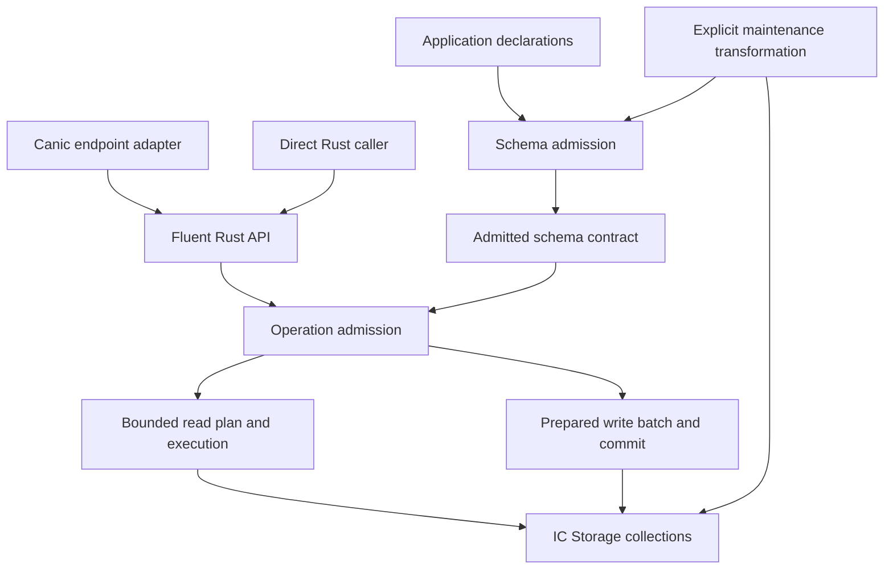

# IC DB system design

Status: proposed, design only. Repository setup, investigation and private source
releases to `dragginzgame/ic-db` are authorized; product implementation, live
deployment and replacement of IcyDB are not. Written 2026-11-13.

Maintainer decision (2026-11-13): freeze IcyDB's local checkout and GitHub
repository pending the IC DB experiment. Preserve existing committed/uncommitted
work, releases and data. Read-only research remains allowed; further edits,
commits, pushes, merges, releases or deployments require an explicit maintainer
decision to lift the freeze or authorize an exception. This records a work freeze,
not a GitHub archive/branch-protection change or an IcyDB retirement decision.

IC DB explores a leaner rewrite of IcyDB for Rust applications on the Internet
Computer, retaining broad fluent query capability and familiar attribute-based
schema authoring. IcyDB supplies requirements, failure examples and useful
algorithms; its accumulated architecture is not a blueprint to reproduce.
Challenge inherited mechanisms and prove platform assumptions before building
infrastructure around them. This remains a separate design-stage project.

No code-size reduction, runtime improvement, storage safety or feature parity is
claimed. An empty library is not a smaller equivalent database.

Accepted scope decision: IC DB exposes a fluent Rust API only. SQL is excluded,
not deferred; there is no separate public dynamic-query frontend. This decision
does not remove SQL from IcyDB or promise parity with its fluent operations.
The target is a broad, bounded, single-entity fluent query builder, including
grouping and distinct, with `#[entity]`-style schema authoring. SQL, joins and
window functions are explicit exclusions. This is a multipurpose database engine
specialized for the IC, with application-defined schemas and no built-in business
domain. Exact fluent semantics and bounds remain to be specified. More code is
acceptable where it delivers useful coherent capability.

Schema changes use compiled, versioned maintenance transitions; general runtime
DDL and online schema activation are excluded. The preferred commit design has
no database-owned ordinary-write WAL (write-ahead log), relying on synchronous
bounded batches and IC message rollback. M0 must prove this with the actual
storage supplier. Durable migration progress remains required.

Resumable aggregation is required within explicit bounds. Application result
mapping uses ordinary Rust iteration, not engine callbacks. The broad schema
type surface is retained unless a concrete reason supports a deliberate cut.
Hours-long maintenance is acceptable; copy space is an accepted cost in a system
that scales across canisters. Efficiency is judged against comparable IcyDB work.

## 1. Product contract

An application should define structured records, write them consistently, query
through useful indexes under explicit resource bounds, and reopen them after a
supported executable upgrade. It should be possible to understand which bytes
are authoritative and why a failed operation cannot leave contradictory records
and indexes.

The database owns row semantics, index/constraint consistency, query results and
its supported persistence transitions. The application owns authorization,
identity issuance, business transactions, tenant routing and cross-canister
coordination. The Canic adapter owns all product endpoint exports, guards,
transport and lifecycle composition. IC DB supplies no endpoint generation or
registration; its Rust library remains usable directly without mounting endpoints.

The target is a useful bounded embedded database, not PostgreSQL completeness,
a distributed database, a general workflow engine or a memory-backend framework.
The intended reduction comes from simpler mechanisms and explicit exclusions,
while preserving broad, application-neutral database capabilities. Exact API and
stored-format compatibility are not promised; no IcyDB retirement is authorized.

### Application-neutral qualification and secondary compatibility

The primary design inputs are accepted database capabilities, IC execution and
storage constraints, and applicable IcyDB lessons. No application's current usage
defines the product's schema, architecture, capability ceiling or milestone order.

Use small synthetic schemas and workloads to exercise independent obligations:

| Workload family | Required evidence |
| --- | --- |
| Typed records and atomic writes | Key ownership, nested/optional values, indexes, uniqueness, references, final-state batches and unchanged reopen |
| Filtered, ordered enumeration | Compound/range access, residual predicates, projection, ties, sparse pages, byte/work bounds and live updates |
| DISTINCT and aggregates | Selected tuple equality, grouping, group filtering/order, empty input, high cardinality and bounded exact resumption |
| Schema evolution | Encoding/index changes, admission, identified transformations, cross-chunk constraints, recovery and allocation reuse |
| Composition and scale | Multiple unrelated schemas, entity/index counts, query shapes, mapping closures and separately mounted host adapters |

Vary data distributions and operation combinations, including rejected and
adversarial cases; no one fixture establishes generality. Small probes choose
mechanisms at M0. The delivered engine qualifies supported combinations in M1–M3.
Independent expected results and declared bounds are required. IcyDB's tests and
history provide further failure cases to rederive, not an automatic obligation
to restore every historical mechanism.

The private [Toko repository](https://github.com/dragginzgame/toko) on GitHub is a
tier-2 compatibility target: its application needs should be accounted for, but
they do not guide the architecture. Inspect it read-only at recorded revisions
when assessing coverage. Translate any gap into a generic capability or an
explicit application integration consequence; do not embed its business model,
copy its schema into the engine, or cut capabilities it does not happen to use.
Toko compatibility does not override the accepted SQL/join/window exclusions.
It is not a prerequisite for specifying generic capabilities or starting M1.

The deleted local Toko checkout was obsolete. Earlier conclusions drawn from it
are superseded and must be rechecked remotely before making compatibility claims.
Do not restore or consult that checkout. This source decision does not change the
independently selected Toko Tooling engineering baseline. No Toko modification,
publication or deployment is authorized.

## 2. Complexity budget and exclusion rules

Every subsystem must name its consumer or accepted product capability, one
authoritative owner, introduced state, failure it prevents and executable
acceptance witness. Each persisted
field needs a writer, reader, invariant and retirement rule. A cache must name
its invalidation owner and remain disposable.

Start without these inherited mechanisms:

- A universal core with mandatory model/view/ops/workflow/adapter layers.
- Separate mutable schema authorities for generated declarations and runtime use.
- Additional query frontends alongside the fluent Rust API.
- SQL parsing/binding/lowering, SQL command caches and text-result conventions.
- General runtime catalog editing and online schema activation.
- Ordinary-write WAL, replay and checkpoint machinery unless M0 proves a gap.
- Joins and window-function execution.
- General backend-neutral storage traits without a second required backend.
- A universal resumable-job interpreter for unrelated database operations.
- Automatic repair/reconciliation of unknown or obsolete persisted formats.
- Generic access-plan conversions, positional side arrays or repeated expression
  normalization unless their semantic or measured execution benefit is shown.
- Plan caches, exact-count acceleration, compiled constraint machines and broad
  generated adapter families as prerequisites for the first useful database.
- Multiple release groups, custom receipt frameworks or native tool packages
  before the corresponding product has a delivery requirement.

Distinguish feature deferrals from proposed enduring constraints: ordinary atomic
writes fit one synchronous message, schema changes use explicit maintenance, one
required storage supplier owns backing mechanics, and access is fluent-only with
no SQL frontend. Additions must preserve this advantage or explicitly justify
surrendering it. An accepted broad fluent capability is sufficient product need;
absence from a particular application is not a reason to cut it. Reintroduction of a mechanism requires
a concrete need and comparison with the simplest correct
alternative. Specialized execution is allowed when Wasm/instruction evidence
justifies it. Fewer lines alone do not justify slower execution or weaker guarantees.

## 3. Proposed ownership and dependency direction

Arrows are responsibility boundaries, not a mandate for a crate per box. Start
with the `ic-db` runtime/facade and internal modules. Attribute-based authoring
justifies a small separate procedural-macro crate when implemented, re-exported
through `ic-db` so applications use one public entry point. Do not recreate
separate core/model/schema/diagnostic packages without an actual boundary need.
The product scaffold has no runtime dependencies. The independent `qualification/`
workspace selects published suppliers for the M0 Wasm rollback probe; no product
dependency may point back into it. Endpoint generation belongs to the separately
owned Canic adapter; qualification exports are private experiment controls.
The required native CLI is a separate client boundary, not part of the Wasm
executor. During M0 its executable lives with the qualification driver and reads
a local fixture; add the product CLI package when the real adapter contract exists.

| Owner | Authoritative responsibility | Not its responsibility |
| --- | --- | --- |
| Admitted schema contract | Entity/field/index identities, types, layout and the selected format | Business ownership, competing generated/durable authorities |
| Row storage | Current records and their admitted encoding | Automatically accepting a changed Rust type |
| Index maintenance | Derived index entries consistent with committed records | Independent business facts or a separate schema authority |
| Read admission/execution | Bound semantics, access choice, resource limits and continuation | Caller authorization, background repair |
| Write admission/commit | Bounded mutation set and atomic row/index outcome | Cross-canister transactions or network calls |
| Maintenance | One selected source-to-target transformation and its recovery | Concurrent online DDL, generic background work scheduling |
| Canic adapter | Endpoints, guards, transport, lifecycle ordering and operational access | Query semantics or independent database state repair |

IC Storage owns allocation handles and collection/backing mechanics; IC DB owns
cross-record and cross-index invariants. The supplier boundary must be proved,
not inferred from the word "storage". Do not recreate Memory/Storage layers merely
to reproduce old package boundaries. Testkit owns PocketIC provisioning/lifecycle;
Build owns generic Wasm build mechanics. Choose their current published versions
when an experiment actually needs them, not speculative pins in this design.

Keep generic typed code at small boundaries: builders, codecs and result
conversion. Prefer shared concrete planning, traversal, grouping, distinct and
commit machinery, so each entity, closure type or fluent chain does not instantiate
another complete executor. Avoid encoding every fluent chain in nested executor
types. Ordinary application `.map()` closures should not specialize database
execution. Do not mandate boxing, a universal iterator or dynamic dispatch
everywhere. Reuse existing IcyDB performance lessons; specialization needs measured
Wasm/instruction value, not another speculative optimization framework.

## 4. Schema and identity: challenge the persisted catalog

Preserve the familiar attribute-based authoring style (`#[entity]` and related
record, field and index declarations). Macros generate the compiled contract,
typed field references and necessary codecs/accessors. They do not generate a
second schema authority or host endpoints. Review individual attributes against
their retained responsibility; this is not blanket source compatibility with
IcyDB's existing options or generated artifacts.

The deployment-defined starting contract creates an opportunity to avoid the
full persisted dynamic catalog, not merely to rewrite its reconciliation code.
**Prefer a compiled canonical schema admitted against a minimal durable format
manifest**, subject to the M0 reopen/evolution experiment. Do not automatically
inherit IcyDB's accepted-snapshot architecture as a requirement of the new product.

The compiled schema owns the current executable's type and operation semantics.
The durable manifest identifies the database incarnation, admitted format/schema
identity and physical collection/layout identities needed to open its records.
Its purpose is admission, not a second editable copy of the schema. Exact schema
identity must cover every behavior relevant to decoding and index consistency;
its definition cannot be just a source name or an unstable Rust hash.

Ordinary access opens only when executable and manifest are admitted together.
A missing/corrupt manifest is an error, never permission to reconstruct it from
generated types. A mismatched executable cannot reinterpret old bytes or silently
accept new declarations. Fresh initialization requires a proven fresh backing.
Typed accessors reference the admitted compiled contract; there is no recurring
proposal/reconciliation/candidate-publication pass on ordinary startup.

A schema-changing executable must explicitly carry the supported source decoding
contract and the transformation to its target, or use a separately approved
export/import path. Old decoders are scoped to that maintenance operation, not
normal runtime fallbacks. They may retire only after their source data and
recovery obligations have been explicitly retired. Arbitrary historical readers
and generic runtime schema editing are not prerequisites.

M0 must prove that the compiled-schema/minimal-manifest arrangement rejects
incompatible layouts and recovers supported maintenance without missing historical
code. Inspection may expose the compiled contract through Rust methods; it does
not require an editable runtime catalog. If this arrangement fails, identify the
missing invariant and reconsider its mechanism explicitly, without silently
restoring runtime DDL or implementing two permanent schema-authority modes.

Persist stable entity/field/index identities independently of source spelling.
Renaming must be explicit; never infer identity from similar names. Permit
unambiguous ergonomic index names with explicit overrides rather than requiring
users to invent every name. Exact identity encoding and allocation are M0/M1
choices, not reasons to copy the current tag/lineage pipeline wholesale.

Retain decimals, large integers, principals/accounts, enums, optional fields,
nested records, lists/maps/sets, composite keys, defaults and managed timestamps.
Current consumer types are experiment inputs, not the product ceiling. A cut needs
a concrete technical or product reason and an explicit decision. Attribute/API
spelling may change while useful semantics remain. Specify ranges, comparison,
text order, null/optional distinctions, default/timestamp behavior and codec limits
once for reads and writes. Retained types must not acquire lossy conversions.
Storing a collection does not imply arbitrary indexing/querying of its contents;
those operations and custom codecs still need explicit contracts.

M0 records a compact type-operation matrix: storage, equality, ordering, indexing,
grouping/distinct and aggregate inputs. Retention does not imply every operation
for every type. Cross-operation witnesses cover decimal equality versus uniqueness/
grouping, composite-key encoding versus comparison, set/map construction order,
enum rename/reorder identity and timestamp preservation during maintenance.
Supported operations must agree; this does not require a universal value engine.

Optional uniqueness is a generic constraint decision: specify whether absent
values participate, and share present-value equality with comparisons and indexes.
Typed conditions may express supported partial-index predicates without SQL text.
Application-specific naming, normalization and length policies are not built into
the engine; its declared type/comparison semantics remain shared and exact.

The initial operation matrix below is a proposed product contract, not delivered
coverage. `Conditional` means an explicit component/comparator and encoded-size
contract is required; it does not mean dropping the capability for lack of a caller.
All families remain storable within declared bounds. Count is available over rows;
counting a selected field must separately define absent-value treatment.

| Type family | Equality | Ordering / index keys | Grouping / DISTINCT | Aggregate inputs beyond count |
| --- | --- | --- | --- | --- |
| Signed/unsigned integers, including 128-bit and U256 | Exact within admitted numeric rules | Exact order; no conversion through float | Same equality as predicates/uniqueness | Sum, average, min/max; explicit accumulator/result range and overflow |
| Decimal | Numeric equality; proposed `1.0 = 1.00` | Comparator and canonical key agree across equivalent scales | Same scale-insensitive equality | Sum, average, min/max; precision/rounding policy must be explicit |
| Finite Float32/Float64 | Declared normalization, including signed zero | Versioned total order over the admitted finite domain | Same normalized equality | Sum, average, min/max; deterministic accumulation/rounding contract |
| Bool, text, bytes | Exact base equality; text transforms are explicit | Declared comparator and bounded key bytes | Same equality and bounded retained key bytes | Min/max where ordered; no implicit numeric conversion |
| ULID, principal, subaccount, account | Canonical identity equality | Explicit identity comparator/key contract | Same identity equality | Min/max where ordered |
| Date, timestamp, duration | Exact typed units | Chronological/numeric unit order | Same typed equality | Min/max; duration arithmetic needs explicit range/result units |
| Enums | Stable variant identity plus payload equality | Conditional on stable variant order and payload comparators | Conditional on canonical payload equality | Min/max when ordering is admitted |
| Optional values | Distinguish absence from zero/empty | Explicit absent ordering; contained type rules | One absent group/distinct value; contained type rules | Explicit absent/empty-input semantics for contained aggregate |
| Nested records, tuples, composite keys | Component equality under stable field identities | Conditional lexicographic components and key-size bounds | Conditional canonical whole-value equality | Min/max when whole-value order is admitted |
| Lists | Order-sensitive element equality | Whole-value/element index operations require separate admission | Conditional on bounded canonical element semantics | Whole-value count; arithmetic requires an explicit selected scalar operation |
| Sets/maps | Construction order must not change equality | Whole-value or member access/indexing remains an explicit decision | Conditional canonical set/key/value equality | Whole-value count; no implicit flattening/reduction |

Do not infer arbitrary member queries from storage or grouping support. IcyDB's
inspected contract already refuses map predicates/indexes and restricts nested
paths; retaining these values does not promise previously unavailable traversal.
Any additional restriction of a retained operation still needs a concrete reason.
Defaults and managed timestamps are authoring/write behavior: migrations preserve
them unless the identified transition deliberately changes them. Exact comparator
identities, numeric result types, float rounding, null/empty aggregate outcomes and
conditional cells remain M0 decisions, with cross-operation witnesses before
implementation claims. Removing SQL must not silently remove finite floats,
dates/durations, field-to-field comparison or supported text/collection predicates.

Derived lookup/layout tables remain disposable and need a measured purpose.
Do not serialize caches or hash multiple equivalent schema representations.

M0 must settle this identity sensitivity table. The canonical contract includes
explicit codec, comparator and supplier-format versions where declarations alone
cannot detect a change; it does not require several competing hashes.

| Change | Proposed admission requirement |
| --- | --- |
| Rust rename preserving explicit identities; documentation/presentation only | Same contract if encoding and stored semantics are unchanged |
| Row encoding | Identify accepted source decoder and admitted transition |
| Index key encoding or text order | New contract; reconstruct affected indexes |
| Null order or uniqueness semantics | New contract; validate target ordering/constraints |
| Supplier collection format | Explicit supplier compatibility identity and supported transition |

The native M0 witness exercises these inputs in one bounded canonical byte
contract. Explicit-ID declaration order and display names are excluded; index
column order and versioned stored semantics are included. This does not detect
an unversioned codec/comparator code change or select a production fingerprint.
Declaration reordering is compatible only when the actual codec preserves layout.

Direct compatibility names an exact accepted source contract, its proven rule
and the transition installing the target identity atomically. It is not permissive
startup reconciliation. Unchanged identity needs no transition.

### Schema maintenance and the DDL boundary

Use deployment-defined schema and explicit maintenance-window evolution.
Hours-long maintenance is acceptable. Source-plus-target capacity is an accepted
tradeoff; expected scale-out is across canisters, not a demand for in-place
migration to minimize temporary space. Per-message work and cleanup remain bounded,
and insufficient capacity must refuse safely rather than damage retained source.
SQL `CREATE`/`ALTER`/`DROP`, independent runtime catalog editing and online
constraint/index activation are excluded. Internal maintenance still creates
target collections, transforms rows, rebuilds indexes, validates constraints,
publishes the target and reclaims retired allocations. These operations belong
to one admitted transition, not a general public DDL interface.

A supported executable upgrade must reopen its data. A schema change is separately
classified as unchanged, directly compatible under a proven rule, or requiring
an explicit transformation. For example, adding an optional field is not declared
safe until its row-decoding and index consequences are proved.

The preferred transformation is bounded copy/validation followed by cutover:

1. Install code carrying the target contract, source decoder and versioned Rust
   transformation. This maintenance-specific Rust function computes target records
   synchronously within chunk bounds, without external effects or reentrant
   database mutation; its version and fixed inputs are stable. It is separate from
   ordinary result mapping and does not introduce general query callback hooks.
2. Establish the durable maintenance gate before copying; ordinary reads and
   writes close and source data stays frozen.
3. Copy affected data into new collections and build its indexes in bounded
   chunks. Commit each chunk's rows, indexes, allocator changes and progress in
   one message; a trap must revert the whole chunk, including progress.
4. Complete validation over all affected dependencies before publication.
5. Atomically switch the manifest/root to the target and reopen admitted access.
6. Reclaim recorded retired source allocations in resumable bounded steps once
   recovery obligations permit it.

For example, adding an index changes the declaration, deploys an admitted
transition, builds and validates the index during maintenance, then publishes
the target. Unaffected collections need not be copied. Retain source until
cutover is committed and recovery obligations are settled. Prove peak space and
bounded cleanup; reject this candidate if it exceeds the declared capacity envelope.
In-place rewriting is not an automatic fallback.

The durable maintenance record retains source and target contract identities,
source/target collection identities, immutable transformation identity/version
and fixed inputs, progress and current phase. This is operation-specific recovery
state, not an ordinary-write WAL or arbitrary transaction replay service.
Resume requires explicit support for that exact transformation, even when source
and target schemas match. Changed transformation code requires a deliberate
restart from preserved source or a separately proven recovery transition; hashing
the whole executable is unnecessary. Retrying cannot select a new source silently;
cancellation before cutover cannot expose target data. After
cutover, cleanup resumes against the retired source, not the live target. Derive
phases from actual irreversible boundaries, not accounting-only transitions.

All supported executables interpret one durable maintenance gate:

| Durable state | Admission and recovery |
| --- | --- |
| Source live, no transformation | Source-compatible executable may serve |
| Source frozen, target building/validating | Ordinary access closed, including under source executable A |
| Cancelled before cutover | Bounded target cleanup; reopen source only under a source-compatible executable after the gate safely clears |
| Target published | Target-compatible executable may serve; source-only executable refuses |
| Retired source awaiting cleanup | Cleanup touches only recorded retired allocations |

A maintenance-only source decoder in B does not authorize B's typed API to serve
the source after cancellation. Source retention after cutover does not promise
rollback after target writes. Before publication, validate the full affected
dependency set of rows, indexes and selected constraints, including unique-value
collisions introduced in different chunks.

Failed validation never publishes the target. Supported code may resume or cancel
the recorded transformation while preserving source. Canic exposes authorized
maintenance controls; it does not own progress or implement another recovery path.

## 5. Reads and query semantics

Fluent Rust builders construct one admitted operation representation. There is
no SQL parser, SQL adapter or separate public dynamic query API. Runtime values
and conditional builder composition can still support application-selected
filters and ordering; applications map their allowed inputs into fluent calls.
Do not replace SQL with a general string-based expression language.

The intended fluent surface is broad within one entity: composable predicates,
field projection, indexed lookup/ranges, ordering, pagination, multi-field grouping,
distinct results, count, sum, min, max and average, with group filtering and ordering
by aggregate results. These are accepted baseline capabilities. M0 specifies exact
types, null/empty/overflow behavior and distinct field/tuple equality. Review
computed expressions and richer ordering on their fluent usefulness and bounded
implementation, not whether SQL originally motivated them. Joins and window
functions remain excluded; broader relational machinery is not implied.

Specify composition before builder spelling. M0 uses a few worked queries with
small inputs, exact outputs, limit/continuation placement and explicit refusals.
Resolve input versus group limits, the distinct projection/tuple, counting distinct
values, post-group filters, ordering stages and equivalent/rejected method orders.
A scan work budget yields incomplete execution; it never silently limits the
mathematical input and turns a whole-query aggregate into a prefix aggregate.

Small composition witnesses, now checked natively with builder spelling still open: input
`(id, category, value)` is `(1,A,10), (2,B,20), (3,A,30), (4,B,20)`.

| Admitted operation | Exact result and limit placement |
| --- | --- |
| Project category, distinct, order category, output limit 1 | First page `[A]`, then `[B]`; duplicates across work/page boundaries stay suppressed |
| Count distinct projected category | `2`, not four entity rows or a sum of page-local distinct counts |
| Project `(category, value)`, distinct, count | `3`; equality covers the selected tuple, not category alone or hidden entity IDs |
| Group category, sum value, keep sums greater than 35, order sum descending then category ascending, output limit 1 | Complete groups are `(A,40), (B,40)`; first output page is `(A,40)` |
| Same grouped operation, input work budget 2 per advance | First advance is incomplete with no final output; it cannot apply the group filter/limit to prefix sums `(A,10), (B,20)` |
| Filter input value at least 20, then the same grouped operation | Only `(B,40)` survives; A sums to 30 after the row filter and fails the group filter |

Output limits apply after the selected projection/distinct or completed group
filter/order stages. An input-prefix limit, if supported later, must be an explicit
different operation. Admission must reject ambiguous stage combinations rather
than allowing method-call order to silently change this meaning. These examples
specify semantics; they do not claim a product fluent engine is implemented.
The native witnesses vary work budgets 1–4, page completed results, and refuse
distinct-key/group capacity overflow without publishing a truncated answer.
Their four-entry finalization bound does not qualify production instruction or
byte limits. Builder method-order admission remains an implementation obligation:
row predicates and aggregate predicates must target explicit stages, while an
output limit must never become an input-prefix limit because of call order.

Remove SQL-only syntax, name/alias binding, literal parsing, statement lowering,
command caching and SQL-facing administration/formatting. Trace shared users
before excluding an underlying capability: comparison, expression evaluation,
projection and aggregation may still serve fluent queries. Origin in SQL work
alone is not evidence that a mechanism is SQL-only. Do not recreate a SQL AST or
compatibility layer behind the fluent builder.

Return bounded typed results that callers can iterate and transform with ordinary
Rust `.map()`. Use a common page container generic over its result type (`Page<T>`
conceptually), with normal iterator access. Entity reads return entities;
projections return projected records/tuples; ungrouped aggregation returns an
aggregate value; grouped pages contain keys and aggregates. Incomplete aggregation
returns an explicit progress outcome. Do not force these results into full entities.
Exact API spelling remains open; no custom engine callback subsystem is required.
Iteration must not hide cross-message fetching or discard page continuation.
Application mapping is outside query planning, bounds and persisted continuation;
mapping a page does not implement global filtering, sorting or aggregation.
Keep database predicates, ordering, grouping and distinct in the fluent operation.
Arbitrary predicate, sort-key, reducer or update callbacks are not part of this
initial contract. Callers construct updated values before submitting a batch;
the database validates them normally. No closures or captures are persisted.

Schema inspection, query explanation and integrity checks may have Rust methods
where needed; SQL command forms are excluded. Ad hoc text
queries, SQL scripts and SQL catalog editing have no compatibility path. M0 must
identify affected consumers/operators and accept their replacement workflows or
exclude them from initial adoption, accounting for application code added.

`make db` installs/updates the native `db` binary without launching it. The `db`
command provides interactive and scriptable schema inspection and bounded queries
(`db schema`, `db query --limit 2`). Schema output comes from the executable's
compiled contract plus durable admission/status, including fields and indexes;
it is not a second editable schema catalog. The CLI uses explicit commands and
options, not SQL or an arbitrary expression language. In the product, the Canic
adapter maps allowed requests into fluent operations under the same admission,
ordering, work/byte limits and continuation semantics as application callers.
No separate CLI planner or executor is permitted. Canic owns remote endpoints,
authentication and authorization; the database owns semantics. Surface partial
pages and refusal reasons explicitly and return nonzero status for failed scripts.
The current M0 console reads only a labelled local synthetic fixture; connecting
to real deployments and exposing broad fluent operations remain implementation work.

For the first query subset, support primary-key lookup, required index equality
or range lookup, composable bounded filters, projection, deterministic order,
page limits, grouping, distinct results and selected aggregates.
Choose a simple deterministic access rule before adding a cost model. An index
restriction is a derived optimization, not a second complete filter authority.
Residual truth semantics remain authoritative when an index covers only part of
a filter. Specify error precedence, null behavior and numeric comparison once.

Physical execution may specialize primary-key, index and bounded scan paths.
Share admission and continuation rules without forcing every hot loop through
one generic iterator framework. Reject unsupported or unbounded query shapes
explicitly; do not quietly fall back to an arbitrarily large scan.

Admit ordering only when the access path supplies the complete requested order
with its unique tie-breaker, or the entire candidate set fits an explicit sort
bound. Sorting a bounded prefix of a differently ordered index cannot establish
global order; refuse that shape when neither proof holds.

Accepted browsing contract:
keyset pagination over a total order with a unique tie-breaker, with documented
live-data behavior across calls; no snapshot-isolation claim. Bind continuations
to the database incarnation, schema/query/order and progress, and bound decoding.
If a cursor carries trusted progress or planner decisions, authenticate it or
revalidate all such claims. Treat application authorization independently on
every request. Inserts/deletes and updates to order or predicate fields are live:
a returned row moving beyond the cursor can repeat; an unseen row moving behind
it can be omitted; predicate membership can change. A tie-breaker gives no
at-most-once identity guarantee. This live behavior is accepted for browsing.
Exact enumeration, where required, needs a separate explicit contract; resumable
aggregation must not silently inherit browsing's duplicate/omission behavior.
Test these cases and schema changes before implementation.

Preferred bounded-scan response: return a possibly empty or partial page with a
continuation when work is exhausted. Only explicit completion ends enumeration.
Advance past the last fully processed candidate, including residual nonmatches,
not merely the last returned row. Count examined index candidates and fetched
rows separately. If a qualifying row cannot fit the remaining output bytes,
retain a position before it so the next page retries it; a row exceeding the
whole response allowance produces an explicit size refusal, not an endless
empty page or silent skip. M0 must accept these progress/retry semantics.

Bound requests using visible limits: bytes, terms/depth, batch size, rows examined,
rows returned and work per continuation. A small query language should not need
an elaborate weighted accounting framework. A bound must stop work before the
protected resource is exceeded, not merely count afterward.

### Constrained resumable aggregation

Aggregation must support bounded advancement across calls, not only refusal when
input exceeds one call's budget. Limit each advance's input work and bytes; also
bound total group cardinality, intermediate-state bytes, output size and the
number of retained jobs.
Resumption is not a promise of unlimited cardinality or arbitrary reducers.
Specify distinct-key retention and its interaction with aggregation separately.
Per-message bounds cover every phase: accumulation, finalization, group filtering,
aggregate ordering, materialization, invalidation and cleanup. Either cap group
state so finalization provably fits one message or advance it in bounded steps.

The operation has an explicit incomplete/complete outcome. Never present partial
accumulators as completed results; group filtering and aggregate ordering operate
on complete results unless a separately proved execution path can finalize groups
earlier. Page-local deduplication is not whole-query distinct. Completed output
may itself need bounded pagination and cleanup.

For an unfiltered projection whose access path orders by the distinct key, a
small ordered-DISTINCT witness now suppresses adjacent equal keys across pages
without a retained seen-set (section 12). Prefer that direct path when its proof
holds; it does not remove the need for bounded retained keys or full collection
for other admitted DISTINCT shapes. In particular, residual filters and ordering
by another field need their own progress/equality proof. Live ordered enumeration
still does not establish a frozen input for an exact count or aggregate.

Probe source-revision invalidation first; freezing input is a comparison candidate,
not an accepted query outage. Hours-long schema maintenance does not authorize
write pauses for ordinary aggregation. Neither consistency mechanism is selected
yet. Prefer explicit source-changed invalidation over invisible restart loops;
any automatic retry must be deliberately bounded. Measure completion under a
representative write rate: exactness on completion does not guarantee useful
completion. Do not accumulate across live pages that repeat/omit rows or introduce
snapshot/versioned storage implicitly.

If revision invalidation is selected, a conservative per-entity revision is a
candidate. Relevant committed mutations advance it atomically with data/index
changes; refused/trapped mutations leave no revision advance. Restoring old values
still counts as change, reopen preserves its meaning, and intermediate aggregate
state writes do not invalidate the input. Prove these properties without adding
a change log or historical rows; select the actual revision scope in M0.

The first fixed grouped-sum probe supports this mechanism's exactness and retry
safety, but all five synthetic contended attempts invalidated (section 12).
Do not select it as a general completion guarantee. A compound application
calculation reading multiple entities needs a coherent boundary for all of them;
one entity's revision cannot certify the other reads. This does not add database
joins or authorize an aggregate write freeze.

M0 also selects where intermediate state lives and who can advance/read/cancel
it. If server-retained, bind it to database/schema/query/algorithm identity and
the chosen source boundary; advance accumulators and position atomically, and
prove retries cannot double-count. Define upgrade invalidation/resume, cancellation,
expiry and bounded reclamation. A client-carried alternative needs bounded size
and validation of trusted claims. Persist no user closures. This is a focused
aggregation mechanism, not a general resumable-job framework or ordinary-write WAL.
Use application-neutral correctness/high-cardinality cases across varied write rates.

## 6. Writes, commit and recovery

Prefer no database-owned WAL for ordinary writes. Prove the message rollback
boundary instead of introducing durable batch records, replay, checkpointing or
log retirement. This choice is conditional on the M0 Wasm/supplier evidence;
removing SQL is not its justification.

Insert, replace/update and delete lower into one concrete prepared batch of row
and derived-index changes. Read required current rows once, validate types and
constraints, calculate changes, then commit. Distinct user commands retain their
semantics; they do not each get a staging/validation engine.

The initial API uses reads of current state followed by one explicit atomic batch
within the same synchronous message. It has no general transaction closure or
read-your-own-staged-writes context. Crossing a message boundary between reads
and submission does not preserve the read assumptions.

Retain reference existence checks and restricted deletion. Validate these against
the intended final batch state; dependent changes are explicit batch commands.
Automatic recursive cascades are excluded initially, and finite batch/fan-out
limits apply to explicit dependent writes.
Every enforced reference needs bounded target-existence and reverse-reference
checks, normally through a maintained ordinary index. A target delete must account
for references deleted/repointed in the same batch, then detect any surviving
reference without an unbounded scan. A mapping's reference to an existing user
does not require every user to have a mapping; declare that inverse requirement
separately if needed. Nested stored containers do not automatically gain enforced
member references; qualify the explicitly supported reference locations.

Preferred candidate: ordinary recoverable refusals occur during preparation.
Decode within bounds, read current records, and validate the complete intended
mutation set before persistent mutation. Then synchronously apply every row,
index and necessary allocator change without external calls. After mutation
starts, complete or trap the enclosing message through the proven rollback
mechanism; never return a partial `BudgetExceeded`. Keep preparation internal to
this operation, with no public prepare-now/commit-later handle.

Preparation establishes structural bounds on encoded bytes, mutations, index
fan-out and peak memory. Remaining commit failures must roll back. The
[IC message execution contract](https://docs.internetcomputer.org/references/message-execution-properties/)
provides message rollback on traps, not on normal application error returns.
A database success is not an independently durable commit:

| Surrounding application behavior | Proposed outcome |
| --- | --- |
| Batch succeeds; message completes normally | Effects persist |
| Batch succeeds; later code in the same message traps | Batch rolls back too |
| Batch A succeeds; B is refused; application normally returns an error | A can persist |
| Batch succeeds before an inter-canister call; later callback traps | Earlier execution's effects remain |

A commit-time trap also rolls back earlier application work in that message.
The Canic adapter must preserve this boundary, not translate an abort into normal
success or error return. Selectively undoing a batch while preserving earlier
message work is outside this contract. Audit history or change feeds, if selected,
need their own requirements; neither is supplied by the migration progress record.

The public cross-record example is one `batch(insert parent, insert dependent)`
(conceptual API), with authorization and stable IDs supplied by the application.
Separate successful database calls do not form one application transaction.

Atomicity alone does not define valid batches. Initial candidate semantics:

| Interaction | Proposed result, subject to M0 acceptance |
| --- | --- |
| Multiple commands for one entity/primary key | Refuse |
| Two mappings claim one principal | Refuse |
| Release/acquire or exchange unique values across distinct rows | Accept if complete final-state uniqueness holds |
| Create user and mapping | Accept if final-state constraints hold; a mandatory mapping per user is a separate declared constraint |
| Delete user leaving its mapping | Refuse under the selected mapping constraint |

Validate interactions against the complete intended result, not independently
against unchanged storage. An in-memory mutation set may suffice; it does not
justify a durable overlay. M0 must prove the chosen semantics with the supplier.

The fixed final-state batch witness now passes these cases (section 12). It stages
at most eight commands in memory, validates changed mappings against final users
and final principal ownership, then removes all touched old index entries before
installing the new rows/indexes. A reverse `(user, mapping)` index permits restricted
deletion to skip mappings deleted/repointed in the same batch. Each skipped old
reference consumes a distinct batch command, so at most the batch bound plus one
candidate is needed to find a surviving reference or exhaust the range. Newly
created references to a deleted user are refused during final-state validation.
This argument relies on maintained index integrity; corruption is not permission
to ignore a reference. The witness qualifies these fixed semantics, not generic
constraint generation, nested references or production resource envelopes.

M0 must establish which guarantees come from IC execution and IC Storage. If the
no-WAL candidate fails, name the exact uncovered failure before reconsidering a
database-owned commit mechanism and its replay/visibility/retirement owner. Do not
copy IcyDB's canonical/live/tombstone/provenance layers first or remove existing
IcyDB protections. Native tests alone cannot prove IC message rollback.

Success would establish disciplined use of IC rollback, not independent
cross-collection transactions supplied by IC Storage.

Malformed stored bytes fail closed through bounded fallible decoding. Recovery
must distinguish incomplete current-contract work from corruption and unsupported
formats. Integrity inspection reports inconsistency; it does not silently repair
business data. Runtime metrics and errors expose actionable state without becoming
another persisted authority or a large mirrored diagnostic taxonomy.

## 7. Capability disposition proposal

"Initial" below is a proposed implementation scope, not a statement of availability.
"Consumer-gated" means a decision remains open; it is not a parity backlog or an
approved removal from IcyDB. Accepted fluent product scope also justifies work
without a current application caller. This inventory covers inspected major families,
not every public API or downstream consumer.

| Existing responsibility | Proposed disposition | Admission or preservation witness |
| --- | --- | --- |
| Durable structured records and stable IDs | Initial | Write/reopen and exact application ID preservation |
| Primary-key and unique secondary indexes | Initial | Duplicate batch refusal and row/index agreement |
| Attribute-based schema and fluent access | Retain familiar authoring style | Compiled contract and typed helpers; no required Canic endpoints |
| Runtime-selected filters | Required through fluent composition | Runtime operands and supported predicate combinations share bounded admission |
| SQL SELECT/mutation syntax and separate dynamic frontend | Excluded by accepted fluent-only scope | Identify affected callers and accepted replacement workflows |
| SQL DDL and general runtime catalog editing | Excluded | Schema defined in code; supported changes use explicit maintenance |
| Joins and window functions | Excluded | Fluent admission exposes no such operations |
| Explicit schema transformation | Initial persistence journey | Interruption, resume, cutover and cleanup witness |
| Online constraint/index activation | Excluded from the selected maintenance contract | Indexes and constraints validated before maintenance cutover |
| Ordinary-write WAL/replay | Omit subject to M0 proof | Wasm rollback covers row/index/allocator changes and host composition |
| Durable migration progress | Required | Exact transformation resumes; chunk data and progress commit together |
| Relations and referential actions | Reference validation and restricted deletion; explicit dependent batches | Final-state constraints hold; no automatic recursive cascades |
| Broad types, composite keys and nested collections | Retain accepted authoring surface | Exact codecs, limits and supported query semantics; concrete reason required for cuts |
| Optional fields, defaults and managed timestamps | Retain with explicit semantics | Insert/update/old-row decode agree; no ambiguous omission |
| Expression/prefix/partial indexes | Review against broad fluent scope | Representative query plus ordering, bounds and maintenance proof |
| Projection and composable predicates | Required fluent capabilities | Typed results and consistent bounded filtering |
| Grouping and distinct results | Required fluent capabilities | Defined equality/null behavior, complete results and bounded high-cardinality execution |
| Multi-field grouping, count/sum/min/max/average, group filtering and aggregate ordering | Required baseline | Defined empty/null/overflow behavior and independent result oracle |
| Resumable aggregation | Required, explicitly constrained | Input consistency, bounded state/work, retry-safe advancement and cleanup |
| Computed expressions and richer ordering | Review for fluent usefulness | Retain useful bounded behavior; exclude SQL-only machinery |
| Exact-count acceleration and query caches | Defer optimization | Measured benefit with invalidation cost included |
| Pagination | Initial explicit live-data contract | Stable order, tamper/refusal and inter-page mutation cases |
| Resumable bulk mutations | Defer ordinary API | Work cannot fit a bounded batch; select explicit semantics |
| Cross-canister transactions/replication/sharding | Application/infrastructure owned | No distributed atomicity claim from local batch success |
| Memory allocation and raw collections | IC Storage owned | Checked ownership and actual supplier guarantees |
| Result mapping | Ordinary Rust iteration over bounded results | No engine callback hooks or hidden page fetching; preserve continuation |
| Endpoints, guards and lifecycle composition | Canic adapter owned | Direct library use and separately composed Canic endpoints |
| Wasm build and PocketIC infrastructure | Build/Testkit owned | No duplicate provisioning/cache/server manager |
| CLI/schema inspection and queries | `make db` installs; `db` runs | Thin no-SQL client, shared fluent semantics, bounded output, Canic-owned remote integration |
| Integrity/error/metrics reporting | Initial bounded essentials | Corruption and incomplete operation produce useful diagnostics |
| Old formats, cancelled plans and compatibility aliases | Historical research only | Unsupported bytes rejected intact; no legacy read path |
| Historical implementation-shape tests | Do not port mechanically | Retain requirements and independent semantic oracles |

## 8. Experiments before an engine

Keep experiments in an independent qualification workspace when authorized.
Use small native/Wasm probes, not a prototype universal database framework.
M0 chooses contracts and proves candidate mechanisms with small representative
examples. The list below names evidence questions, not a full feature matrix to
implement twice. Full supported combinations belong to the delivered M1–M3 engine.
Prove one migration's data/progress boundary and one representative resumable
aggregate; do not build general migration or grouped-query engines in qualification.

1. **Commit boundary:** use the actual Wasm environment and selected supplier;
   inject failure before, between and after row/index/allocator mutations. Contrast
   normal error returns with traps and exercise section 6's composition and
   intra-batch cases, reference validation and restricted deletion. Independently
   inspect allocator metadata and index entries,
   not just reads through the writer's own lookup path. Establish whether the
   bounded contract can dispense with an ordinary-write journal.
2. **Schema authority:** qualify the compiled-schema/minimal-manifest candidate
   for unchanged reopen, changed declarations, unsupported
   formats and interrupted installation. Prove that generated metadata cannot mask
   missing/corrupt format metadata, and that source decoders remain available for
   the selected maintenance recovery. Specify the retained type-operation matrix
   and probe a few cross-operation boundaries; qualify the full matrix in M1–M3.
3. **Maintenance:** select a representative encoding change and index rebuild
   that expose retained storage and constraint obligations. Interrupt every
   progress/cutover/cleanup boundary; test cancellation and source executable A's
   refusal while frozen. Interrupt B, install B-prime with the same target schema
   but a different transformation identity, and require refusal without mixed
   results. Inject failures between chunk data and progress writes and prove
   both revert together. Test target uniqueness collisions across chunks, complete
   dependency validation, source preservation and allocation reuse on a second
   migration. Exercise prolonged maintenance, capacity refusal and restart recovery;
   hours of downtime are accepted, but unbounded individual messages are not.
   Separately test upgrade-hook traps and multi-message transformation recovery:
   [atomic executable upgrades](https://docs.internetcomputer.org/references/ic-interface-spec/management-canister/)
   do not supply atomicity for an entire multi-message database transformation.
4. **Query contract:** derive cases from the retained capability matrix, with
   fluent operand validation and an independent result oracle. Prove ordering admission,
   sparse-filter empty/partial-page progress, output-byte retry without skips,
   and insert/delete/order-field/filter-membership changes between pages.
   Include grouping/distinct cases with repeated keys across work/page boundaries,
   nulls, empty input and high cardinality; prove result completeness or refusal.
5. **Resumable aggregation:** use one small grouped aggregate across bounded
   advances with an independent oracle. Probe revision invalidation first, including
   row/revision rollback, value restoration, reopen and self-invalidation avoidance.
   Exercise representative writes to distinguish exactness from completion.
   Bound finalization/order/materialization as well as scanning. Define replay,
   cancellation/expiry and upgrade contracts; probe the selected state/progress
   mechanism now and qualify the full aggregate family during M2.
6. **Composition and size:** compare an empty host, a small typed-record workload,
   varied representative entity/index sets, and those workloads through the Canic
   adapter. Vary entity count, fluent-chain shapes, application mapping closures and
   endpoint count independently; attribute incremental Wasm costs to each.
   Confirm ordinary result mapping does not instantiate another executor. Reuse
   applicable IcyDB performance evidence and target remaining uncertainties.

These experiments may disprove the proposed architecture. In particular, do not
assume IC Storage supplies cross-collection transactions or that a maintenance
copy fits the real storage budget. Evidence precedes the implementation choice.
Prove progress separately from safe rollback: selected insertion, growth and
reclamation primitives must fit the advertised message envelope. Repeatedly
trapping safely on the same oversized operation is not successful continuation.

## 9. Delivery and deletion gates

| Milestone | End-to-end result | Exit condition |
| --- | --- | --- |
| M0 — Scope and feasibility | Application-neutral capability contracts and small mechanism probes | Outputs below accepted; no product engine yet |
| M1 — Useful persistent records | Application-defined typed schemas support indexed reads and bounded cross-record writes | Real public API, bounded atomic batch, reopen, rejection tests and team instructions |
| M2 — Fluent queries | Broad filtering, projection, ordering, live pages, grouping, distinct and constrained resumable aggregates | Shared semantics, exact completed aggregates, bounded state/work and measured cost |
| M3 — Schema maintenance | Executable B preserves promised state through one selected transformation | Interrupted progress, cutover, cancellation/cleanup and same-contract recovery qualified |
| M4 — Product qualification | Reusable host adapter and comparative evidence across representative workloads | Net responsibility reduction, acceptable costs, explicit remaining capability gaps; tier-2 integration findings recorded separately |
| M5 — Additional capabilities | Extensions beyond retained types, required relations and aggregate baseline | Each extends a working journey and deletes any superseded mechanism in that scope |

Within M2, implement filtering/projection/ordering/live pages first, then distinct,
grouping and aggregate semantics, then resumable exact aggregation and completed
output pagination. This sequences delivery without reducing the accepted scope.

M0 exits with application-neutral schema/query/write contracts,
the broad fluent capability inventory and SQL-only exclusion rationale;
ordinary batch and intra-batch contracts backed by a Wasm rollback probe; schema
identity/compatibility decisions; a minimal identified-maintenance recovery probe;
ordering, page-exhaustion and grouping/distinct contracts, including resumable
aggregation input consistency and state ownership; supplier ownership,
allocation, rollback and reclamation evidence; and a comparable baseline with
numeric acceptance budgets.
Record results against these contracts in this design and executable experiments,
not a parallel local issue queue. Small probes are disposable when disproved.
Keep further architecture changes tied to probe evidence or explicit product
decisions; M0 is not a disposable implementation of the full database.

The design is not approval to implement these milestones. Do not recreate the old
module tree under new crate names. Each accepted milestone includes its callers,
tests, diagnostics, instructions and removal of abandoned prototypes. Keep one
chosen implementation in IC DB. IcyDB remains a separate working product until
an explicit replacement decision; leaving it intact is not an excuse to support
two engines behind a permanent adapter in the new product.

### Next delivery: close M0, then typed schemas in M1

Use IcyDB's accumulated guides, regression tests and change history as a source
of requirements and counterexamples. For each relevant case, identify the user
outcome and failure it prevents, then choose the smallest mechanism under this
design's contract. SQL-authored tests can still establish retained fluent behavior.
Do not transplant their SQL transport, schema lifecycle or generated adapters
along with the invariant. Reading a historical test is not evidence that it passes
in the new engine, or that every historical requirement remains applicable.

M1 delivers application-defined schemas, not a prescribed user/account model.
Use a small synthetic parent/dependent schema to establish typed records,
references and bounded batches, plus unrelated scalar/composite/nested schema
examples to expose accidental domain coupling. Fixture names are test vocabulary,
not built-in entities. The retained type-operation matrix defines the scope;
application-specific fields, defaults and string limits do not enter it.

Keep familiar `#[entity(...)]` authoring and small generated typed boundaries.
The first delivered schema must provide fields, type/optionality/bound information,
primary and secondary keys, references, stable identities and codec/semantic
versions from one compiled contract. `db schema` must inspect that contract and
its durable admission status instead of a hand-written fixture description.
The macro crate generates declarations, codecs and typed field/key access; the
shared runtime admits and executes. Canic alone exports product endpoints.

The M1 API journey is create a fresh database; reopen a compatible one; insert
related records in one bounded batch; look up by primary and secondary key;
read/modify/replace typed values; reject conflicts; reopen after upgrade.
Whole-row replacement must distinguish present/absent values and preserve the key.
If partial updates are exposed, omission and setting an optional field to `None`
must remain different operations. Generated IDs, defaults and timestamps have
explicit ownership; conversion from a row must not silently replace a supplied ID.
Exact method and generated-helper names remain open until this journey compiles.

Do not grow M0 into a second implementation of that journey. Consolidate the
remaining decisions before product work:

| Remaining M0 decision | Evidence or disposition still required |
| --- | --- |
| Generic capability contract | Specify supported predicate/order/count combinations, cursor semantics, type bounds and optional-unique equality independently of any application |
| Aggregate completion | Choose revision invalidation or another proven input boundary, state ownership and acceptable completion behavior under writes |
| Durable compatibility and capacity | Select the canonical identity/codec contract and a feasible repeated-migration allocation strategy or accepted lifetime growth bound |
| Comparative acceptance | Capture a fixed SQL-disabled IcyDB baseline and numerical budgets using existing evidence where applicable; do not infer speed or size savings from toy probes |

The existing probes support specific candidate mechanisms. They do not close
these decisions. M1 delivers the real schema and persistent record API; M2 expands
fluent execution and M3 adds supported transformations. No extra schema-only
framework or additional disposable database is required between M0 and M1.

## 10. Measurement and qualification

Before claiming an improvement, capture the same workload/data and comparable
semantics against a fixed IcyDB candidate. Record source revision plus dirty-file
identity, lockfiles, compiler, features, target, build profile and selected supplier
graph. Comparing the new minimal core with every IcyDB feature enabled is invalid.
Use an IcyDB build with SQL disabled when attributing fluent-runtime savings;
removing an optional SQL frontend alone is not proof of a smaller fluent engine.

Measure total uncompressed Wasm bytes and code-section bytes, IC cycles and
instruction counts for insert/update/delete, indexed lookup, selected scan/page,
reopen and maintenance. Include normal/rejected/interrupted cases where relevant.
Measure the complete application read-modify-write journey, including a possible
application read followed by the database's validation/index-maintenance read.
Do not hide that cost by measuring only batch application or introduce transaction
closures/prepared-write handles without evidence of a required contract change.
Measure live row/index bytes, temporary source-plus-target bytes, allocator
overhead/reusable free space and physical stable-memory allocation before/after
cleanup and a second migration. The
[stable-memory API](https://docs.internetcomputer.org/references/ic-interface-spec/canister-interface/#stable-memory)
offers size/grow/read/write, not shrink; logical cleanup must not be counted as
physical allocation reduction. Supplier reuse of freed capacity needs evidence.
Wall-clock/native timings are not database performance proof.

Use section 8's four composition builds to measure growth beyond two entities.
Monomorphization is an explicit size budget: compare identical workloads/build
settings while adding entities, query shapes, result-mapping closures and Canic endpoints.
Report total uncompressed Wasm and code-section deltas plus IC instructions/cycles;
source LOC, generic elegance and native timings cannot establish absence of bloat.
Include generated codec/field glue and application mapping, not just the shared core.
Runtime datasets include sparse residual matches, duplicate secondary keys,
maximum records, rejected writes and high index fan-out, not only average rows.

The performance objective is improved efficiency relative to comparable IcyDB,
not a fresh arbitrary size-versus-speed preference. Reuse relevant existing
IcyDB investigations when their inputs and semantics match; do not repeat settled
optimization work. Report Wasm and instruction/cycle tradeoffs separately rather
than treating one smaller metric as proof that every workload improved.
Set numeric acceptance budgets from that baseline before implementing the
measured replacement; numbers remain unmeasured here, not zero. Count API
concepts, authoritative/derived representations, durable fields/phases, runtime
transformations, generated implementations and dependencies. Report non-test and
test LOC separately when comparing implementations; include code moved into
suppliers, adapters or consumer workarounds (filtering, sorting, retries and
integrity checks) rather than claiming a local deletion as a system reduction.

At adoption, compare the architecture with targeted IcyDB simplification under
the same scope choices; implementing both is unnecessary. Explain why reaching
the smaller contract in IcyDB would be harder or riskier before preferring a new
repository. Report separately: simplification of the same promised behavior,
deliberate scope reduction, and relocation into consumer/host/supplier code.

Reuse IcyDB as a differential oracle only for intentionally preserved behavior.
Use independent expected outcomes or a deliberately bounded SQLite oracle where
semantics match; do not make old behavior correct merely because both paths agree.
Retain corruption, invalid-input, uniqueness, cursor and failure-window tests.
Do not port thousands of private fixture builders just to keep old test names.

The scaffold CI covers Linux and both declared macOS hosts when run remotely.
Remote host CI and database qualification have not passed yet. Local scaffold
checks establish tooling/compiler wiring only; section 12 records the narrower
passing M0 Wasm probe separately.

## 11. Hard cuts, adoption and open decisions

New persisted formats and public APIs are permitted design candidates. They do
not authorize rewriting or deleting an existing IcyDB installation. No automatic
import, fallback decoder or in-place format conversion is planned. Any eventual
migration needs a separate consumer-approved export/import or retirement plan,
with integrity checks and a recovery/disposition owner. Within a supported IC DB
contract, interruption recovery and promised upgrade preservation remain required.

Resolve these questions at M0, not through accidental implementation:

- Which schema/query/constraint combinations are admitted, and what independent
  workloads qualify their semantics, resource bounds and expected refusals?
- What per-message work and capacity bounds qualify hours-long maintenance?
  Copy space is accepted; prove safe refusal and recovery when it cannot fit.
- Which cross-record operations need atomicity, and what does Storage actually
  guarantee? Does any required operation exceed the synchronous batch contract,
  requiring explicit maintenance or a separately accepted scope change?
- Which cursors survive executable/schema changes, and how is their trust
  established? Live browsing is accepted; select the separate consistency/state
  contract for resumable exact aggregation, including behavior under ongoing writes.
- What exact codec, default/timestamp and query semantics qualify the retained
  type surface? Any proposed cut needs a concrete reason, not application usage.
- Does measured benefit justify a separate replacement after consumer changes,
  missing capabilities and supplier responsibilities are included?

A negative answer can stop the rewrite or change its scope. The goal is a simpler
useful database, not completing a rewrite because a repository now exists.

## 12. Source record and confidence

The design review sharpened M0 requirements; it did not independently verify the
repository observations below. The subsequent M0 experiment is recorded separately
from those observations. Neither the review nor that probe establishes full
consumer adoption, supplier qualification or a performance improvement.

Read-only investigation on 2026-11-13:

- IcyDB at HEAD `c71f242833b2c490aaf11f68a62cb72c1b48e340`, with substantial
  uncommitted 0.311/tooling/dependency work. Inspected current README, schema
  authoring guide, persisted-format inventory, `db`/`db::schema` ownership,
  mega-audit findings/programme/schema-lifecycle-removal and 0.311 status.
  The type-operation review also reads `crates/icydb-core/src/value/mod.rs` and
  `docs/contracts/QUERY_PRACTICE.md` without changing the frozen checkout.
  These observations included uncommitted work before the subsequent maintainer
  freeze. The freeze does not by itself capture a reproducible benchmark baseline;
  revision plus working-tree identity still need recording for comparisons.
- Later schema closeout inspection found IcyDB at clean HEAD
  `6d421e3601a3d71e42af23ea5fe6b168cb6ef2ac` (the freeze commit). Read its current
  schema-authoring guide, entity declaration fixtures, entity-rename and schema-guard
  integration tests, and scoped change history. These add caller-authored ID,
  omitted-versus-null, explicit identity and host authorization requirements;
  they were not executed here. This later revision supersedes the earlier dirty
  checkout as a source for new research, not as a measured benchmark result.
- Canic at HEAD `8ef9529ed65984817c74621c4a9a6b56806cc14c`, with active uncommitted
  rewrite work. Its system design and M0 first-journey record motivated the
  user-journey/disposition/experiment approach. Canic was changing during the
  investigation; no statement here certifies its current implementation stage.
- Earlier local Toko inspection is superseded: the maintainer identified the
  checkout as obsolete and deleted it. Its schema proposal and consumer-specific
  milestone gates have been removed. GitHub metadata confirms the authorized
  tier-2 source is private `dragginzgame/toko`, default branch `development`.
  Current remote application contents have not yet been requalified. Future
  compatibility findings must record the inspected revision; repository access
  alone does not validate the withdrawn local observations.

The earlier IcyDB audits already show important convergence in mutation,
traversal and candidate construction. They do not establish multiple wholly
redundant engines or a defensible whole-subsystem deletion count. This design
therefore challenges the required breadth and representation/state ownership;
it does not promise savings from renaming crates or repeating completed cleanups.

The product scaffold selects only published Toko Tooling 0.42.5. Qualification
selects published IC Storage 0.74.0, Testkit 0.102.0 (PocketIC 16.1.0), Platform
Runtime 0.22.2, Wire 0.22.1 and Wire Endpoint 0.13.1, with exact resolution in its
own lockfile. Versions were checked at selection; these are probe inputs, not a
product compatibility promise. No first-party implementation has been copied
from IcyDB or Canic.

### M0 evidence so far (2026-11-13)

The Wasm probes below pass in local PocketIC with the published supplier versions
above, Rust 1.100.0 and the qualification Wasm release profile. `m0-contracts`
instead runs native semantic checks without PocketIC. Full
contracts, limits and run instructions live with the [executable probes](../../qualification/README.md).
These are synthetic mechanism witnesses, not product qualification or comparative
performance results.

| Probe | Evidence established | Important limit |
| --- | --- | --- |
| `make m0-contracts` | Numeric key/comparison agreement, canonical schema sensitivity and projection/DISTINCT/grouping composition pass; work budgets preserve complete answers and state-capacity overflow refuses | Native candidate constructions only; no product builder/codec/hash, full type coverage, arithmetic or Wasm cost proof |
| `make m0-rollback` | Traps after allocation, row/index writes and surrounding application work restore the complete backing image; normal error returns retain previous writes; same-code reopen works | Supplier-internal failures, instruction exhaustion and cross-message callbacks remain unqualified |
| `make m0-batch` | Final-state unique exchanges/release-acquire, reference existence and indexed restricted deletion pass; refusals precede mutation; five index/row failure boundaries restore backing | Eight commands with numeric stand-ins; no generic/nested constraints, rich codecs or corruption repair |
| `make m0-aggregation` | Twelve rows produce exact grouped sums in four advances; replay, progress rollback, cancellation and same-code upgrade pass | One fixed three-group sum; every one of five synthetically contended attempts invalidated |
| `make m0-maintenance` | Identified copy/index rebuilding, changed-transformation refusal, frozen-source enforcement, cutover, cancellation, missing/unsupported identity refusal and upgrade-hook rollback pass | Six rows and predeclared allocations; no general transformation, repeated-migration reuse or production capacity proof |
| `make m0-reads` | Path/order refusal, sparse-page progress, actual reply-byte retry/refusal, ordered DISTINCT, cursor binding and live mutation cases pass | Eight rows and two direct paths; no full sort, filtered/unordered DISTINCT or broad type/predicate execution |
| `make db`, then `db` | Installation and interactive/script-mode schema/status inspection and bounded queries against the local fixture | Fresh temporary data; no product runtime or remote Canic integration |

Raw backing comparisons cover allocator controls as well as logical rows.
Complete expected row/index sets and full-sort/projection oracles provide checks
independent of admission and traversal. The original rollback fixture grows from
42 physical pages (2,752,512 bytes) to 50 (3,276,800 bytes); traps restore its
42-page image. These numbers describe the fixture, not efficiency budgets.

Batch preparation retains only bounded intended changes in memory. Unique-value
swaps remove touched old index entries before installing new ones. Reverse
reference checks account for same-batch deletes/repoints; an unrelated user delete
examines zero candidates despite nine mappings elsewhere. Mapping existence does
not imply a mandatory mapping for every user. No durable staging or ordinary-write
journal was added.

Aggregation returns ordered sums `(0,300), (2,260), (1,220)` only after completion.
Value restoration still invalidates the captured revision; intermediate-state
writes do not. Completed output retains its captured revision after later writes.
The contention schedule demonstrates possible starvation, not its frequency under
representative write-rate distributions. Consistency, ownership/expiry and completion requirements
remain open.

Maintenance B-prime has the same target schema as B but a different transformation
identity and refuses B's partial output. Distinct source values colliding under
the target rule in separate chunks refuse without publication. Cancellation
preserves source data, but source-compatible A must restore ordinary service.
Source A cannot serve after target publication. Logical cleanup leaves physical
allocation at 50 pages.

Published IC Storage 0.74.0 documents that buckets are never reclaimed or
reassigned to another allocation. The cleanup observation does not establish
capacity reuse by a fresh target. Repeated migrations still need a proven reuse
strategy or explicitly accepted lifetime growth limit; do not conceal this
supplier constraint behind a database-owned allocator.

The read probe returns `[None, 10, 20, 30, 40]` across one-candidate DISTINCT
pages, with zero row fetches and no durable query state. It sizes tentative
success replies by re-encoding small pages; this is a bounded fixture technique,
not a selected production optimization. Cursors are revalidated logical seek
positions, not trusted receipts or authorization claims. Live updates reproduce
the accepted duplicate/omission behavior and cannot establish exact aggregate
input. Queries leave stable backing unchanged.

The numeric witness compares 91 decimal values across 8,281 pairs and agrees on
73 groups, including scale-equivalent values. Its 41-byte key demonstrates exact
semantics, not an efficient selected index format. The schema witness checks 17
identity-affecting changes; declared version discipline remains necessary.

The rollback, batch and read controls use different toy layouts on separate
fresh installations. Probe handlers are not a supported product format or public
API. M0 still needs the remaining application-neutral type/fluent and
identity decisions, production resource evidence and comparable numerical budgets.
